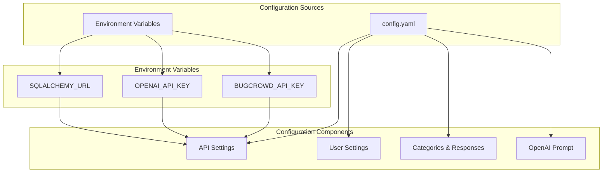
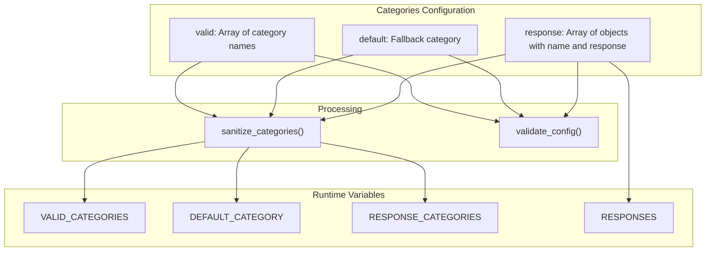
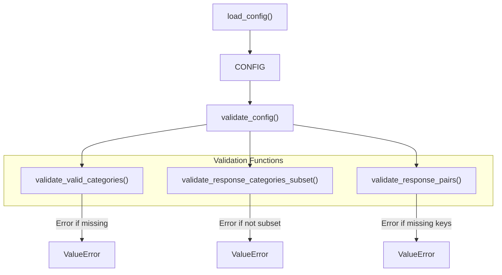
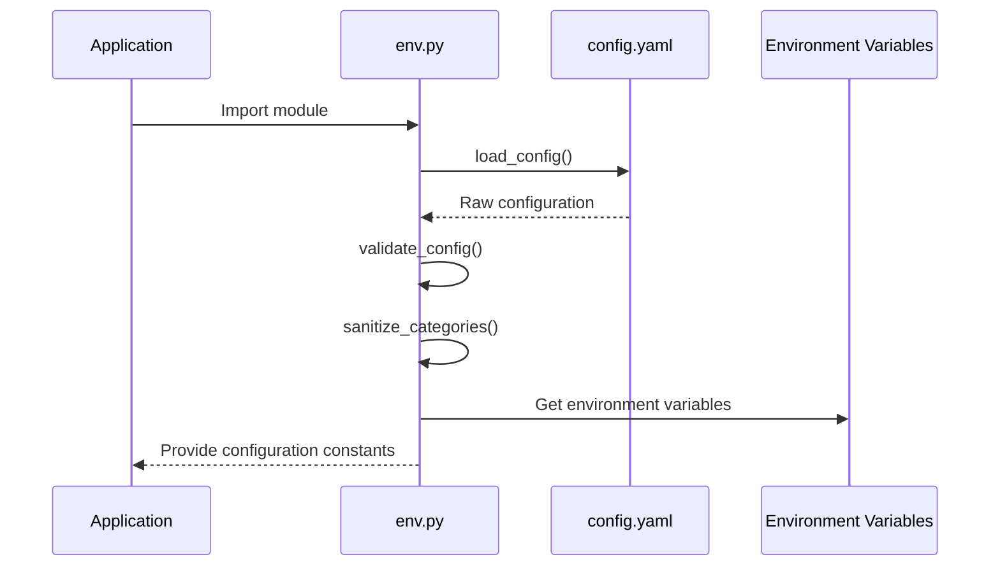

<!-- source: DeepWiki mcp.deepwiki.com · repo openai/bugbounty-gpt · page 1.2 Configuration · fetched 2026-10-26 -->

# Configuration

<details>
<summary>Relevant source files</summary>

The following files were used as context for generating this wiki page:

- [README.md](README.md)
- [bugbounty_gpt/env.py](bugbounty_gpt/env.py)
- [tests/test_config_validation.py](tests/test_config_validation.py)

</details>


This page explains how to configure the BugCrowd GPT Classifier system using the `config.yaml` file and environment variables. The configuration system controls all aspects of the application's behavior, from API connections to submission categorization and automated responses.

For information about deploying the system, see [Deployment](#1.3).

## Configuration Overview

The BugCrowd GPT Classifier uses a combination of:
1. A YAML configuration file (`config.yaml`)
2. Environment variables for sensitive information



Sources: [README.md:35-69](). [bugbounty_gpt/env.py:1-71]()

## Configuration File Structure

The `config.yaml` file is located in the root directory of the project and contains the following main sections:

| Section | Purpose |
|---------|---------|
| `api` | API connection settings for BugCrowd and OpenAI |
| `user` | User-specific settings like user ID and program filter |
| `categories` | Defines valid categories and automated responses |
| `openai_prompt` | The prompt template used for OpenAI classification |

Sources: [README.md:40-63](), [bugbounty_gpt/env.py:8-12]()

## API Settings

The `api` section in `config.yaml` configures the connections to external APIs:

```yaml
api:
  base_url: "https://api.bugcrowd.com"
  openai_model: "gpt-4"
```

- `base_url`: The base URL for the BugCrowd API
- `openai_model`: The OpenAI model to use for classification (e.g., "gpt-4")

Sources: [README.md:42-44](), [bugbounty_gpt/env.py:48-52]()

## User Settings

The `user` section contains settings specific to the user and program:

```yaml
user:
  user_id: ""  # BugCrowd user ID
  filter_program: "openai-test-sandbox"  # Program identifier
```

- `user_id`: The BugCrowd ID of the user assigned to reports (can be empty)
- `filter_program`: The specific BugCrowd program to filter submissions by

Sources: [README.md:46-50](), [bugbounty_gpt/env.py:57-59]()

## Categories Configuration

The `categories` section is crucial for the classification and response system:



The categories section has three main components:

1. **Valid Categories**: A list of all possible classification categories
   ```yaml
   categories:
     valid:
       - "Functional Bugs or Glitches"
       - "Customer Support Issues"
       - "Security Report"
       # ... other categories
   ```

2. **Default Category**: The fallback category when classification fails
   ```yaml
   categories:
     default: "Security Report"
   ```

3. **Response Categories**: Categories that receive automated responses
   ```yaml
   categories:
     response:
       - name: "Functional Bugs or Glitches"
         response: "Thank you for your submission. This appears to be a functional bug rather than a security issue..."
       - name: "Customer Support Issues"
         response: "Thank you for your submission. This appears to be a customer support issue..."
       # ... other response pairs
   ```

Sources: [README.md:53-59](), [bugbounty_gpt/env.py:64-68](), [tests/test_config_validation.py:13-39]()

## OpenAI Prompt

The `openai_prompt` section contains the template used to instruct the OpenAI model:

```yaml
openai_prompt: |
  You are a bug bounty submission classifier. Your task is to categorize the following submission into one of these categories:
  - Functional Bugs or Glitches
  - Customer Support Issues
  - Security Report
  # ... additional instructions and guidelines
```

This multi-line string provides detailed instructions to the AI model on how to classify submissions.

Sources: [README.md:61-63](), [bugbounty_gpt/env.py:61-62]()

## Environment Variables

Sensitive information is stored in environment variables rather than in the configuration file:

| Variable | Purpose |
|----------|---------|
| `BUGCROWD_API_KEY` | API key for BugCrowd authentication |
| `OPENAI_API_KEY` | API key for OpenAI services |
| `SQLALCHEMY_URL` | Database connection string |

The `SQLALCHEMY_URL` should follow the format:
```
postgresql+asyncpg://<username>:<password>@<host>:<port>/<database>
```

Sources: [README.md:65-69](), [bugbounty_gpt/env.py:50-55]()

## Configuration Validation

The system validates the configuration at startup to ensure it meets requirements:



The validation ensures:
1. Valid categories are defined
2. Response categories are a subset of valid categories
3. Each response category has both a name and response text

Sources: [bugbounty_gpt/env.py:22-44](), [tests/test_config_validation.py:13-39]()

## Category Sanitization

Category names are sanitized to create valid Python identifiers for use in the database:

```python
def sanitize_category(category: str) -> str:
    """Sanitizes a single category name to ensure it is a valid Python identifier."""
    return re.sub(r'\W|^(?=\d)', '_', category).upper().strip()
```

For example:
- "Functional Bugs or Glitches" → "FUNCTIONAL_BUGS_OR_GLITCHES"
- "123 Category with Special!@#$%^&*()" → "_123_CATEGORY_WITH_SPECIAL__________"

Sources: [bugbounty_gpt/env.py:14-20](), [tests/test_config_validation.py:4-11]()

## Docker Compose Configuration

When using Docker Compose for development or testing, additional environment variables are needed:

| Variable | Purpose |
|----------|---------|
| `DB_USER` | Database username |
| `DB_PASSWORD` | Database password |
| `DB_NAME` | Database name |
| `BUGCROWD_API_KEY` | BugCrowd API key |
| `OPENAI_API_KEY` | OpenAI API key |

These variables are used to configure the ephemeral database for testing configuration changes.

Sources: [README.md:71-114]()

## Configuration Loading Process

The configuration loading process follows these steps:

1. Load the YAML configuration file
2. Validate the configuration structure
3. Sanitize category names
4. Set up environment variables
5. Create runtime configuration variables



Sources: [bugbounty_gpt/env.py:1-71]()

## Best Practices

When configuring the system, follow these best practices:

1. Keep API keys and database credentials in environment variables, not in the configuration file
2. Test configuration changes using the ephemeral database in Docker Compose
3. Ensure all response categories are a subset of valid categories
4. Provide detailed instructions in the OpenAI prompt for accurate classification
5. Use descriptive category names that clearly distinguish different types of submissions

Sources: [README.md:35-114]()

---

