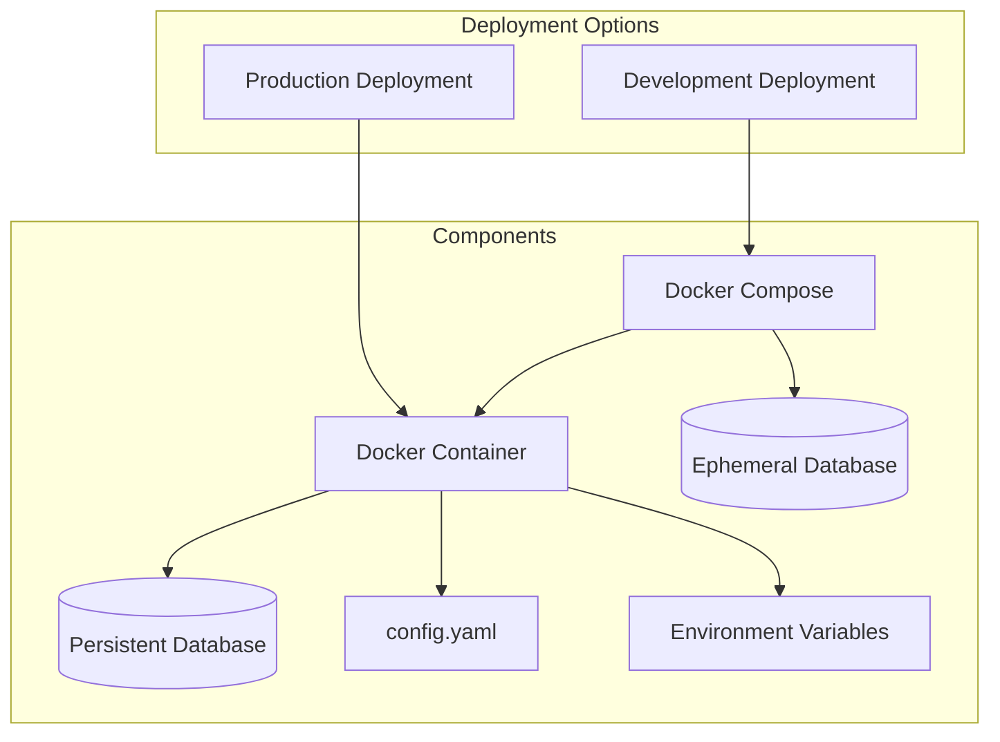
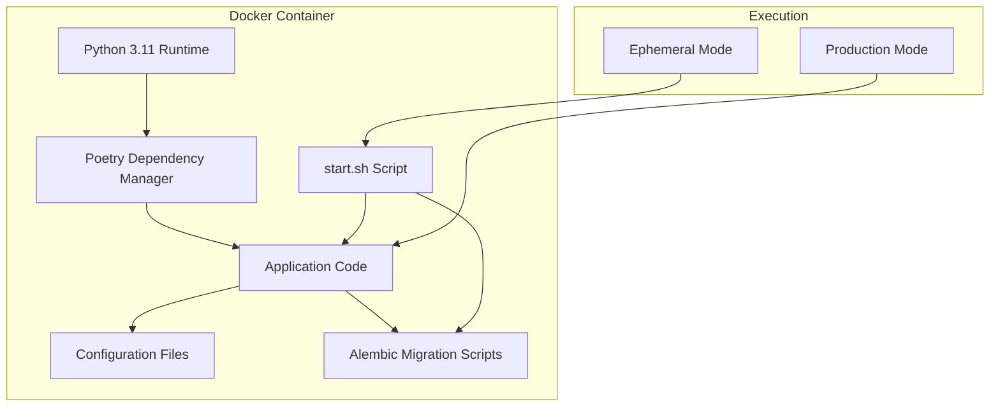
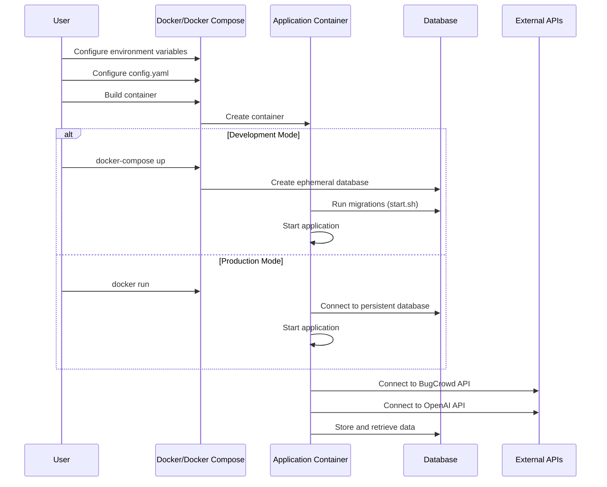

<!-- source: DeepWiki mcp.deepwiki.com · repo openai/bugbounty-gpt · page 1.3 Deployment · fetched 2026-10-26 -->

# Deployment

Relevant source files

The following files were used as context for generating this wiki page:

- [Dockerfile](Dockerfile)
- [README.md](README.md)
- [bugbounty_gpt/start.sh](bugbounty_gpt/start.sh)

This document describes how to deploy the BugCrowd GPT Classifier system using Docker and Docker Compose. It covers the deployment process, configuration requirements, and operational considerations for both development and production environments.

For information about system architecture, see [System Architecture](#1.1). For details on configuration options, see [Configuration](#1.2).

## Deployment Overview

The BugCrowd GPT Classifier can be deployed using Docker containers, which package all dependencies and configuration into a standardized environment. The system supports two primary deployment modes:

1. **Development Mode** - Uses an ephemeral database for testing configuration changes
2. **Production Mode** - Connects to a persistent database for long-term operation

Sources: [Dockerfile](). [README.md:21-34]().

## Docker Container Setup

The system is containerized using a Dockerfile that:

1. Uses Python 3.11 as the base image
2. Installs Poetry for dependency management
3. Creates a non-root user for security
4. Copies application code and configuration files
5. Installs dependencies using Poetry
6. Sets up Alembic for database migrations
7. Configures the startup command based on deployment mode

Sources: [Dockerfile:1-38](). [bugbounty_gpt/start.sh:1-8]().

## Deployment Methods

### Development Deployment with Docker Compose

For development and testing, Docker Compose provides a convenient way to set up the application with an ephemeral database:

1. Configure environment variables and `config.yaml`
2. Build the containers with `docker-compose build`
3. Start the application with `docker-compose up`
4. When finished, tear down everything with `docker-compose down -v`

This approach is particularly useful when testing configuration changes, especially modifications to category types that require database schema updates.

### Production Deployment

For production environments:

1. Configure environment variables and `config.yaml`
2. Build the Docker image without the `ephemeral_db` argument
3. Run the container, connecting it to a persistent PostgreSQL database
4. Manage database migrations manually using Alembic

## Required Configuration

### Environment Variables

The following environment variables must be set for deployment:

| Variable | Description | Required For |
|----------|-------------|-------------|
| `BUGCROWD_API_KEY` | API key for BugCrowd | All deployments |
| `OPENAI_API_KEY` | API key for OpenAI | All deployments |
| `SQLALCHEMY_URL` | Database connection URL | Production deployments |
| `DB_USER` | Database username | Docker Compose development |
| `DB_PASSWORD` | Database password | Docker Compose development |
| `DB_NAME` | Database name | Docker Compose development |

### Configuration File

The `config.yaml` file must be properly configured before deployment. This file contains:

- API settings (base URLs, model names)
- User settings (user ID, program filter)
- Category definitions
- OpenAI prompt template

Sources: [README.md:35-64](). [Dockerfile:15-16]().

## Deployment Process

Sources: [Dockerfile:33-38](). [bugbounty_gpt/start.sh:1-8]().

## Docker Container Structure

The Docker container includes the following components:

1. **Application Code**: The `bugbounty_gpt` package containing the application logic
2. **Configuration**: The `config.yaml` file with application settings
3. **Database Migration Scripts**: Alembic configuration and migration scripts
4. **Start Script**: A shell script that runs migrations and starts the application in ephemeral mode

The container is configured to run as a non-root user for security purposes.

Sources: [Dockerfile:7-31]().

## Ephemeral Database Mode

The ephemeral database mode is controlled by the `EPHEMERAL_DB` build argument in the Dockerfile. When set to `true`, the container runs the `start.sh` script, which:

1. Executes database migrations using `python -m bugbounty_gpt.db.migrate`
2. Starts the main application with `python -m bugbounty_gpt`

This mode is useful for testing configuration changes that affect the database schema, particularly changes to category types that are stored as Enum values in the database.

Sources: [Dockerfile:33-38](). [bugbounty_gpt/start.sh:1-8](). [README.md:70-81]().

## Production Considerations

When deploying to production:

1. Use a persistent PostgreSQL database with proper backup procedures
2. Manage database migrations carefully, especially when changing category types
3. Set up monitoring and logging for the container
4. Consider implementing a container orchestration system for high availability
5. Secure API keys and database credentials using environment variables or a secrets management system

Sources: [README.md:82-102]().

## Troubleshooting Deployment Issues

Common deployment issues include:

1. **Missing Environment Variables**: Ensure all required environment variables are set
2. **Database Connection Issues**: Verify the database connection URL and credentials
3. **Permission Problems**: Check that the container has appropriate permissions for file access
4. **Migration Failures**: When changing category types, you may need to recreate the database schema

For testing configuration changes that affect the database schema, use the ephemeral database mode with Docker Compose to quickly iterate without affecting production data.

Sources: [README.md:103-114]().

---

