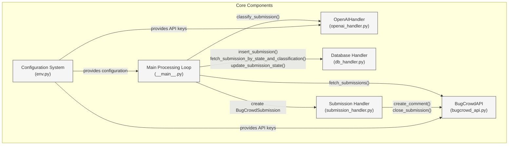
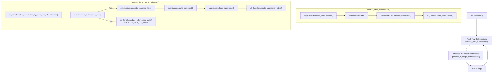
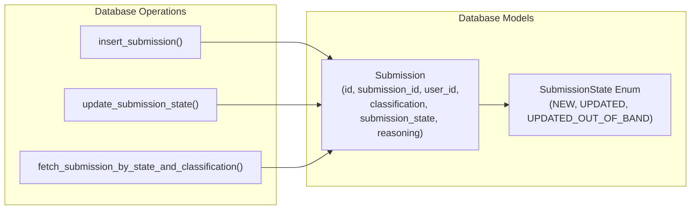
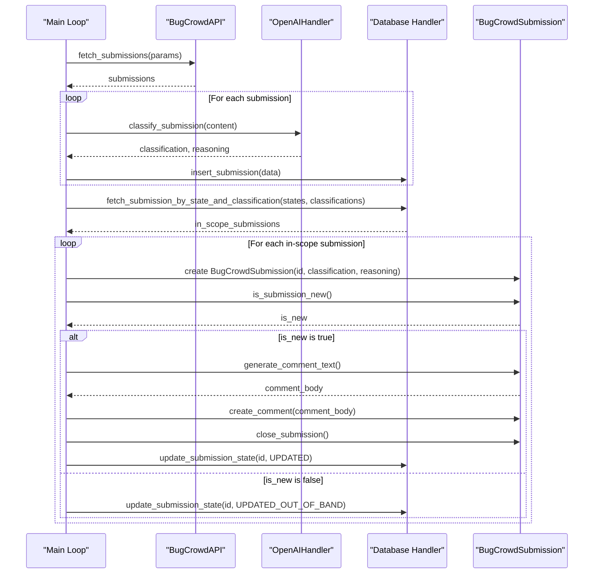
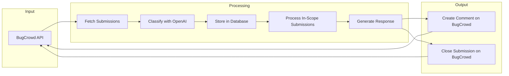

<!-- source: DeepWiki mcp.deepwiki.com · repo openai/bugbounty-gpt · page 2 Core Components · fetched 2026-10-26 -->

# Core Components

Relevant source files

The following files were used as context for generating this wiki page:

- [bugbounty_gpt/__main__.py](bugbounty_gpt/__main__.py)
- [pyproject.toml](pyproject.toml)

This page provides an overview of the main components that make up the bugbounty-gpt system. It describes the core modules, their responsibilities, and how they interact with each other to automate the triage and classification of bug bounty submissions.

For information about the high-level system architecture, see [System Architecture](#1.1). For details on specific integrations, see [BugCrowd API Integration](#2.1) and [OpenAI Integration](#2.2).

## Component Overview

The bugbounty-gpt system consists of several core components that work together to process bug bounty submissions:

Sources: [bugbounty_gpt/__main__.py:1-100]()

## Main Processing Loop

The main processing loop is the orchestrator of the system, responsible for:

1. Fetching new submissions from BugCrowd
2. Classifying them using OpenAI
3. Storing them in the database
4. Processing submissions that are in scope
5. Generating responses and closing submissions

The main loop runs continuously with a configurable wait period between iterations.

Sources: [bugbounty_gpt/__main__.py:29-97]()

## BugCrowd API Integration

The `BugCrowdAPI` class handles all interactions with the BugCrowd platform, including:

- Fetching submissions with specific filters
- Creating comments on submissions
- Closing submissions
- Assigning submissions to users

This component abstracts away the details of the HTTP requests and authentication required to interact with the BugCrowd API.

Sources: [bugbounty_gpt/__main__.py:8-8](), [bugbounty_gpt/__main__.py:40-40]()

## OpenAI Integration

The `OpenAIHandler` is responsible for classifying bug bounty submissions using OpenAI's language models. It:

1. Takes the submission content as input
2. Sends it to the OpenAI API with a specific prompt
3. Parses the response to extract the classification and reasoning
4. Returns this information to the main loop

The classification determines whether a submission is in scope and what type of issue it represents.

Sources: [bugbounty_gpt/__main__.py:6-6](), [bugbounty_gpt/__main__.py:49-49]()

## Database Handler

The `db_handler` module provides functions for interacting with the PostgreSQL database, including:

- Inserting new submissions
- Updating submission states
- Fetching submissions based on state and classification

The database serves as the system's persistent storage and state management mechanism.

Sources: [bugbounty_gpt/__main__.py:4-5](), [bugbounty_gpt/__main__.py:58-58](), [bugbounty_gpt/__main__.py:68-68](), [bugbounty_gpt/__main__.py:80-82]()

## Submission Handler

The `BugCrowdSubmission` class represents a submission from BugCrowd and provides methods to:

- Generate appropriate comment text based on the classification
- Create comments on the submission
- Close the submission
- Check if the submission is still in the "new" state

This component encapsulates the business logic for responding to different types of submissions.

Sources: [bugbounty_gpt/__main__.py:7-7](), [bugbounty_gpt/__main__.py:71-82]()

## Configuration System

The configuration system, primarily implemented in `env.py`, provides centralized access to all configuration parameters, including:

- BugCrowd API credentials
- OpenAI API credentials
- Database connection string
- User ID for assignment
- Program filter
- Response categories

Configuration can be set through a combination of environment variables and a YAML configuration file.

| Configuration Parameter | Description | Used By |
|------------------------|-------------|---------|
| `USER_ID` | The ID of the user to assign submissions to | Main Loop |
| `FILTER_PROGRAM` | The BugCrowd program to filter submissions by | Main Loop |
| `RESPONSE_CATEGORIES` | Categories of submissions that should receive responses | Main Loop |
| `SQLALCHEMY_URL` | Database connection string | Database Handler |

Sources: [bugbounty_gpt/__main__.py:9-9](), [bugbounty_gpt/__main__.py:34-36](), [bugbounty_gpt/__main__.py:67-67](), [bugbounty_gpt/__main__.py:72-72]()

## Component Interactions

The following diagram illustrates how the core components interact during the processing of a bug bounty submission:

Sources: [bugbounty_gpt/__main__.py:29-97]()

## Data Flow

The data flow through the system follows a clear path from input to output:

Sources: [bugbounty_gpt/__main__.py:29-97]()

## Dependencies

The core components rely on several external libraries:

| Library | Purpose |
|---------|---------|
| `httpx` | HTTP client for API requests |
| `openai` | Client for OpenAI API |
| `sqlalchemy` | ORM for database operations |
| `asyncpg` | Async PostgreSQL driver |
| `pyyaml` | YAML parsing for configuration |

Sources: [pyproject.toml:14-27]()

## Summary

The core components of bugbounty-gpt work together to create an automated system for triaging and responding to bug bounty submissions. The main processing loop orchestrates the flow, while specialized handlers manage interactions with external services and the database. The configuration system provides flexibility in how the system operates.

For more detailed information about specific components, see:
- [BugCrowd API Integration](#2.1)
- [OpenAI Integration](#2.2)
- [Submission Handling](#2.3)
- [Database](#3)

---

