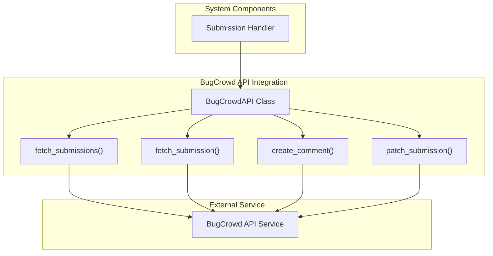
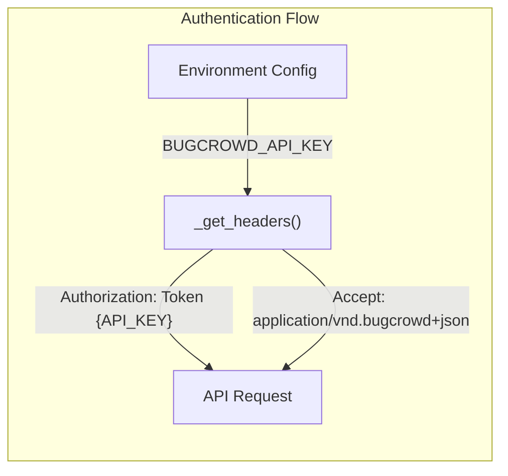
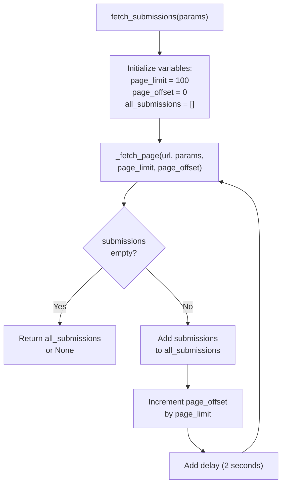
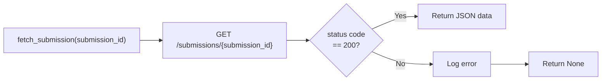
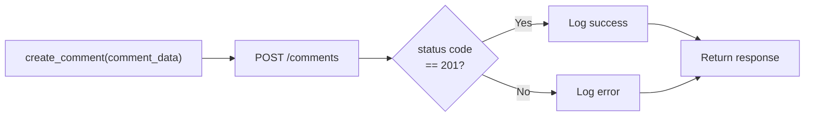
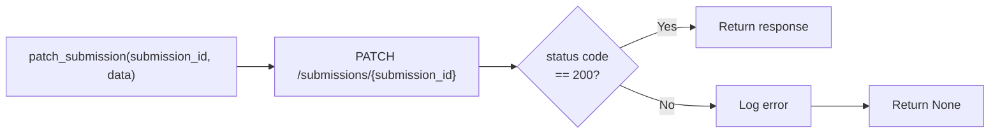
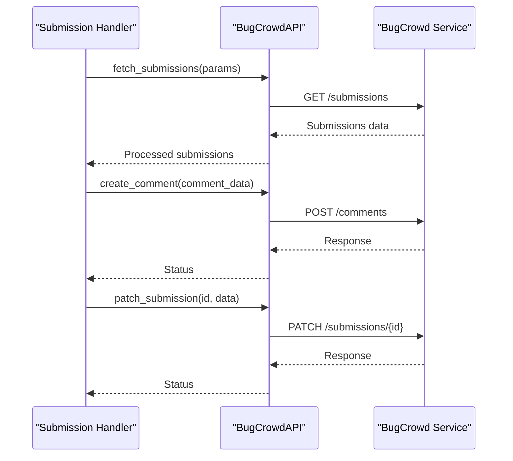

<!-- source: DeepWiki mcp.deepwiki.com · repo openai/bugbounty-gpt · page 2.1 BugCrowd API Integration · fetched 2026-10-26 -->

# BugCrowd API Integration

<details>
<summary>Relevant source files</summary>

The following files were used as context for generating this wiki page:

- [bugbounty_gpt/handlers/bugcrowd_api.py](bugbounty_gpt/handlers/bugcrowd_api.py)
- [tests/test_bugcrowd_api_client.py](tests/test_bugcrowd_api_client.py)
- [tests/test_comment_handling.py](tests/test_comment_handling.py)

</details>


This document describes the BugCrowd API integration in the bugbounty-gpt system. It covers how the system interacts with the BugCrowd API to fetch submissions, create comments, and update submission states. For information about how submissions are processed and classified, see [Submission Handling](#2.3).

## Overview

The BugCrowd API integration is implemented in the `BugCrowdAPI` class, which provides methods for interacting with the BugCrowd API. This class handles authentication, request formatting, and response parsing.



Sources: [bugbounty_gpt/handlers/bugcrowd_api.py:9-136]()

## Authentication and Headers

The BugCrowd API requires authentication using an API key. The API key is stored in the environment configuration and accessed through the `BUGCROWD_API_KEY` variable.



Sources: [bugbounty_gpt/handlers/bugcrowd_api.py:11-21](), [bugbounty_gpt/env.py]()

The `_get_headers` method generates the necessary headers for API requests:

- `Accept`: Specifies the content type, defaulting to `application/vnd.bugcrowd+json`
- `Authorization`: Includes the API key in the format `Token {BUGCROWD_API_KEY}`

For PATCH requests, an additional `Content-Type` header is set to `application/vnd.bugcrowd.v4+json`.

Sources: [bugbounty_gpt/handlers/bugcrowd_api.py:11-21](), [bugbounty_gpt/handlers/bugcrowd_api.py:125-127]()

## Core API Methods

The `BugCrowdAPI` class provides several static methods for interacting with the BugCrowd API:

| Method | Purpose | Parameters | Return Value |
|--------|---------|------------|--------------|
| `fetch_submissions` | Fetches all submissions from BugCrowd | `params`: Query parameters | List of submissions or None |
| `fetch_submission` | Fetches a specific submission | `submission_id`: ID of the submission | Submission data or None |
| `create_comment` | Creates a comment on a submission | `comment_data`: Data for the comment | Response object |
| `patch_submission` | Updates a submission | `submission_id`: ID of the submission, `data`: Update data | Response object or None |

Sources: [bugbounty_gpt/handlers/bugcrowd_api.py:50-136]()

### Fetching Submissions

The `fetch_submissions` method retrieves all submissions from BugCrowd that match the provided parameters. It uses pagination to handle large result sets, fetching up to 100 submissions per page.



Sources: [bugbounty_gpt/handlers/bugcrowd_api.py:50-75]()

The `_fetch_page` method handles the actual API request for a single page of submissions:

1. Constructs pagination parameters
2. Makes an HTTP GET request to the BugCrowd API
3. Parses the JSON response
4. Returns the data array or an empty list if there's an error

Sources: [bugbounty_gpt/handlers/bugcrowd_api.py:23-48]()

### Fetching a Single Submission

The `fetch_submission` method retrieves a specific submission by its ID:



Sources: [bugbounty_gpt/handlers/bugcrowd_api.py:77-94]()

### Creating Comments

The `create_comment` method posts a comment to a submission:



Sources: [bugbounty_gpt/handlers/bugcrowd_api.py:96-113]()

The comment data structure follows a specific format:

```json
{
  "data": {
    "type": "comment",
    "attributes": {
      "body": "Comment text",
      "visibility_scope": "everyone"
    },
    "relationships": {
      "submission": {
        "data": {
          "id": "submission_id",
          "type": "submission"
        }
      }
    }
  }
}
```

Sources: [tests/test_comment_handling.py:7-27]()

### Updating Submissions

The `patch_submission` method updates a submission's attributes:



Sources: [bugbounty_gpt/handlers/bugcrowd_api.py:115-136]()

## Error Handling

The BugCrowd API integration includes error handling for various scenarios:

1. **JSON Decoding Errors**: When the API response cannot be parsed as JSON
2. **HTTP Error Codes**: When the API returns non-success status codes
3. **Empty Results**: When no submissions are found

All errors are logged using the Python logging module, with appropriate error messages.

Sources: [bugbounty_gpt/handlers/bugcrowd_api.py:42-46](), [bugbounty_gpt/handlers/bugcrowd_api.py:92-94](), [bugbounty_gpt/handlers/bugcrowd_api.py:111-113](), [bugbounty_gpt/handlers/bugcrowd_api.py:132-134]()

## Rate Limiting

To avoid hitting rate limits on the BugCrowd API, the `fetch_submissions` method includes a delay of 2 seconds between API calls when paginating through results.

Sources: [bugbounty_gpt/handlers/bugcrowd_api.py:63](), [bugbounty_gpt/handlers/bugcrowd_api.py:73]()

## Integration with Submission Handler

The BugCrowd API is used by the Submission Handler to:

1. Fetch submissions for processing
2. Create comments on submissions
3. Update submission states (e.g., closing submissions)



Sources: [bugbounty_gpt/handlers/bugcrowd_api.py:50-136](), [tests/test_comment_handling.py:1-53]()

## Configuration

The BugCrowd API integration relies on two configuration values:

1. `API_BASE_URL`: The base URL for the BugCrowd API
2. `BUGCROWD_API_KEY`: The API key for authentication

These values are imported from the environment configuration module.

Sources: [bugbounty_gpt/handlers/bugcrowd_api.py:5](), [bugbounty_gpt/env.py]()

## Testing

The BugCrowd API integration is tested using unit tests that mock the HTTP client to simulate API responses. The tests cover:

1. Header generation
2. Fetching submissions (single page and pagination)
3. Fetching a specific submission
4. Creating comments
5. Updating submissions

Sources: [tests/test_bugcrowd_api_client.py:1-70](), [tests/test_comment_handling.py:1-53]()

---

