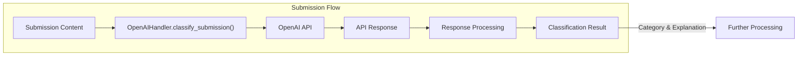
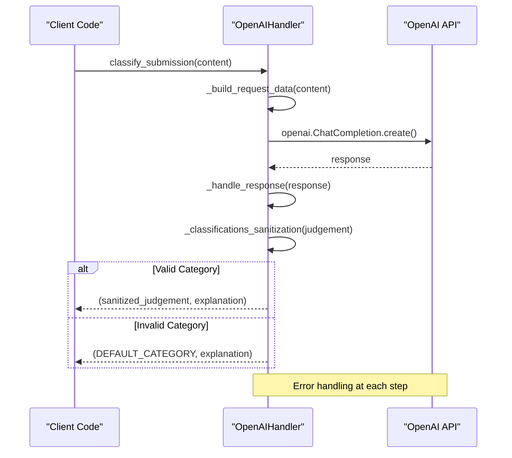
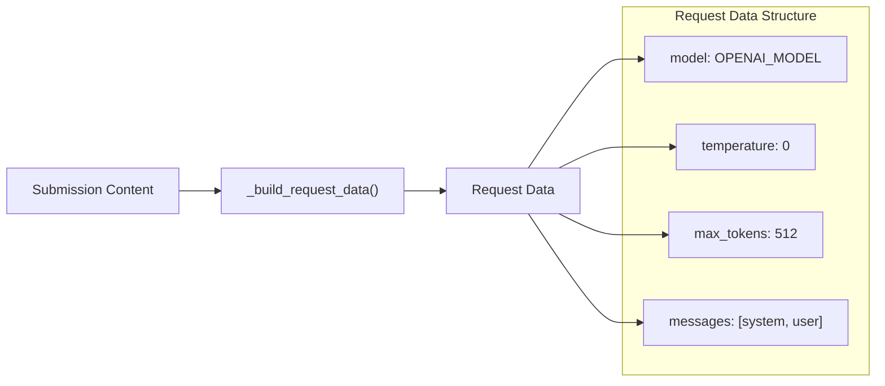
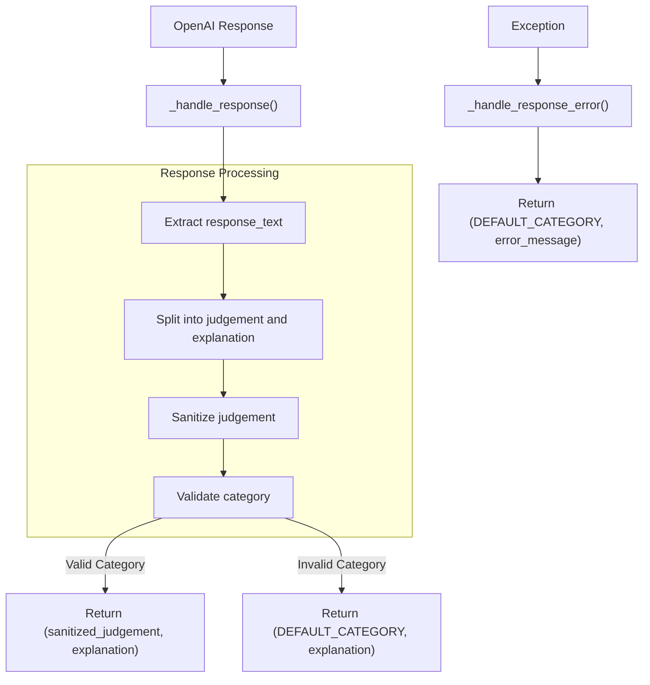
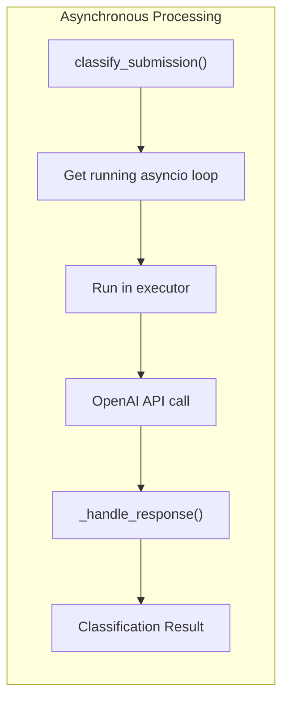

<!-- source: DeepWiki mcp.deepwiki.com · repo openai/bugbounty-gpt · page 2.2 OpenAI Integration · fetched 2026-10-26 -->

# OpenAI Integration

<details>
<summary>Relevant source files</summary>

The following files were used as context for generating this wiki page:

- [bugbounty_gpt/handlers/openai_handler.py](bugbounty_gpt/handlers/openai_handler.py)
- [tests/test_openai_classification.py](tests/test_openai_classification.py)

</details>


This document describes how the bugbounty-gpt system integrates with OpenAI's API to classify bug bounty submissions. The OpenAI integration is responsible for analyzing submission content and categorizing it according to predefined categories.

For information about how submissions are processed after classification, see [Submission Handling](#2.3).

## Overview

The OpenAI integration is a core component that enables automated classification of bug bounty submissions. It sends submission content to OpenAI's API and processes the response to determine the appropriate category and explanation for each submission.



Sources: [bugbounty_gpt/handlers/openai_handler.py:68-84]()

## Architecture

The OpenAI integration is implemented through the `OpenAIHandler` class, which provides methods for building requests, sending them to the OpenAI API, and processing the responses.

```mermaid
classDiagram
    class OpenAIHandler {
        +classify_submission(submission_content) async
        -_build_request_data(submission_content)
        -_handle_response(response)
        -_handle_response_error(error)
        -_classifications_sanitization(input_string)
    }
    
    OpenAIHandler --> "OpenAI API" : sends requests to
    OpenAIHandler --> "VALID_CATEGORIES" : validates against
    OpenAIHandler --> "DEFAULT_CATEGORY" : fallback to
    OpenAIHandler --> "OPENAI_PROMPT" : uses
    OpenAIHandler --> "OPENAI_MODEL" : uses
```

Sources: [bugbounty_gpt/handlers/openai_handler.py:9-84]()

## Configuration

The OpenAI integration relies on several configuration parameters defined in the environment:

| Parameter | Description | Source |
|-----------|-------------|--------|
| `OPENAI_PROMPT` | System prompt that guides the AI's classification | env.py |
| `OPENAI_MODEL` | The OpenAI model to use (e.g., "gpt-3.5-turbo") | env.py |
| `VALID_CATEGORIES` | List of valid classification categories | env.py |
| `DEFAULT_CATEGORY` | Fallback category when classification fails | env.py |

Sources: [bugbounty_gpt/handlers/openai_handler.py:5]()

## Classification Process

The classification process involves several steps:

1. Building the request data with the submission content
2. Sending the request to OpenAI's API
3. Processing the response to extract the category and explanation
4. Sanitizing and validating the category
5. Returning the classification result



Sources: [bugbounty_gpt/handlers/openai_handler.py:68-84](), [bugbounty_gpt/handlers/openai_handler.py:49-66]()

### Request Building

The `_build_request_data` method constructs the request payload for the OpenAI API:



Sources: [bugbounty_gpt/handlers/openai_handler.py:20-36]()

### Response Handling

The response from OpenAI is processed to extract the classification category and explanation:



Sources: [bugbounty_gpt/handlers/openai_handler.py:49-66](), [bugbounty_gpt/handlers/openai_handler.py:38-47]()

### Category Sanitization

The `_classifications_sanitization` method ensures consistent formatting of category names:

1. Removes leading and trailing spaces
2. Replaces spaces with underscores
3. Converts to uppercase

This standardization allows for reliable category matching against the `VALID_CATEGORIES` list.

Sources: [bugbounty_gpt/handlers/openai_handler.py:10-18]()

## Error Handling

The OpenAI integration includes robust error handling to manage various failure scenarios:

1. API request failures
2. Response parsing errors
3. Invalid category classifications

In all error cases, the system falls back to the `DEFAULT_CATEGORY` and provides an appropriate error message.

Sources: [bugbounty_gpt/handlers/openai_handler.py:38-47](), [bugbounty_gpt/handlers/openai_handler.py:83-84]()

## Rate Limiting

The integration includes a basic rate limiting mechanism to prevent exceeding OpenAI's API rate limits:

```python
time.sleep(5)  # Consider replacing with a more robust rate-limiting strategy
```

This simple delay helps manage API request frequency, though as noted in the code comment, a more sophisticated approach may be beneficial for production use.

Sources: [bugbounty_gpt/handlers/openai_handler.py:77]()

## Asynchronous Operation

The `classify_submission` method operates asynchronously, allowing the system to handle multiple submissions efficiently:



The method uses `asyncio.get_running_loop()` and `run_in_executor()` to make the synchronous OpenAI API call non-blocking.

Sources: [bugbounty_gpt/handlers/openai_handler.py:68-84]()

## Testing

The OpenAI integration includes comprehensive unit tests that verify:

1. Category sanitization
2. Request data building
3. Response handling for successful cases
4. Response handling for error cases
5. End-to-end classification functionality

These tests ensure the reliability of the classification process and proper error handling.

Sources: [tests/test_openai_classification.py:1-68]()

---

