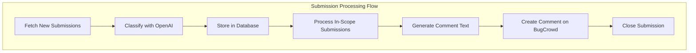
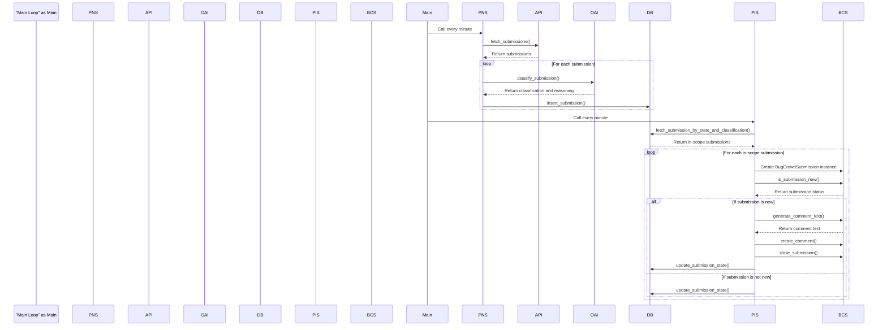
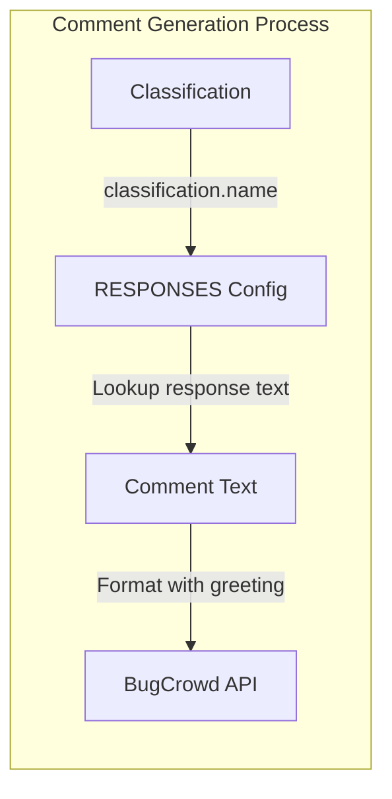
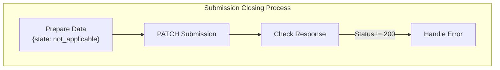
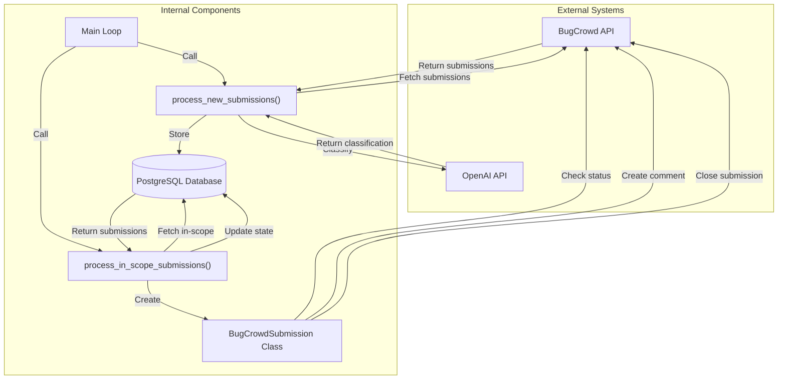

<!-- source: DeepWiki mcp.deepwiki.com · repo openai/bugbounty-gpt · page 2.3 Submission Handling · fetched 2026-10-26 -->

# Submission Handling

<details>
<summary>Relevant source files</summary>

The following files were used as context for generating this wiki page:

- [bugbounty_gpt/__main__.py](bugbounty_gpt/__main__.py)
- [bugbounty_gpt/handlers/submission_handler.py](bugbounty_gpt/handlers/submission_handler.py)
- [tests/test_comment_handling.py](tests/test_comment_handling.py)

</details>


This page documents the submission handling process in the bugbounty-gpt system, focusing on how bug bounty submissions from BugCrowd are processed, classified, and responded to. The submission handling component is a core part of the system that bridges the BugCrowd API integration ([BugCrowd API Integration](#2.1)) with the OpenAI classification system ([OpenAI Integration](#2.2)).

## Overview

The submission handling process involves fetching new submissions from BugCrowd, classifying them using OpenAI, storing them in the database, and then processing them based on their classification. For submissions that fall into specific response categories, the system generates appropriate comments and closes the submissions.



Sources: [bugbounty_gpt/__main__.py:29-97](), [bugbounty_gpt/handlers/submission_handler.py:8-158]()

## BugCrowdSubmission Class

The `BugCrowdSubmission` class is the central component for handling individual submissions. It encapsulates all operations that can be performed on a submission, including checking its status, creating comments, and closing the submission.

```mermaid
classDiagram
    class "BugCrowdSubmission" {
        +String submission_id
        +Enum classification
        +String reasoning
        +is_submission_new()
        +close_submission()
        +create_comment()
        +generate_comment_text()
        +assign_to_user()
    }
    
    "BugCrowdSubmission" --> "BugCrowdAPI": uses
    "BugCrowdSubmission" --> "RESPONSES": references
```

Sources: [bugbounty_gpt/handlers/submission_handler.py:8-158]()

### Key Methods

The `BugCrowdSubmission` class provides several key methods for handling submissions:

| Method | Purpose |
|--------|---------|
| `is_submission_new()` | Checks if the submission is in the "new" state on BugCrowd |
| `close_submission()` | Closes the submission by setting its state to "not_applicable" |
| `create_comment(comment_body)` | Creates a comment on the submission with the specified text |
| `generate_comment_text()` | Generates a response text based on the submission's classification |
| `assign_to_user(user_id)` | Assigns the submission to a specific user |

Sources: [bugbounty_gpt/handlers/submission_handler.py:64-157]()

## Submission Processing Workflow

The submission processing workflow consists of two main phases: fetching and processing new submissions, and handling in-scope submissions.



Sources: [bugbounty_gpt/__main__.py:29-97]()

### Fetching and Processing New Submissions

The `process_new_submissions()` function fetches new, non-duplicate submissions from BugCrowd and processes them:

1. Fetch submissions using the BugCrowd API with specific filters
2. For each submission:
   - Check if it has been seen before
   - Extract submission ID, user ID, and content
   - Classify the submission using OpenAI
   - Store the submission data in the database

Sources: [bugbounty_gpt/__main__.py:29-58]()

### Processing In-Scope Submissions

The `process_in_scope_submissions()` function handles submissions that have been classified into specific response categories:

1. Fetch submissions with state "NEW" and classifications in the configured response categories
2. For each submission:
   - Create a `BugCrowdSubmission` instance
   - Check if the submission is still in the "new" state on BugCrowd
   - Generate a comment based on the classification
   - Create the comment on BugCrowd
   - Close the submission
   - Update the submission state in the database

Sources: [bugbounty_gpt/__main__.py:60-82]()

## Comment Generation and Handling

The system generates comments for submissions based on their classification. The comment text is retrieved from the `RESPONSES` configuration, which maps classification names to appropriate response texts.



Sources: [bugbounty_gpt/handlers/submission_handler.py:144-157](), [bugbounty_gpt/handlers/submission_handler.py:129-143]()

### Comment Creation

The `create_comment()` method handles the creation of comments on BugCrowd:

1. Prepare the comment data with the specified text and visibility scope
2. Send the comment data to the BugCrowd API
3. Handle any errors that occur during comment creation

The method includes robust error handling for various HTTP status codes (400, 404, 409) that might be returned by the BugCrowd API.

Sources: [bugbounty_gpt/handlers/submission_handler.py:91-143](), [tests/test_comment_handling.py:7-53]()

## Submission Closing

After creating a comment, the system closes the submission by setting its state to "not_applicable". This is done through the `close_submission()` method, which sends a PATCH request to the BugCrowd API.



Sources: [bugbounty_gpt/handlers/submission_handler.py:74-89]()

## Integration with Main Loop

The submission handling process is integrated into the main loop of the application, which runs continuously:

1. Fetch and process new submissions
2. Process in-scope submissions
3. Wait for a specified interval (1 minute)
4. Repeat

This ensures that new submissions are regularly processed and responded to in a timely manner.

Sources: [bugbounty_gpt/__main__.py:84-97]()

## Data Flow

The following diagram illustrates the data flow through the submission handling system:



Sources: [bugbounty_gpt/__main__.py:29-97](), [bugbounty_gpt/handlers/submission_handler.py:8-158]()

## Configuration Dependencies

The submission handling system relies on several configuration parameters:

| Parameter | Purpose |
|-----------|---------|
| `USER_ID` | The ID of the user to assign submissions to |
| `FILTER_PROGRAM` | The BugCrowd program to filter submissions by |
| `RESPONSE_CATEGORIES` | Categories of submissions that should receive responses |
| `RESPONSES` | Mapping of classification names to response texts |

These parameters are loaded from the configuration system, which is documented in the [Configuration](#1.2) page.

Sources: [bugbounty_gpt/__main__.py:9](), [bugbounty_gpt/handlers/submission_handler.py:2]()

## Error Handling

The submission handling system includes robust error handling for various scenarios:

1. Failed API requests to BugCrowd
2. Invalid or missing response templates
3. Submissions that have been updated out-of-band

Errors are logged with appropriate severity levels, and the system is designed to continue processing other submissions even if one fails.

Sources: [bugbounty_gpt/handlers/submission_handler.py:117-143](), [tests/test_comment_handling.py:38-53]()

---

