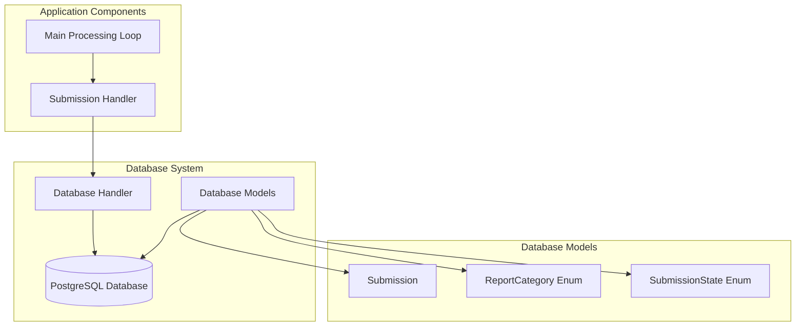
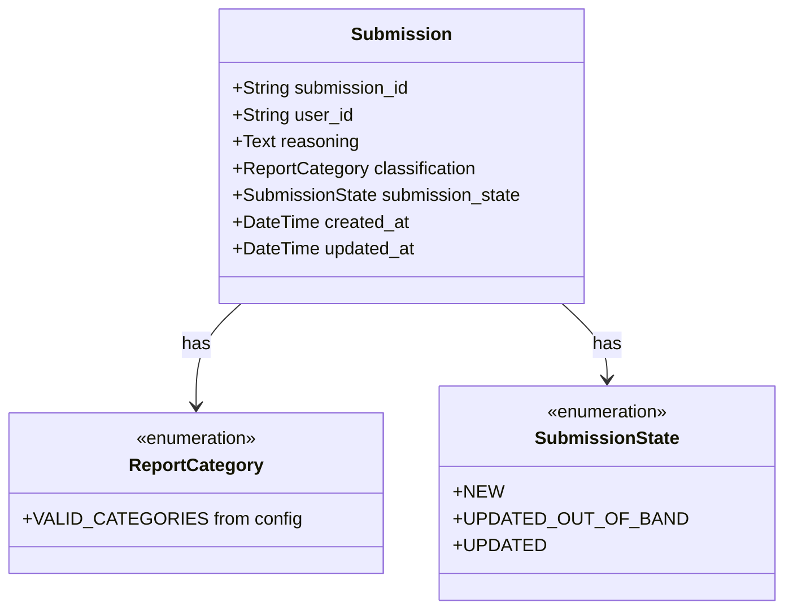
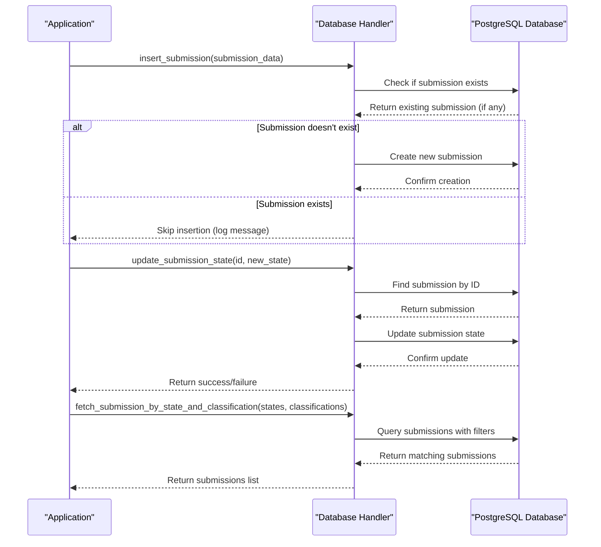
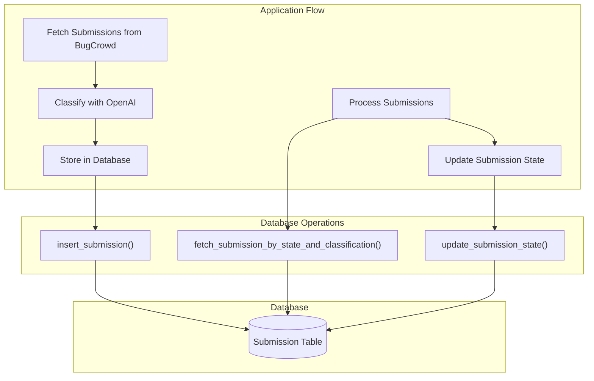

<!-- source: DeepWiki mcp.deepwiki.com · repo openai/bugbounty-gpt · page 3 Database · fetched 2026-10-26 -->

# Database

<details>
<summary>Relevant source files</summary>

The following files were used as context for generating this wiki page:

- [bugbounty_gpt/db/db_handler.py](bugbounty_gpt/db/db_handler.py)
- [bugbounty_gpt/db/models.py](bugbounty_gpt/db/models.py)

</details>


This page provides an overview of the database system used in the bugbounty-gpt application. It covers the database structure, models, operations, and how the application interacts with the database to store and retrieve submission data.

For information about database migrations, see [Database Migrations](#3.3).

## Database Overview

The bugbounty-gpt application uses a PostgreSQL database to store information about bug bounty submissions. The database serves as a persistent storage layer that tracks submissions, their classifications, and their processing states.



Sources: [bugbounty_gpt/db/models.py:1-54](), [bugbounty_gpt/db/db_handler.py:1-87]()

## Database Models

The database schema is defined using SQLAlchemy's ORM (Object-Relational Mapping) system. The primary model is the `Submission` class, which represents bug bounty submissions.

### Submission Model

The `Submission` model is the core data structure that stores information about bug bounty reports:



Sources: [bugbounty_gpt/db/models.py:33-54]()

### Enumerations

The database uses two key enumerations:

1. **ReportCategory**: Dynamically generated from the `VALID_CATEGORIES` configuration setting. This enum represents the possible classifications for a submission.

2. **SubmissionState**: Represents the processing state of a submission with the following values:
   - `NEW`: A newly received submission that hasn't been processed
   - `UPDATED_OUT_OF_BAND`: A submission that was updated outside the normal flow
   - `UPDATED`: A submission that has been processed and updated

Sources: [bugbounty_gpt/db/models.py:26-32]()

## Database Operations

The database operations are encapsulated in the `db_handler.py` module, which provides functions for interacting with the database. These operations are implemented as asynchronous functions using SQLAlchemy's async capabilities.

### Key Database Operations

| Operation | Function | Description |
|-----------|----------|-------------|
| Insert Submission | `insert_submission` | Adds a new submission to the database if it doesn't already exist |
| Update Submission State | `update_submission_state` | Updates the state of an existing submission |
| Fetch by State and Classification | `fetch_submission_by_state_and_classification` | Retrieves submissions matching specific states and classifications |
| Fetch by ID | `fetch_submission_by_id` | Retrieves a specific submission by its ID |



Sources: [bugbounty_gpt/db/db_handler.py:20-87]()

### Submission Insertion

The `insert_submission` function checks if a submission already exists in the database before inserting it. This prevents duplicate entries:

```
1. Check if submission exists using _find_submission_by_id
2. If submission exists, log and skip
3. If submission doesn't exist, create a new Submission object and commit to database
```

Sources: [bugbounty_gpt/db/db_handler.py:20-38]()

### State Management

The `update_submission_state` function allows the application to track the processing status of submissions:

```
1. Find the submission by ID
2. If found, update its submission_state attribute
3. Commit the changes to the database
4. Return success/failure status
```

Sources: [bugbounty_gpt/db/db_handler.py:40-57]()

### Query Operations

The database handler provides functions to query submissions based on various criteria:

- `_find_submission_by_id`: Internal helper function to find a submission by ID
- `fetch_submission_by_state_and_classification`: Retrieves submissions matching specific states and classifications
- `fetch_submission_by_id`: Public function to retrieve a submission by ID

Sources: [bugbounty_gpt/db/db_handler.py:7-18](), [bugbounty_gpt/db/db_handler.py:59-87]()

## Database Interaction Flow

The following diagram illustrates how the application interacts with the database during the submission processing workflow:



Sources: [bugbounty_gpt/db/db_handler.py:1-87](), [bugbounty_gpt/db/models.py:1-54]()

## Database Connection Management

The database connection is managed at the application level, with session objects being passed to the database handler functions. This approach allows for efficient connection pooling and transaction management.

The application uses SQLAlchemy's async session capabilities to perform database operations asynchronously, which helps maintain application responsiveness while waiting for database operations to complete.

Sources: [bugbounty_gpt/db/db_handler.py:7-87]()

## Summary

The database system in bugbounty-gpt provides:

1. **Persistence**: Stores bug bounty submissions and their processing state
2. **Classification tracking**: Records the AI-generated classification of each submission
3. **State management**: Tracks the processing state of each submission
4. **Efficient querying**: Allows filtering submissions by state and classification

The database design follows a simple but effective schema that supports the application's core functionality of processing and responding to bug bounty submissions.

---

