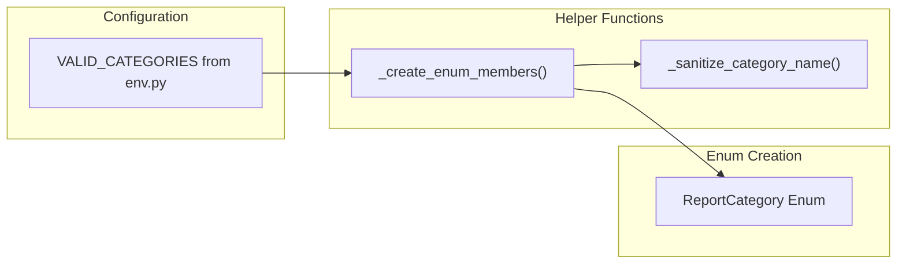
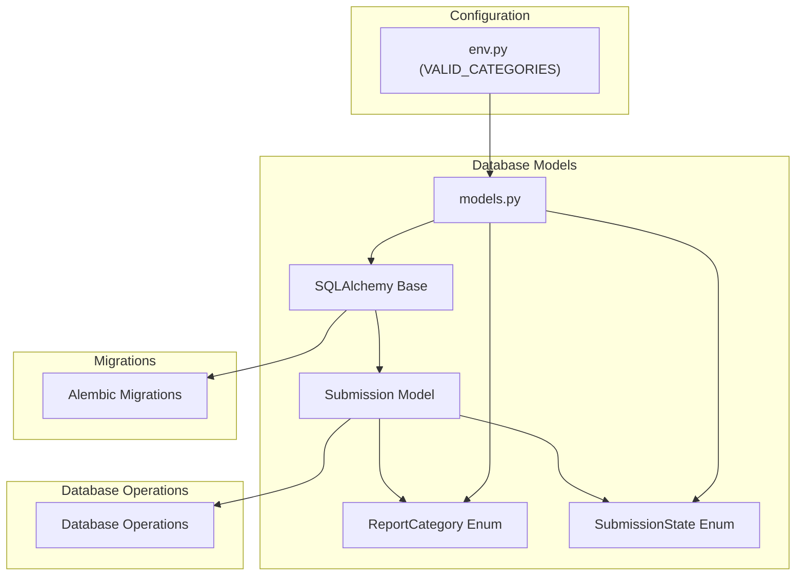

<!-- source: DeepWiki mcp.deepwiki.com · repo openai/bugbounty-gpt · page 3.1 Database Models · fetched 2026-10-26 -->

# Database Models

<details>
<summary>Relevant source files</summary>

The following files were used as context for generating this wiki page:

- [bugbounty_gpt/db/models.py](bugbounty_gpt/db/models.py)
- [tests/test_database_and_models.py](tests/test_database_and_models.py)

</details>


This document describes the database models used in the bugbounty-gpt system. It covers the core data structures that represent submissions and their classifications in the database. For information about database operations and how the system interacts with these models, see [Database Operations](#3.2). For details on database migrations, see [Database Migrations](#3.3).

## Overview

The bugbounty-gpt system uses SQLAlchemy ORM (Object-Relational Mapping) to define and interact with the database models. The models are defined in the `models.py` file and represent the core data structures used to store bug bounty submissions and their classifications.

Sources: [bugbounty_gpt/db/models.py:1-55]()

## Database Model Structure

The database model structure consists of a single table `submission` and two enum types: `ReportCategory` and `SubmissionState`.

```mermaid
classDiagram
    class "Submission" {
        +String submission_id (PK)
        +String user_id
        +Text reasoning
        +ReportCategory classification
        +SubmissionState submission_state
        +DateTime created_at
        +DateTime updated_at
    }
    
    class "ReportCategory" {
        <<enumeration>>
        +POLICY_OR_CONTENT_COMPLAINTS
        +Other categories from config
    }
    
    class "SubmissionState" {
        <<enumeration>>
        +NEW = 1
        +UPDATED_OUT_OF_BAND = 2
        +UPDATED = 3
    }
    
    Submission --> "1" ReportCategory : classification
    Submission --> "1" SubmissionState : submission_state
```

Sources: [bugbounty_gpt/db/models.py:28-54]()

## Submission Model

The `Submission` class is the primary database model that represents a bug bounty submission. It is defined using SQLAlchemy's declarative base and maps to the `submission` table in the database.

### Attributes

| Attribute | Type | Description |
|-----------|------|-------------|
| submission_id | String(100) | Primary key, unique identifier for the submission |
| user_id | String(100) | Identifier for the user who created the submission |
| reasoning | Text | Reasoning text for the submission classification |
| classification | ReportCategory | Classification of the report using the ReportCategory enum |
| submission_state | SubmissionState | State of the submission using the SubmissionState enum |
| created_at | DateTime | Timestamp of submission creation (auto-generated) |
| updated_at | DateTime | Timestamp of the last update (auto-updated) |

Sources: [bugbounty_gpt/db/models.py:33-54]()

## Enum Types

The system uses two enum types to represent the state and classification of submissions.

### ReportCategory Enum

The `ReportCategory` enum is dynamically generated from the `VALID_CATEGORIES` configuration defined in the environment settings. This allows the system to be flexible and adapt to different categorization schemes without changing the database schema.

The enum is created using helper functions:

1. `_sanitize_category_name`: Converts category names to uppercase with underscores
2. `_create_enum_members`: Creates a dictionary mapping sanitized names to original category names



Sources: [bugbounty_gpt/db/models.py:8-26]()

### SubmissionState Enum

The `SubmissionState` enum represents the current state of a submission in the system's workflow. It has three possible values:

1. `NEW` (1): A newly created submission
2. `UPDATED_OUT_OF_BAND` (2): A submission that was updated outside the normal flow
3. `UPDATED` (3): A submission that has been processed and updated

Sources: [bugbounty_gpt/db/models.py:28-31]()

## Database Model Integration

The database models integrate with the rest of the system as follows:



Sources: [bugbounty_gpt/db/models.py:1-55]()

## Testing

The database models are tested in the `test_database_and_models.py` file, which includes tests for:

1. Sanitizing category names
2. Creating enum members
3. Verifying the ReportCategory enum values

These tests ensure that the helper functions work correctly and that the enum types are properly created.

Sources: [tests/test_database_and_models.py:1-13]()

## Summary

The database models in bugbounty-gpt provide a simple but flexible structure for storing and tracking bug bounty submissions. The key features include:

1. A single `Submission` table that stores all relevant information about a submission
2. A dynamically generated `ReportCategory` enum that adapts to the categories defined in the configuration
3. A `SubmissionState` enum that tracks the processing state of each submission

This design allows the system to efficiently store and retrieve submission data while maintaining the flexibility to adapt to different categorization schemes.

---

