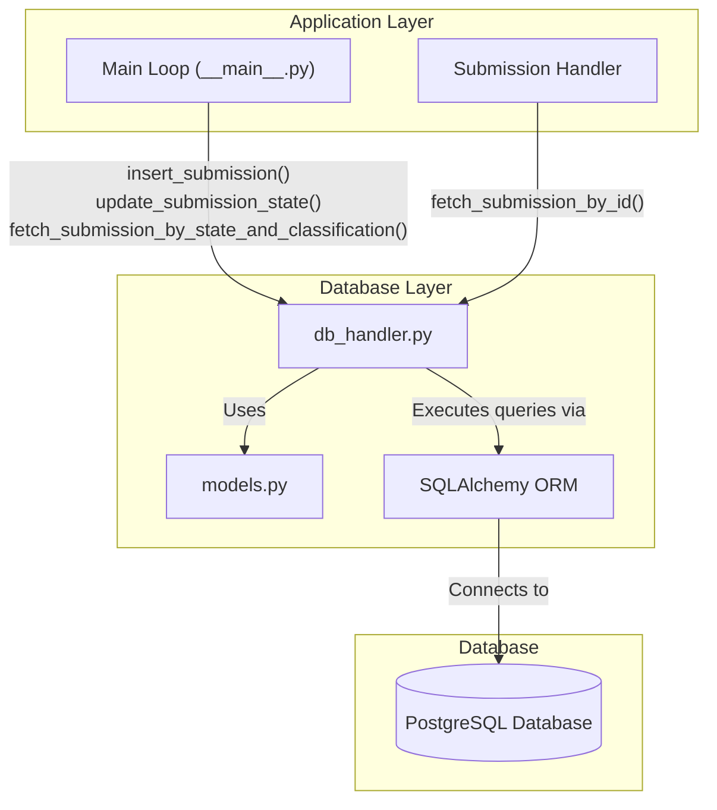
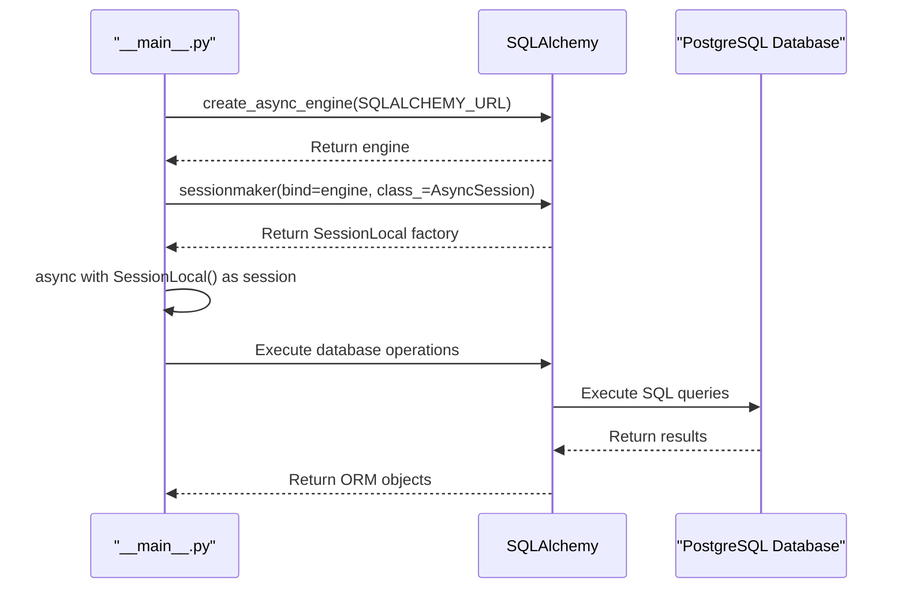
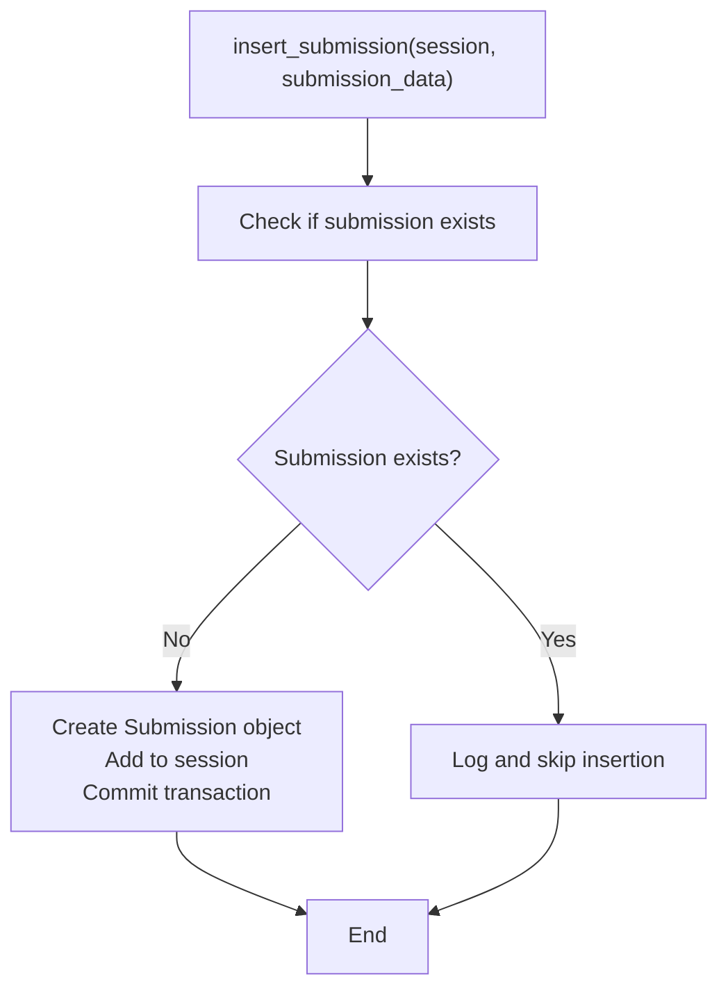
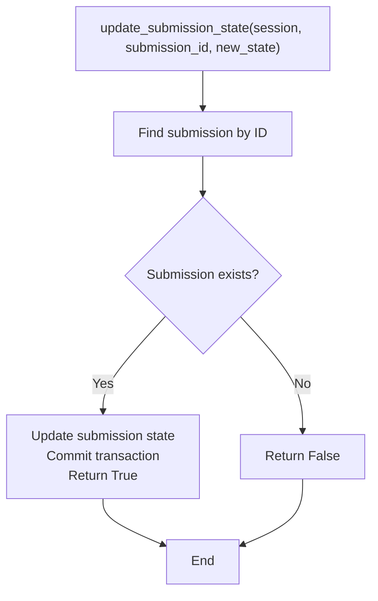
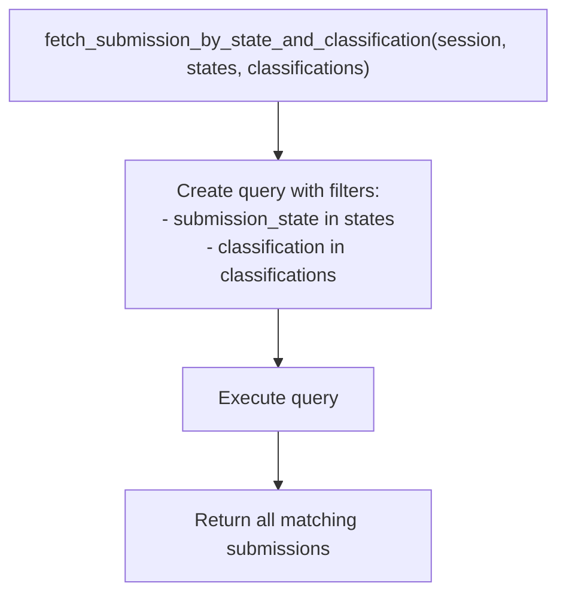
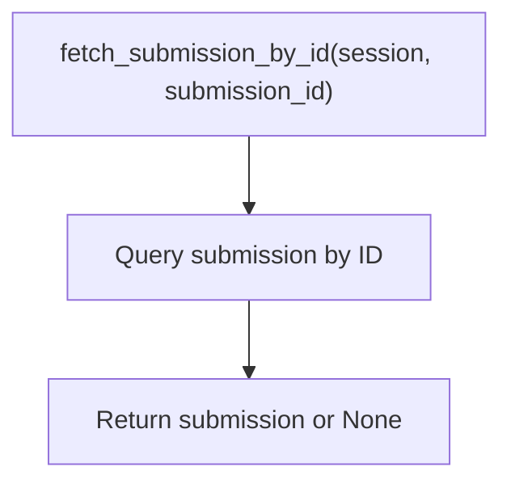
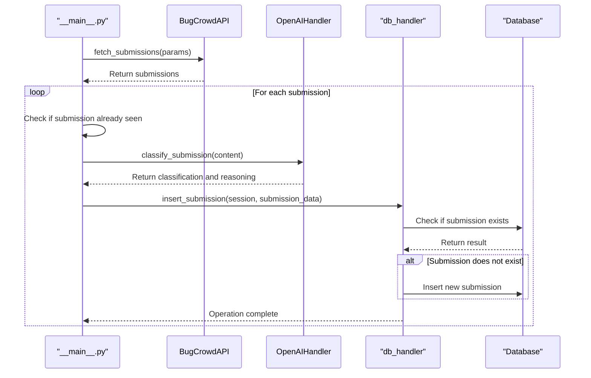
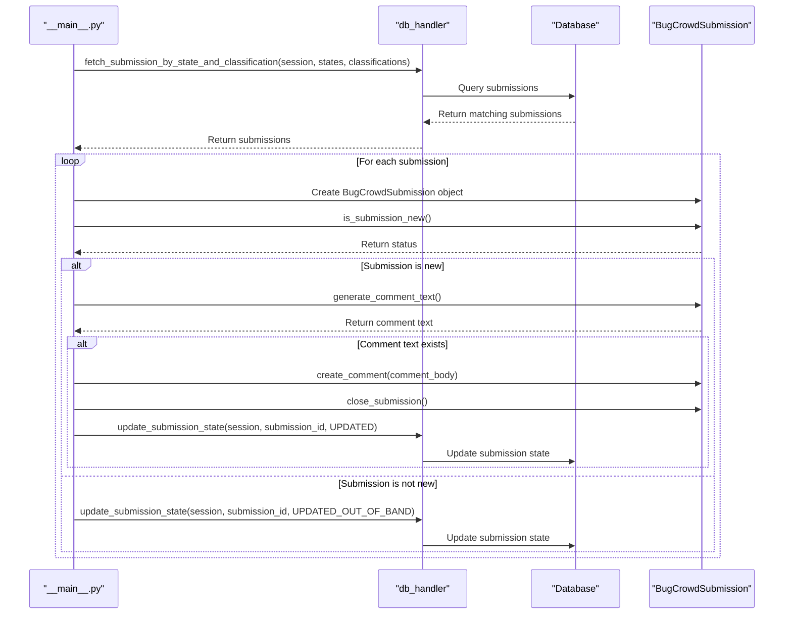

<!-- source: DeepWiki mcp.deepwiki.com · repo openai/bugbounty-gpt · page 3.2 Database Operations · fetched 2026-10-26 -->

# Database Operations

<details>
<summary>Relevant source files</summary>

The following files were used as context for generating this wiki page:

- [bugbounty_gpt/__main__.py](bugbounty_gpt/__main__.py)
- [bugbounty_gpt/db/db_handler.py](bugbounty_gpt/db/db_handler.py)

</details>


This document describes the database operations in the bugbounty-gpt system, focusing on how the application interacts with the PostgreSQL database to store and retrieve submission data. For information about database models and their structure, see [Database Models](#3.1). For details on database migrations, see [Database Migrations](#3.3).

## Overview

The database operations in bugbounty-gpt are primarily handled by the `db_handler.py` module, which provides a set of asynchronous functions for common database operations such as inserting new submissions, updating submission states, and fetching submissions based on specific criteria.



Sources: [bugbounty_gpt/db/db_handler.py:1-88](), [bugbounty_gpt/__main__.py:1-101]()

## Database Connection Setup

The database connection is established in the main module using SQLAlchemy's async engine. The application uses a session factory pattern to create database sessions as needed.



Sources: [bugbounty_gpt/__main__.py:17-25]()

## Core Database Operations

The `db_handler.py` module provides the following key operations:

### 1. Finding Submissions by ID

The `_find_submission_by_id` function is an internal helper that retrieves a submission by its ID:

```python
async def _find_submission_by_id(session, submission_id):
    stmt = select(Submission).filter(Submission.submission_id == submission_id)
    result = await session.execute(stmt)
    return result.scalar_one_or_none()
```

Sources: [bugbounty_gpt/db/db_handler.py:7-18]()

### 2. Inserting New Submissions

The `insert_submission` function adds a new submission to the database if it doesn't already exist:



Sources: [bugbounty_gpt/db/db_handler.py:20-38]()

### 3. Updating Submission State

The `update_submission_state` function changes the state of an existing submission:



Sources: [bugbounty_gpt/db/db_handler.py:40-57]()

### 4. Fetching Submissions by State and Classification

The `fetch_submission_by_state_and_classification` function retrieves submissions that match specific states and classifications:



Sources: [bugbounty_gpt/db/db_handler.py:59-75]()

### 5. Fetching Submission by ID

The `fetch_submission_by_id` function is a public wrapper around the internal `_find_submission_by_id` function:



Sources: [bugbounty_gpt/db/db_handler.py:77-87]()

## Database Usage in the Application

The main application uses these database operations in two primary workflows:

### 1. Processing New Submissions



Sources: [bugbounty_gpt/__main__.py:29-58]()

### 2. Processing In-Scope Submissions



Sources: [bugbounty_gpt/__main__.py:60-82]()

## Database Session Management

The application uses SQLAlchemy's async session management with context managers to ensure proper handling of database connections:

```python
async with SessionLocal() as session:
    # Database operations
    # Session is automatically closed when the block exits
```

This pattern is used consistently throughout the application to ensure that database connections are properly managed and released.

Sources: [bugbounty_gpt/__main__.py:39-58](), [bugbounty_gpt/__main__.py:65-82]()

## Database Operation Parameters

| Function | Parameters | Return Value | Description |
|----------|------------|--------------|-------------|
| `_find_submission_by_id` | `session`, `submission_id` | Submission object or None | Internal helper to find a submission by ID |
| `insert_submission` | `session`, `submission_data` | None | Inserts a new submission if it doesn't exist |
| `update_submission_state` | `session`, `submission_id`, `new_state` | Boolean | Updates a submission's state |
| `fetch_submission_by_state_and_classification` | `session`, `states`, `classifications` | List of Submission objects | Fetches submissions matching criteria |
| `fetch_submission_by_id` | `session`, `submission_id` | Submission object or None | Public function to find a submission by ID |

Sources: [bugbounty_gpt/db/db_handler.py:7-87]()

## Error Handling

The database operations include basic error handling through logging and return values. For example, `update_submission_state` returns `True` if the update was successful and `False` otherwise. The application logs database operations for debugging purposes.

Sources: [bugbounty_gpt/db/db_handler.py:5-87]()

## Summary

The database operations in bugbounty-gpt provide a clean, asynchronous interface for interacting with the PostgreSQL database. The operations are designed to be simple and focused, handling common tasks such as inserting new submissions, updating submission states, and fetching submissions based on specific criteria. The application uses SQLAlchemy's async session management to ensure proper handling of database connections.

---

