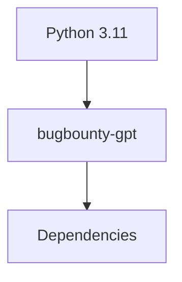
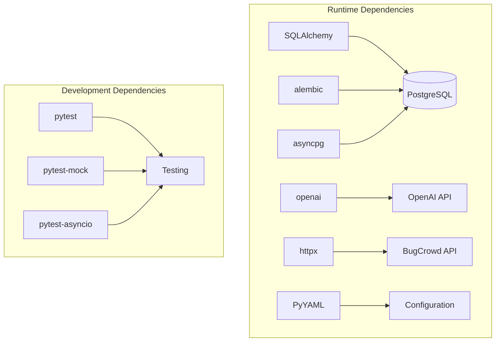
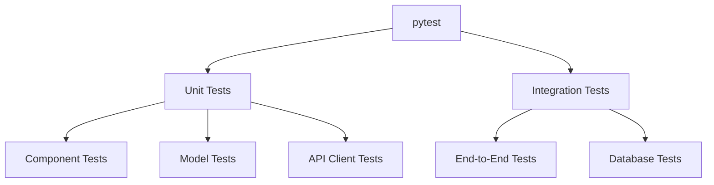
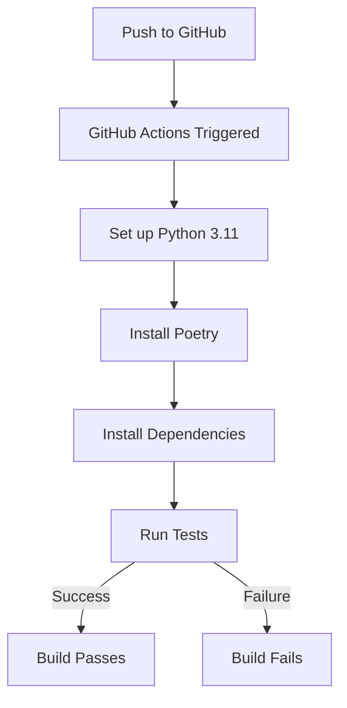
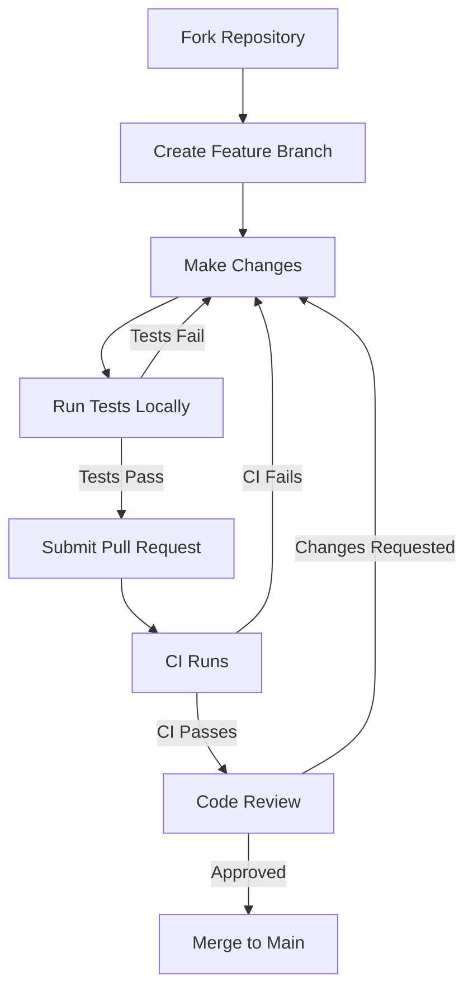
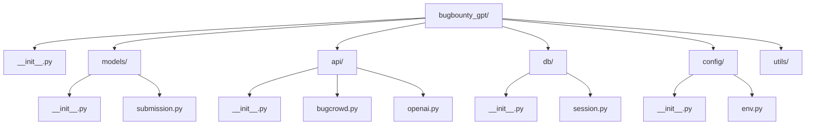

<!-- source: DeepWiki mcp.deepwiki.com · repo openai/bugbounty-gpt · page 4 Development · fetched 2026-10-26 -->

# Development

<details>
<summary>Relevant source files</summary>

The following files were used as context for generating this wiki page:

- [.github/workflows/python-app.yml](.github/workflows/python-app.yml)
- [poetry.lock](poetry.lock)
- [pyproject.toml](pyproject.toml)

</details>


This document provides information for developers working on the `bugbounty-gpt` project. It covers the development environment setup, testing approach, dependency management, and continuous integration/continuous deployment (CI/CD) pipeline.

For information about deploying the system, see [Deployment](#1.3).

## Development Environment

The `bugbounty-gpt` project uses modern Python development tools to ensure code quality and maintainability.

### Python Version

The project requires Python 3.11 as specified in the project configuration:



Sources: [pyproject.toml:14-15]()

### Poetry for Dependency Management

The project uses Poetry for dependency management. Poetry provides a modern approach to Python package management with features like:

- Dependency resolution
- Virtual environment management
- Package building and publishing

To install dependencies:

```bash
poetry install
```

To add a new dependency:

```bash
poetry add package-name
```

Sources: [pyproject.toml:1-32](), [.github/workflows/python-app.yml:21-27]()

## Project Dependencies

The project has several key dependencies that are managed through Poetry:

### Core Dependencies

| Dependency | Version | Purpose |
|------------|---------|---------|
| alembic | 1.12.1 | Database migration tool |
| asyncpg | 0.28.0 | Asynchronous PostgreSQL client |
| httpx | 0.25.0 | HTTP client for API requests |
| openai | 0.28.1 | OpenAI API client |
| psycopg2-binary | 2.9.9 | PostgreSQL adapter |
| SQLAlchemy | 2.0.22 | SQL toolkit and ORM |
| PyYAML | 6.0.1 | YAML parser for configuration |

### Development Dependencies

| Dependency | Version | Purpose |
|------------|---------|---------|
| pytest | * | Testing framework |
| pytest-mock | * | Mocking library for pytest |
| pytest-asyncio | ^0.20.3 | Async testing support |



Sources: [pyproject.toml:14-32]()

## Testing

The project uses pytest as its testing framework, with additional support for mocking and asynchronous testing through pytest-mock and pytest-asyncio.

### Running Tests

To run the tests:

```bash
poetry run pytest
```

### Test Structure

Tests are organized to match the structure of the application code, with unit tests for individual components and integration tests for testing interactions between components.



Sources: [pyproject.toml:29-32](), [.github/workflows/python-app.yml:28-30]()

## Continuous Integration

The project uses GitHub Actions for continuous integration to ensure code quality and prevent regressions.

### CI Workflow

The CI workflow is defined in `.github/workflows/python-app.yml` and includes the following steps:

1. Check out the code
2. Set up Python 3.11
3. Install Poetry
4. Install dependencies
5. Run tests



The CI workflow runs on:
- Push to the main branch
- Pull requests to the main branch

Sources: [.github/workflows/python-app.yml:1-30]()

## Development Workflow

The recommended development workflow for contributing to the project is as follows:

1. Fork the repository
2. Create a feature branch
3. Make changes
4. Run tests locally
5. Submit a pull request
6. Wait for CI to pass
7. Address review comments
8. Merge to main



Sources: [.github/workflows/python-app.yml:1-30]()

## Database Migrations

The project uses Alembic for database migrations. For more information about database migrations, see [Database Migrations](#3.3).

## Development Environment Setup

To set up a development environment:

1. Clone the repository
2. Install Poetry
3. Install dependencies with `poetry install`
4. Set up environment variables or configuration file
5. Run the application with `poetry run python -m bugbounty_gpt`

For local development, you can use Docker Compose to set up a PostgreSQL database:

```bash
docker-compose up -d db
```

Sources: [pyproject.toml:1-32]()

## Code Organization

The codebase follows a modular structure:



This organization separates concerns and makes the codebase easier to navigate and maintain.

Sources: [pyproject.toml:8-12]()

## Development Best Practices

When developing for the project, follow these best practices:

1. Write tests for new functionality
2. Follow PEP 8 style guidelines
3. Use type hints
4. Document code with docstrings
5. Keep functions small and focused
6. Use async/await for I/O-bound operations
7. Handle exceptions appropriately
8. Use dependency injection for testability

Sources: [pyproject.toml:1-32](), [.github/workflows/python-app.yml:1-30]()

## Conclusion

This document provides an overview of the development process for the `bugbounty-gpt` project. By following the guidelines and using the tools described here, developers can contribute effectively to the project while maintaining code quality and reliability.

For more information about specific components of the system, refer to the other wiki pages:
- [Overview](#1)
- [Core Components](#2)
- [Database](#3)
- [Testing](#4.1)
- [Dependencies](#4.2)
- [CI/CD](#4.3)

---

