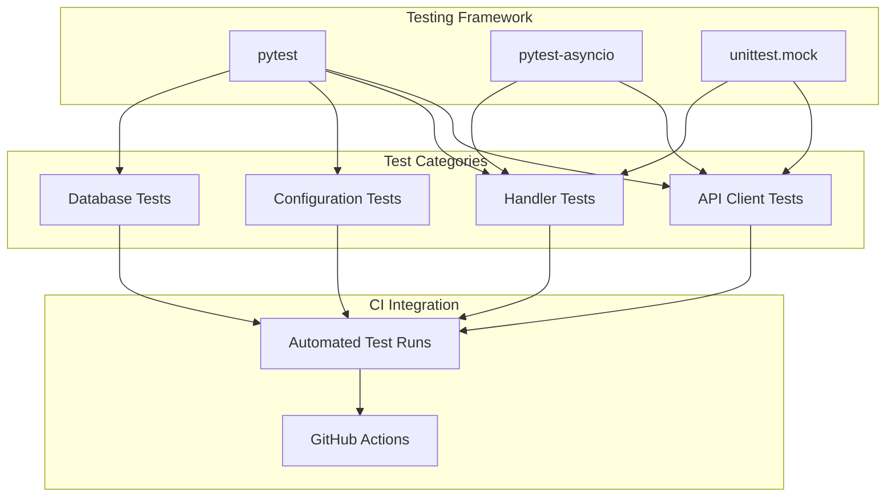
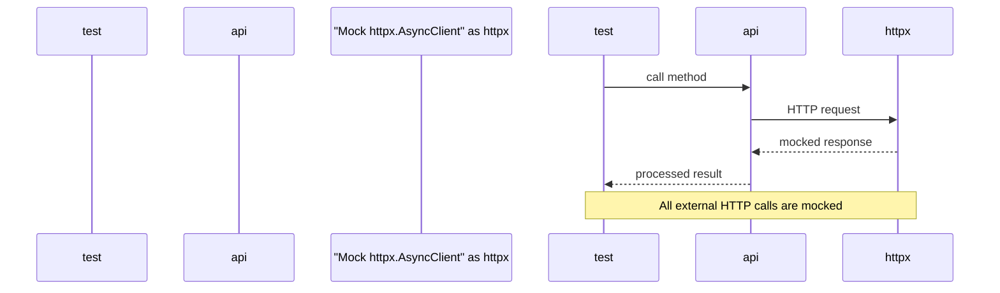
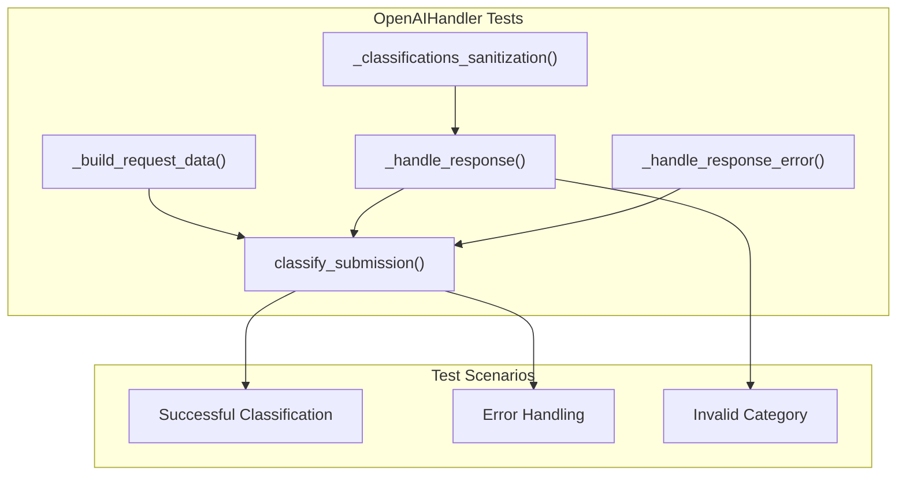
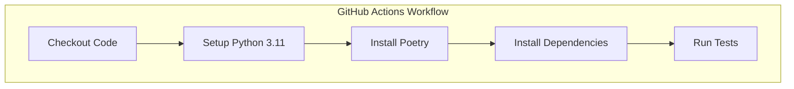

<!-- source: DeepWiki mcp.deepwiki.com · repo openai/bugbounty-gpt · page 4.1 Testing · fetched 2026-10-26 -->

# Testing

<details>
<summary>Relevant source files</summary>

The following files were used as context for generating this wiki page:

- [.github/workflows/python-app.yml](.github/workflows/python-app.yml)
- [tests/test_bugcrowd_api_client.py](tests/test_bugcrowd_api_client.py)
- [tests/test_comment_handling.py](tests/test_comment_handling.py)
- [tests/test_config_validation.py](tests/test_config_validation.py)
- [tests/test_database_and_models.py](tests/test_database_and_models.py)
- [tests/test_openai_classification.py](tests/test_openai_classification.py)

</details>


This page documents the testing approach for the `bugbounty-gpt` system. It covers the testing framework, test organization, and how to run tests. For information about CI/CD integration, see [CI/CD](#4.3).

## Overview of Testing Approach

The `bugbounty-gpt` project uses pytest as its primary testing framework. Tests are organized by component and focus on unit testing the core functionality of the system.



Sources: [.github/workflows/python-app.yml:1-31](), [tests/test_bugcrowd_api_client.py:1-7](), [tests/test_openai_classification.py:1-5]()

## Test Organization

Tests are organized in the `tests/` directory and are grouped by component:

| Test File | Purpose |
|-----------|---------|
| `test_bugcrowd_api_client.py` | Tests for the BugCrowd API client |
| `test_comment_handling.py` | Tests for comment creation and handling |
| `test_config_validation.py` | Tests for configuration validation |
| `test_database_and_models.py` | Tests for database models |
| `test_openai_classification.py` | Tests for OpenAI integration and classification |

Sources: [tests/test_bugcrowd_api_client.py](), [tests/test_comment_handling.py](), [tests/test_config_validation.py](), [tests/test_database_and_models.py](), [tests/test_openai_classification.py]()

## Testing Components

### BugCrowd API Testing

Tests for the BugCrowd API client focus on verifying that the client correctly interacts with the BugCrowd API, including:

- Header generation
- Submission fetching
- Comment creation
- Submission patching



Sources: [tests/test_bugcrowd_api_client.py:8-70]()

### OpenAI Integration Testing

Tests for the OpenAI integration verify that:

- Request data is correctly built
- Responses are properly parsed
- Error handling works as expected
- Classification results are correctly sanitized



Sources: [tests/test_openai_classification.py:6-68]()

### Comment Handling Testing

Tests for comment handling verify:

- Comment data preparation
- Successful comment creation
- Error handling during comment creation

Sources: [tests/test_comment_handling.py:1-54]()

### Configuration Testing

Tests for configuration validation ensure:

- Category sanitization works correctly
- Configuration validation catches invalid configurations
- Response categories are properly validated

Sources: [tests/test_config_validation.py:1-39]()

### Database Model Testing

Tests for database models verify:

- Category name sanitization
- Enum member creation
- Enum value correctness

Sources: [tests/test_database_and_models.py:1-13]()

## Asynchronous Testing

Many components in the system use asynchronous functions. The project uses `pytest-asyncio` to test these components. Asynchronous tests are marked with the `@pytest.mark.asyncio` decorator.

```python
@pytest.mark.asyncio
async def test_async_function():
    # Test code here
    result = await some_async_function()
    assert result == expected_value
```

Sources: [tests/test_bugcrowd_api_client.py:13-70](), [tests/test_comment_handling.py:29-53](), [tests/test_openai_classification.py:52-68]()

## Mocking

The tests use the `unittest.mock` module to mock external dependencies, particularly HTTP requests to the BugCrowd API and OpenAI API. This ensures that tests can run without actual API access and provides deterministic results.

```python
# Example of mocking an HTTP request
with patch.object(httpx.AsyncClient, 'get', return_value=mock_response) as mock_get:
    result = await function_under_test()
    assert result == expected_value
```

Sources: [tests/test_bugcrowd_api_client.py:23-25](), [tests/test_openai_classification.py:53-58]()

## Running Tests

Tests can be run locally using Poetry:

```bash
poetry run pytest
```

To run a specific test file:

```bash
poetry run pytest tests/test_file_name.py
```

To run tests with verbose output:

```bash
poetry run pytest -v
```

Sources: [.github/workflows/python-app.yml:28-30]()

## CI Integration

Tests are automatically run as part of the CI pipeline using GitHub Actions. The workflow is defined in `.github/workflows/python-app.yml`.



The CI workflow:
1. Checks out the code
2. Sets up Python 3.11
3. Installs Poetry
4. Installs project dependencies
5. Runs the tests using pytest

Sources: [.github/workflows/python-app.yml:1-31]()

## Test Coverage

The current test suite focuses on unit testing the core components of the system. The main areas covered are:

1. BugCrowd API integration
2. OpenAI classification
3. Comment handling
4. Configuration validation
5. Database models

Future improvements could include:
- Integration tests
- End-to-end tests
- Increased test coverage for edge cases

Sources: [tests/test_bugcrowd_api_client.py](), [tests/test_openai_classification.py](), [tests/test_comment_handling.py](), [tests/test_config_validation.py](), [tests/test_database_and_models.py]()

---

