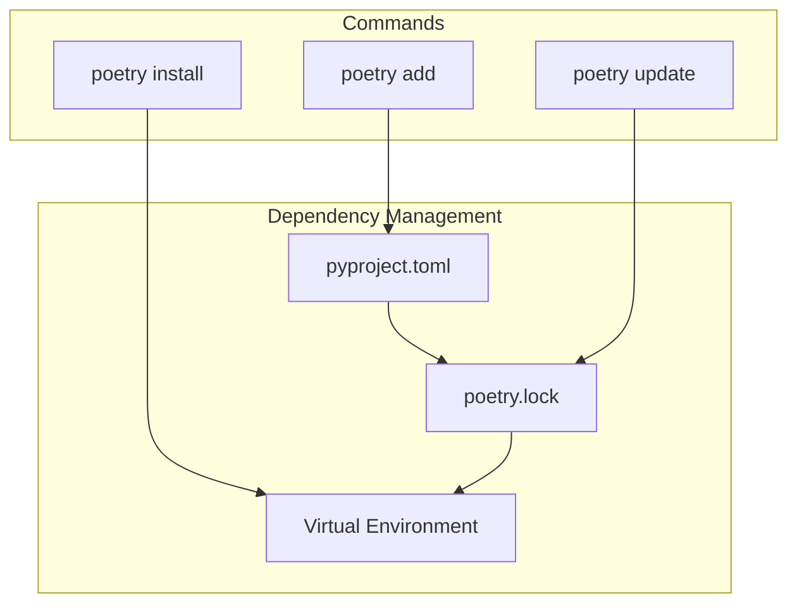
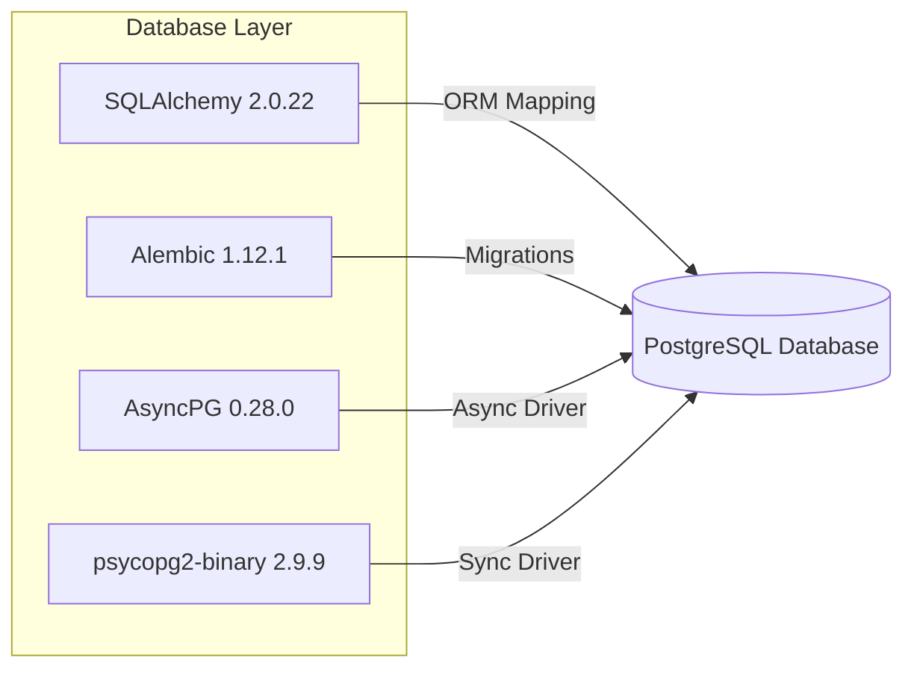
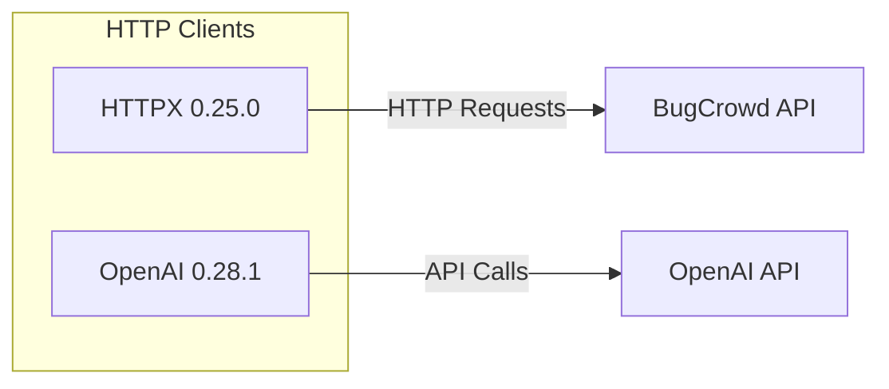
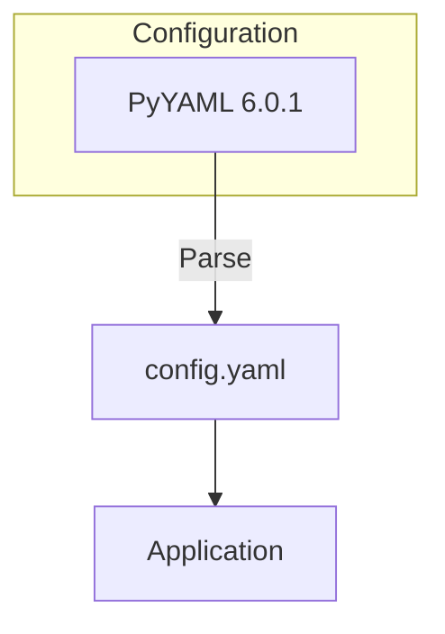
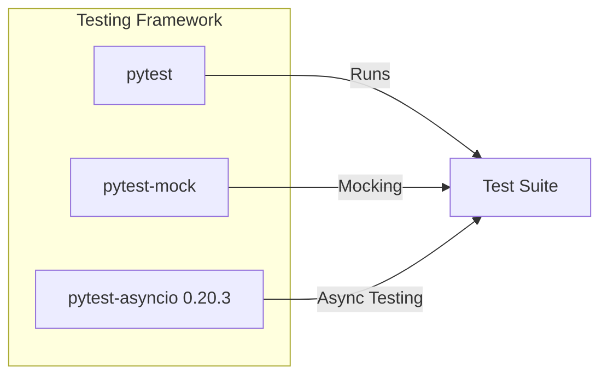
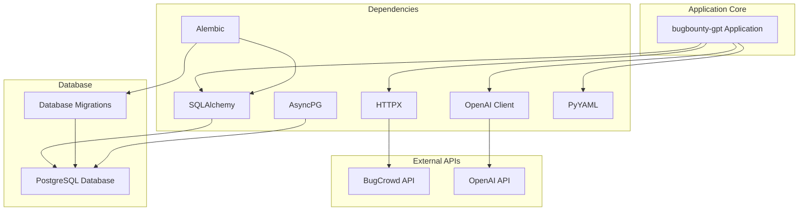

<!-- source: DeepWiki mcp.deepwiki.com · repo openai/bugbounty-gpt · page 4.2 Dependencies · fetched 2026-10-26 -->

# Dependencies

<details>
<summary>Relevant source files</summary>

The following files were used as context for generating this wiki page:

- [poetry.lock](poetry.lock)
- [pyproject.toml](pyproject.toml)

</details>


This page documents the dependencies used in the `bugbounty-gpt` project, their purposes, and how they are managed. It covers both runtime dependencies and development dependencies required for the system to function properly.

## Overview

The `bugbounty-gpt` project uses Poetry for dependency management. All dependencies are defined in the `pyproject.toml` file, with their exact versions locked in the `poetry.lock` file to ensure reproducible builds.

Sources: [pyproject.toml:1-33](), [poetry.lock:1-30]()

## Dependency Management

### Poetry

Poetry is the primary dependency management tool used in this project. It handles package installation, dependency resolution, and virtual environment management.



Sources: [pyproject.toml:1-33](), [poetry.lock:1-30]()

## Core Dependencies

The project relies on several key libraries to function:

### Database Dependencies



- **SQLAlchemy (2.0.22)**: ORM for database interactions
- **Alembic (1.12.1)**: Database migration tool built on SQLAlchemy
- **AsyncPG (0.28.0)**: Asynchronous PostgreSQL driver
- **psycopg2-binary (2.9.9)**: PostgreSQL adapter for Python

Sources: [pyproject.toml:16-17](), [pyproject.toml:18](), [pyproject.toml:25-26]()

### API and HTTP Dependencies



- **HTTPX (0.25.0)**: Modern HTTP client with async support, used for BugCrowd API interactions
- **OpenAI (0.28.1)**: Official OpenAI client library for API access

Sources: [pyproject.toml:18](), [pyproject.toml:24]()

### Configuration Dependencies



- **PyYAML (6.0.1)**: YAML parser for configuration files

Sources: [pyproject.toml:27]()

## Development Dependencies

The project uses several tools for testing and development:



- **pytest**: Testing framework
- **pytest-mock**: Thin wrapper around the mock package for easier use with pytest
- **pytest-asyncio**: Pytest support for asyncio

Sources: [pyproject.toml:30-32]()

## Dependency Relationships

The following diagram shows the relationships between major dependencies in the system:



Sources: [pyproject.toml:14-27]()

## Dependency Version Constraints

The project specifies exact versions for most dependencies to ensure reproducibility. The Python version is constrained to Python 3.11.x.

| Dependency | Version | Purpose |
|------------|---------|---------|
| Python | 3.11.* | Runtime environment |
| alembic | 1.12.1 | Database migrations |
| asyncpg | 0.28.0 | Async PostgreSQL driver |
| httpx | 0.25.0 | HTTP client |
| idna | 3.4 | Internationalized Domain Names |
| iniconfig | 2.0.0 | INI file parsing |
| Mako | 1.2.4 | Template engine (used by Alembic) |
| MarkupSafe | 2.1.3 | String handling for templates |
| multidict | 6.0.4 | Dictionary with multiple values per key |
| openai | 0.28.1 | OpenAI API client |
| psycopg2-binary | 2.9.9 | PostgreSQL adapter |
| SQLAlchemy | 2.0.22 | SQL toolkit and ORM |
| PyYAML | 6.0.1 | YAML parser |

Sources: [pyproject.toml:14-27]()

## Transitive Dependencies

The main dependencies pull in several transitive dependencies. Key ones include:

- **aiohttp**: Used by the OpenAI client for async HTTP requests
- **certifi**: Provides Mozilla's CA Bundle for secure connections
- **charset-normalizer**: Character encoding detection
- **h11**: HTTP/1.1 implementation used by httpx
- **anyio**: Asynchronous I/O library

Sources: [poetry.lock:3-96](), [poetry.lock:145-162](), [poetry.lock:258-353](), [poetry.lock:508-516]()

## Installing Dependencies

Dependencies are installed using Poetry:

```bash
# Install all dependencies (including dev)
poetry install

# Install only production dependencies
poetry install --no-dev
```

When running in Docker, dependencies are installed during the container build process.

Sources: [pyproject.toml:1-33]()

## Updating Dependencies

To update dependencies:

```bash
# Update all dependencies
poetry update

# Update specific dependency
poetry update <package-name>
```

After updating, the `poetry.lock` file will be regenerated with the new dependency versions.

Sources: [poetry.lock:1-30]()

---

