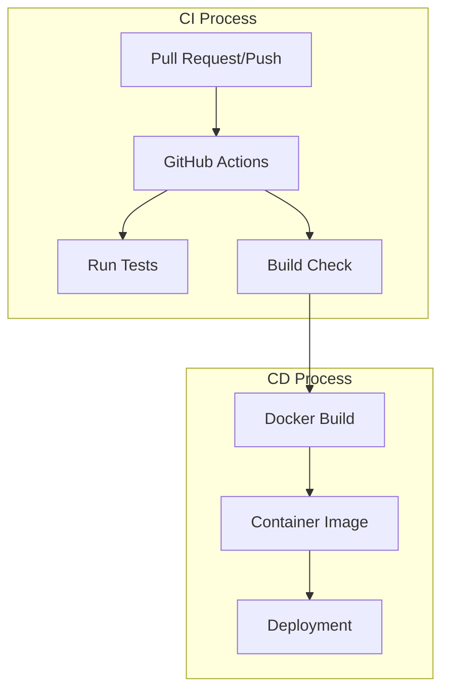
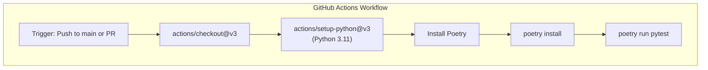
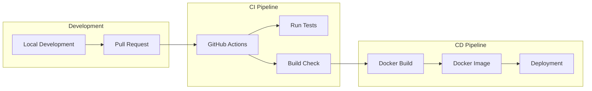

<!-- source: DeepWiki mcp.deepwiki.com · repo openai/bugbounty-gpt · page 4.3 CI/CD · fetched 2026-10-26 -->

# CI/CD

Relevant source files

The following files were used as context for generating this wiki page:

- [.github/workflows/python-app.yml](.github/workflows/python-app.yml)
- [Dockerfile](Dockerfile)

This page documents the Continuous Integration and Continuous Deployment (CI/CD) setup for the bugbounty-gpt project. It covers the GitHub Actions workflow configuration, Docker containerization, and the deployment process.

For information about dependencies management, see [Dependencies](#4.2).

## Overview

The bugbounty-gpt project uses GitHub Actions for continuous integration and Docker for containerization and deployment. The CI pipeline automatically runs tests on pull requests and pushes to the main branch, while the Docker configuration enables consistent deployment across environments.

Sources: [.github/workflows/python-app.yml:1-31](), [Dockerfile:1-40]()

## GitHub Actions Workflow

The project uses GitHub Actions for continuous integration. The workflow is defined in the `.github/workflows/python-app.yml` file and is triggered on:
- Push events to the main branch
- Pull request events targeting the main branch

### Workflow Configuration

The workflow consists of a single job named "build" that runs on the latest Ubuntu environment and performs the following steps:

1. Check out the repository code
2. Set up Python 3.11
3. Install Poetry (dependency management tool)
4. Install project dependencies using Poetry
5. Run tests using pytest

Sources: [.github/workflows/python-app.yml:1-31]()

## Docker Containerization

The project uses Docker for containerization, which ensures consistent deployment across different environments. The Docker configuration is defined in the `Dockerfile`.

### Docker Image Configuration

The Docker image is built on top of the official Python 3.11 slim-bookworm image and includes:

1. Poetry installation
2. Creation of a non-root user for security
3. Copy of application code, configuration, and dependencies
4. Installation of dependencies using Poetry
5. Copy of Alembic configuration and migration scripts for database management
6. Configuration for running the application with or without an ephemeral database

```mermaid
flowchart TD
    subgraph "Docker Image Layers"
        BaseImage["python:3.11-slim-bookworm"]
        PoetryLayer["Install Poetry"]
        UserLayer["Create non-root user"]
        CodeLayer["Copy application code"]
        ConfigLayer["Copy config files"]
        DepsLayer["Install dependencies"]
        AlembicLayer["Copy Alembic files"]
        PermissionsLayer["Set permissions"]
        UserSwitchLayer["Switch to non-root user"]
        EnvLayer["Set environment variables"]
        CmdLayer["Set CMD instruction"]
    end
    
    BaseImage --> PoetryLayer
    PoetryLayer --> UserLayer
    UserLayer --> CodeLayer
    CodeLayer --> ConfigLayer
    ConfigLayer --> DepsLayer
    DepsLayer --> AlembicLayer
    AlembicLayer --> PermissionsLayer
    PermissionsLayer --> UserSwitchLayer
    UserSwitchLayer --> EnvLayer
    EnvLayer --> CmdLayer
```

Sources: [Dockerfile:1-40]()

### Build Arguments and Environment Variables

The Docker image accepts a build argument `EPHEMERAL_DB` which determines the startup behavior:

- If `EPHEMERAL_DB=true`, the container runs the `start.sh` script
- Otherwise, it directly runs the Python module `bugbounty_gpt`

This allows for flexible deployment configurations, particularly useful for development versus production environments.

Sources: [Dockerfile:33-38]()

## CI/CD Integration

The CI/CD pipeline integrates the GitHub Actions workflow with Docker containerization to provide a complete development and deployment process.

Sources: [.github/workflows/python-app.yml:1-31](), [Dockerfile:1-40]()

## Development Workflow

The typical development workflow for the bugbounty-gpt project is:

1. Developers make changes locally and create a pull request
2. GitHub Actions automatically runs tests on the pull request
3. After approval and merge, GitHub Actions runs tests on the main branch
4. The Docker image can be built and deployed manually or through additional automation

This workflow ensures that code quality is maintained through automated testing before changes are merged into the main branch.

| Step | Action | Triggered By | Output |
|------|--------|-------------|--------|
| 1 | Run tests | Pull request or push to main | Test results |
| 2 | Build check | Successful tests | Build status |
| 3 | Docker build | Manual or automated trigger | Docker image |
| 4 | Deployment | Manual or automated trigger | Deployed application |

Sources: [.github/workflows/python-app.yml:1-31](), [Dockerfile:1-40]()

## Security Considerations

The CI/CD pipeline includes several security measures:

1. The GitHub Actions workflow has limited permissions (read-only access to repository contents)
2. The Docker image runs as a non-root user to reduce the risk of container breakout
3. Dependencies are explicitly defined and locked using Poetry to prevent supply chain attacks

For more information about security considerations, see [Security](#5).

Sources: [.github/workflows/python-app.yml:8-9](), [Dockerfile:7-8](), [Dockerfile:30-31]()

---

