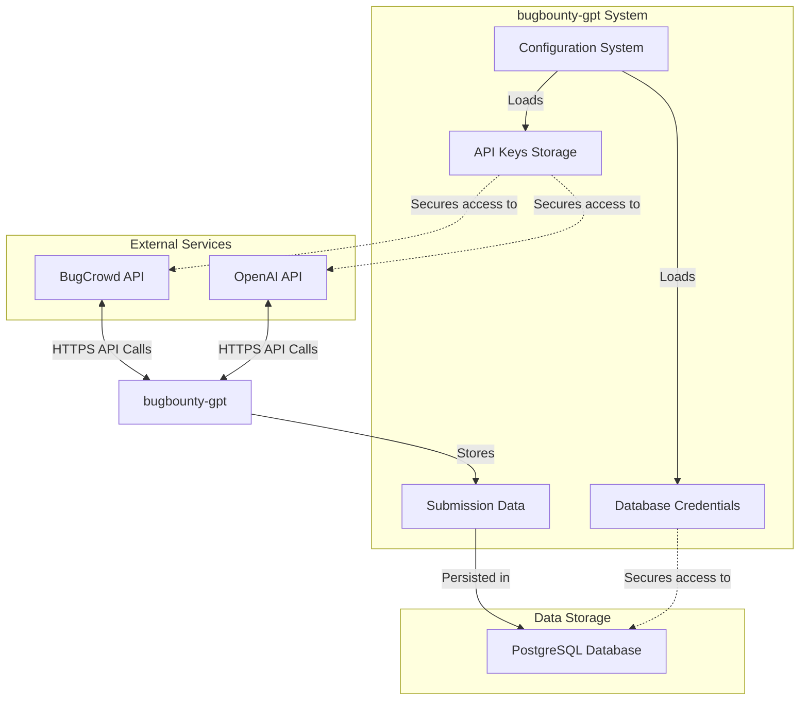
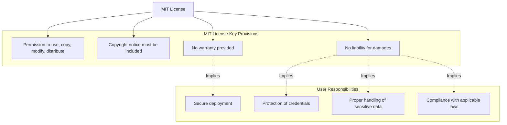

<!-- source: DeepWiki mcp.deepwiki.com · repo openai/bugbounty-gpt · page 5 Security · fetched 2026-10-26 -->

# Security

Relevant source files

The following files were used as context for generating this wiki page:

- [LICENSE](LICENSE)
- [SECURITY.md](SECURITY.md)

This page documents the security aspects of the bugbounty-gpt system, including security policies, vulnerability reporting procedures, and security-related considerations for deployment and operation.

## Security Policy Overview

The bugbounty-gpt project follows OpenAI's Coordinated Vulnerability Disclosure Policy. This policy outlines how security vulnerabilities should be reported and how they will be addressed by the OpenAI team.

The full details of the policy can be found in the SECURITY.md file in the repository root and on OpenAI's official website.

Sources: [SECURITY.md:1-4]()

## Vulnerability Reporting

If you discover a security vulnerability in the bugbounty-gpt system, please follow these steps:

1. Report the vulnerability to OpenAI's security team using the contact information provided in the security policy.
2. Include detailed information about the vulnerability, including steps to reproduce.
3. Allow time for the OpenAI team to investigate and address the issue before public disclosure.

OpenAI provides a PGP key for secure communication about vulnerabilities, which can be found at the URL referenced in the SECURITY.md file.

Sources: [SECURITY.md:1-4]()

## Security Architecture

The bugbounty-gpt system interacts with several external services and handles potentially sensitive data. Understanding the security architecture is essential for secure deployment and operation.

Sources: [SECURITY.md:1-4]()

## Credential Management

The bugbounty-gpt system requires several credentials to operate:

1. BugCrowd API credentials
2. OpenAI API key
3. Database credentials

These credentials should be managed securely using environment variables or a secure configuration file that is not committed to version control.

### Recommended Practices

| Credential Type | Storage Recommendation | Notes |
|----------------|------------------------|-------|
| API Keys | Environment variables | Never commit API keys to version control |
| Database Credentials | Environment variables or secure config | Use strong, unique passwords |
| Configuration Files | Use .gitignore to exclude from repo | Maintain separate configs for dev/prod |

## Data Security Considerations

The bugbounty-gpt system processes bug bounty submissions which may contain sensitive information. Consider the following security aspects:

1. **Data in Transit**: All API communications should use HTTPS
2. **Data at Rest**: Database should be properly secured with access controls
3. **Data Retention**: Implement appropriate data retention policies for submissions
4. **Access Control**: Limit access to the system and its data to authorized personnel only

## License and Legal Considerations

The bugbounty-gpt system is released under the MIT License, which has specific provisions regarding liability and warranty. Users should review the license terms to understand their rights and obligations.

Sources: [LICENSE:1-21]()

## Security Best Practices for Deployment

When deploying the bugbounty-gpt system, consider the following security best practices:

1. **Container Security**: If using Docker, follow container security best practices:
   - Use minimal base images
   - Run containers with non-root users
   - Keep container images updated

2. **Network Security**:
   - Use network segmentation
   - Implement proper firewall rules
   - Consider using a VPN for administrative access

3. **Monitoring and Logging**:
   - Implement logging for security-relevant events
   - Set up monitoring for unusual activity
   - Regularly review logs for security issues

4. **Updates and Patches**:
   - Keep all dependencies updated
   - Regularly check for security advisories affecting the system components
   - Apply security patches promptly

## Related Documentation

For information about system deployment, see [Deployment](#1.3).
For details about configuration, including secure handling of credentials, see [Configuration](#1.2).