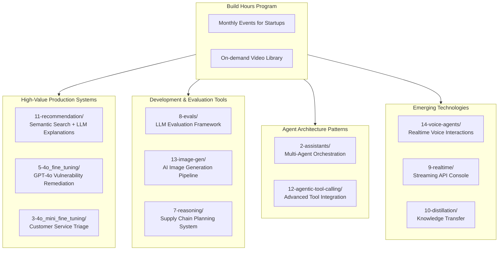
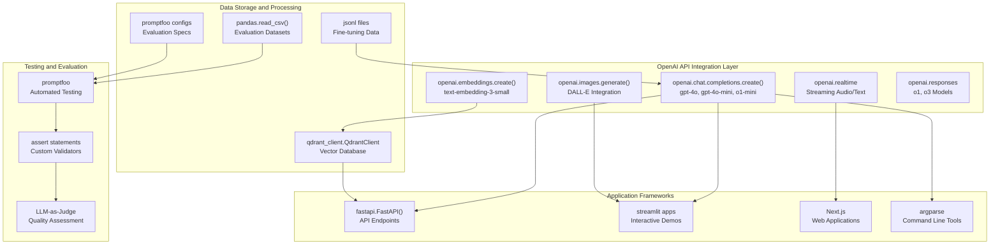

<!-- source: DeepWiki mcp.deepwiki.com · repo openai/build-hours · page 1 Overview · fetched 2026-10-26 -->

# Overview

Relevant source files

The following files were used as context for generating this wiki page:

- [README.md](README.md)

This document provides a comprehensive overview of the Build Hours repository, which contains demonstration systems and reference implementations for leveraging OpenAI's APIs and models across diverse startup use cases. The repository serves as both educational material for monthly Build Hours events and practical reference code for developers building AI-powered applications.

The codebase demonstrates eight major system categories ranging from recommendation engines to real-time voice interactions, each showcasing different aspects of LLM integration patterns, evaluation methodologies, and production deployment considerations. For detailed documentation of specific systems, see the dedicated sections: [Recommendation System](#2), [Fine-tuning Systems](#3), [Image Generation System](#4), [Evaluation and Testing](#5), [Agent Systems](#6), [Reasoning and Planning](#7), and [Realtime Applications](#8).

## Program Purpose and Target Audience

Build Hours are monthly events designed for startup founders and developers to explore specific ideas for leveraging OpenAI's API and models. The program supports startups at every stage from concept to scale, providing practical demonstrations of AI integration patterns and best practices.

**System Architecture Overview**

Sources: [README.md:3-5]()

## System Categories and Complexity Levels

The repository organizes AI systems into four complexity tiers, each demonstrating different integration patterns and production readiness levels.

| Complexity Level | Systems | Primary Focus | Target Audience |
|------------------|---------|---------------|-----------------|
| **Production Ready** | Recommendation Engine, Fine-tuning Systems | Business-critical applications with full evaluation pipelines | Startup CTOs, Senior Engineers |
| **Advanced Prototypes** | Image Generation, Supply Chain Planning | Complex multi-step workflows with LLM orchestration | Product Managers, ML Engineers |
| **Development Tools** | Evaluation Framework, Agent Systems | Testing, debugging, and development acceleration | Developer Teams, QA Engineers |
| **Emerging Examples** | Voice Agents, Realtime Console | Cutting-edge capabilities and experimental features | Innovation Teams, Researchers |

**Core Technology Integration Map**

Sources: [README.md:1-9]()

## Repository Structure and Navigation

The codebase follows a numerical organization system where each major system is contained within its own directory. The most critical systems (recommendation engine, fine-tuning) have the highest development activity and most comprehensive documentation.

**System Importance and Development Activity**

| Directory | System Name | Importance Score | Primary Use Case | Key Technologies |
|-----------|-------------|------------------|------------------|------------------|
| `11-recommendation/` | Semantic Search Engine | 10.74 | E-commerce recommendations | Qdrant, embeddings, FastAPI |
| `5-4o_fine_tuning/` | Vulnerability Fixes | 8.47 | Security code analysis | Fine-tuning, promptfoo, semgrep |
| `3-4o_mini_fine_tuning/` | Customer Service | 8.45 | Chat triage automation | Fine-tuning, synthetic data |
| `13-image-gen/` | Image Generation | 6.62 | Creative content pipeline | DALL-E, SVG processing |
| `8-evals/` | Evaluation Framework | 6.44 | LLM testing methodology | promptfoo, pandas |
| `7-reasoning/` | Supply Chain Planning | 5.15 | Multi-LLM orchestration | o1-mini, gpt-4o |
| `12-agentic-tool-calling/` | Agent Tools | 4.62 | Function calling patterns | OpenAI tools, async |
| `2-assistants/` | Multi-Agent Systems | 4.10 | Conversational orchestration | Assistant transfers |
| `10-distillation/` | Model Compression | 3.50 | Cost optimization | Knowledge transfer |
| `14-voice-agents/` | Voice Interactions | 2.98 | Realtime audio processing | Realtime API |
| `9-realtime/` | API Console | 2.23 | Development tooling | WebRTC, streaming |

## Setup and Development Environment

Each system in the repository includes its own setup requirements and dependencies. For comprehensive installation instructions and environment configuration, see [Setup and Requirements](#1.2). The repository requires Python 3.8+ and Node.js for web-based systems, with OpenAI API keys configured for all demonstrations.

Most systems include standalone demo scripts and can be explored independently, though some advanced examples like the recommendation engine require additional infrastructure setup including vector databases and evaluation frameworks.

Sources: [README.md:1-9]()

---

