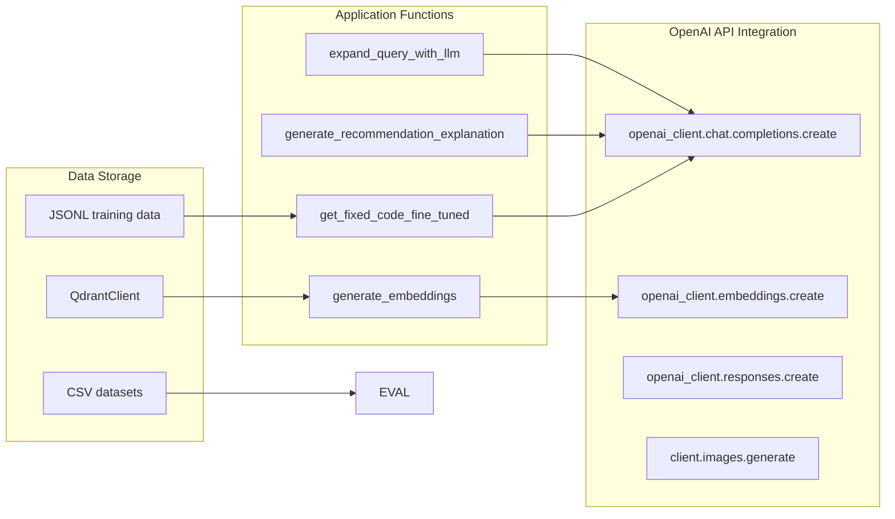
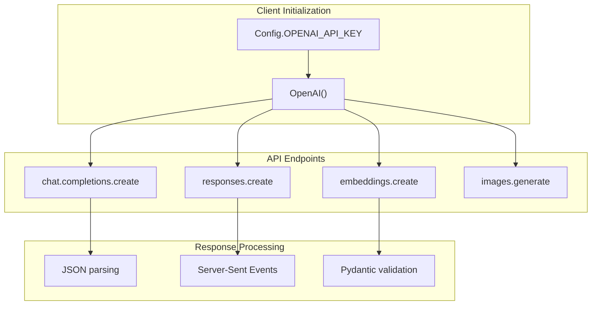
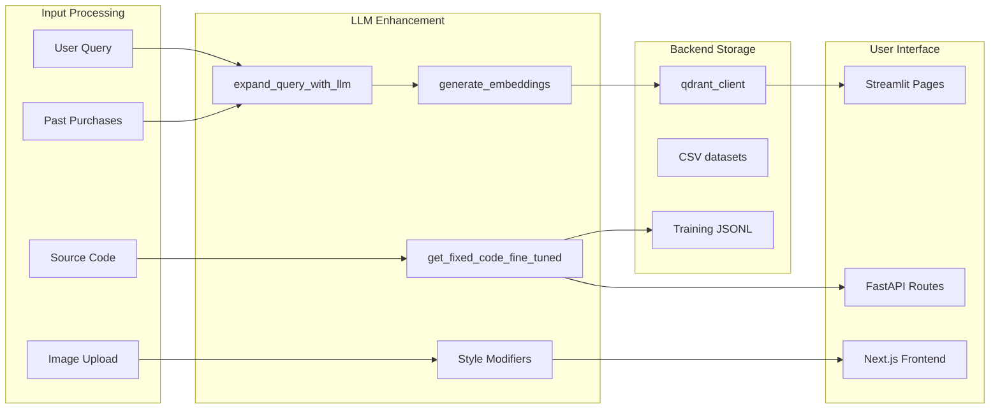
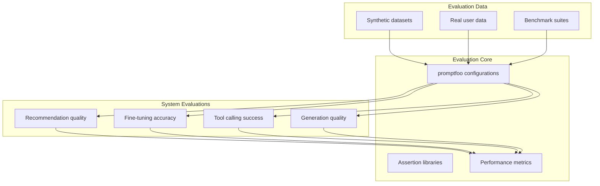

<!-- source: DeepWiki mcp.deepwiki.com · repo openai/build-hours · page 1.1 Key Systems · fetched 2026-10-26 -->

# Key Systems

<details>
<summary>Relevant source files</summary>

The following files were used as context for generating this wiki page:

- [.gitignore](.gitignore)
- [11-recommendation/README.md](11-recommendation/README.md)
- [11-recommendation/helper_functions.py](11-recommendation/helper_functions.py)
- [11-recommendation/pages/page_1_semantic_search.py](11-recommendation/pages/page_1_semantic_search.py)
- [11-recommendation/pages/page_2_explainable_recommendations.py](11-recommendation/pages/page_2_explainable_recommendations.py)
- [11-recommendation/upload-to-qdrant.py](11-recommendation/upload-to-qdrant.py)
- [13-image-gen/imagegen-demo/README.md](13-image-gen/imagegen-demo/README.md)
- [13-image-gen/imagegen-demo/src/app/api/stream/route.ts](13-image-gen/imagegen-demo/src/app/api/stream/route.ts)
- [3-4o_mini_fine_tuning/0_generate_eval_data.py](3-4o_mini_fine_tuning/0_generate_eval_data.py)
- [3-4o_mini_fine_tuning/prompts/cot3.json](3-4o_mini_fine_tuning/prompts/cot3.json)
- [3-4o_mini_fine_tuning/prompts/verbatim_input.txt](3-4o_mini_fine_tuning/prompts/verbatim_input.txt)
- [5-4o_fine_tuning/README.md](5-4o_fine_tuning/README.md)
- [5-4o_fine_tuning/eval.py](5-4o_fine_tuning/eval.py)
- [5-4o_fine_tuning/example.py](5-4o_fine_tuning/example.py)
- [5-4o_fine_tuning/example_cot.py](5-4o_fine_tuning/example_cot.py)

</details>


This document provides a high-level overview of the most important AI systems demonstrated in the Build Hours repository, organized by complexity, business impact, and technical architecture. These systems showcase practical implementations of OpenAI's APIs across recommendation engines, model fine-tuning, agent frameworks, and real-time applications.

For detailed setup instructions and requirements, see [Setup and Requirements](#1.2). For comprehensive documentation of individual systems, refer to their respective sections: [Recommendation System](#2), [Fine-tuning Systems](#3), [Image Generation System](#4), [Evaluation and Testing](#5), [Agent Systems](#6), [Reasoning and Planning](#7), and [Realtime Applications](#8).

## System Architecture Overview

The repository contains eight primary system categories that demonstrate different aspects of LLM integration and deployment patterns.

### System Architecture by Business Impact

```mermaid
graph TB
    subgraph "Production-Ready Systems"
        REC[11-recommendation<br/>"Semantic Search & LLM Explanations"]
        FT4O[5-4o_fine_tuning<br/>"Vulnerability Fix Training"]
        FT4OMINI[3-4o_mini_fine_tuning<br/>"Customer Service Triage"]
    end
    
    subgraph "Advanced Demonstrations"
        IMG[13-image-gen<br/>"AI Image Generation Pipeline"]
        EVAL[8-evals<br/>"LLM Evaluation Framework"]
        AGENT[12-agentic-tool-calling<br/>"Agent Tool Integration"]
    end
    
    subgraph "Emerging Technologies"
        VOICE[14-voice-agents<br/>"Realtime Voice Interactions"]
        REASON[7-reasoning<br/>"Supply Chain Planning"]
        RT[9-realtime<br/>"Realtime API Console"]
    end
    
    REC --> EVAL
    FT4O --> EVAL
    FT4OMINI --> EVAL
    AGENT --> RT
    VOICE --> RT
```

**Sources:** [.gitignore:1-12](), [5-4o_fine_tuning/README.md:1-58](), [11-recommendation/README.md:1-48](), [13-image-gen/imagegen-demo/README.md:1-88]()

### Core Integration Patterns



**Sources:** [11-recommendation/helper_functions.py:305-317](), [11-recommendation/helper_functions.py:324-334](), [11-recommendation/helper_functions.py:461-492](), [5-4o_fine_tuning/eval.py:99-134]()

## System Categories by Complexity

### Tier 1: Production-Ready Systems

| System | Primary Function | Key Components | Business Value |
|--------|------------------|----------------|----------------|
| **Recommendation Engine** | Semantic search with LLM explanations | `helper_functions.py`, `QdrantClient`, Streamlit UI | Highest - Revenue impact through personalized recommendations |
| **GPT-4o Fine-tuning** | Vulnerability fix automation | `eval.py`, semgrep integration, dataset processing | High - Security automation for enterprise |
| **GPT-4o-mini Fine-tuning** | Customer service triage | Synthetic data generation, evaluation framework | High - Customer support automation |

### Tier 2: Advanced Demonstrations

| System | Primary Function | Key Components | Innovation Value |
|--------|------------------|----------------|------------------|
| **Image Generation** | AI-powered image creation with post-processing | Next.js API, Sharp library, SVG overlay | Medium - Creative workflow automation |
| **Evaluation Framework** | LLM performance testing | `promptfoo` configs, assertion libraries | Medium - Quality assurance for AI systems |
| **Agent Systems** | Tool-calling and orchestration | FastAPI servers, streaming responses | Medium - AI agent deployment patterns |

### Tier 3: Emerging Technologies

| System | Primary Function | Key Components | Research Value |
|--------|------------------|----------------|----------------|
| **Voice Agents** | Realtime audio interactions | OpenAI Realtime API, workspace integration | Emerging - Next-gen user interfaces |
| **Supply Chain Planning** | Multi-LLM reasoning orchestration | o1-mini planning, gpt-4o execution | Emerging - Complex reasoning systems |
| **Realtime Console** | Interactive streaming interface | Audio management, tool integration | Emerging - Real-time AI interactions |

**Sources:** [11-recommendation/helper_functions.py:1-493](), [5-4o_fine_tuning/eval.py:1-357](), [3-4o_mini_fine_tuning/0_generate_eval_data.py:1-267](), [13-image-gen/imagegen-demo/src/app/api/stream/route.ts:1-89]()

## Core Technical Architecture

### LLM Integration Layer

The repository demonstrates consistent patterns for OpenAI API integration across all systems:



**Sources:** [11-recommendation/helper_functions.py:13-14](), [5-4o_fine_tuning/eval.py:22](), [13-image-gen/imagegen-demo/src/app/api/stream/route.ts:4](), [3-4o_mini_fine_tuning/0_generate_eval_data.py:9]()

### Data Flow Architecture



**Sources:** [11-recommendation/helper_functions.py:250-321](), [11-recommendation/upload-to-qdrant.py:65-120](), [5-4o_fine_tuning/eval.py:137-254](), [13-image-gen/imagegen-demo/src/app/api/stream/route.ts:8-87]()

## System Integration Points

### Evaluation and Testing Integration

All major systems integrate with a common evaluation framework:



**Sources:** [3-4o_mini_fine_tuning/0_generate_eval_data.py:17-31](), [5-4o_fine_tuning/eval.py:25-91](), [3-4o_mini_fine_tuning/prompts/cot3.json:1-10]()

### Technology Stack Summary

| Layer | Technologies | Primary Systems |
|-------|-------------|----------------|
| **Frontend** | Streamlit, Next.js, React | Recommendation UI, Image Generation |
| **Backend** | FastAPI, Python, Node.js | Agent servers, API endpoints |
| **LLM Integration** | OpenAI SDK, Pydantic validation | All systems |
| **Vector Storage** | Qdrant, embeddings | Recommendation engine |
| **Evaluation** | promptfoo, custom assertions | All systems |
| **Deployment** | Docker, requirements.txt | Infrastructure |

**Sources:** [11-recommendation/README.md:18-48](), [13-image-gen/imagegen-demo/README.md:15-87](), [5-4o_fine_tuning/README.md:9-37](), [11-recommendation/upload-to-qdrant.py:6-16]()

---

