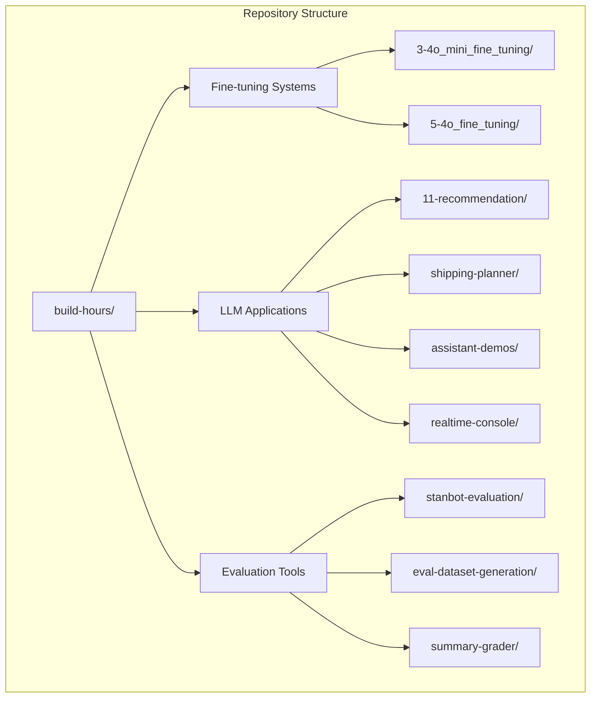
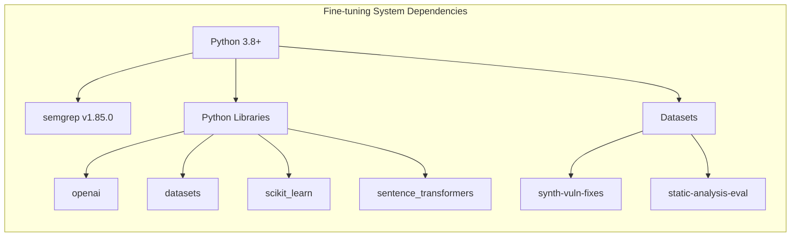
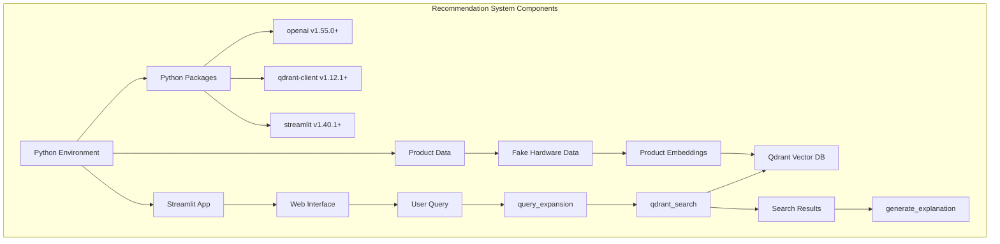
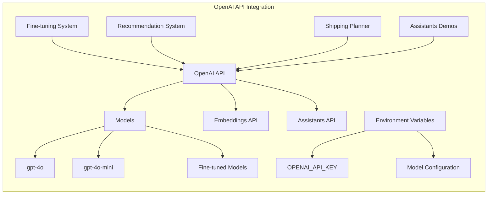

<!-- source: DeepWiki mcp.deepwiki.com · repo openai/build-hours · page 1.2 Setup and Requirements · fetched 2026-10-26 -->

# Setup and Requirements

<details>
<summary>Relevant source files</summary>

The following files were used as context for generating this wiki page:

- [11-recommendation/app.py](11-recommendation/app.py)
- [11-recommendation/config.py](11-recommendation/config.py)
- [11-recommendation/docker-compose.yaml](11-recommendation/docker-compose.yaml)
- [11-recommendation/images.zip](11-recommendation/images.zip)
- [11-recommendation/requirements.txt](11-recommendation/requirements.txt)
- [11-recommendation/upload-data/fake_hardware_data.csv](11-recommendation/upload-data/fake_hardware_data.csv)
- [14-voice-agents/realtime-workspace-agents/.env.sample](14-voice-agents/realtime-workspace-agents/.env.sample)
- [14-voice-agents/realtime-workspace-agents/.gitignore](14-voice-agents/realtime-workspace-agents/.gitignore)
- [14-voice-agents/realtime-workspace-agents/LICENSE](14-voice-agents/realtime-workspace-agents/LICENSE)
- [5-4o_fine_tuning/.gitignore](5-4o_fine_tuning/.gitignore)
- [5-4o_fine_tuning/requirements.txt](5-4o_fine_tuning/requirements.txt)
- [5-4o_fine_tuning/util.py](5-4o_fine_tuning/util.py)

</details>


This page provides comprehensive instructions for setting up the development environment and meeting the requirements for the various systems in the Build Hours repository. For information about specific systems, see their respective pages: [Fine-tuning Systems](#2), [Recommendation System](#3), and [Evaluation Tools](#4).

## Common Setup Requirements

### Python Environment

All systems in this repository require Python 3.8 or newer. We recommend setting up a virtual environment to manage dependencies:

```bash
# Create a virtual environment
python -m venv .venv

# Activate the virtual environment
# On Windows:
.venv\Scripts\activate
# On macOS/Linux:
source .venv/bin/activate
```

### Repository Structure

The repository is organized by system type, with each top-level numbered directory containing a self-contained application or demonstration:



Sources: `.gitignore`

## System-Specific Requirements

### Fine-tuning Systems

The GPT-4o fine-tuning system for vulnerability fixes requires:

1. **Dependencies**: Install the required Python packages:

```bash
cd 5-4o_fine_tuning
pip install -r requirements.txt
```

2. **Semgrep**: The static analysis tool Semgrep (version 1.85.0) is required for vulnerability detection and verification:

```bash
pip install semgrep==1.85.0
# Verify installation
semgrep --version
```

3. **Dataset Access**: The system uses two datasets:
   - `synth-vuln-fixes` for training
   - `static-analysis-eval` for evaluation



Sources: `5-4o_fine_tuning/requirements.txt`, `5-4o_fine_tuning/util.py`

### Recommendation System

The recommendation system requires:

1. **Dependencies**: Install the required Python packages:

```bash
cd 11-recommendation
pip install -r requirements.txt
```

2. **Qdrant Vector Database**: This system uses Qdrant for vector storage and retrieval.

3. **Product Data**: Sample product data is included in the repository:

```bash
# Upload sample data to Qdrant
cd 11-recommendation
python upload-data/upload-to-qdrant.py
```

4. **Streamlit Interface**: The system uses Streamlit for its user interface:

```bash
cd 11-recommendation
streamlit run app.py
```



Sources: `11-recommendation/requirements.txt`, `11-recommendation/app.py`, `11-recommendation/upload-data/fake_hardware_data.csv`

## OpenAI API Access

Most systems in the repository require access to OpenAI's API:

1. **API Key**: Store your OpenAI API key in an environment variable:

```bash
# On Windows
set OPENAI_API_KEY=your-api-key-here

# On macOS/Linux
export OPENAI_API_KEY=your-api-key-here
```

2. **Model Access**: Ensure you have access to the required models:
   - GPT-4o (for fine-tuning and applications)
   - GPT-4o-mini (for distillation and lighter applications)
   - Embedding models (for vector operations)



Sources: `5-4o_fine_tuning/util.py`, `11-recommendation/app.py`

## Data Directory Management

Some systems in the repository require specific data directories:

1. **Excluded Directories**: The following directories are excluded from git tracking:
   - `3-4o_mini_fine_tuning/evals/`
   - `3-4o_mini_fine_tuning/data/`
   - `5-4o_fine_tuning/staticeval/`
   - `11-recommendation/images/`

2. **Creating Required Directories**: Some systems may need directories created before they run:

```bash
# For fine-tuning evaluation
mkdir -p 5-4o_fine_tuning/staticeval

# For mini fine-tuning
mkdir -p 3-4o_mini_fine_tuning/data
mkdir -p 3-4o_mini_fine_tuning/evals
```

Sources: `.gitignore`, `5-4o_fine_tuning/.gitignore`

## System Compatibility Matrix

The table below summarizes the key requirements for each system:

| System | Python Version | OpenAI Models | Additional Tools | Data Requirements |
|--------|---------------|--------------|-----------------|-------------------|
| GPT-4o Fine-tuning | 3.8+ | GPT-4o | Semgrep 1.85.0 | synth-vuln-fixes dataset |
| 4o-mini Fine-tuning | 3.8+ | GPT-4o, GPT-4o-mini | - | Customer service dataset |
| Recommendation System | 3.8+ | OpenAI Embeddings | Qdrant, Streamlit | Product data |
| Shipping Planner | 3.8+ | GPT-4o, o1-mini | - | Shipping scenarios |
| Assistants Demos | 3.8+ | Assistants API | - | - |
| Evaluation Tools | 3.8+ | GPT-4o | - | Evaluation datasets |

Sources: `5-4o_fine_tuning/requirements.txt`, `11-recommendation/requirements.txt`

## Troubleshooting Common Setup Issues

- **Semgrep Installation**: If you encounter issues with Semgrep installation, try installing it via pip directly: `pip install semgrep==1.85.0`
- **Qdrant Connection**: Ensure Qdrant server is running if using a local instance, or check connection strings for cloud deployments
- **OpenAI API Limits**: Be aware of rate limits and model access restrictions that may affect system performance
- **Data Directory Access**: Ensure proper permissions for data directories, especially when running evaluation scripts

Sources: `5-4o_fine_tuning/util.py`

---

