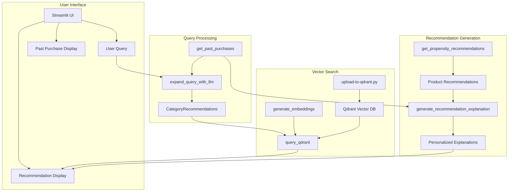
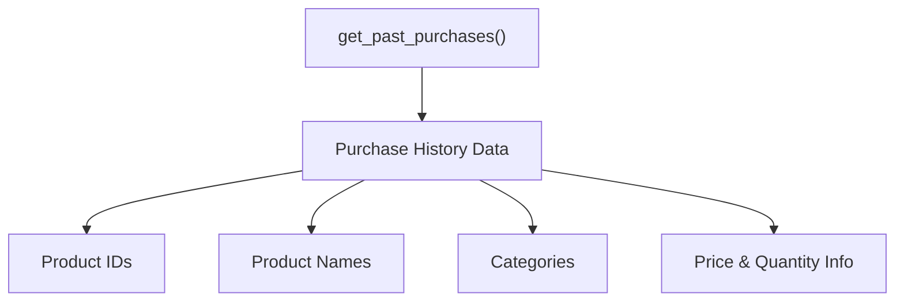
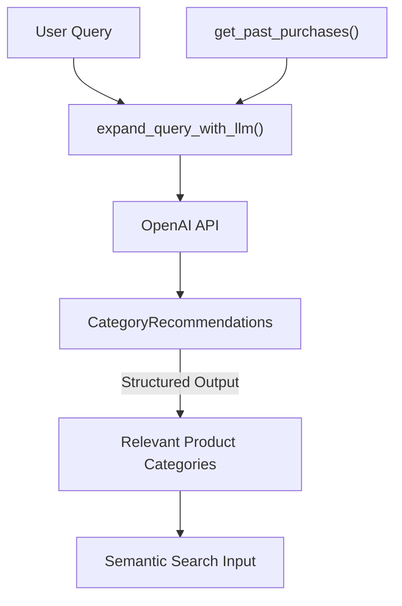
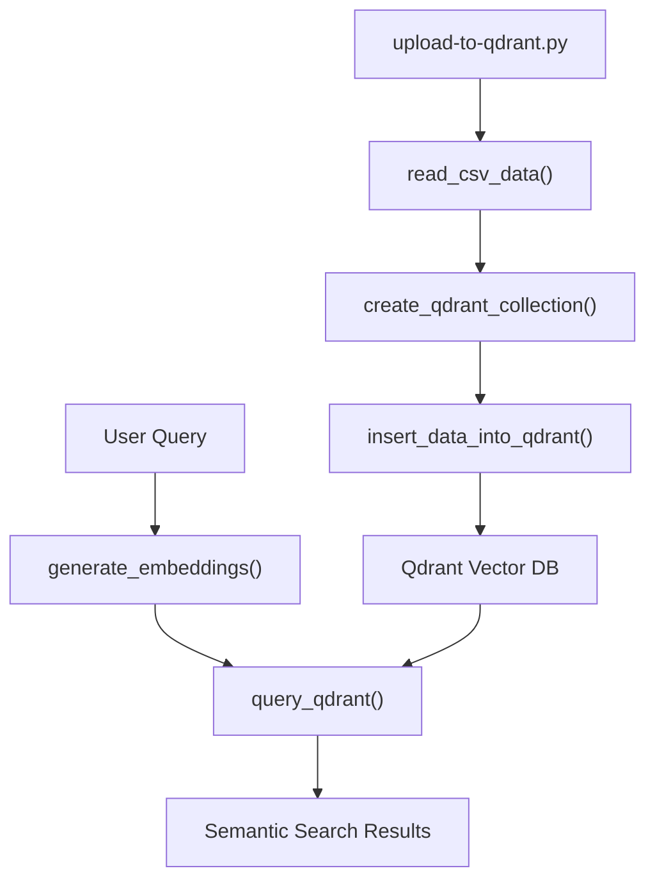
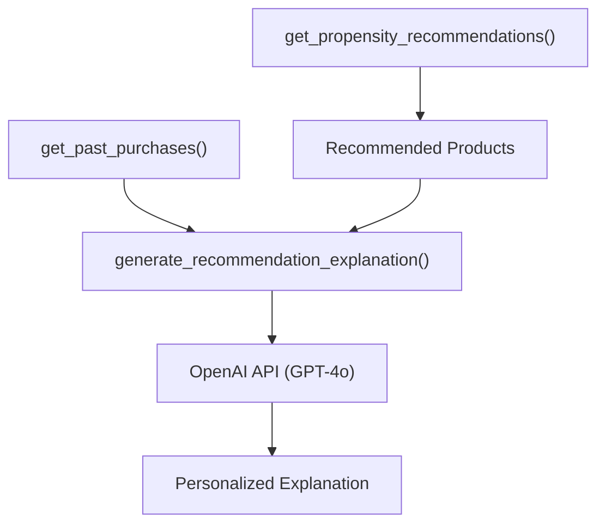
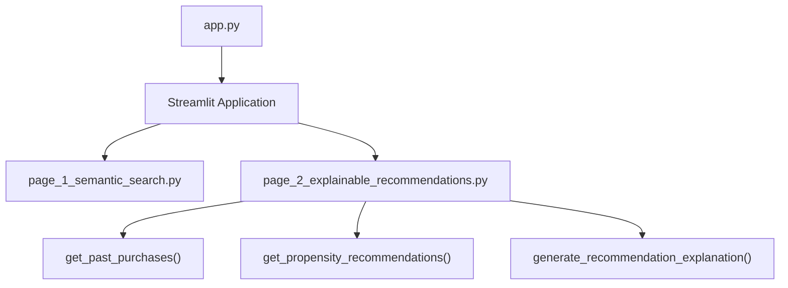
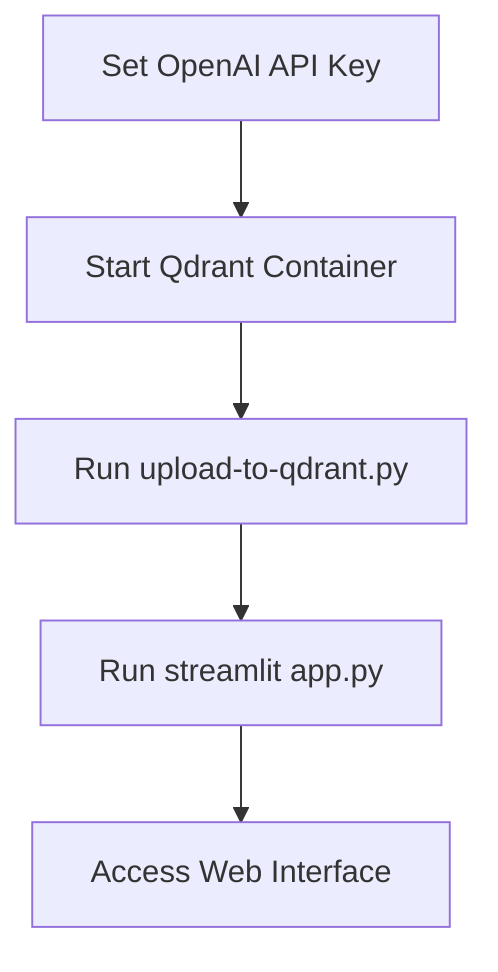

<!-- source: DeepWiki mcp.deepwiki.com · repo openai/build-hours · page 2 Recommendation System · fetched 2026-10-26 -->

# Recommendation System

Relevant source files

The following files were used as context for generating this wiki page:

- [11-recommendation/README.md](11-recommendation/README.md)
- [11-recommendation/helper_functions.py](11-recommendation/helper_functions.py)
- [11-recommendation/pages/page_1_semantic_search.py](11-recommendation/pages/page_1_semantic_search.py)
- [11-recommendation/pages/page_2_explainable_recommendations.py](11-recommendation/pages/page_2_explainable_recommendations.py)
- [11-recommendation/upload-to-qdrant.py](11-recommendation/upload-to-qdrant.py)

## Introduction

The Recommendation System is an LLM-enhanced product recommendation platform that combines traditional recommendation techniques with GPT-4o capabilities to provide personalized, explainable product recommendations. The system demonstrates two key enhancements that LLMs bring to recommendation engines:

1. **Contextual Understanding**: Using LLMs to expand user queries with additional context to improve search relevance
2. **Recommendation Explainability**: Generating natural language explanations for why specific products are being recommended

The system is implemented as a Streamlit web application with a Qdrant vector database backend for semantic search capabilities.

Sources: [11-recommendation/README.md:1-5](), [11-recommendation/app.py:13-18]()

## System Architecture

### High-Level Architecture Diagram

Sources: [11-recommendation/helper_functions.py:19-168](), [11-recommendation/helper_functions.py:246-322](), [11-recommendation/helper_functions.py:323-387](), [11-recommendation/helper_functions.py:390-492](), [11-recommendation/upload-to-qdrant.py:1-132]()

## Core Components

The recommendation system consists of four primary components that work together to deliver personalized product recommendations:

### 1. User Context Management

The system maintains user context through the `get_past_purchases()` function, which retrieves the user's purchase history. This historical data serves as a foundation for personalizing both search results and recommendation explanations.

Sources: [11-recommendation/helper_functions.py:19-194]()

### 2. Query Expansion with LLM

The query expansion component uses GPT-4o to analyze user queries and expand them with relevant product categories, enhancing search relevance.

The `expand_query_with_llm()` function:
- Takes a user query and purchase history as inputs
- Uses GPT-4o with structured outputs (via the `CategoryRecommendations` model)
- Returns enriched categories relevant to both the query and purchase history
- Biases recommendations toward categories complementary to past purchases

Sources: [11-recommendation/helper_functions.py:246-322](), [11-recommendation/helper_functions.py:198-245]()

### 3. Vector Database Integration

The system uses Qdrant as a vector database for semantic search, with integration handled by several components:

Key functions:
- `generate_embeddings()`: Converts text to vector embeddings using OpenAI's embedding models
- `query_qdrant()`: Performs semantic search on product data using embeddings and category filters
- Data upload process in `upload-to-qdrant.py` creates the collection and loads product data from CSV

Sources: [11-recommendation/helper_functions.py:323-387](), [11-recommendation/upload-to-qdrant.py:1-132]()

### 4. Recommendation Explanation Generation

The recommendation explanation component enhances traditional recommendation algorithms by adding natural language explanations for why products are being recommended.

The `generate_recommendation_explanation()` function:
- Takes a recommended product and user's purchase history
- Creates a prompt for GPT-4o that includes product details and purchase context
- Returns a concise, personalized explanation connecting the recommendation to user preferences
- Limits explanations to two sentences for readability

Sources: [11-recommendation/helper_functions.py:461-492](), [11-recommendation/helper_functions.py:390-460]()

## Implementation Details

### Data Model

The system uses several structured data models to organize information:

| Component | Data Structure | Purpose |
|-----------|----------------|---------|
| Product Data | Dictionary | Contains product details including ID, name, category, price |
| Past Purchases | List of Dictionaries | Represents user's purchase history |
| Category Enum | Enum | Defines valid product categories for structured outputs |
| Category | Pydantic Model | Represents a product category with item and description |
| CategoryRecommendations | Pydantic Model | Contains list of Category objects for structured output |

Sources: [11-recommendation/helper_functions.py:198-249](), [11-recommendation/helper_functions.py:19-194]()

### User Interface

The system is implemented as a Streamlit application with two main pages:

1. **Semantic Search Page**
   - Allows users to enter queries
   - Shows expanded categories from LLM processing
   - Displays semantic search results

2. **Explainable Recommendations Page**
   - Displays user's purchase history
   - Shows recommended products with scores
   - Provides on-demand explanations for recommendations

The explainable recommendations page displays both the recommended products and allows users to generate explanations on demand through a button interface.

Sources: [11-recommendation/pages/page_2_explainable_recommendations.py:1-60](), [11-recommendation/app.py:1-18]()

## Configuration and Setup

The recommendation system requires the following components to be configured:

1. **OpenAI API**: For generating embeddings and LLM responses
2. **Qdrant Vector Database**: For storing and querying product vectors
3. **Product Data**: CSV file with product information

Setup steps:
1. Configure environment variables in `config.py`
2. Start Qdrant using Docker
3. Upload product data using `upload-to-qdrant.py`
4. Launch the Streamlit application with `streamlit run app.py`

Sources: [11-recommendation/README.md:6-47](), [11-recommendation/upload-to-qdrant.py:120-132]()

## Data Flow

The recommendation system handles data through the following flow:

1. **Setup Phase**:
   - Product data is loaded into Qdrant with embedded descriptions
   - Categories are pre-defined in the `CategoryEnum`

2. **Query Phase**:
   - User enters a query in the Streamlit UI
   - Query is expanded using `expand_query_with_llm()`
   - Expanded categories guide semantic search in Qdrant
   - Results are displayed to the user

3. **Recommendation Phase**:
   - System retrieves propensity-based recommendations
   - User requests explanations for recommendations
   - Explanations are generated using `generate_recommendation_explanation()`
   - Recommendations and explanations are displayed to the user

The system maintains user state across sessions using Streamlit's session state functionality, allowing explanations to persist during user interaction.

Sources: [11-recommendation/helper_functions.py:246-322](), [11-recommendation/helper_functions.py:461-492](), [11-recommendation/pages/page_2_explainable_recommendations.py:15-57]()

---

