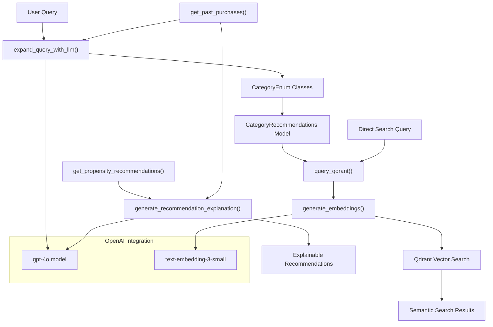
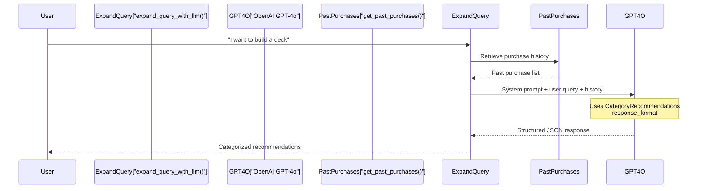
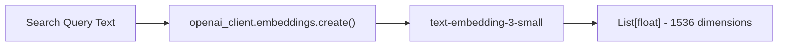
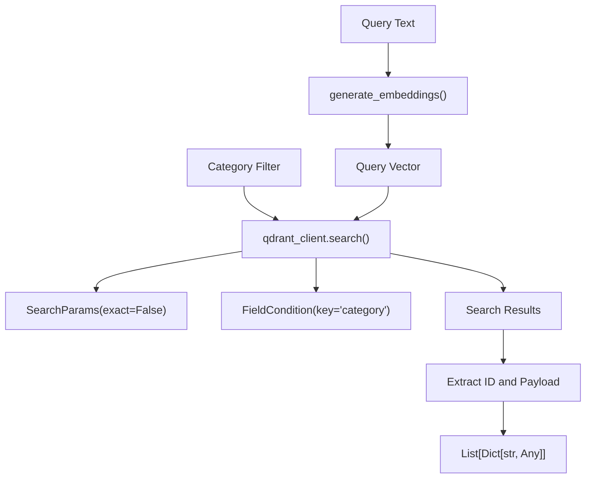
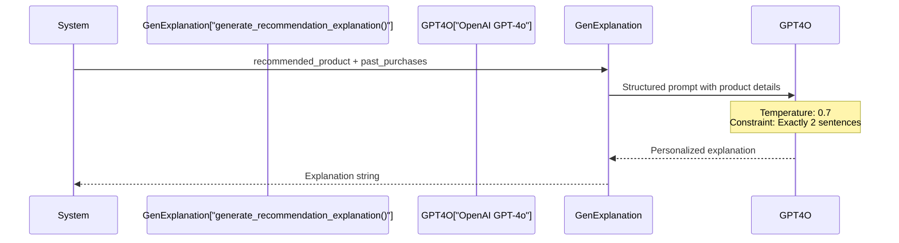
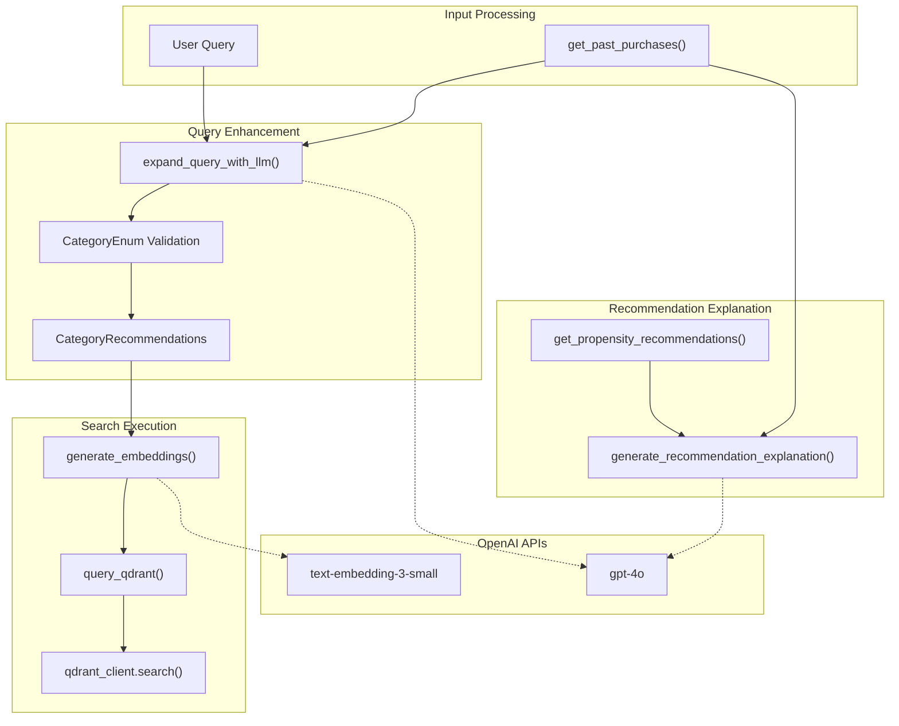

<!-- source: DeepWiki mcp.deepwiki.com · repo openai/build-hours · page 2.1 Core Recommendation Functions · fetched 2026-10-26 -->

# Core Recommendation Functions

Relevant source files

The following files were used as context for generating this wiki page:

- [11-recommendation/README.md](11-recommendation/README.md)
- [11-recommendation/helper_functions.py](11-recommendation/helper_functions.py)
- [11-recommendation/pages/page_1_semantic_search.py](11-recommendation/pages/page_1_semantic_search.py)
- [11-recommendation/pages/page_2_explainable_recommendations.py](11-recommendation/pages/page_2_explainable_recommendations.py)
- [11-recommendation/upload-to-qdrant.py](11-recommendation/upload-to-qdrant.py)

## Purpose and Scope

This document covers the core algorithmic components of the LLM-enhanced recommendation system, including query expansion, semantic search, and explainable recommendations. These functions form the foundation of the recommendation engine by combining traditional vector similarity search with large language model capabilities for improved contextual understanding and user experience.

For information about the vector database setup and configuration, see [Qdrant Vector Database Integration](#2.3). For details about the user interface and system deployment, see [Recommendation System Configuration](#2.4).

## Recommendation System Architecture

The core recommendation system operates through three primary algorithmic pathways: query expansion for contextual understanding, semantic search for product retrieval, and explanation generation for recommendation transparency.

Sources: [11-recommendation/helper_functions.py:1-493](), [11-recommendation/README.md:1-48]()

## Query Expansion System

The query expansion system transforms ambiguous user queries into structured category recommendations using GPT-4o with Pydantic structured outputs. The `expand_query_with_llm()` function processes natural language input and returns categorized recommendations.

### Structured Output Models

The system uses Pydantic models to constrain LLM responses to predefined product categories:

| Model | Purpose | Key Fields |
|-------|---------|------------|
| `CategoryEnum` | Defines valid product categories | 41 predefined categories (Tools, Hardware, Paint, etc.) |
| `Category` | Individual category recommendation | `item` (CategoryEnum), `description` (str) |
| `CategoryRecommendations` | Response container | `categories` (List[Category]) |

### Query Expansion Algorithm

The function incorporates past purchase history to bias recommendations toward complementary products while maintaining relevance to the user's stated goals.

Sources: [11-recommendation/helper_functions.py:250-322](), [11-recommendation/helper_functions.py:201-248]()

## Semantic Search Implementation

The semantic search system combines OpenAI embeddings with Qdrant vector similarity search to retrieve relevant products within specific categories.

### Embedding Generation

The `generate_embeddings()` function creates vector representations using OpenAI's `text-embedding-3-small` model:

### Vector Search Process

The `query_qdrant()` function performs filtered similarity search:

1. **Embedding Generation**: Converts query text to vector using `generate_embeddings()`
2. **Category Filtering**: Applies `models.Filter` with `FieldCondition` for category matching
3. **Similarity Search**: Executes vector search with configurable `top_k` parameter
4. **Result Processing**: Returns product IDs and payload data

Sources: [11-recommendation/helper_functions.py:324-334](), [11-recommendation/helper_functions.py:337-387]()

## Explainable Recommendations

The explanation system generates personalized reasoning for product recommendations by analyzing the relationship between recommended items and user purchase history.

### Recommendation Generation

The `get_propensity_recommendations()` function provides mock propensity-scored recommendations with predicted scores ranging from 0.8 to 1.0. In production systems, this would be replaced with actual machine learning models.

### Explanation Algorithm

The `generate_recommendation_explanation()` function uses GPT-4o to create contextual explanations:

The explanation prompt instructs the model to:
- Reference user preferences from purchase history
- Generate excitement about the recommended product  
- Maintain concise, positive, and engaging tone
- Produce exactly two sentences per explanation

Sources: [11-recommendation/helper_functions.py:390-459](), [11-recommendation/helper_functions.py:461-492]()

## Core Function Integration

The recommendation system integrates multiple functions through a cohesive data flow that processes user input through contextual expansion, semantic search, and explanation generation.

### Function Dependencies

| Function | Dependencies | Input Types | Output Types |
|----------|-------------|-------------|--------------|
| `expand_query_with_llm()` | `openai_client`, `CategoryRecommendations` | `str`, `List[Dict]` | `str` (JSON) |
| `generate_embeddings()` | `openai_client`, `Config.EMBEDDING_MODEL` | `str` | `List[float]` |
| `query_qdrant()` | `qdrant_client`, `generate_embeddings()` | `str`, `str`, `int` | `List[Dict[str, Any]]` |
| `generate_recommendation_explanation()` | `openai_client` | `Dict[str, Any]`, `List[Dict]` | `str` |
| `get_propensity_recommendations()` | None (mock data) | None | `List[Dict[str, Any]]` |

Sources: [11-recommendation/helper_functions.py:1-493](), [11-recommendation/config.py]()

---

