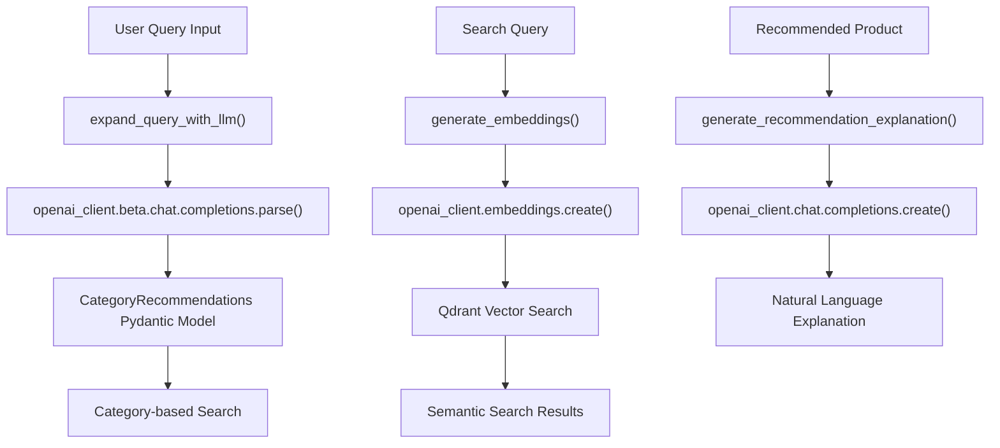
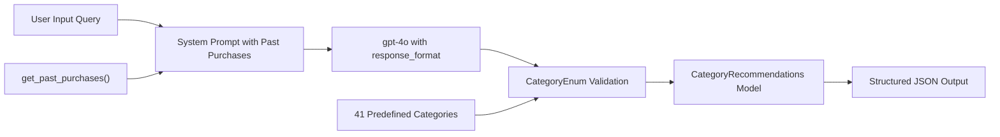
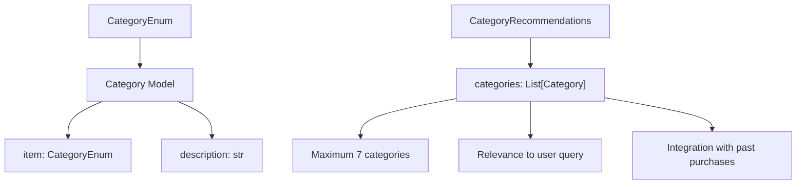
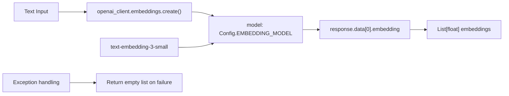
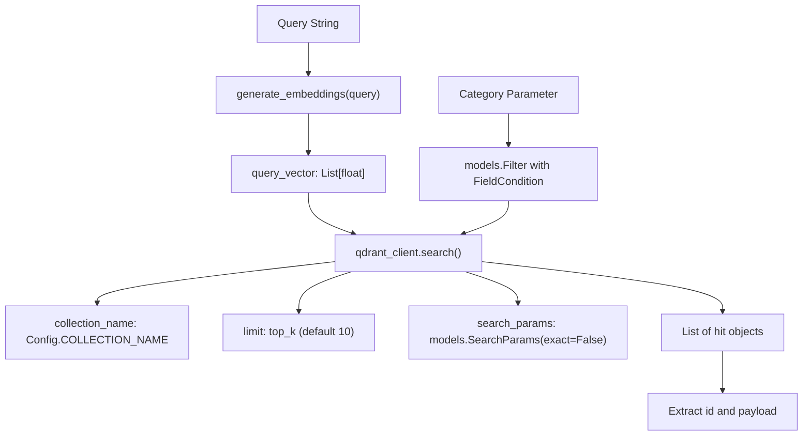
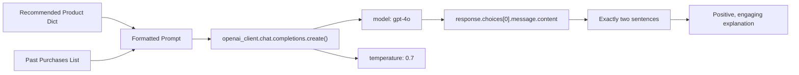
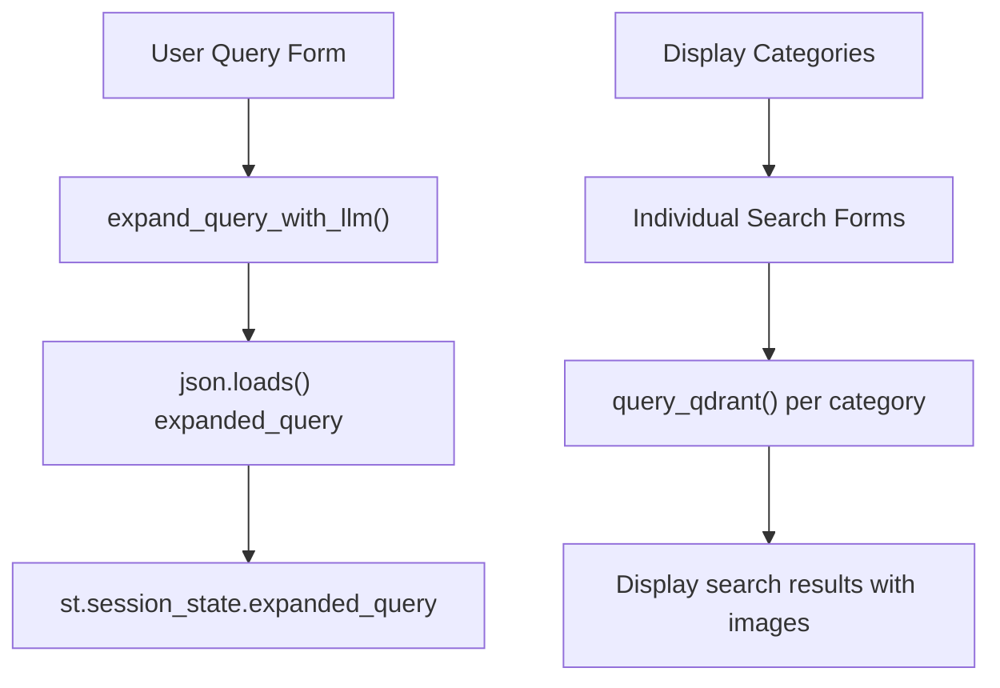
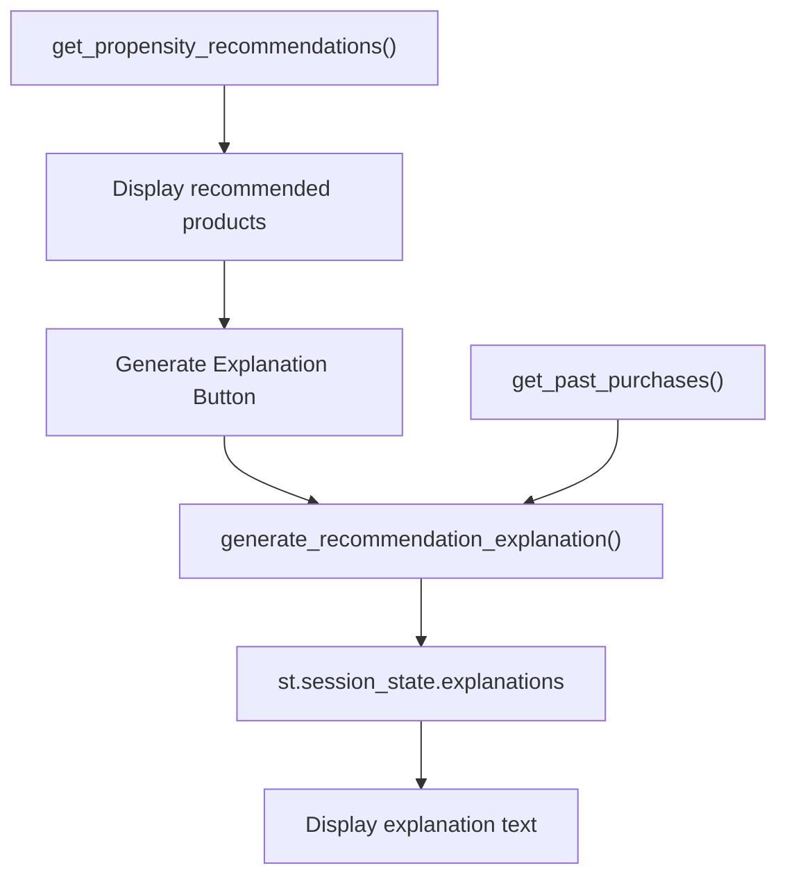

<!-- source: DeepWiki mcp.deepwiki.com · repo openai/build-hours · page 2.2 LLM Integration and Semantic Search · fetched 2026-10-26 -->

# LLM Integration and Semantic Search

<details>
<summary>Relevant source files</summary>

The following files were used as context for generating this wiki page:

- [11-recommendation/README.md](11-recommendation/README.md)
- [11-recommendation/helper_functions.py](11-recommendation/helper_functions.py)
- [11-recommendation/pages/page_1_semantic_search.py](11-recommendation/pages/page_1_semantic_search.py)
- [11-recommendation/pages/page_2_explainable_recommendations.py](11-recommendation/pages/page_2_explainable_recommendations.py)
- [11-recommendation/upload-to-qdrant.py](11-recommendation/upload-to-qdrant.py)

</details>


This document covers the LLM integration components and semantic search capabilities within the recommendation system. It focuses on how OpenAI APIs are leveraged for query expansion, embedding generation, and recommendation explanations. For the core recommendation algorithms, see [Core Recommendation Functions](#2.1). For vector database operations, see [Qdrant Vector Database Integration](#2.3).

## LLM Integration Architecture

The system integrates multiple OpenAI API endpoints to enhance the recommendation experience through natural language understanding and generation.

### OpenAI API Integration Pattern



Sources: [11-recommendation/helper_functions.py:305-318](), [11-recommendation/helper_functions.py:324-334](), [11-recommendation/helper_functions.py:485-492]()

### Core LLM Integration Components

| Component | OpenAI Model | Purpose | Input | Output |
|-----------|--------------|---------|-------|--------|
| `expand_query_with_llm` | `gpt-4o` | Query expansion with structured outputs | User query + past purchases | `CategoryRecommendations` JSON |
| `generate_embeddings` | `text-embedding-3-small` | Vector embedding generation | Text string | List of floats (embeddings) |
| `generate_recommendation_explanation` | `gpt-4o` | Recommendation explanations | Product + purchase history | Natural language explanation |

Sources: [11-recommendation/helper_functions.py:250-321](), [11-recommendation/helper_functions.py:324-334](), [11-recommendation/helper_functions.py:461-492]()

## Query Expansion System

The query expansion system transforms ambiguous user queries into structured category recommendations using OpenAI's structured outputs feature.

### Query Expansion Flow



Sources: [11-recommendation/helper_functions.py:250-321](), [11-recommendation/helper_functions.py:201-248]()

### Structured Output Schema

The system uses Pydantic models to enforce structured responses from the LLM:



The `CategoryEnum` defines 41 predefined categories including:
- `TOOLS_HAND_TOOLS`, `TOOLS_POWER_TOOLS`, `TOOLS_GARDEN_TOOLS`
- `HARDWARE_FASTENERS`, `HARDWARE_BRACKETS_SUPPORTS`
- `PAINT_INTERIOR_PAINT`, `PAINT_EXTERIOR_PAINT`
- `BUILDING_MATERIALS_LUMBER`, `BUILDING_MATERIALS_DRYWALL`
- `PLUMBING_PIPES_FITTINGS`, `ELECTRICAL_WIRING_CABLES`
- `GARDENING_SOIL_FERTILIZERS`, `OUTDOOR_PATIO_FURNITURE`

Sources: [11-recommendation/helper_functions.py:201-248](), [11-recommendation/helper_functions.py:243-248]()

## Semantic Search Pipeline

The semantic search pipeline combines embedding generation with vector similarity search to find relevant products.

### Embedding Generation Process



Sources: [11-recommendation/helper_functions.py:324-334]()

### Vector Search Implementation



Sources: [11-recommendation/helper_functions.py:337-387]()

### Search Result Processing

The `query_qdrant` function returns structured results:

```python
# Result format from query_qdrant()
results = [
    {
        "id": hit.id,
        "payload": hit.payload
    }
    for hit in search_result
]
```

The payload contains:
- `product_id`: Unique product identifier
- `product_name`: Product name for display
- `category`: Product category for filtering
- `price`: Product price
- `detailed_description`: Full product description

Sources: [11-recommendation/helper_functions.py:376-383]()

## Recommendation Explanation System

The explanation system generates natural language explanations for recommended products using the user's purchase history.

### Explanation Generation Flow



Sources: [11-recommendation/helper_functions.py:461-492]()

### Explanation Prompt Structure

The explanation prompt template includes:
- Product information (name, category)
- User's past purchase history (JSON format)
- Specific constraints:
  - Exactly two sentences
  - Reference purchase history categories
  - Positive and engaging tone
  - Product excitement focus

Sources: [11-recommendation/helper_functions.py:469-483]()

## Integration with Streamlit Pages

The LLM integration functions are used across two main Streamlit pages:

### Page 1: Semantic Search Implementation



Sources: [11-recommendation/pages/page_1_semantic_search.py:42-56](), [11-recommendation/pages/page_1_semantic_search.py:77-79]()

### Page 2: Explainable Recommendations



Sources: [11-recommendation/pages/page_2_explainable_recommendations.py:44-48](), [11-recommendation/pages/page_2_explainable_recommendations.py:55-57]()

## Configuration and Error Handling

The LLM integration uses configuration settings and implements comprehensive error handling:

### Configuration Dependencies

| Setting | Purpose | Default/Usage |
|---------|---------|---------------|
| `Config.EMBEDDING_MODEL` | OpenAI embedding model | Referenced in `generate_embeddings` |
| `Config.QDRANT_HOST` | Qdrant server host | Used in `QdrantClient` initialization |
| `Config.QDRANT_PORT` | Qdrant server port | Used in `QdrantClient` initialization |
| `Config.COLLECTION_NAME` | Qdrant collection name | Used in search operations |

Sources: [11-recommendation/helper_functions.py:11-14](), [11-recommendation/helper_functions.py:329]()

### Error Handling Patterns

All LLM integration functions implement try-catch error handling:
- `expand_query_with_llm`: Returns original query on LLM failure
- `generate_embeddings`: Returns empty list on API failure
- `query_qdrant`: Returns empty list on search failure
- Comprehensive logging with `logger.error()` and `logger.info()`

Sources: [11-recommendation/helper_functions.py:319-321](), [11-recommendation/helper_functions.py:332-334](), [11-recommendation/helper_functions.py:385-387]()

---

