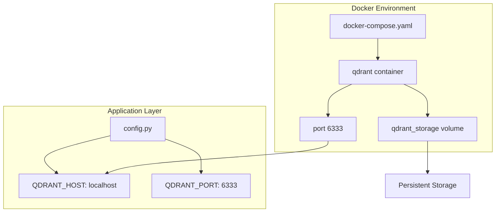
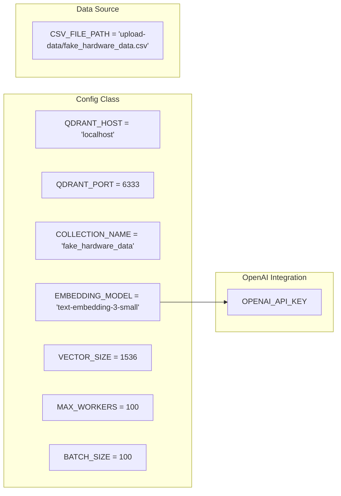
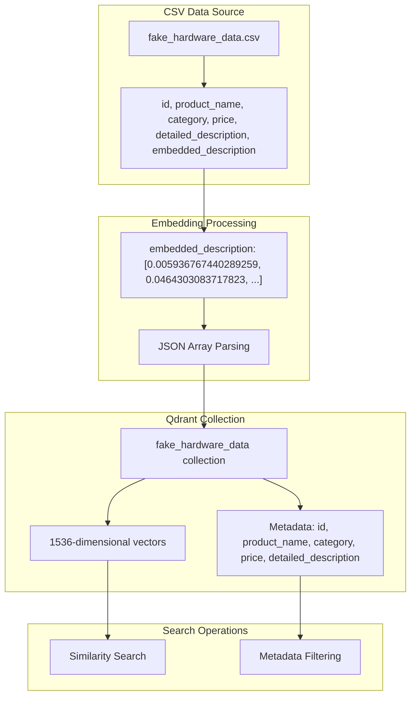
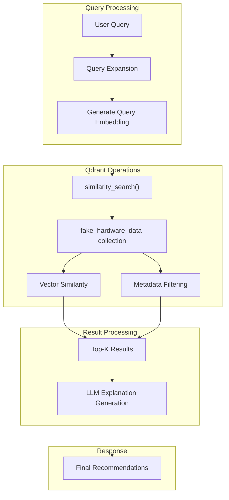
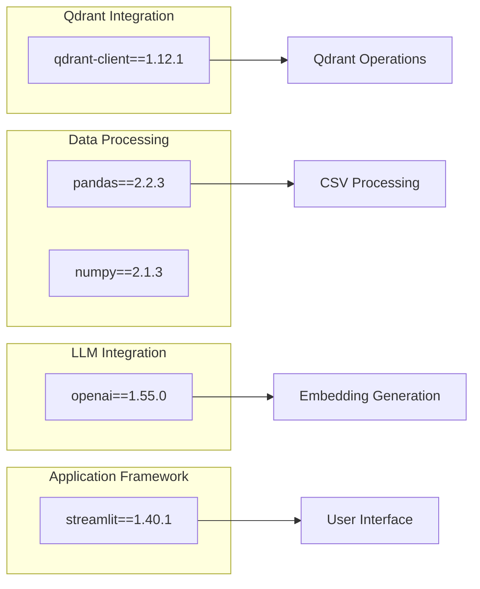

<!-- source: DeepWiki mcp.deepwiki.com · repo openai/build-hours · page 2.3 Qdrant Vector Database Integration · fetched 2026-10-26 -->

# Qdrant Vector Database Integration

Relevant source files

The following files were used as context for generating this wiki page:

- [11-recommendation/app.py](11-recommendation/app.py)
- [11-recommendation/config.py](11-recommendation/config.py)
- [11-recommendation/docker-compose.yaml](11-recommendation/docker-compose.yaml)
- [11-recommendation/images.zip](11-recommendation/images.zip)
- [11-recommendation/requirements.txt](11-recommendation/requirements.txt)
- [11-recommendation/upload-data/fake_hardware_data.csv](11-recommendation/upload-data/fake_hardware_data.csv)

This document covers the Qdrant vector database setup and integration within the recommendation system. It details the infrastructure configuration, embedding storage mechanisms, and vector similarity search capabilities that power the semantic search functionality. For core recommendation algorithms and LLM integration, see [Core Recommendation Functions](#2.1). For overall system configuration, see [Recommendation System Configuration](#2.4).

## Infrastructure Setup

The Qdrant vector database runs as a containerized service managed through Docker Compose, providing persistent vector storage and similarity search capabilities for the recommendation engine.

### Docker Configuration

**Docker Service Configuration**

The Qdrant service is defined in [docker-compose.yaml:3-9]() with the following specifications:

- **Image**: `qdrant/qdrant:v1.3.0`
- **Port Mapping**: Host port 6333 maps to container port 6333
- **Volume**: `qdrant_storage` provides data persistence
- **Restart Policy**: `on-failure` ensures service availability

Sources: [11-recommendation/docker-compose.yaml:1-12]()

## Configuration Management

The `Config` class centralizes all Qdrant-related parameters and provides a single point of configuration for the vector database integration.

### Configuration Parameters

**Key Configuration Values**

| Parameter | Value | Purpose |
|-----------|--------|---------|
| `QDRANT_HOST` | `'localhost'` | Qdrant server hostname |
| `QDRANT_PORT` | `6333` | Qdrant server port |
| `COLLECTION_NAME` | `'fake_hardware_data'` | Vector collection identifier |
| `EMBEDDING_MODEL` | `'text-embedding-3-small'` | OpenAI embedding model |
| `VECTOR_SIZE` | `1536` | Embedding vector dimensions |
| `MAX_WORKERS` | `100` | Concurrent processing limit |
| `BATCH_SIZE` | `100` | Bulk operation batch size |

Sources: [11-recommendation/config.py:3-12]()

## Vector Storage Architecture

The system stores product embeddings in Qdrant with structured metadata, enabling efficient similarity search and filtering capabilities.

### Data Structure and Embedding Format

**Embedding Data Format**

The CSV contains pre-computed embeddings stored as JSON array strings in the `embedded_description` field. Each embedding is a 1536-dimensional vector generated using OpenAI's `text-embedding-3-small` model, as configured in [config.py:9-10]().

Example embedding structure from [fake_hardware_data.csv:2]():
- **Product ID**: `5a7e545d-9662-4700-a2aa-d4a18a07fb00`
- **Vector**: `[0.005936767440289259, 0.0464303083717823, ...]` (1536 dimensions)
- **Metadata**: Product name, category, price, detailed description

Sources: [11-recommendation/upload-data/fake_hardware_data.csv:1-3](), [11-recommendation/config.py:8-10]()

## Integration with Recommendation Pipeline

The Qdrant integration supports the recommendation system's semantic search capabilities through vector similarity operations and metadata-based filtering.

### Search Flow Architecture

**Vector Search Integration Points**

The Qdrant client integrates with the recommendation pipeline through several key operations:

1. **Collection Management**: Creating and configuring the `fake_hardware_data` collection with 1536-dimensional vectors
2. **Bulk Upload**: Processing CSV embeddings and uploading to Qdrant with metadata
3. **Similarity Search**: Performing vector similarity queries with configurable result limits
4. **Metadata Filtering**: Supporting category-based and price-range filtering during search operations

Sources: [11-recommendation/config.py:8](), [11-recommendation/upload-data/fake_hardware_data.csv:1-2]()

## Dependencies and Requirements

The Qdrant integration relies on specific Python packages for client connectivity and data processing.

### Required Packages

**Core Dependencies**

- **qdrant-client v1.12.1**: Primary client library for Qdrant operations
- **pandas v2.2.3**: CSV data processing and manipulation
- **numpy v2.1.3**: Numerical operations for embedding vectors
- **openai v1.55.0**: Embedding generation and LLM integration

Sources: [11-recommendation/requirements.txt:44](), [11-recommendation/requirements.txt:33](), [11-recommendation/requirements.txt:30](), [11-recommendation/requirements.txt:31]()

---

