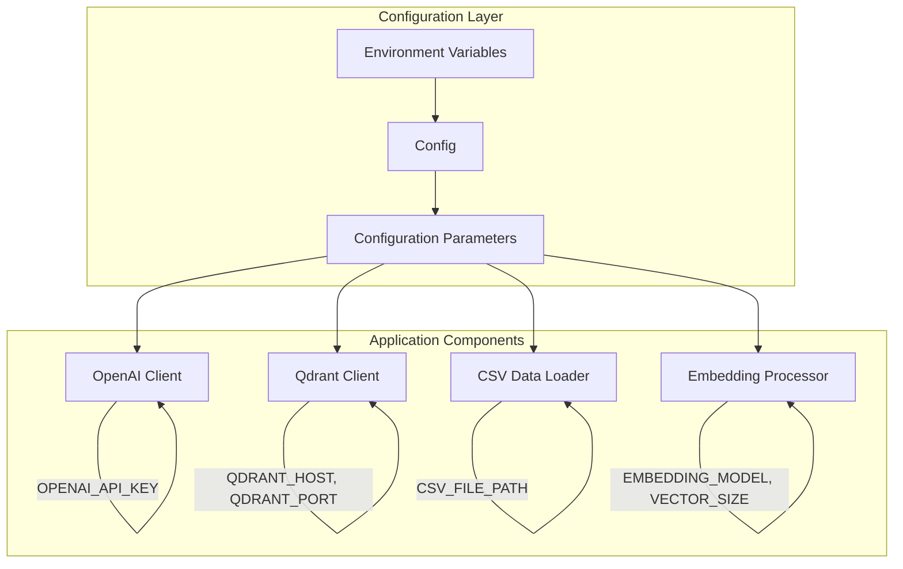
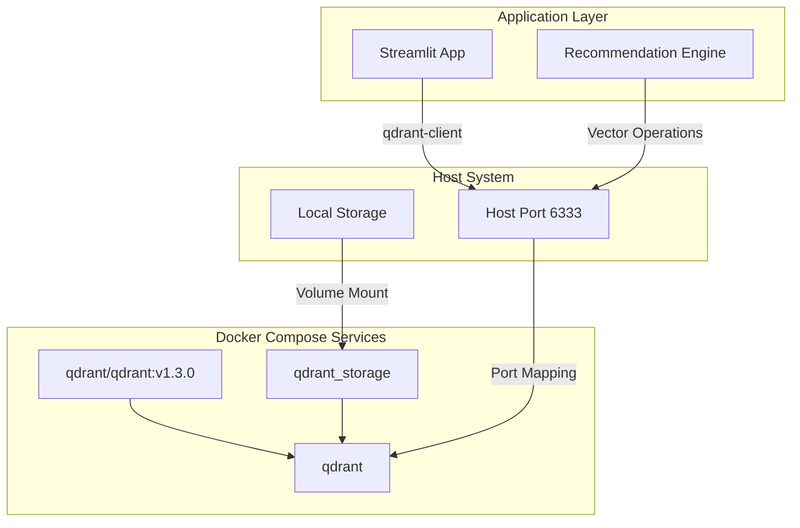
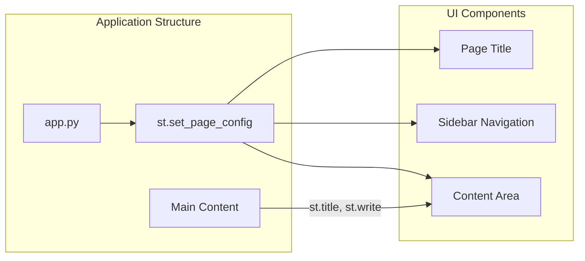
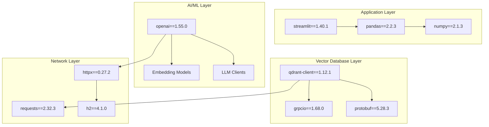
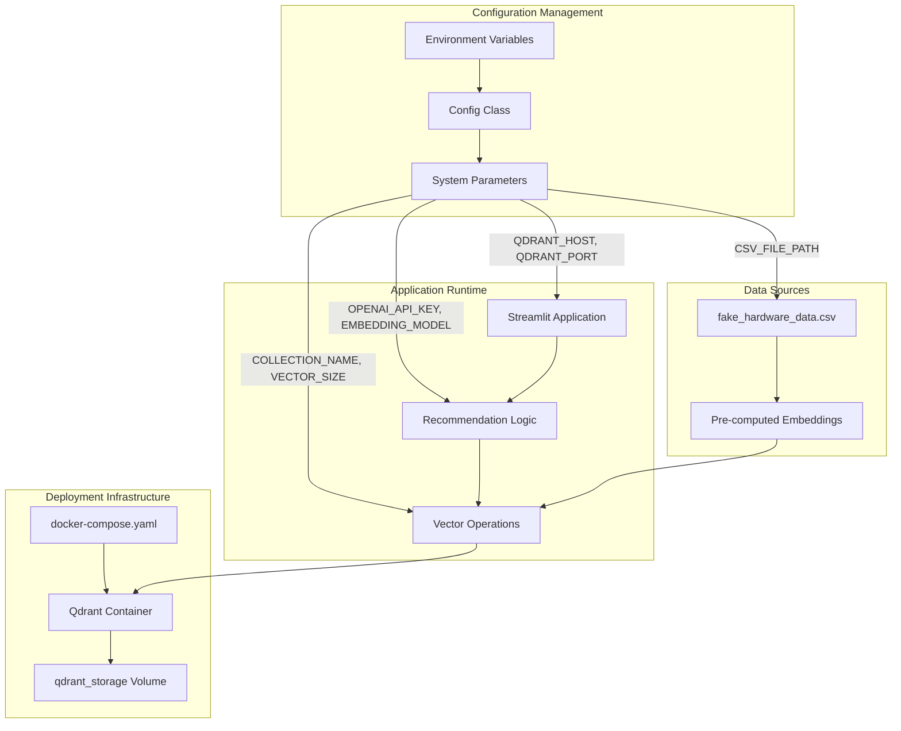

<!-- source: DeepWiki mcp.deepwiki.com · repo openai/build-hours · page 2.4 Recommendation System Configuration · fetched 2026-10-26 -->

# Recommendation System Configuration

Relevant source files

The following files were used as context for generating this wiki page:

- [11-recommendation/app.py](11-recommendation/app.py)
- [11-recommendation/config.py](11-recommendation/config.py)
- [11-recommendation/docker-compose.yaml](11-recommendation/docker-compose.yaml)
- [11-recommendation/images.zip](11-recommendation/images.zip)
- [11-recommendation/requirements.txt](11-recommendation/requirements.txt)
- [11-recommendation/upload-data/fake_hardware_data.csv](11-recommendation/upload-data/fake_hardware_data.csv)

This document covers the configuration management, deployment setup, and system architecture for the recommendation system. It details how configuration parameters are managed, how services are deployed, and how the various system components are integrated.

For information about the core recommendation algorithms, see [Core Recommendation Functions](#2.1). For details about LLM integration, see [LLM Integration and Semantic Search](#2.2). For vector database specifics, see [Qdrant Vector Database Integration](#2.3).

## Configuration Management

The recommendation system uses a centralized configuration approach through the `Config` class, which manages all system parameters including API keys, database connections, and operational settings.

### Configuration Parameters

The system configuration is defined in [11-recommendation/config.py:3-13]() with the following key parameters:

| Parameter | Purpose | Default Value |
|-----------|---------|---------------|
| `OPENAI_API_KEY` | OpenAI API authentication | Environment variable |
| `QDRANT_HOST` | Qdrant vector database host | `localhost` |
| `QDRANT_PORT` | Qdrant vector database port | `6333` |
| `CSV_FILE_PATH` | Data source file location | `upload-data/fake_hardware_data.csv` |
| `COLLECTION_NAME` | Qdrant collection identifier | `fake_hardware_data` |
| `EMBEDDING_MODEL` | OpenAI embedding model | `text-embedding-3-small` |
| `VECTOR_SIZE` | Embedding dimension size | `1536` |
| `MAX_WORKERS` | Concurrent processing limit | `100` |
| `BATCH_SIZE` | Batch processing size | `100` |

### Configuration Architecture

**Sources:** [11-recommendation/config.py:1-13]()

## Deployment Architecture

The system uses Docker Compose for container orchestration, providing a consistent deployment environment across different platforms.

### Container Services

The deployment configuration is defined in [11-recommendation/docker-compose.yaml:1-12]() and includes:

#### Qdrant Vector Database Service

The Qdrant service configuration includes:
- **Image**: `qdrant/qdrant:v1.3.0` for vector database functionality
- **Port Mapping**: Host port `6333` mapped to container port `6333`
- **Volume Persistence**: `qdrant_storage` volume for data persistence
- **Restart Policy**: `on-failure` for automatic recovery

**Sources:** [11-recommendation/docker-compose.yaml:1-12]()

## Application Configuration

The Streamlit application provides the user interface and is configured in [11-recommendation/app.py:1-19]() with specific UI settings.

### Streamlit Configuration

The application uses `st.set_page_config()` with the following parameters:

| Setting | Value | Purpose |
|---------|-------|---------|
| `page_title` | "Recommendations with LLMs" | Browser tab title |
| `page_icon` | ":rocket:" | Browser tab icon |
| `layout` | "wide" | Full-width layout |
| `initial_sidebar_state` | "expanded" | Sidebar visibility |

### Application Entry Points

**Sources:** [11-recommendation/app.py:6-18]()

## Dependencies and Environment

The system dependencies are managed through [11-recommendation/requirements.txt:1-59]() with key packages for different system components.

### Core Dependencies

| Category | Packages | Purpose |
|----------|----------|---------|
| **AI/ML** | `openai==1.55.0` | OpenAI API integration |
| **Vector Database** | `qdrant-client==1.12.1` | Qdrant vector operations |
| **Web Framework** | `streamlit==1.40.1` | User interface framework |
| **Data Processing** | `pandas==2.2.3`, `numpy==2.1.3` | Data manipulation |
| **HTTP Client** | `httpx==0.27.2`, `requests==2.32.3` | API communication |

### System Integration Dependencies

**Sources:** [11-recommendation/requirements.txt:1-59]()

## System Architecture Overview

The complete system architecture integrates configuration management, deployment infrastructure, and application components into a cohesive recommendation system.

### End-to-End Configuration Flow

This architecture ensures:
- **Centralized Configuration**: All system parameters managed through the `Config` class
- **Containerized Deployment**: Consistent runtime environment via Docker Compose
- **Scalable Vector Operations**: Dedicated Qdrant service with persistent storage
- **Modular Application Structure**: Clear separation between UI, business logic, and data layers

**Sources:** [11-recommendation/config.py:1-13](), [11-recommendation/docker-compose.yaml:1-12](), [11-recommendation/app.py:1-19](), [11-recommendation/requirements.txt:1-59]()

---

