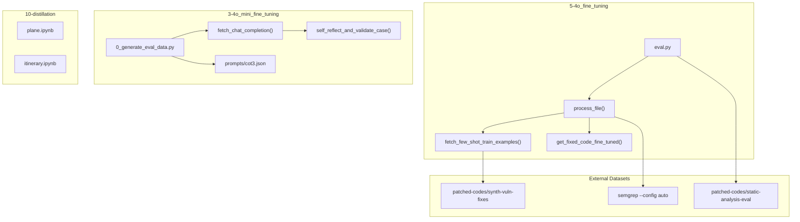
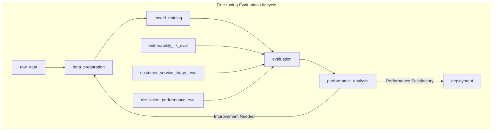

<!-- source: DeepWiki mcp.deepwiki.com · repo openai/build-hours · page 3 Fine-tuning Systems · fetched 2026-10-26 -->

# Fine-tuning Systems

<details>
<summary>Relevant source files</summary>

The following files were used as context for generating this wiki page:

- [.gitignore](.gitignore)
- [3-4o_mini_fine_tuning/0_generate_eval_data.py](3-4o_mini_fine_tuning/0_generate_eval_data.py)
- [3-4o_mini_fine_tuning/prompts/cot3.json](3-4o_mini_fine_tuning/prompts/cot3.json)
- [3-4o_mini_fine_tuning/prompts/verbatim_input.txt](3-4o_mini_fine_tuning/prompts/verbatim_input.txt)
- [5-4o_fine_tuning/README.md](5-4o_fine_tuning/README.md)
- [5-4o_fine_tuning/eval.py](5-4o_fine_tuning/eval.py)
- [5-4o_fine_tuning/example.py](5-4o_fine_tuning/example.py)
- [5-4o_fine_tuning/example_cot.py](5-4o_fine_tuning/example_cot.py)

</details>


This document provides an overview of the fine-tuning systems implemented in the Build Hours repository. These systems demonstrate practical approaches to specializing large language models for specific tasks through fine-tuning, model distillation, and comprehensive evaluation frameworks.

## Overview

The repository contains three distinct fine-tuning approaches, each targeting different use cases and demonstrating various optimization strategies:

| System | Model | Use Case | Key Features |
|--------|-------|----------|--------------|
| GPT-4o Vulnerability Fixes | `gpt-4o` | Static analysis remediation | Semgrep integration, few-shot examples |
| GPT-4o-mini Customer Service | `gpt-4o-mini` | Chat triage classification | Self-reflection validation, CoT prompting |
| Model Distillation | `gpt-4o` → `gpt-4o-mini` | Knowledge transfer | Cost optimization, performance preservation |

### Fine-tuning Systems Architecture



Sources: [5-4o_fine_tuning/eval.py](), [3-4o_mini_fine_tuning/0_generate_eval_data.py](), [5-4o_fine_tuning/README.md](), [3-4o_mini_fine_tuning/prompts/cot3.json]()

## Core Implementation Components

### Static Analysis Integration

The vulnerability fix system integrates directly with `semgrep` for automated security analysis:

```mermaid
flowchart TD
    subgraph "process_file() Workflow"
        input_file["input_file.py"]
        semgrep_scan["semgrep --config auto"]
        tmp_file["output.json"]
        vulnerability_found["data.results[0]"]
        prompt_construction["vulnerability report + original code"]
        few_shot_retrieval["fetch_few_shot_train_examples()"]
        model_call["get_fixed_code_fine_tuned()"]
        fixed_code["corrected code"]
        verification["semgrep rescan"]
        success_check["len(data.results) == 0"]
    end
    
    input_file --> semgrep_scan
    semgrep_scan --> tmp_file
    tmp_file --> vulnerability_found
    vulnerability_found --> prompt_construction
    prompt_construction --> few_shot_retrieval
    few_shot_retrieval --> model_call
    model_call --> fixed_code
    fixed_code --> verification
    verification --> success_check
```



Sources: [5-4o_fine_tuning/eval.py:137-254]()

### Evaluation Data Generation Pipeline

The customer service triage system uses a sophisticated data generation approach with self-reflection:

```mermaid
flowchart TD
    subgraph "0_generate_eval_data.py Pipeline"
        meta_prompt["SYS_PROMPT + USER_PROMPT"]
        thread_executor["ThreadPoolExecutor"]
        gpt4o_generation["fetch_chat_completion()"]
        initial_cases["all_cases[]"]
        reflection_loop["n_self_reflection_loops"]
        self_critique["self_reflect_and_validate_case()"]
        validation_check["is_original_case_correct"]
        case_correction["updated_case"]
        final_dataset["CSV output"]
    end
    
    meta_prompt --> thread_executor
    thread_executor --> gpt4o_generation
    gpt4o_generation --> initial_cases
    initial_cases --> reflection_loop
    reflection_loop --> self_critique
    self_critique --> validation_check
    validation_check --> case_correction
    case_correction --> final_dataset
```



Sources: [3-4o_mini_fine_tuning/0_generate_eval_data.py:115-267]()

## System Configuration and Parameters

### Vulnerability Fix System Configuration

The `eval.py` script supports multiple evaluation modes:

| Parameter | Default | Description |
|-----------|---------|-------------|
| `--model` | `gpt-4o-mini` | OpenAI model name (base or fine-tuned) |
| `--n_shot` | `0` | Number of few-shot examples |
| `--use_similarity` | `False` | Enable similarity-based example retrieval |

Example usage:
```bash
python eval.py --model gpt-4o --n_shot 5 --use_similarity
```

Sources: [5-4o_fine_tuning/eval.py:298-314](), [5-4o_fine_tuning/README.md:33-37]()

### Customer Service Data Generation Parameters

The data generation script uses configurable parameters:

| Parameter | Value | Purpose |
|-----------|-------|---------|
| `n_samples` | `100` | Number of test cases to generate |
| `n_self_reflection_loops` | `1` | Validation iterations |
| `SYS_PROMPT` | Metaprompt template | Guides test case generation |
| `classes` | 10 categories | Triage classification targets |

Sources: [3-4o_mini_fine_tuning/0_generate_eval_data.py:11-14](), [3-4o_mini_fine_tuning/0_generate_eval_data.py:41-95]()

## Integration with Evaluation Systems

The fine-tuning systems integrate with robust evaluation frameworks to measure performance and ensure quality.



Sources: [5-4o_fine_tuning/eval.py](), [3-4o_mini_fine_tuning/0_generate_eval_data.py](), [10-distillation/itinerary.ipynb:230-291]()

## Best Practices and Considerations

The demonstrated fine-tuning systems highlight several best practices:

1. **Data Quality**: Use self-reflection for validation (as in customer service triage)
2. **Few-Shot Learning**: Use similarity-based retrieval for more relevant examples
3. **Task-Specific Prompting**: Design system prompts that clearly define the task boundaries
4. **Evaluation**: Use objective metrics and validation tools (like semgrep for vulnerability fixes)
5. **Model Selection**: Balance quality, cost, and latency based on application needs
6. **Hybrid Approaches**: Combine fine-tuning with distillation for optimal results

For specific applications of these fine-tuning systems, see the documentation on [Recommendation System](#3), [Shipping Planning Agent System](#5.1), and [Assistant Demos](#6).

---

