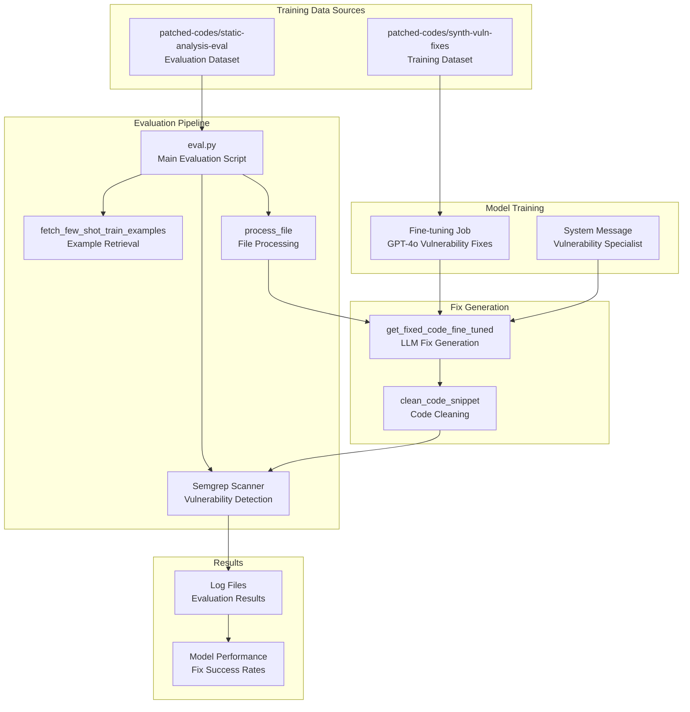
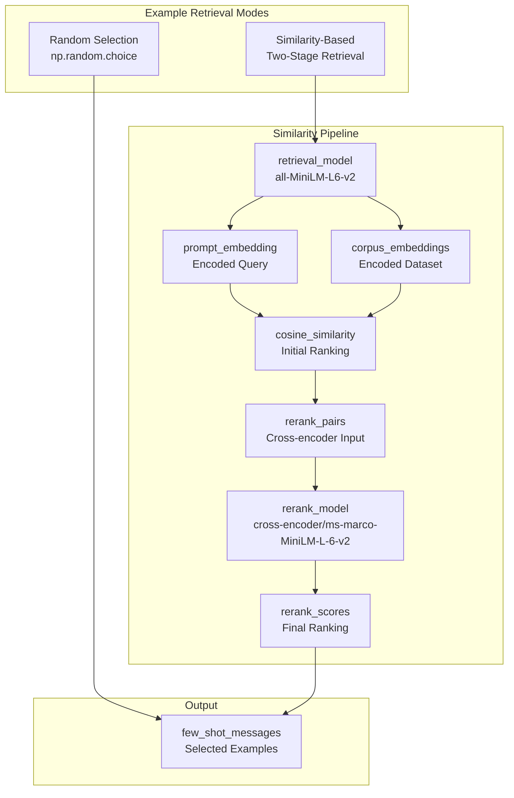
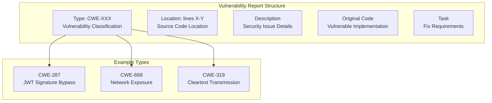
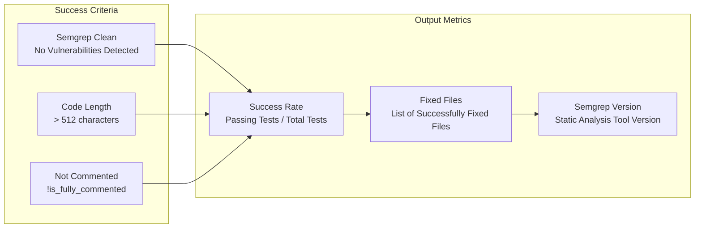
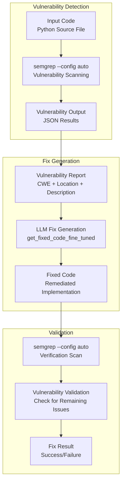

<!-- source: DeepWiki mcp.deepwiki.com · repo openai/build-hours · page 3.1 GPT-4o for Vulnerability Fixes · fetched 2026-10-26 -->

# GPT-4o for Vulnerability Fixes

<details>
<summary>Relevant source files</summary>

The following files were used as context for generating this wiki page:

- [5-4o_fine_tuning/README.md](5-4o_fine_tuning/README.md)
- [5-4o_fine_tuning/eval.py](5-4o_fine_tuning/eval.py)
- [5-4o_fine_tuning/example.py](5-4o_fine_tuning/example.py)
- [5-4o_fine_tuning/example_cot.py](5-4o_fine_tuning/example_cot.py)
- [5-4o_fine_tuning/logs/ft_gpt-4o-2024-08-06_openai-gtm_vulnfixes0821-long_9ymKVX9n-0-shot_20240825_2220.log](5-4o_fine_tuning/logs/ft_gpt-4o-2024-08-06_openai-gtm_vulnfixes0821-long_9ymKVX9n-0-shot_20240825_2220.log)
- [5-4o_fine_tuning/logs/gpt-4o-5-shot_20240822_2310.log](5-4o_fine_tuning/logs/gpt-4o-5-shot_20240822_2310.log)

</details>


This document covers the GPT-4o fine-tuning system for static analysis vulnerability remediation, demonstrating how to train and evaluate models for automated code security fixes. The system uses synthetic vulnerability datasets to fine-tune GPT-4o for identifying and correcting security issues in Python code.

For general fine-tuning utilities and evaluation tools, see [Fine-tuning Utilities and Evaluation](#3.4). For customer service fine-tuning approaches, see [GPT-4o-mini for Customer Service](#3.2). For broader evaluation frameworks, see [Evaluation and Testing](#5).

## System Overview

The vulnerability fixing system trains GPT-4o to automatically remediate security vulnerabilities identified by static analysis tools. The system integrates with Semgrep for vulnerability detection and uses structured evaluation datasets to measure fix quality.



Sources: [5-4o_fine_tuning/README.md:1-58](), [5-4o_fine_tuning/eval.py:1-357]()

## Core Evaluation Framework

The evaluation system processes vulnerable code files through a comprehensive pipeline that detects vulnerabilities, generates fixes, and validates the remediation effectiveness.

### Evaluation Pipeline Architecture

```mermaid
graph LR
    subgraph "Input Processing"
        TC["test_case<br/>{source, file_name, cwe}"]
        IF["input_file<br/>staticeval/{file_name}"]
    end
    
    subgraph "Vulnerability Detection"
        SC1["semgrep --config auto<br/>Initial Scan"]
        TF1["tmp_file<br/>{file_name}.output.json"]
        VR["Vulnerability Report<br/>{cwe, lines, message}"]
    end
    
    subgraph "Fix Generation"
        PR["prompt<br/>Vulnerability + Original Code"]
        FSE["fetch_few_shot_train_examples<br/>Similarity-based Retrieval"]
        GFC["get_fixed_code_fine_tuned<br/>LLM Fix Generation"]
        OF["output_file<br/>{file_name}_fixed.py"]
    end
    
    subgraph "Validation"
        SC2["semgrep --config auto<br/>Verification Scan"]
        TF2["tmp_file<br/>Results Validation"]
        FL["fixed_files<br/>Success Tracking"]
    end
    
    TC --> IF
    IF --> SC1
    SC1 --> TF1
    TF1 --> VR
    VR --> PR
    PR --> FSE
    FSE --> GFC
    GFC --> OF
    OF --> SC2
    SC2 --> TF2
    TF2 --> FL
```



Sources: [5-4o_fine_tuning/eval.py:137-254]()

### Key Evaluation Functions

| Function | Purpose | Location |
|----------|---------|----------|
| `process_file` | Main file processing pipeline | [5-4o_fine_tuning/eval.py:137-254]() |
| `fetch_few_shot_train_examples` | Retrieves training examples for prompting | [5-4o_fine_tuning/eval.py:25-92]() |
| `get_fixed_code_fine_tuned` | Generates vulnerability fixes using LLM | [5-4o_fine_tuning/eval.py:98-135]() |
| `create_log_file` | Records evaluation results and metrics | [5-4o_fine_tuning/eval.py:256-295]() |

## Few-Shot Learning System

The system supports configurable few-shot learning with two retrieval modes for selecting relevant training examples.



Sources: [5-4o_fine_tuning/eval.py:25-92]()

### Configuration Parameters

| Parameter | Default | Purpose |
|-----------|---------|---------|
| `--model` | `gpt-4o-mini` | OpenAI model name (base or fine-tuned) |
| `--n_shot` | `0` | Number of few-shot examples |
| `--use_similarity` | `False` | Enable similarity-based example retrieval |

Sources: [5-4o_fine_tuning/eval.py:298-315]()

## Training Data Structure

The system uses structured conversation formats for training the vulnerability fixing model.

### System Message Template

The core system message defines the model's role and behavior:

```
You are an AI assistant specialized in fixing code vulnerabilities. 
Your task is to provide corrected code that addresses the reported security issue. 
Always maintain the original functionality while improving security. 
Be precise and make only necessary changes. 
Maintain the original code style and formatting unless it directly relates to the vulnerability. 
Pay attention to data flow between sources and sinks when provided.
```

Sources: [5-4o_fine_tuning/eval.py:111-118](), [5-4o_fine_tuning/example.py:2-9]()

### Prompt Structure

The user prompts follow a standardized format for vulnerability reporting:



Sources: [5-4o_fine_tuning/README.md:41-49](), [5-4o_fine_tuning/example.py:12-69](), [5-4o_fine_tuning/example_cot.py:7-32]()

## Performance Results

The evaluation logs show model performance across different configurations:

### Model Comparison

| Model | Configuration | Score | Passing Tests | Total Tests |
|-------|---------------|-------|---------------|-------------|
| Fine-tuned GPT-4o | 0-shot | 61.94% | 70/113 | 113 |
| Base GPT-4o | 5-shot | 56.64% | 64/113 | 113 |

Sources: [5-4o_fine_tuning/logs/ft_gpt-4o-2024-08-06_openai-gtm_vulnfixes0821-long_9ymKVX9n-0-shot_20240825_2220.log:1-81](), [5-4o_fine_tuning/logs/gpt-4o-5-shot_20240822_2310.log:1-75]()

### Evaluation Metrics

The system tracks several key metrics:



Sources: [5-4o_fine_tuning/eval.py:222-246](), [5-4o_fine_tuning/eval.py:277-295]()

## Integration with Static Analysis

The system integrates with Semgrep for both vulnerability detection and fix validation:

### Semgrep Integration Flow



Sources: [5-4o_fine_tuning/eval.py:172-246]()

The system validates fixes by ensuring that the remediated code passes Semgrep analysis without triggering the original vulnerability, demonstrating effective security issue resolution.

Sources: [5-4o_fine_tuning/eval.py:232-246](), [5-4o_fine_tuning/README.md:6-7]()

---

