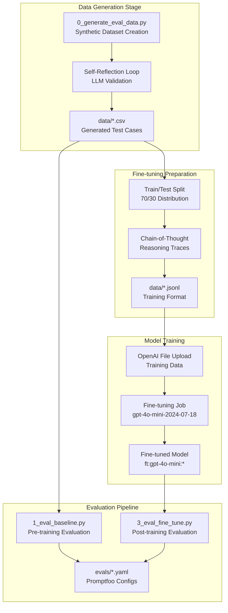
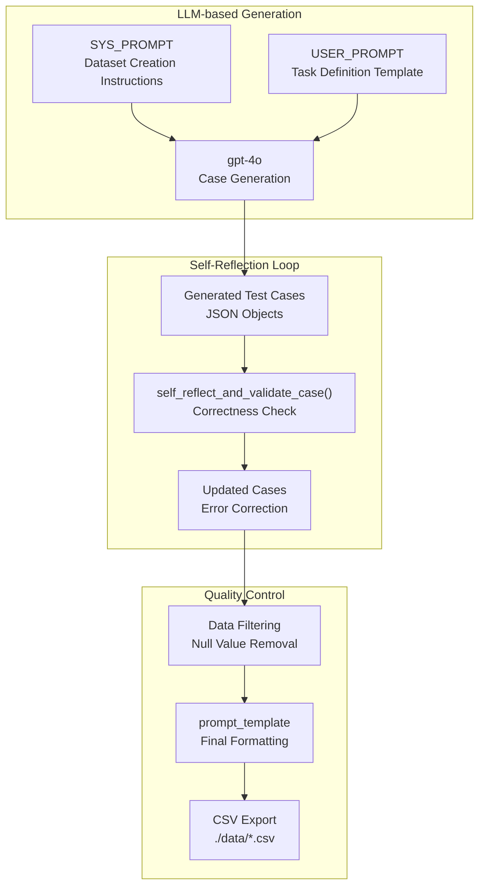
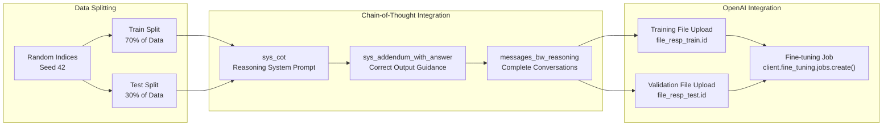
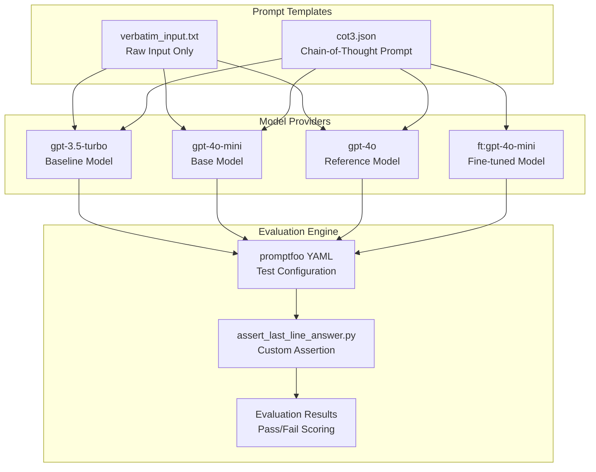
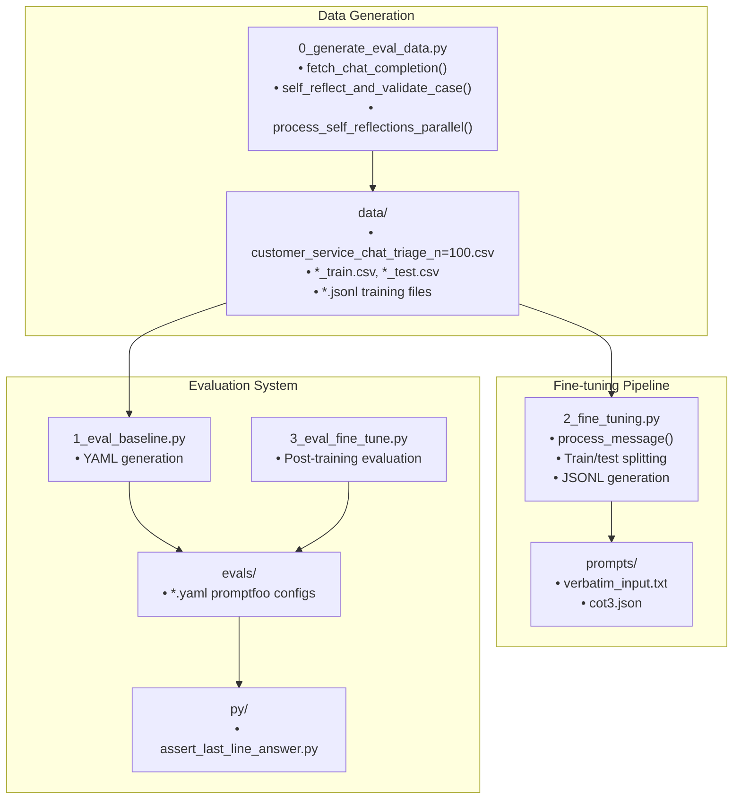

<!-- source: DeepWiki mcp.deepwiki.com · repo openai/build-hours · page 3.2 GPT-4o-mini for Customer Service · fetched 2026-10-26 -->

# GPT-4o-mini for Customer Service

Relevant source files

The following files were used as context for generating this wiki page:

- [.gitignore](.gitignore)
- [3-4o_mini_fine_tuning/0_generate_eval_data.py](3-4o_mini_fine_tuning/0_generate_eval_data.py)
- [3-4o_mini_fine_tuning/1_eval_baseline.py](3-4o_mini_fine_tuning/1_eval_baseline.py)
- [3-4o_mini_fine_tuning/2_fine_tuning.py](3-4o_mini_fine_tuning/2_fine_tuning.py)
- [3-4o_mini_fine_tuning/3_eval_fine_tune.py](3-4o_mini_fine_tuning/3_eval_fine_tune.py)
- [3-4o_mini_fine_tuning/prompts/cot3.json](3-4o_mini_fine_tuning/prompts/cot3.json)
- [3-4o_mini_fine_tuning/prompts/verbatim_input.txt](3-4o_mini_fine_tuning/prompts/verbatim_input.txt)
- [3-4o_mini_fine_tuning/py/assert_last_line_answer.py](3-4o_mini_fine_tuning/py/assert_last_line_answer.py)

## Purpose and Scope

This system demonstrates fine-tuning GPT-4o-mini for customer service chat triage, specifically for classifying technical support tickets for a SaaS product called "Nile Cloud, Inc." The workflow includes synthetic dataset generation, chain-of-thought reasoning integration, fine-tuning execution, and comprehensive evaluation using promptfoo.

For GPT-4o fine-tuning for vulnerability fixes, see [GPT-4o for Vulnerability Fixes](#3.1). For general evaluation frameworks, see [Evaluation and Testing](#5).

## System Architecture and Workflow

The customer service fine-tuning system follows a four-stage pipeline from synthetic data generation through model evaluation:

### Overall System Flow

Sources: [3-4o_mini_fine_tuning/0_generate_eval_data.py:1-267](), [3-4o_mini_fine_tuning/2_fine_tuning.py:1-151](), [3-4o_mini_fine_tuning/1_eval_baseline.py:1-40](), [3-4o_mini_fine_tuning/3_eval_fine_tune.py:1-65]()

## Customer Service Classification Categories

The system classifies customer service tickets into ten predefined categories, each with specific examples and use cases:

| Category | Description | Example Indicators |
|----------|-------------|-------------------|
| Billing and Payments | Invoice and payment issues | "charged twice", "incorrect amount" |
| Cancellation | Service termination requests | "cancel subscription", "end billing cycle" |
| Account Issues | Login and account management | "can't log in", "update email address" |
| Support (Admin Portal) | Administrative interface problems | "admin portal access", "user permissions" |
| Technical Support (Authentication) | Login and security issues | "authentication code", "password reset" |
| Technical Support (Database) | Database-related problems | "query timeouts", "data retrieval errors" |
| Performance and Latency Issues | Speed and responsiveness | "application slow", "loading delays" |
| Technical Support (Web Hosting) | Server and hosting issues | "website down", "deployment help" |
| Security Issues | Security vulnerabilities | "unknown login attempt", "security alert" |
| Legal and Compliance | Regulatory compliance | "GDPR compliance", "data protection laws" |
| Feedback or Feature Request | Product improvements | "new features", "dark mode suggestion" |

Sources: [3-4o_mini_fine_tuning/0_generate_eval_data.py:41-95]()

## Synthetic Data Generation Process

### Data Generation Pipeline

The system uses `gpt-4o` to generate challenging test cases through the `fetch_chat_completion()` function with `ThreadPoolExecutor` for parallel processing. Each generated case includes reasoning, input text, and correct classification.

**Key Parameters:**
- `n_samples = 100` - Number of test cases to generate
- `n_self_reflection_loops = 1` - Validation iterations
- Response format enforced as JSON objects

Sources: [3-4o_mini_fine_tuning/0_generate_eval_data.py:10-13](), [3-4o_mini_fine_tuning/0_generate_eval_data.py:117-136](), [3-4o_mini_fine_tuning/0_generate_eval_data.py:150-179]()

## Fine-tuning Workflow Implementation

### Training Data Preparation

**Chain-of-Thought System Prompt Structure:**
The `sys_cot` prompt guides the model through a 6-step reasoning process:
1. Analyze chat content for primary issues
2. Extract key phrases and concepts
3. Consider each category with confidence scores (1-10)
4. Highlight ambiguity or limitations
5. Synthesize findings and create rationale
6. Output final answer on last line

Sources: [3-4o_mini_fine_tuning/2_fine_tuning.py:21-40](), [3-4o_mini_fine_tuning/2_fine_tuning.py:43-52](), [3-4o_mini_fine_tuning/2_fine_tuning.py:122-137]()

## Evaluation Framework Architecture

### Model Comparison Pipeline

**Custom Assertion Logic:**
The `get_assert()` function in `assert_last_line_answer.py` implements last-line answer extraction with case-insensitive matching against target classifications.

**Evaluation Configuration:**
- Uses YAML format for promptfoo test definitions
- Supports multiple prompt-provider combinations
- Generates comparative performance metrics

Sources: [3-4o_mini_fine_tuning/1_eval_baseline.py:9-29](), [3-4o_mini_fine_tuning/3_eval_fine_tune.py:13-42](), [3-4o_mini_fine_tuning/py/assert_last_line_answer.py:1-21]()

## Core System Components

### File Structure and Responsibilities

**Key Constants and Configuration:**
- `FT_MODEL = "gpt-4o-mini-2024-07-18"` - Base model for fine-tuning
- `n_samples = 100` - Dataset size
- `random.seed(42)` - Reproducible data splits
- Train/test split ratio: 70/30

Sources: [3-4o_mini_fine_tuning/2_fine_tuning.py:13-14](), [3-4o_mini_fine_tuning/0_generate_eval_data.py:11-14](), [.gitignore:6-7]()

## Integration Points and Dependencies

The system integrates with several external services and internal components:

**OpenAI API Integration:**
- `client.chat.completions.create()` for data generation and reasoning traces
- `client.files.create()` for training data upload  
- `client.fine_tuning.jobs.create()` for model training

**Evaluation Framework:**
- Promptfoo YAML configurations for systematic testing
- Custom Python assertions for answer validation
- Multi-model comparison capabilities

**Data Processing:**
- Pandas for CSV manipulation and data splitting
- ThreadPoolExecutor for parallel LLM calls
- JSON/JSONL format handling for OpenAI compatibility

Sources: [3-4o_mini_fine_tuning/2_fine_tuning.py:4-11](), [3-4o_mini_fine_tuning/0_generate_eval_data.py:2-9](), [3-4o_mini_fine_tuning/1_eval_baseline.py:2-5]()

---

