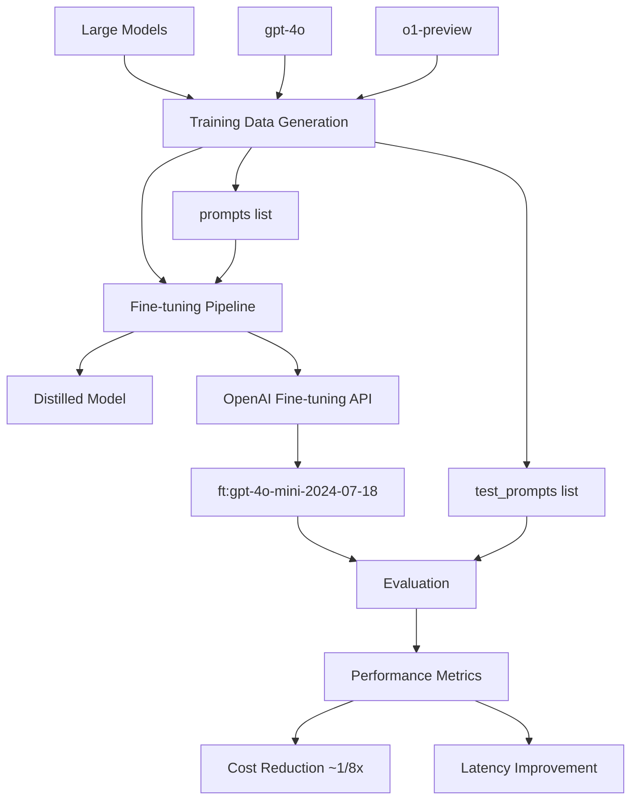
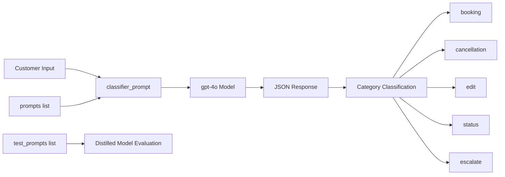
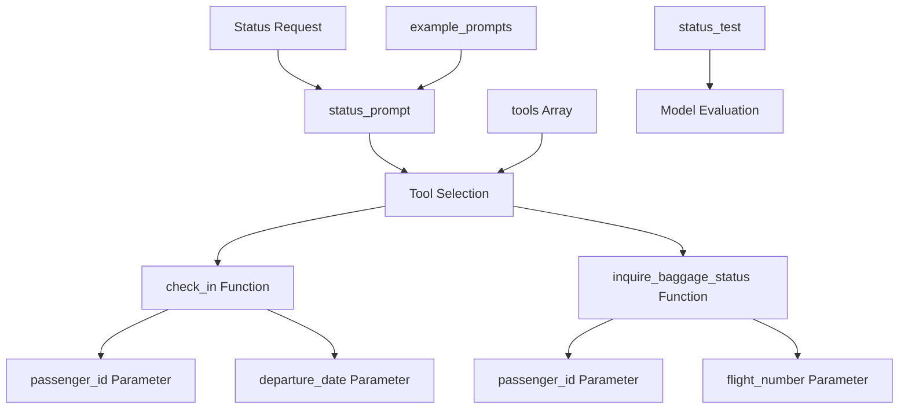
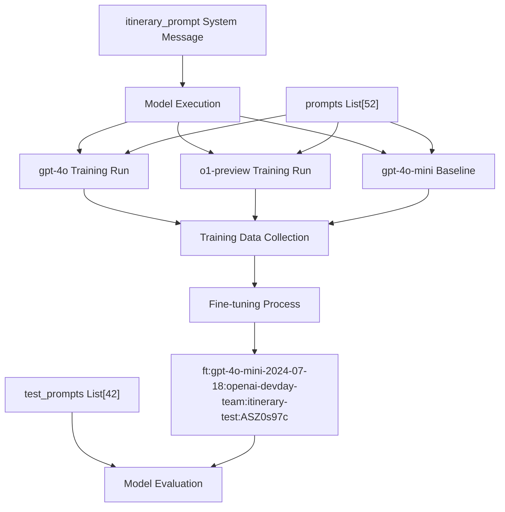
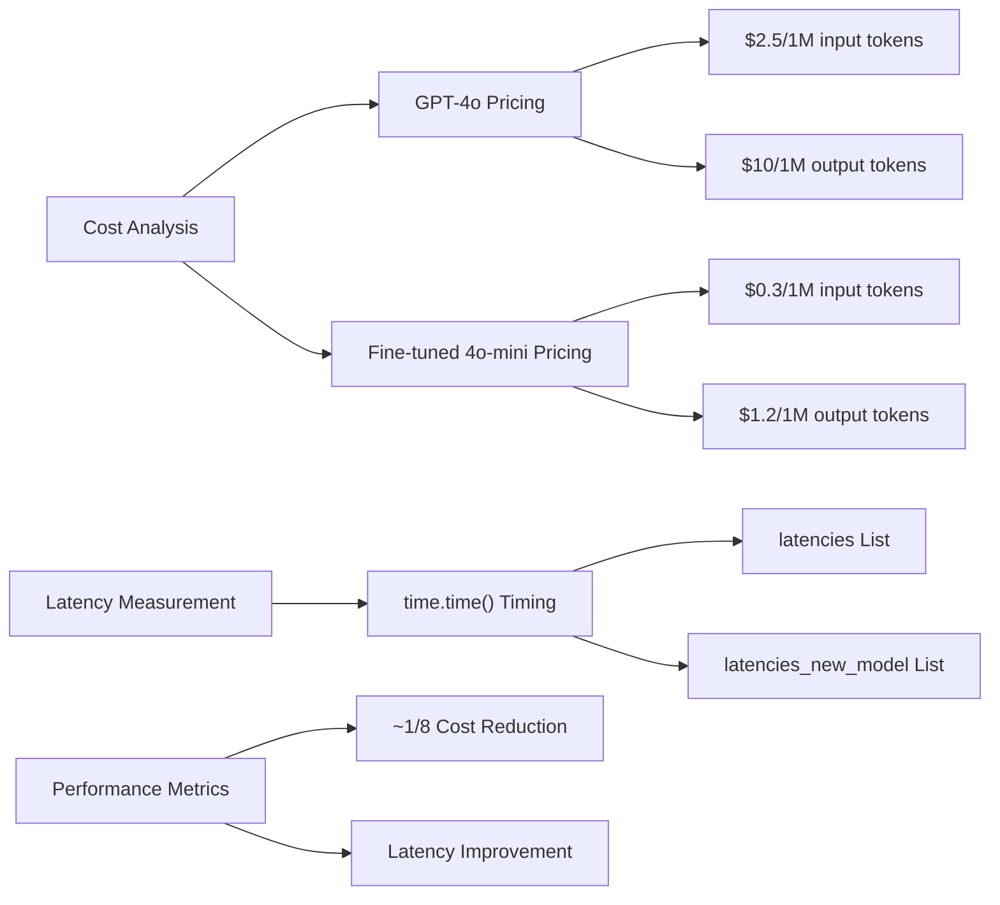

<!-- source: DeepWiki mcp.deepwiki.com · repo openai/build-hours · page 3.3 Model Distillation · fetched 2026-10-26 -->

# Model Distillation

<details>
<summary>Relevant source files</summary>

The following files were used as context for generating this wiki page:

- [10-distillation/itinerary.ipynb](10-distillation/itinerary.ipynb)
- [10-distillation/plane.ipynb](10-distillation/plane.ipynb)

</details>


This document covers model distillation techniques for transferring knowledge from larger, more capable models to smaller, more cost-effective models. The distillation process involves using outputs from high-performance models like `gpt-4o` and `o1-preview` to create training data for fine-tuning smaller models like `gpt-4o-mini`.

For information about fine-tuning workflows and utilities, see [Fine-tuning Utilities and Evaluation](#3.4). For customer service specific fine-tuning, see [GPT-4o-mini for Customer Service](#3.2).

## Overview

Model distillation enables organizations to achieve similar performance to larger models while significantly reducing costs and latency. The system demonstrates two primary use cases: multi-agent airline support workflows and travel itinerary generation. Both examples follow a consistent pattern of generating high-quality outputs with premium models, then using those outputs to train smaller, specialized models.

## Distillation Workflow



The distillation process begins with large models generating diverse, high-quality responses. These responses become training data for fine-tuning smaller models, which are then evaluated against test sets to measure knowledge transfer effectiveness.

Sources: [10-distillation/plane.ipynb:1-909](), [10-distillation/itinerary.ipynb:1-316]()

## Airline Support Service Example

The airline support system demonstrates distillation in a multi-agent architecture with two specialized components: a classifier agent and a status agent.

### Classifier Agent Implementation



The classifier agent uses `classifier_prompt` to categorize customer requests into five categories. The system processes training data through `gpt-4o` with metadata tracking for project organization.

Sources: [10-distillation/plane.ipynb:27-86](), [10-distillation/plane.ipynb:597-620]()

### Status Agent with Tool Calling



The status agent demonstrates distillation with function calling capabilities. It uses structured tools defined in the `tools` array to handle check-in and baggage status requests.

Sources: [10-distillation/plane.ipynb:670-763](), [10-distillation/plane.ipynb:891-909]()

## Trip Itinerary Generation System

The itinerary system showcases distillation for content generation tasks, comparing outputs across multiple model tiers.

### Training Data Generation Pipeline



The system generates training data using 52 diverse prompts across three models, then evaluates the distilled model against 42 test prompts. Each execution includes metadata for tracking and organization.

Sources: [10-distillation/itinerary.ipynb:18-44](), [10-distillation/itinerary.ipynb:184-216]()

### Performance Optimization Analysis



The system includes comprehensive performance analysis, measuring both cost efficiency and response latency between the original and distilled models.

Sources: [10-distillation/itinerary.ipynb:247-291]()

## Implementation Patterns

### Metadata and Tracking

Both examples use consistent metadata patterns for experiment tracking:

```python
metadata = {"model": model, "stage": "classifier", "project": "airplane", "run": "2"}
metadata = {"model": model, "project": "itinerary", "run": "1"}
```

This enables systematic comparison and evaluation across different model configurations and distillation experiments.

### Model Configuration

The distillation workflow supports multiple model types:
- **Source Models**: `gpt-4o`, `o1-preview` for high-quality training data generation
- **Target Models**: `gpt-4o-mini` fine-tuned variants for production deployment
- **Evaluation**: Direct comparison using `test_prompts` arrays

### Cost-Performance Trade-offs

The distillation approach achieves approximately 8x cost reduction while maintaining comparable quality. The `latencies` measurement system quantifies the performance improvements, typically showing significant latency reductions alongside cost savings.

Sources: [10-distillation/plane.ipynb:608-614](), [10-distillation/itinerary.ipynb:194-195](), [10-distillation/itinerary.ipynb:257-291]()

---

