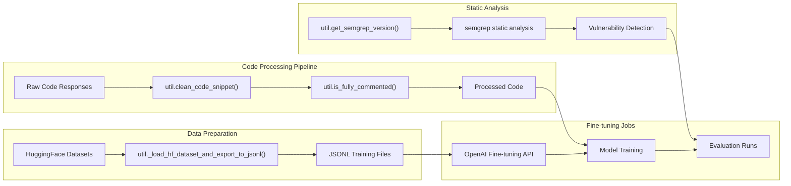

<!-- source: DeepWiki mcp.deepwiki.com · repo openai/build-hours · page 3.4 Fine-tuning Utilities and Evaluation · fetched 2026-10-26 -->

# Fine-tuning Utilities and Evaluation

<details>
<summary>Relevant source files</summary>

The following files were used as context for generating this wiki page:

- [5-4o_fine_tuning/.gitignore](5-4o_fine_tuning/.gitignore)
- [5-4o_fine_tuning/requirements.txt](5-4o_fine_tuning/requirements.txt)
- [5-4o_fine_tuning/util.py](5-4o_fine_tuning/util.py)

</details>


This document covers the supporting utilities, dataset preparation tools, and evaluation infrastructure that enable fine-tuning workflows across the repository. These utilities provide essential functions for dataset management, code analysis, and evaluation processes that support the fine-tuning systems documented in sections [3.1](#3.1) and [3.2](#3.2).

For information about specific fine-tuning implementations, see [GPT-4o for Vulnerability Fixes](#3.1) and [GPT-4o-mini for Customer Service](#3.2). For model distillation approaches, see [Model Distillation](#3.3).

## Core Utility Functions

The fine-tuning utilities provide essential data processing and analysis capabilities through a centralized `util.py` module. These functions handle common tasks across different fine-tuning workflows including dataset conversion, code analysis, and text preprocessing.

### Dataset Management Functions

The primary dataset utility is `_load_hf_dataset_and_export_to_jsonl()` which converts HuggingFace datasets to JSONL format required for OpenAI fine-tuning jobs. This function specifically targets vulnerability fix datasets:

- `patched-codes/synth-vuln-fixes` training dataset
- `patched-codes/static-analysis-eval` evaluation dataset

The function preserves data ordering using `OrderedDict` and provides error handling for dataset loading operations.

### Code Analysis Utilities

Code preprocessing utilities support vulnerability fix workflows:

- `clean_code_snippet()` removes markdown code block delimiters from LLM responses
- `is_fully_commented()` validates whether code snippets are entirely commented out
- `get_semgrep_version()` retrieves the version of semgrep static analysis tool

Sources: [5-4o_fine_tuning/util.py:64-89](), [5-4o_fine_tuning/util.py:43-61](), [5-4o_fine_tuning/util.py:26-40](), [5-4o_fine_tuning/util.py:8-23]()

## Utility Function Architecture

```mermaid
graph TD
    subgraph "Dataset Utilities"
        hf_load["_load_hf_dataset_and_export_to_jsonl()"]
        synth_vuln["patched-codes/synth-vuln-fixes"]
        static_eval["patched-codes/static-analysis-eval"]
        jsonl_train["synth-vuln-fixes-train.jsonl"]
        jsonl_eval["static-vuln-fixes-eval.jsonl"]
    end
    
    subgraph "Code Processing Utilities"
        clean_snippet["clean_code_snippet()"]
        check_comments["is_fully_commented()"]
        get_version["get_semgrep_version()"]
    end
    
    subgraph "External Dependencies"
        datasets["datasets library"]
        semgrep["semgrep==1.85.0"]
        subprocess["subprocess module"]
    end
    
    hf_load --> synth_vuln
    hf_load --> static_eval
    synth_vuln --> jsonl_train
    static_eval --> jsonl_eval
    
    hf_load --> datasets
    get_version --> semgrep
    get_version --> subprocess
    
    clean_snippet --> "Markdown code block removal"
    check_comments --> "Comment validation"
```

Sources: [5-4o_fine_tuning/util.py:64-89](), [5-4o_fine_tuning/util.py:8-23](), [5-4o_fine_tuning/requirements.txt:1-9]()

## Evaluation Infrastructure

The evaluation infrastructure supports comprehensive testing of fine-tuned models through static analysis integration and dataset validation. The system uses semgrep for static code analysis and provides utilities for validating training data quality.

### Static Analysis Integration

The `get_semgrep_version()` function enables version tracking and compatibility checking for semgrep static analysis tool. This integration supports vulnerability detection evaluation workflows where models are assessed on their ability to identify and fix security issues.

### Dataset Validation

The utility functions provide validation mechanisms for training datasets:

| Function | Purpose | Input | Output |
|----------|---------|-------|--------|
| `is_fully_commented()` | Validates code commenting | Code string | Boolean |
| `clean_code_snippet()` | Removes markdown artifacts | Raw LLM response | Clean code |
| `_load_hf_dataset_and_export_to_jsonl()` | Converts dataset format | HuggingFace dataset | JSONL file |

Sources: [5-4o_fine_tuning/util.py:26-40](), [5-4o_fine_tuning/util.py:43-61](), [5-4o_fine_tuning/util.py:64-89]()

## Dependency Management

The fine-tuning utilities rely on a specific set of dependencies managed through `requirements.txt`. These dependencies support different aspects of the fine-tuning workflow:

### Core Dependencies

- `openai` - OpenAI API integration for fine-tuning jobs
- `datasets` - HuggingFace datasets library for data loading
- `pydantic` - Data validation and serialization
- `tiktoken` - Token counting and text processing

### Analysis and Evaluation Dependencies

- `semgrep==1.85.0` - Static analysis tool (pinned version)
- `scikit_learn` - Machine learning evaluation metrics
- `sentence_transformers` - Embedding generation for evaluation

### Application Dependencies

- `streamlit` - Web interface for evaluation tools
- `tenacity` - Retry logic for API calls

Sources: [5-4o_fine_tuning/requirements.txt:1-9]()

## Integration with Fine-tuning Workflows



Sources: [5-4o_fine_tuning/util.py:64-89](), [5-4o_fine_tuning/util.py:43-61](), [5-4o_fine_tuning/util.py:8-23](), [5-4o_fine_tuning/requirements.txt:1-9]()

## File Organization

The fine-tuning utilities are organized within the `5-4o_fine_tuning` directory structure:

- `util.py` - Core utility functions for dataset and code processing
- `requirements.txt` - Dependency specifications
- `.gitignore` - Excludes `staticeval/` directory from version control

The excluded `staticeval/` directory likely contains generated evaluation data or temporary files from static analysis runs.

Sources: [5-4o_fine_tuning/.gitignore:1](), [5-4o_fine_tuning/util.py:1-89](), [5-4o_fine_tuning/requirements.txt:1-9]()

---

