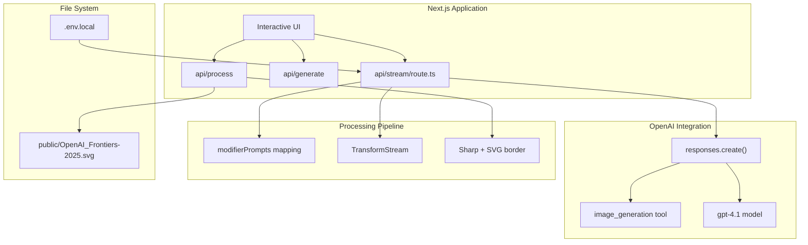
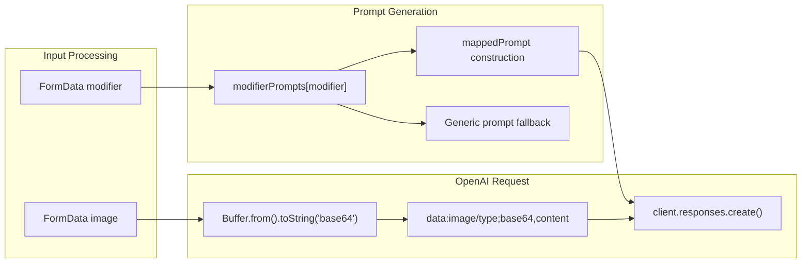
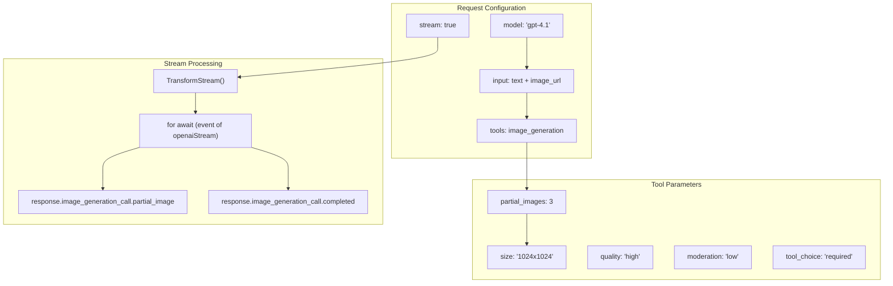
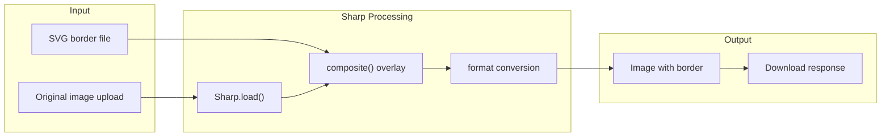
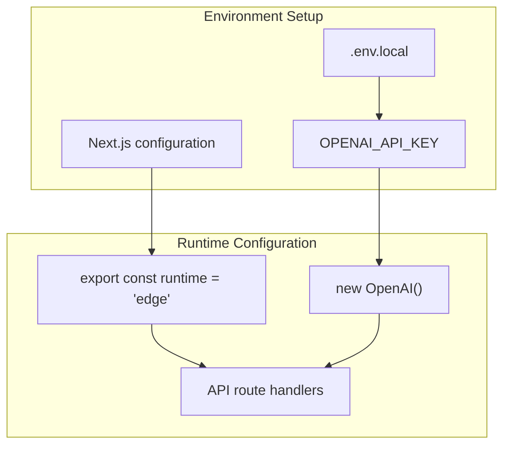

<!-- source: DeepWiki mcp.deepwiki.com · repo openai/build-hours · page 4 Image Generation System · fetched 2026-10-26 -->

# Image Generation System

Relevant source files

The following files were used as context for generating this wiki page:

- [13-image-gen/imagegen-demo/README.md](13-image-gen/imagegen-demo/README.md)
- [13-image-gen/imagegen-demo/src/app/api/stream/route.ts](13-image-gen/imagegen-demo/src/app/api/stream/route.ts)

## Purpose and Scope

The Image Generation System is a Next.js web application that provides AI-powered image generation and post-processing capabilities using OpenAI's image generation APIs. The system allows users to upload reference images, apply custom style modifiers, and generate stylized images through a streaming interface. Additionally, it provides post-processing functionality to overlay SVG borders on images.

This system was originally developed for the OpenAI SF Frontiers event and has been repurposed for Build Hours demonstrations. For information about other AI model integrations, see [Fine-tuning Systems](#3). For agent-based systems, see [Agent Systems](#6).

## System Architecture

The Image Generation System is built as a Next.js application with API routes handling image generation and processing. The system integrates with OpenAI's responses API using the `gpt-4.1` model and image generation tools.

### Core Components Architecture

Sources: [13-image-gen/imagegen-demo/README.md:1-88](), [13-image-gen/imagegen-demo/src/app/api/stream/route.ts:1-89]()

## Style Modifier System

The system implements a comprehensive style modifier mapping that transforms user-selected modifiers into detailed prompts for image generation. Each modifier corresponds to a specific artistic style or theme.

### Style Modifier Mapping

| Modifier Key | Style Description | Primary Theme |
|--------------|-------------------|---------------|
| `ghibli-style` | Studio Ghibli aesthetic | Soft colors, dreamy atmosphere, magical elements |
| `paperback` | 1980s sci-fi book cover | Vintage paperback with dramatic lighting |
| `action-figure` | Retro toy packaging | 1980s-1990s action figure box design |
| `lego-minifigure-style` | LEGO aesthetic | Blocky proportions, glossy plastic texture |
| `japanese-anime-movie-poster` | Anime theatrical poster | Hand-painted cel-style, dramatic gradients |
| `80s-cave` | Retro-futurist arcade | CRT monitors, circuit boards, neon lighting |
| `mission-patch` | NASA mission patch | Embroidered design with OpenAI branding |
| `knitted-cozy-scene` | Cozy textile art | Chunky yarn, fireplace setting |
| `comic-panel` | Comic book format | Multi-panel story narrative |

### Modifier Processing Flow

Sources: [13-image-gen/imagegen-demo/src/app/api/stream/route.ts:15-36]()

## Streaming Image Generation

The system implements streaming image generation using OpenAI's responses API with real-time partial image updates. This provides users with progressive feedback during the generation process.

### Streaming Implementation

The streaming process uses the `responses.create()` method with specific configuration for image generation:

### Event Processing

The streaming handler processes two main event types:

1. **Partial Image Events** (`response.image_generation_call.partial_image`): Provides incremental image updates as base64 data
2. **Completion Events** (`response.image_generation_call.completed`): Signals final image generation completion

Sources: [13-image-gen/imagegen-demo/src/app/api/stream/route.ts:37-87]()

## Post-processing Pipeline

The system includes image post-processing capabilities using the Sharp library to overlay SVG borders on generated or uploaded images. This functionality is accessible through the `/api/process` endpoint.

### SVG Overlay Configuration

The post-processing system expects an SVG border file located at `public/OpenAI_Frontiers-2025.svg`. This path can be customized by modifying the configuration in the process route handler.

### Processing Workflow

Sources: [13-image-gen/imagegen-demo/README.md:61-66]()

## API Endpoints and Configuration

The Image Generation System exposes three main API endpoints for different functionality:

### API Endpoint Structure

| Endpoint | Method | Purpose | Key Features |
|----------|--------|---------|--------------|
| `/api/stream` | POST | Streaming image generation | Real-time partial updates, style modifiers |
| `/api/generate` | POST | Standard image generation | Batch processing, style application |
| `/api/process` | POST | Image post-processing | SVG overlay, Sharp integration |

### Environment Configuration

The system requires OpenAI API key configuration through environment variables:

### Deployment and Development

The system supports both development and production deployment configurations:

- **Development**: `npm run dev` starts the development server with hot reloading
- **Production**: `npm run build && npm run start` creates optimized production build
- **Deployment**: Compatible with Vercel deployment platform

Sources: [13-image-gen/imagegen-demo/README.md:33-87](), [13-image-gen/imagegen-demo/src/app/api/stream/route.ts:1-6]()

---

