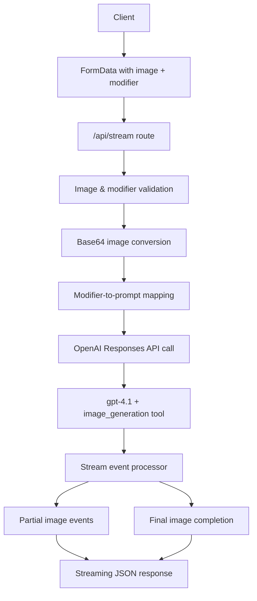
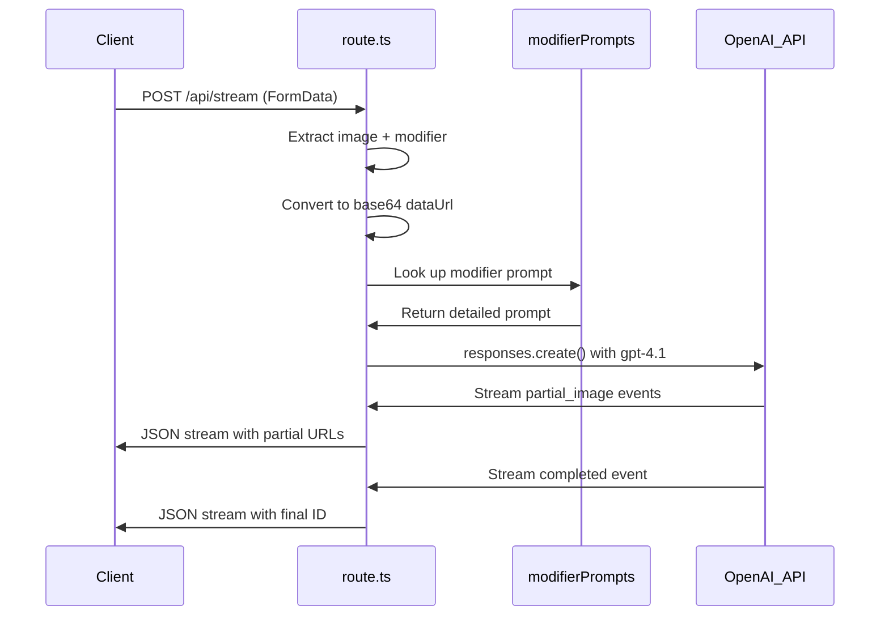
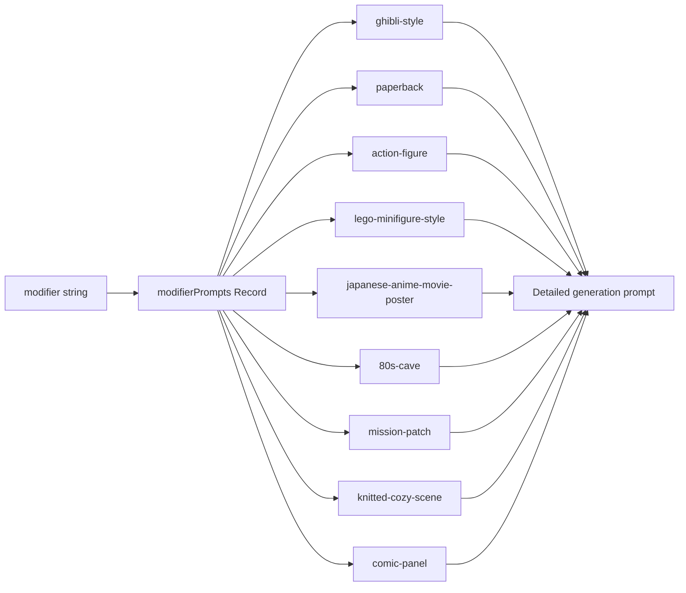
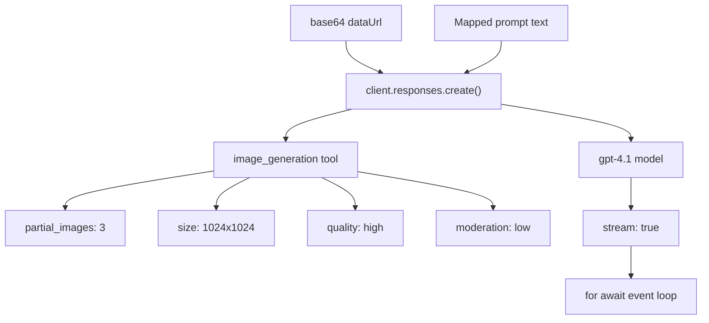
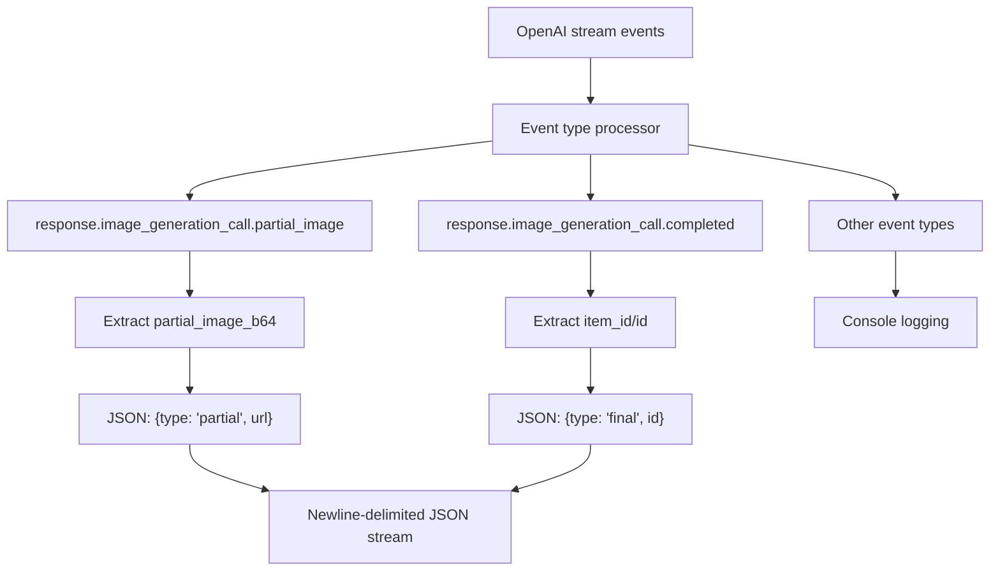
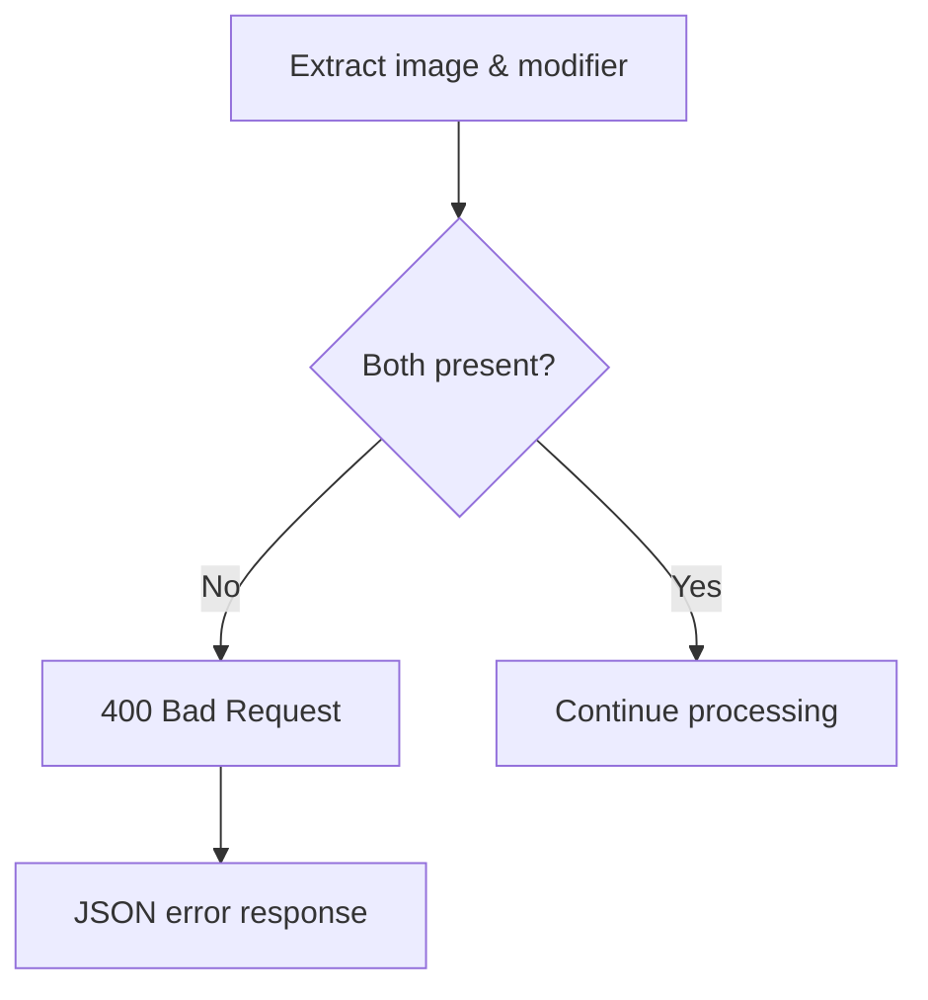

<!-- source: DeepWiki mcp.deepwiki.com · repo openai/build-hours · page 4.1 Image Generation API · fetched 2026-10-26 -->

# Image Generation API

<details>
<summary>Relevant source files</summary>

The following files were used as context for generating this wiki page:

- [13-image-gen/imagegen-demo/README.md](13-image-gen/imagegen-demo/README.md)
- [13-image-gen/imagegen-demo/src/app/api/stream/route.ts](13-image-gen/imagegen-demo/src/app/api/stream/route.ts)

</details>


This document covers the streaming image generation API that integrates with OpenAI's image generation capabilities and implements a style modifier system. The API accepts uploaded images and applies AI-generated style transformations using predefined prompts.

For information about SVG overlay processing and image manipulation workflows, see [Post-processing Pipeline](#4.2).

## Overview

The Image Generation API provides a streaming endpoint that processes uploaded images through OpenAI's Responses API using the `gpt-4.1` model with image generation tools. The system supports multiple predefined style modifiers that transform images according to specific artistic and thematic prompts.

## API Architecture

The core API is implemented as a Next.js Edge Runtime route that handles image uploads, applies style modifiers, and streams partial image results back to the client.



Sources: [13-image-gen/imagegen-demo/src/app/api/stream/route.ts:1-89]()

## Request Processing Flow

The API follows a structured request processing pipeline that converts form data into streaming image generation responses:

| Stage | Component | Description |
|-------|-----------|-------------|
| Input | `FormData` processing | Extracts uploaded image file and style modifier |
| Validation | Parameter validation | Ensures both image and modifier are present |
| Conversion | Base64 encoding | Converts image to data URL format |
| Mapping | Prompt generation | Maps modifier to detailed generation prompt |
| Generation | OpenAI API call | Streams image generation with partial results |
| Output | JSON streaming | Returns partial and final image events |



Sources: [13-image-gen/imagegen-demo/src/app/api/stream/route.ts:8-35]()

## Style Modifier System

The system implements a comprehensive style modifier mapping that converts simple modifier keys into detailed generation prompts:



Sources: [13-image-gen/imagegen-demo/src/app/api/stream/route.ts:15-26]()

### Modifier Prompt Examples

The system includes nine predefined style modifiers, each with detailed artistic direction:

| Modifier Key | Style Description | Key Elements |
|--------------|-------------------|--------------|
| `ghibli-style` | Studio Ghibli aesthetic | Soft colors, dreamy atmosphere, OpenAI logo cloud |
| `paperback` | 1980s sci-fi book cover | Vintage typography, "BUILD HOUR" title, GPU background |
| `action-figure` | Retro toy packaging | 1980s-90s blister pack, accessories, toy aesthetics |
| `lego-minifigure-style` | LEGO character style | Blocky proportions, plastic texture, San Francisco setting |
| `japanese-anime-movie-poster` | Vintage anime poster | Hand-painted cel shading, dramatic gradients, wear effects |

Sources: [13-image-gen/imagegen-demo/src/app/api/stream/route.ts:16-25]()

## OpenAI Integration

The API integrates with OpenAI's Responses API using the `gpt-4.1` model and image generation tools:



### API Configuration

The OpenAI integration uses specific configuration parameters optimized for streaming image generation:

```typescript
// Configuration from route.ts
model: "gpt-4.1"
tools: [{
  type: "image_generation",
  partial_images: 3,
  size: "1024x1024", 
  quality: "high",
  moderation: "low"
}]
stream: true
tool_choice: 'required'
```

Sources: [13-image-gen/imagegen-demo/src/app/api/stream/route.ts:37-59]()

## Streaming Response Handling

The API implements a Transform Stream to process OpenAI's streaming events and convert them to client-consumable JSON:



### Stream Event Processing

The system handles two primary event types from the OpenAI stream:

| Event Type | Data Extracted | Response Format |
|------------|----------------|-----------------|
| `response.image_generation_call.partial_image` | `partial_image_b64` | `{type: "partial", url: "data:image/png;base64,..."}` |
| `response.image_generation_call.completed` | `item_id` or `id` | `{type: "final", id: "..."}` |

Sources: [13-image-gen/imagegen-demo/src/app/api/stream/route.ts:61-87]()

## Edge Runtime Configuration

The API is configured to run on Vercel's Edge Runtime for optimal performance and global distribution:

```typescript
export const runtime = "edge";
```

This configuration enables:
- Reduced cold start times
- Global edge deployment
- Streaming response optimization
- Minimal resource overhead

Sources: [13-image-gen/imagegen-demo/src/app/api/stream/route.ts:6]()

## Error Handling

The API implements basic validation to ensure required parameters are provided:



Sources: [13-image-gen/imagegen-demo/src/app/api/stream/route.ts:12-14]()

---

