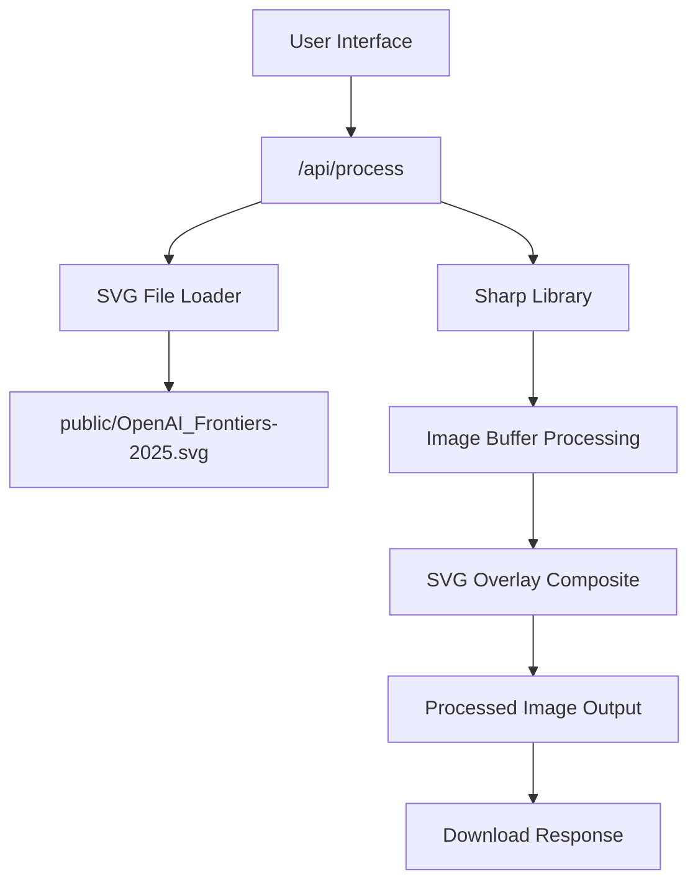
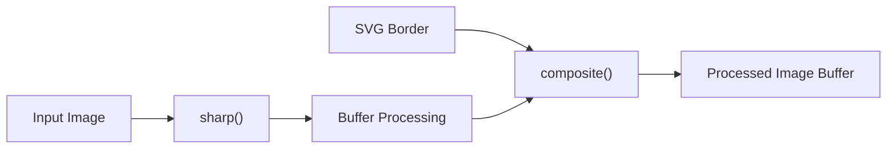
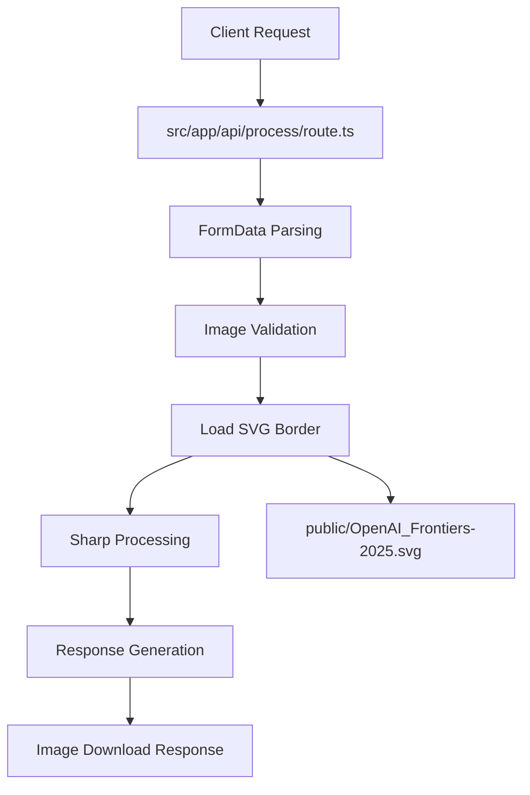
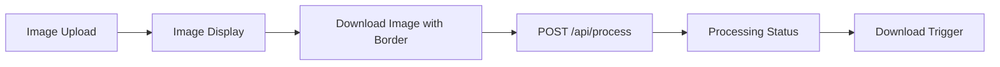
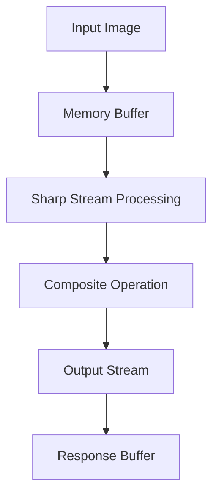

<!-- source: DeepWiki mcp.deepwiki.com · repo openai/build-hours · page 4.2 Post-processing Pipeline · fetched 2026-10-26 -->

# Post-processing Pipeline

Relevant source files

The following files were used as context for generating this wiki page:

- [13-image-gen/imagegen-demo/README.md](13-image-gen/imagegen-demo/README.md)
- [13-image-gen/imagegen-demo/src/app/api/stream/route.ts](13-image-gen/imagegen-demo/src/app/api/stream/route.ts)

The post-processing pipeline provides image manipulation capabilities for the AI image generation system, specifically focused on overlaying SVG borders and enhancing generated or uploaded images. This system uses the Sharp library to perform high-performance image transformations and compositing operations.

For information about the core image generation and streaming capabilities, see [Image Generation API](#4.1).

## Overview

The post-processing pipeline operates as a standalone component that accepts images and applies visual enhancements through programmatic image manipulation. The primary function is overlaying decorative SVG borders onto images, though the architecture supports extensible post-processing operations.

### Core Pipeline Architecture

**Pipeline Data Flow**
The system processes images through a linear transformation pipeline where each stage operates on image buffers and metadata.

Sources: [13-image-gen/imagegen-demo/README.md:10-12](), [13-image-gen/imagegen-demo/README.md:61-66]()

### Sharp Library Integration

The pipeline leverages the Sharp library for high-performance image processing operations. Sharp provides the core image manipulation capabilities including format conversion, resizing, and compositing operations required for SVG overlay functionality.

**Sharp Operation Chain**
The Sharp library provides chainable operations for efficient image processing with minimal memory overhead.

Sources: [13-image-gen/imagegen-demo/README.md:11]()

## API Endpoint Architecture

The post-processing functionality is exposed through a Next.js API route that handles image uploads and SVG overlay operations.

### Process Route Implementation

**API Route Processing Flow**
The `/api/process` endpoint coordinates the entire post-processing workflow from request parsing to response generation.

Sources: [13-image-gen/imagegen-demo/README.md:61](), [13-image-gen/imagegen-demo/README.md:65]()

### Configuration and Asset Management

The pipeline expects specific SVG assets to be available in the public directory structure. The default configuration uses a predefined border design that can be customized by replacing the SVG file.

| Component | Path | Purpose |
|-----------|------|---------|
| SVG Border | `public/OpenAI_Frontiers-2025.svg` | Default border overlay design |
| Process Route | `src/app/api/process/route.ts` | API endpoint implementation |
| Sharp Config | Internal to route handler | Image processing parameters |

**Asset Configuration**
The system uses file-based configuration where SVG assets are loaded from the public directory during processing operations.

Sources: [13-image-gen/imagegen-demo/README.md:65-66]()

## User Interface Integration

The post-processing pipeline integrates with the web interface through dedicated UI controls that trigger the post-processing workflow.

### UI Workflow Integration

**User Interaction Flow**
The interface provides a streamlined workflow where users can immediately post-process images after upload or generation.

Sources: [13-image-gen/imagegen-demo/README.md:61]()

## System Dependencies and Requirements

The post-processing pipeline requires specific Node.js packages and system capabilities for image processing operations.

### Technical Requirements

| Dependency | Purpose | Version Requirement |
|------------|---------|-------------------|
| Sharp | Image processing | Latest stable |
| Next.js | API route framework | v18+ |
| Node.js | Runtime environment | v18+ |

**Runtime Dependencies**
The Sharp library requires native binaries for optimal performance and may need platform-specific compilation.

Sources: [13-image-gen/imagegen-demo/README.md:17-18]()

### Performance Characteristics

The pipeline is optimized for single-image processing with minimal memory overhead. Sharp's streaming architecture enables efficient processing of large images without excessive memory consumption.

**Memory Management Flow**
The system uses streaming operations to minimize memory footprint during image processing operations.

Sources: [13-image-gen/imagegen-demo/README.md:11]()

---

