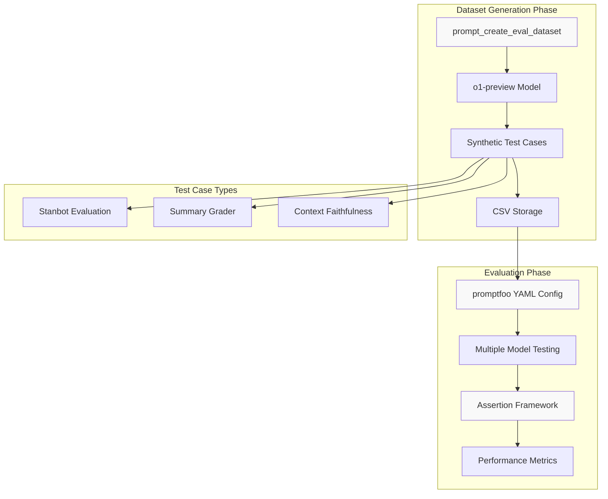
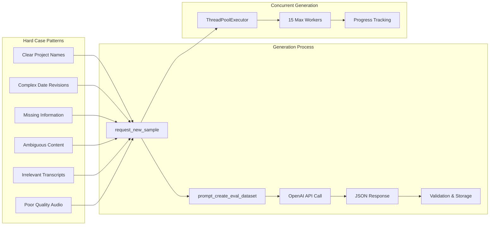
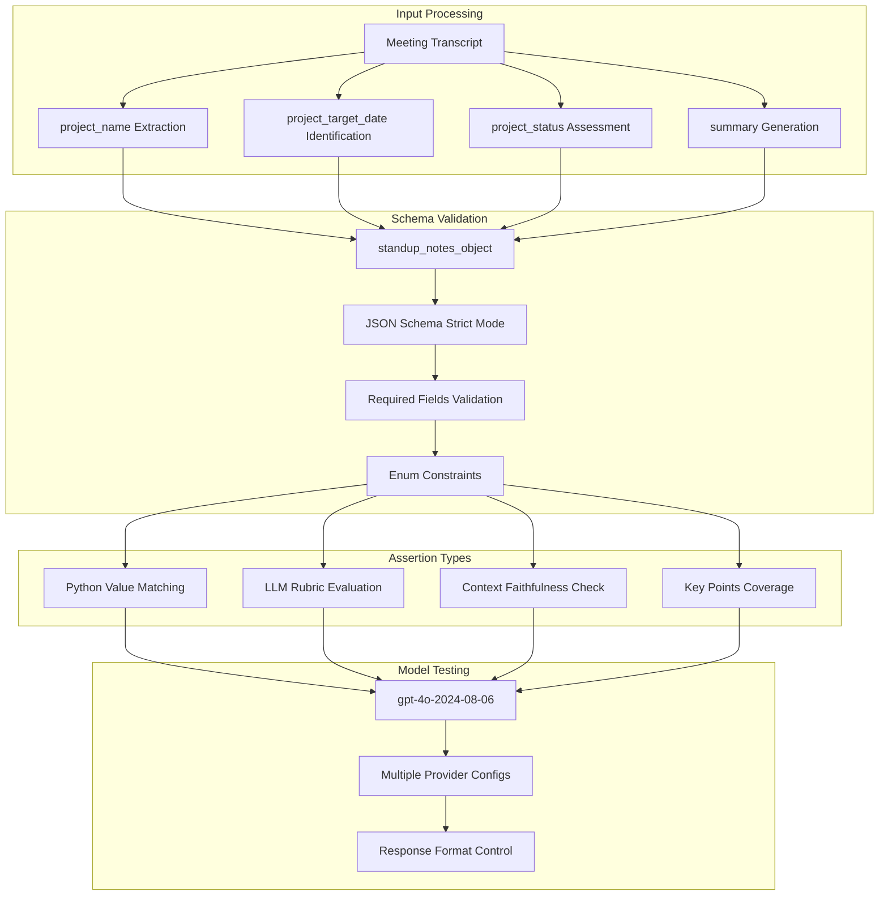
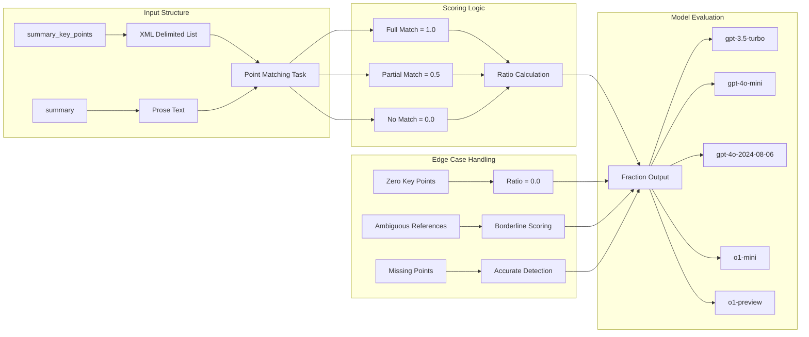
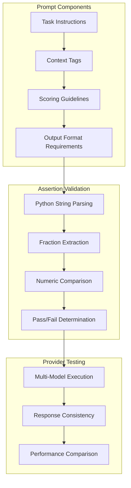

<!-- source: DeepWiki mcp.deepwiki.com · repo openai/build-hours · page 5 Evaluation and Testing · fetched 2026-10-26 -->

# Evaluation and Testing

Relevant source files

The following files were used as context for generating this wiki page:

- [8-evals/01_create_stanbot_draft_datasett.py](8-evals/01_create_stanbot_draft_datasett.py)
- [8-evals/03_create_summary_grader_dataset.py](8-evals/03_create_summary_grader_dataset.py)
- [8-evals/04_summary_grader_eval.py](8-evals/04_summary_grader_eval.py)
- [8-evals/data/draft_stanbot_outputs_n=18.csv](8-evals/data/draft_stanbot_outputs_n=18.csv)
- [8-evals/data/draft_summary_grader_outputs_n=12.csv](8-evals/data/draft_summary_grader_outputs_n=12.csv)
- [8-evals/data/pfoo_eval_stanbot.yaml](8-evals/data/pfoo_eval_stanbot.yaml)
- [8-evals/data/pfoo_eval_summary_grader.yaml](8-evals/data/pfoo_eval_summary_grader.yaml)
- [8-evals/data/reviewed_stanbot_outputs_n=18.csv](8-evals/data/reviewed_stanbot_outputs_n=18.csv)
- [8-evals/data/reviewed_summary_grader_outputs_n=12.csv](8-evals/data/reviewed_summary_grader_outputs_n=12.csv)
- [8-evals/utils/constants.py](8-evals/utils/constants.py)

This document covers the comprehensive LLM evaluation framework within the Build Hours repository. This system provides automated testing and quality assessment for various LLM-powered applications, with a focus on synthetic dataset generation, multi-model evaluation, and structured performance metrics.

For information about the specific systems being evaluated, see [Fine-tuning Systems](#3), [Recommendation System](#2), and [Agent Systems](#6).

## Evaluation Framework Overview

The evaluation system is built around a two-phase approach: synthetic dataset generation using advanced LLMs, followed by systematic evaluation across multiple models using the promptfoo framework. The system focuses on testing information extraction tasks, summary quality assessment, and meeting transcript processing.

**Evaluation Framework Architecture**

The system supports multiple evaluation patterns including Python-based assertions, LLM-rubric evaluations, and custom metrics validation. Each evaluation type generates structured test cases that can be executed across different model configurations.

Sources: [8-evals/utils/constants.py:1-34](), [8-evals/04_summary_grader_eval.py:62-66]()

## Dataset Generation System

The evaluation framework uses a sophisticated dataset generation approach where advanced LLMs create synthetic test cases based on specified difficulty patterns and edge cases.

**Synthetic Dataset Generation Pipeline**

The `request_new_sample` function handles the core generation logic, utilizing templated prompts that specify task context, example inputs, and desired output columns. The system generates multiple variations of each test case type to ensure comprehensive coverage.

| Hard Case Type | Purpose | Example Scenario |
|----------------|---------|------------------|
| Project name clearly mentioned | Baseline positive case | "Apollo Project" explicitly referenced |
| Complex date/status revisions | Timeline confusion testing | Multiple date changes in one meeting |
| Missing project information | Negative case handling | No project name mentioned |
| Ambiguous content | Edge case robustness | Vague references to deliverables |
| Irrelevant transcripts | False positive prevention | Non-engineering conversations |
| Poor transcript quality | Real-world conditions | Background noise, interruptions |

Sources: [8-evals/01_create_stanbot_draft_datasett.py:39-46](), [8-evals/03_create_summary_grader_dataset.py:31-36](), [8-evals/01_create_stanbot_draft_datasett.py:74-97]()

## Stanbot Evaluation

The Stanbot evaluation system tests LLM performance on extracting structured information from software engineering standup meeting transcripts. This evaluation focuses on project name extraction, target date identification, and status assessment.

**Stanbot Evaluation Pipeline**

The system uses structured JSON schema validation through the `standup_notes_object` schema, which enforces strict typing and required fields. The evaluation includes both deterministic Python assertions and LLM-based rubric scoring for subjective quality measures.

### Schema Definition

The evaluation schema defines four core extraction targets:

- `project_name`: Title case project names with "Project" word excluded
- `project_target_date`: MM/DD/YYYY format dates with inference capability  
- `project_status`: Enumerated values (Complete, On Track, At Risk, Not Found)
- `reasoning`: Step-by-step analysis for explainability

Sources: [8-evals/utils/constants.py:36-73](), [8-evals/data/pfoo_eval_stanbot.yaml:49-91]()

### Evaluation Metrics

The system implements multiple assertion types to comprehensively evaluate model performance:

| Metric Type | Implementation | Purpose |
|-------------|----------------|---------|
| `project_name` | Python equality check | Exact match validation |
| `project_target_date` | String comparison | Date extraction accuracy |
| `project_status` | Enum validation | Status classification correctness |
| `context-faithfulness` | LLM rubric | Hallucination detection |
| `key_points_in_summary` | LLM scoring | Content coverage assessment |

Sources: [8-evals/data/pfoo_eval_stanbot.yaml:92-159]()

## Summary Grader Evaluation

The Summary Grader evaluation system assesses how well LLMs can determine the fraction of key points that appear in a given summary. This evaluation type focuses on content coverage analysis and partial matching capabilities.

**Summary Grader Evaluation Flow**

The evaluation prompt instructs models to analyze coverage between key points and summaries, with specific guidance on partial matching and ratio calculation. The system tests across five different OpenAI models to assess consistency and capability differences.

### Test Case Categories

The summary grader includes four distinct test case categories designed to challenge different aspects of content analysis:

1. **Accurate Capture (3-6 points)**: All key points clearly present in summary
2. **Missing Points**: Summary omits some or all key points  
3. **Zero Key Points**: Empty key points list with summary present
4. **Ambiguous Inclusion**: Borderline cases requiring judgment calls

Sources: [8-evals/03_create_summary_grader_dataset.py:31-36](), [8-evals/04_summary_grader_eval.py:32-41]()

### Prompt Design and Output Format

The evaluation prompt emphasizes step-by-step reasoning and requires a specific output format: `"Fraction: 0.25"` with no additional markdown. This structured output enables reliable parsing and metric calculation across different model responses.

**Summary Grader Prompt and Validation Architecture**

Sources: [8-evals/04_summary_grader_eval.py:14-28](), [8-evals/data/pfoo_eval_summary_grader.yaml:1-18]()

## Evaluation Execution and Configuration

The evaluation system uses promptfoo as the underlying execution framework, with YAML configuration files defining test suites, prompts, providers, and assertions. This approach enables reproducible, automated evaluation across multiple models and test cases.

### Promptfoo Integration

The system generates structured YAML configurations that specify the complete evaluation setup:

- **Tests**: Individual test cases with input variables and expected outputs
- **Prompts**: Template strings with variable substitution  
- **Providers**: Model configurations and API endpoints
- **Assertions**: Validation logic for automated scoring

### Concurrent Processing

Dataset generation utilizes `ThreadPoolExecutor` with 15 concurrent workers to efficiently create large evaluation datasets. Progress tracking through `tqdm` provides visibility into generation status and completion estimates.

```mermaid
graph LR
    subgraph "Generation Workflow"
        A["case_repeats = 3"] --> B["sample_cases Expansion"]
        B --> C["ThreadPoolExecutor(15)"]
        C --> D["concurrent.futures"]
        D --> E["Progress Tracking"]
        E --> F["Results Collection"]
    end
    
    subgraph "Error Handling"
        G["JSON Validation"] --> H["None Filtering"]
        H --> I["Error Reporting"]
    end
    
    F --> G
    
    subgraph "Output Storage"
        J["DataFrame Creation"] --> K["CSV Export"]
        K --> L["Filename Generation"]
    end
    
    I --> J
```

**Concurrent Dataset Generation Pipeline**

The system implements robust error handling for malformed JSON responses and provides detailed logging for debugging failed generation attempts. Generated datasets are saved with descriptive filenames including record counts for easy identification.

Sources: [8-evals/01_create_stanbot_draft_datasett.py:81-97](), [8-evals/03_create_summary_grader_dataset.py:74-97](), [8-evals/04_summary_grader_eval.py:68-75]()

---

