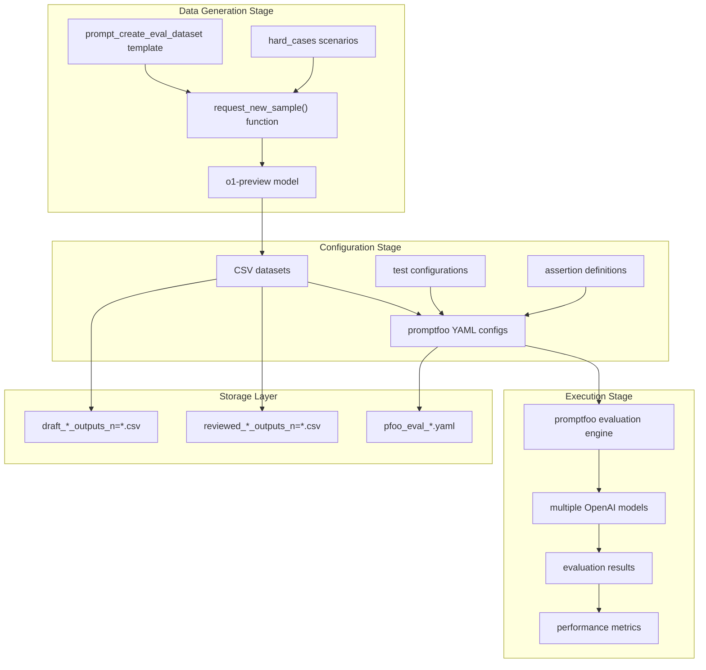
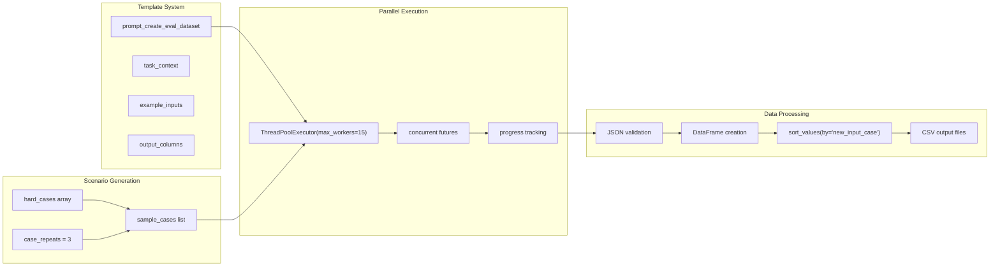
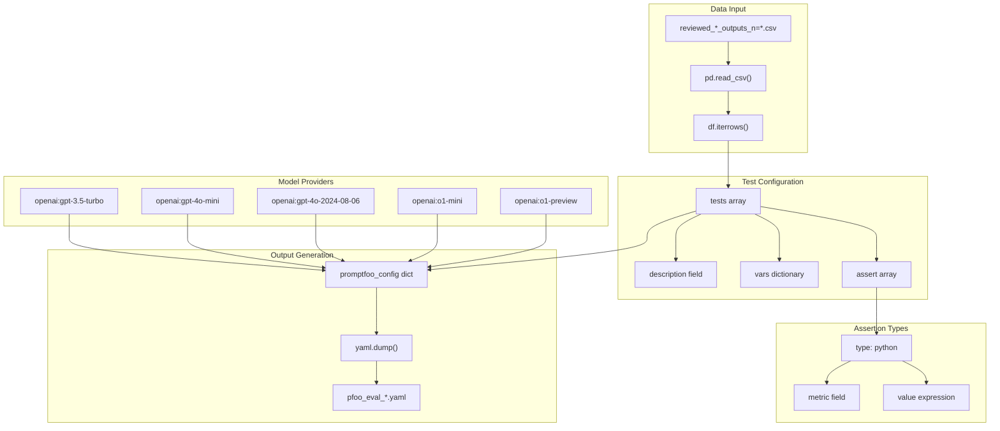
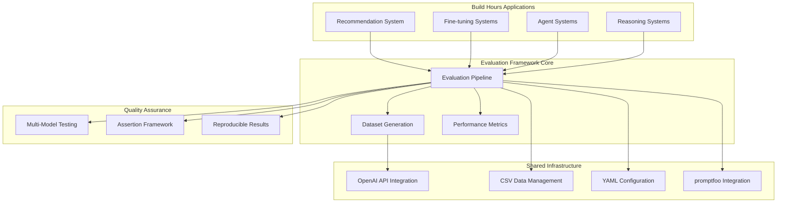

<!-- source: DeepWiki mcp.deepwiki.com · repo openai/build-hours · page 5.1 Evaluation Framework Overview · fetched 2026-10-26 -->

# Evaluation Framework Overview

Relevant source files

The following files were used as context for generating this wiki page:

- [8-evals/01_create_stanbot_draft_datasett.py](8-evals/01_create_stanbot_draft_datasett.py)
- [8-evals/03_create_summary_grader_dataset.py](8-evals/03_create_summary_grader_dataset.py)
- [8-evals/04_summary_grader_eval.py](8-evals/04_summary_grader_eval.py)
- [8-evals/data/draft_stanbot_outputs_n=18.csv](8-evals/data/draft_stanbot_outputs_n=18.csv)

This document covers the high-level architecture and design patterns of the LLM evaluation framework within the build-hours repository. The framework provides systematic approaches for generating synthetic evaluation datasets, configuring multi-model testing scenarios, and measuring LLM performance across different tasks.

For detailed information about specific evaluation implementations, see [Stanbot Evaluation](#5.3) and [Summary Grader](#5.4). For synthetic dataset creation techniques, see [Evaluation Dataset Generation](#5.2).

## Purpose and Scope

The evaluation framework serves as the foundation for systematic LLM testing across multiple applications in the build-hours repository. It provides:

- **Synthetic Dataset Generation**: LLM-driven creation of evaluation datasets with controllable difficulty scenarios
- **Multi-Model Benchmarking**: Standardized testing across different OpenAI models using promptfoo integration  
- **Assertion Framework**: Both Python-based and LLM-based evaluation metrics
- **Reproducible Evaluation Pipelines**: Standardized workflows for dataset creation, configuration generation, and results analysis

## Evaluation Framework Architecture

The evaluation system follows a three-stage pipeline architecture with clear separation between data generation, configuration management, and execution.

Sources: [8-evals/01_create_stanbot_draft_datasett.py:1-121](), [8-evals/03_create_summary_grader_dataset.py:1-112](), [8-evals/04_summary_grader_eval.py:1-76]()

## Synthetic Dataset Generation Pipeline

The framework uses a systematic approach to generate challenging evaluation scenarios through LLM-based data synthesis with controllable difficulty parameters.

Sources: [8-evals/01_create_stanbot_draft_datasett.py:47-108](), [8-evals/03_create_summary_grader_dataset.py:47-108]()

## Evaluation Configuration and Execution

The framework transforms generated datasets into promptfoo evaluation configurations with standardized assertion patterns and multi-model testing.

Sources: [8-evals/04_summary_grader_eval.py:7-76]()

## Hard Case Scenarios and Difficulty Patterns

The evaluation framework implements systematic difficulty progression through predefined scenario categories that test different failure modes and edge cases.

| Scenario Type | Example Hard Cases | Purpose |
|---------------|-------------------|---------|
| **Stanbot Evaluation** | "Project name mentioned clearly" | Test basic extraction capability |
| | "Project info with complex date revisions" | Test parsing with multiple date changes |
| | "Project name not mentioned at all" | Test negative cases and robustness |
| | "Transcript unrelated to engineering" | Test classification accuracy |
| | "Long transcript with irrelevant info" | Test information filtering |
| | "Bad transcript quality" | Test noise robustness |
| **Summary Grader** | "3-6 key points accurately captured" | Test baseline performance |
| | "Summary misses some/all key points" | Test precision measurement |
| | "0 items in summary_key_points" | Test edge case handling |
| | "Ambiguous or borderline inclusion" | Test nuanced evaluation |

Sources: [8-evals/01_create_stanbot_draft_datasett.py:39-46](), [8-evals/03_create_summary_grader_dataset.py:31-36]()

## Integration with Build Hours Ecosystem

The evaluation framework integrates with the broader build-hours repository through standardized patterns for model testing, data management, and quality assurance across different AI applications.

Sources: [8-evals/01_create_stanbot_draft_datasett.py:1-121](), [8-evals/03_create_summary_grader_dataset.py:1-112](), [8-evals/04_summary_grader_eval.py:1-76]()

---

