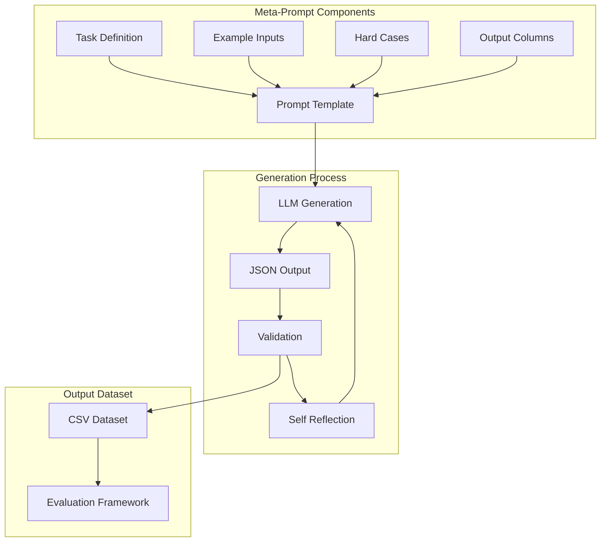
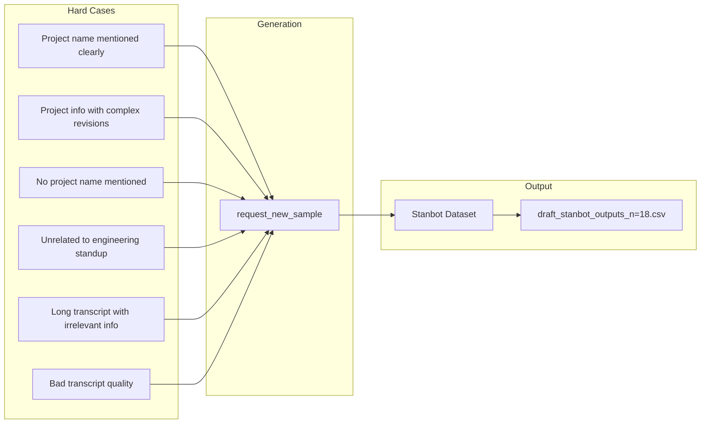
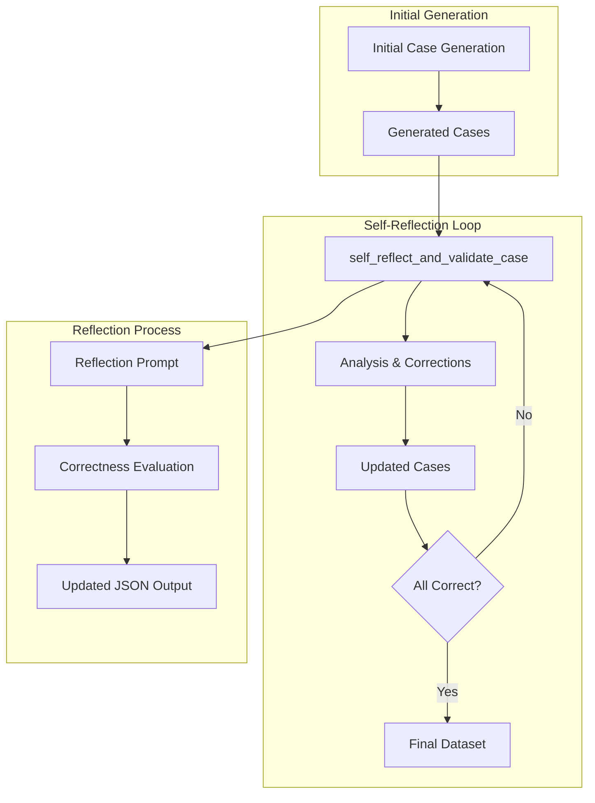
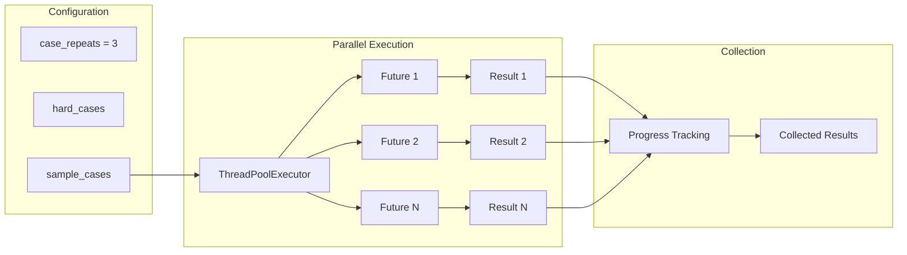
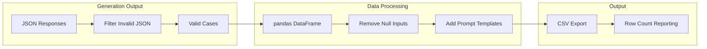

<!-- source: DeepWiki mcp.deepwiki.com · repo openai/build-hours · page 5.2 Evaluation Dataset Generation · fetched 2026-10-26 -->

# Evaluation Dataset Generation

<details>
<summary>Relevant source files</summary>

The following files were used as context for generating this wiki page:

- [.gitignore](.gitignore)
- [3-4o_mini_fine_tuning/0_generate_eval_data.py](3-4o_mini_fine_tuning/0_generate_eval_data.py)
- [3-4o_mini_fine_tuning/prompts/cot3.json](3-4o_mini_fine_tuning/prompts/cot3.json)
- [3-4o_mini_fine_tuning/prompts/verbatim_input.txt](3-4o_mini_fine_tuning/prompts/verbatim_input.txt)
- [8-evals/01_create_stanbot_draft_datasett.py](8-evals/01_create_stanbot_draft_datasett.py)
- [8-evals/03_create_summary_grader_dataset.py](8-evals/03_create_summary_grader_dataset.py)
- [8-evals/04_summary_grader_eval.py](8-evals/04_summary_grader_eval.py)
- [8-evals/data/draft_stanbot_outputs_n=18.csv](8-evals/data/draft_stanbot_outputs_n=18.csv)

</details>


This document covers the synthetic dataset generation system used to create evaluation data for LLM performance testing. The system uses meta-prompting techniques with self-reflection loops to generate challenging test cases across multiple domains including meeting transcript processing, summary grading, and customer service triage.

For information about the broader evaluation framework that consumes these datasets, see [Evaluation Framework Overview](#5.1). For specific evaluation implementations like Stanbot, see [Stanbot Evaluation](#5.3).

## Meta-Prompt Architecture

The evaluation dataset generation system employs a meta-prompting approach where LLMs are used to generate evaluation datasets by providing task definitions, examples, and difficulty specifications.



**Meta-Prompt System Architecture**

The core template structure is defined in `utils.constants.prompt_create_eval_dataset` and follows this pattern:

- **Task Context**: Detailed description of the evaluation task
- **Example Inputs**: Representative examples in the expected format  
- **Hard Cases**: Specific difficulty scenarios to target
- **Output Format**: Structured specification of expected output fields

Sources: [8-evals/01_create_stanbot_draft_datasett.py:32-54](), [8-evals/03_create_summary_grader_dataset.py:25-42](), [3-4o_mini_fine_tuning/0_generate_eval_data.py:97-111]()

## Dataset Generation Types

The system supports multiple evaluation domains, each with specialized generation parameters and difficulty cases.

| Dataset Type | Purpose | Hard Cases | Output Fields |
|---|---|---|---|
| Stanbot | Meeting transcript processing | Project name clarity, complex status revisions, irrelevant information | `project_name`, `project_target_date`, `project_status`, `summary_key_points`, `summary` |
| Summary Grader | Summary quality assessment | Missing key points, ambiguous inclusion, zero points | `key_points_total`, `key_points_present_in_summary`, `ratio_points_in_summary_vs_key_points_total` |
| Customer Service Triage | Chat classification | Technical jargon, missing information, multiple categories | `case`, `reasoning`, `input`, `correct_output` |

### Stanbot Dataset Generation

The stanbot dataset targets meeting transcript summarization with emphasis on project extraction:



**Stanbot Dataset Generation Flow**

Sources: [8-evals/01_create_stanbot_draft_datasett.py:39-46](), [8-evals/data/draft_stanbot_outputs_n=18.csv:1-507]()

### Summary Grader Dataset Generation  

The summary grader dataset focuses on evaluating how well summaries capture key points:

```python
# Hard cases designed to test edge conditions
hard_cases = [
    "1. 3-6 key points, accurately captured in summary",
    "2. Summary misses some or all key points", 
    "3. 0 items in summary_key_points, but summary present",
    "4. 3-6 items in summary_key_points, with ambiguous or borderline inclusion in the summary",
]
```

The `request_new_sample` function generates cases using the `o1-preview` model for higher quality reasoning about summary-key point relationships.

Sources: [8-evals/03_create_summary_grader_dataset.py:31-36](), [8-evals/03_create_summary_grader_dataset.py:47-66]()

## Self-Reflection Validation System

The generation system includes a self-reflection mechanism to validate and correct generated test cases before finalizing the dataset.



**Self-Reflection Validation Flow**

The reflection system analyzes each generated case and provides structured feedback:

```python
{
    original_case: <case>,
    analysis: "",
    corrections_needed: ""
    is_original_case_correct: <bool>,
    updated_case: <updated_case>,
}
```

This process continues for `n_self_reflection_loops` iterations until the fraction of incorrect cases reaches zero or the maximum iterations are reached.

Sources: [3-4o_mini_fine_tuning/0_generate_eval_data.py:150-193](), [3-4o_mini_fine_tuning/0_generate_eval_data.py:196-229]()

## Parallel Generation Architecture

The system uses `concurrent.futures.ThreadPoolExecutor` to generate multiple samples in parallel, significantly reducing generation time.



**Parallel Generation Architecture**

The parallel generation pattern is consistent across all dataset types:

1. **Case Expansion**: Each hard case is repeated `case_repeats` times
2. **Future Submission**: Each case is submitted as a separate future to the executor
3. **Progress Tracking**: `tqdm` provides real-time progress updates
4. **Result Collection**: Results are collected and filtered for valid JSON

Sources: [8-evals/01_create_stanbot_draft_datasett.py:82-108](), [8-evals/03_create_summary_grader_dataset.py:75-97](), [3-4o_mini_fine_tuning/0_generate_eval_data.py:138-145]()

## Output Formats and Data Processing

Generated datasets follow standardized formats optimized for downstream evaluation frameworks.

### Dataset Schema

Each generated sample contains:
- **Input fields**: Raw data to be processed (transcripts, summaries, chat messages)
- **Expected outputs**: Ground truth labels and structured responses
- **Metadata**: Generation parameters, difficulty case, reasoning

### Quality Control Pipeline



**Data Processing Pipeline**

The quality control process includes:

1. **JSON Validation**: Invalid JSON responses are filtered out with error reporting
2. **Null Filtering**: Cases with missing inputs are removed
3. **Template Application**: Prompt templates are applied to create evaluation-ready formats
4. **Metrics Reporting**: Final dataset statistics are logged

Sources: [3-4o_mini_fine_tuning/0_generate_eval_data.py:232-266](), [8-evals/01_create_stanbot_draft_datasett.py:106-119]()

## Integration with Evaluation Framework  

Generated datasets integrate seamlessly with the promptfoo evaluation framework through standardized YAML configuration generation.

### Promptfoo Configuration Generation

The `summary_grader_eval.py` demonstrates the conversion process:

```python
tests = []
for idx, row in df.iterrows():
    tests.append({
        "description": "Test if summary is correct",
        "vars": {"input": row["input"]},
        "assert": [{
            "type": "python",
            "metric": "frac_key_points_in_summary", 
            "value": f"'{row['ratio_points_in_summary_vs_key_points_total']}' in output.split('\\n')[-1]",
        }],
    })
```

The system generates comprehensive evaluation configurations with:
- **Test Cases**: Individual test specifications with input variables
- **Prompts**: Evaluation prompt templates for different tasks
- **Providers**: Multiple LLM providers for comparative evaluation
- **Assertions**: Python and LLM-based validation logic

Sources: [8-evals/04_summary_grader_eval.py:11-76]()

## Configuration and Customization

The generation system supports extensive customization through parameter modification:

- **Sample Count**: `n_samples` controls dataset size
- **Self-Reflection**: `n_self_reflection_loops` determines validation iterations  
- **Concurrency**: `max_workers` in ThreadPoolExecutor controls parallelism
- **Model Selection**: Different models can be used for generation vs validation
- **Hard Cases**: Domain-specific difficulty scenarios can be customized

This flexibility enables the system to generate targeted evaluation datasets for specific LLM capabilities and use cases.

Sources: [3-4o_mini_fine_tuning/0_generate_eval_data.py:11-13](), [8-evals/01_create_stanbot_draft_datasett.py:82-83]()

---

