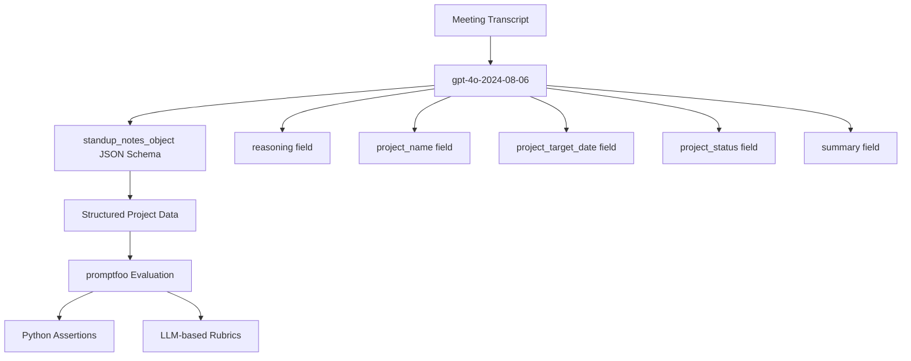
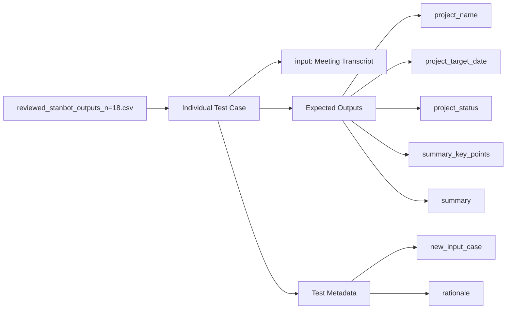
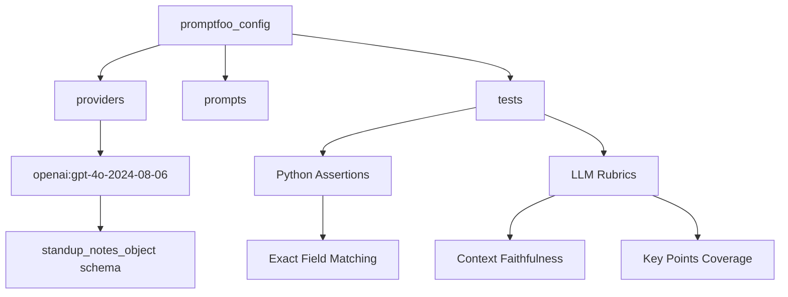
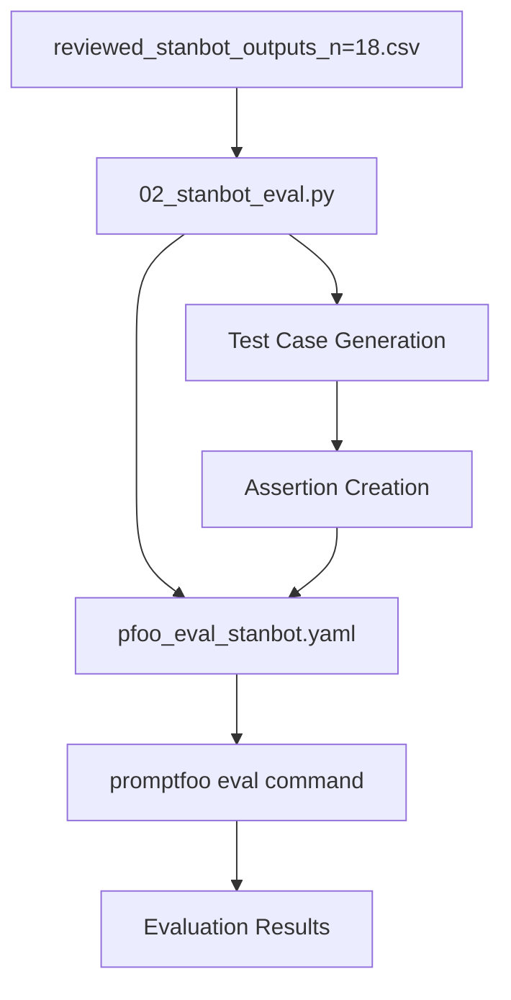
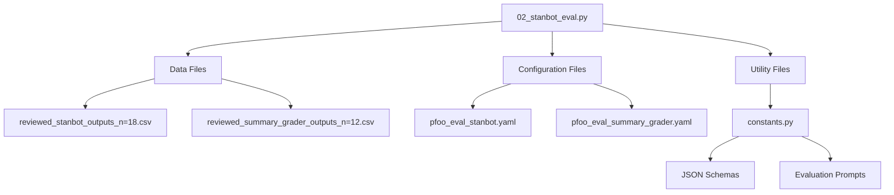

<!-- source: DeepWiki mcp.deepwiki.com · repo openai/build-hours · page 5.3 Stanbot Evaluation · fetched 2026-10-26 -->

# Stanbot Evaluation

<details>
<summary>Relevant source files</summary>

The following files were used as context for generating this wiki page:

- [8-evals/02_stanbot_eval.py](8-evals/02_stanbot_eval.py)
- [8-evals/data/draft_summary_grader_outputs_n=12.csv](8-evals/data/draft_summary_grader_outputs_n=12.csv)
- [8-evals/data/pfoo_eval_stanbot.yaml](8-evals/data/pfoo_eval_stanbot.yaml)
- [8-evals/data/pfoo_eval_summary_grader.yaml](8-evals/data/pfoo_eval_summary_grader.yaml)
- [8-evals/data/reviewed_stanbot_outputs_n=18.csv](8-evals/data/reviewed_stanbot_outputs_n=18.csv)
- [8-evals/data/reviewed_summary_grader_outputs_n=12.csv](8-evals/data/reviewed_summary_grader_outputs_n=12.csv)
- [8-evals/utils/constants.py](8-evals/utils/constants.py)

</details>


## Purpose and Scope

The Stanbot Evaluation system tests an AI system that extracts project information from engineering standup meeting transcripts. This document covers the evaluation framework, test dataset generation, and metrics used to assess the accuracy of project information extraction from conversational meeting transcripts.

For information about other evaluation systems in the codebase, see [Evaluation Framework Overview](#5.1) and [Summary Grader](#5.4).

## System Overview

Stanbot is an AI system that processes engineering standup meeting transcripts and extracts structured project information. The evaluation system tests Stanbot's ability to accurately identify and extract key project details from natural language conversations.

### Core Extraction Tasks

The system extracts four primary data points from meeting transcripts:

| Field | Description | Format | Fallback Value |
|-------|-------------|--------|----------------|
| `project_name` | Name of the project or initiative | Title Case, excluding "Project" | "Not Found" |
| `project_target_date` | Planned release/completion date | mm/dd/yyyy | "Not Found" |
| `project_status` | Current project state | Complete, On Track, At Risk, Not Found | "Not Found" |
| `summary` | Key points and progress summary | Free text | N/A |

### Stanbot Data Flow



**Sources:** [8-evals/02_stanbot_eval.py:123-166](), [8-evals/utils/constants.py:36-73]()

## Evaluation Dataset

The evaluation dataset contains 18 manually reviewed test cases covering diverse scenarios that challenge the extraction system. Each test case includes a meeting transcript, expected outputs, and ground truth annotations.

### Test Case Categories

The dataset is organized into six primary test case categories:

#### 1. Clear Project Information (3 cases)
- **Description:** Project name mentioned explicitly in transcript
- **Example:** "Remember, we're focusing on the Apollo Project this week"
- **Expected Performance:** High accuracy on all extraction fields

#### 2. Complex Information Context (3 cases)  
- **Description:** Project info embedded within numerous tasks and date revisions
- **Example:** Multiple date changes, status updates, and task discussions
- **Challenge:** Distinguishing project-level from task-level information

#### 3. Missing Project Information (3 cases)
- **Description:** No project name mentioned in transcript
- **Expected Output:** `project_name: "Not Found"`
- **Challenge:** Avoiding false positive extractions

#### 4. Non-Engineering Content (3 cases)
- **Description:** Conversations unrelated to engineering standups
- **Example:** Friends planning camping trips using engineering terminology
- **Expected Output:** All fields should be "Not Found"

#### 5. Information Overload (3 cases)
- **Description:** Long transcripts with extensive irrelevant information
- **Challenge:** Filtering signal from noise in verbose conversations

#### 6. Poor Transcript Quality (3 cases)
- **Description:** Transcripts with background noise, incomplete sentences, typos
- **Challenge:** Robust extraction despite data quality issues

### Dataset Structure



**Sources:** [8-evals/data/reviewed_stanbot_outputs_n=18.csv:1-502]()

## Evaluation Framework

The evaluation system uses `promptfoo` to systematically test Stanbot's extraction capabilities across the curated dataset. The framework generates YAML configuration files that define prompts, providers, and assertion criteria.

### Prompt Variants

The system tests two different prompt approaches:

#### 1. Basic Extraction Prompt
```
Consider this transcript and extract the following information.
# Transcript:
{{context}}
```

#### 2. Expert Extraction Prompt with Detailed Rules
- Explicit project status definitions (Complete, On Track, At Risk)
- Target date extraction guidelines with examples
- Project name identification rules with exclusions
- Summary formatting requirements

### Provider Configuration



**Sources:** [8-evals/02_stanbot_eval.py:168-180](), [8-evals/data/pfoo_eval_stanbot.yaml:49-91]()

## Metrics and Assertions

The evaluation framework employs multiple assertion types to comprehensively assess extraction quality:

### Python Assertions

Exact match assertions verify precise field extraction:

```python
{
    "metric": "project_name",
    "type": "python", 
    "value": f"output.get('project_name').lower() == '{row['project_name'].lower()}'"
}
```

Applied to:
- `project_name` field matching
- `project_target_date` field matching  
- `project_status` field matching

### LLM-based Rubrics

#### Context Faithfulness Assessment
- **Purpose:** Detect hallucinations in extracted information
- **Method:** Compare extraction output against source transcript
- **Output:** "factual" or "hallucinated" classification
- **Source:** Arize evaluation methodology

#### Key Points Coverage Analysis
- **Purpose:** Measure summary completeness against expected key points
- **Scoring:** Full point (1.0) for strong match, half point (0.5) for partial match
- **Output:** Ratio format "Fraction: 0.25"

### Evaluation Execution



**Sources:** [8-evals/02_stanbot_eval.py:13-69](), [8-evals/02_stanbot_eval.py:184-192]()

## Configuration and Execution

### Schema Definition

The system uses OpenAI's structured output with a strict JSON schema to ensure consistent extraction format:

```json
{
  "type": "object",
  "required": ["reasoning", "project_name", "project_target_date", "project_status", "summary"],
  "properties": {
    "reasoning": {"type": "string"},
    "project_name": {"type": "string"},
    "project_target_date": {"type": "string"}, 
    "project_status": {"enum": ["Complete", "On Track", "At Risk", "Not Found"]},
    "summary": {"type": "string"}
  }
}
```

### Execution Workflow

1. **Dataset Loading:** Load test cases from `reviewed_stanbot_outputs_n=18.csv`
2. **Test Generation:** Transform CSV rows into promptfoo test format
3. **Configuration Export:** Generate `pfoo_eval_stanbot.yaml` configuration
4. **Evaluation Execution:** Run `promptfoo eval -c pfoo_eval_stanbot.yaml`
5. **Results Analysis:** Review assertion pass/fail rates and rubric scores

### File Structure



**Sources:** [8-evals/02_stanbot_eval.py:1-195](), [8-evals/utils/constants.py:1-113]()

---

