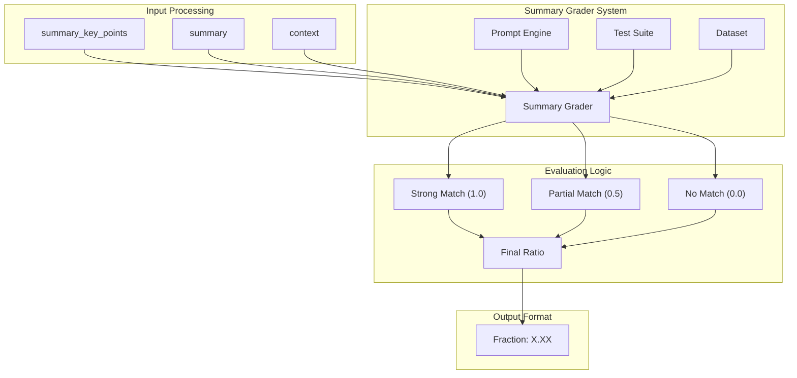
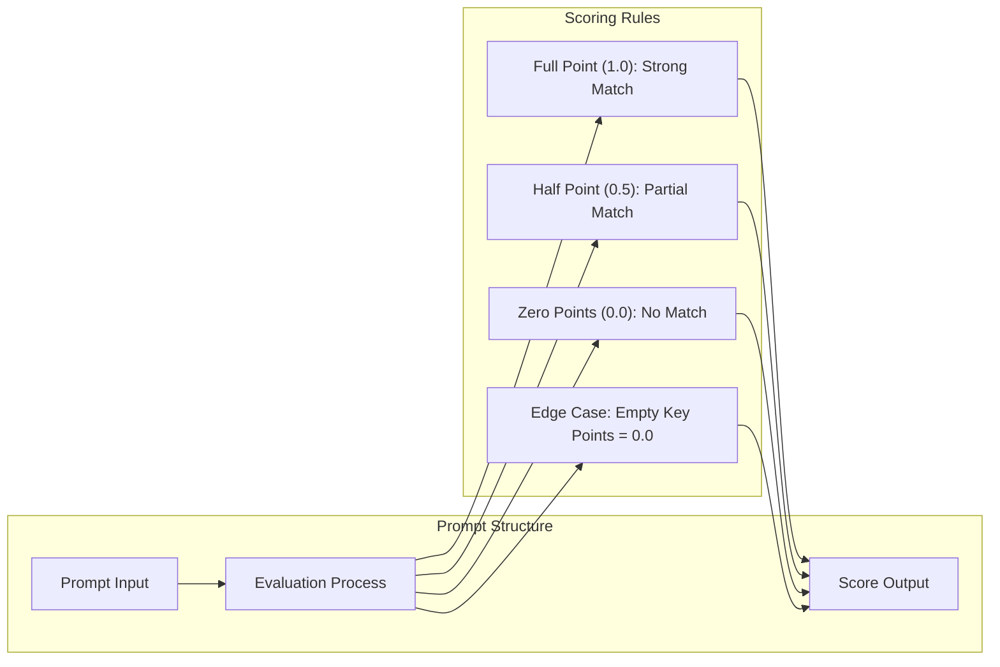
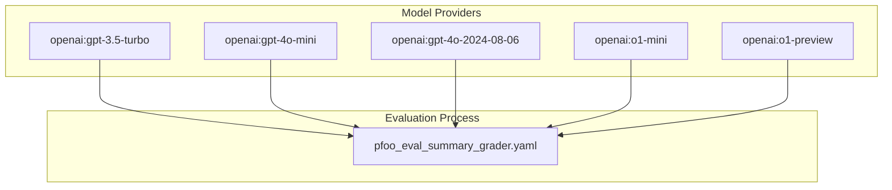
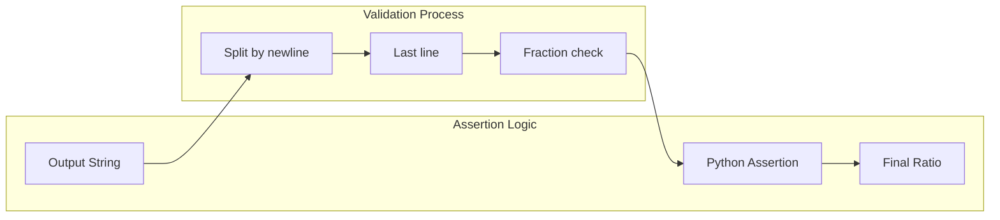
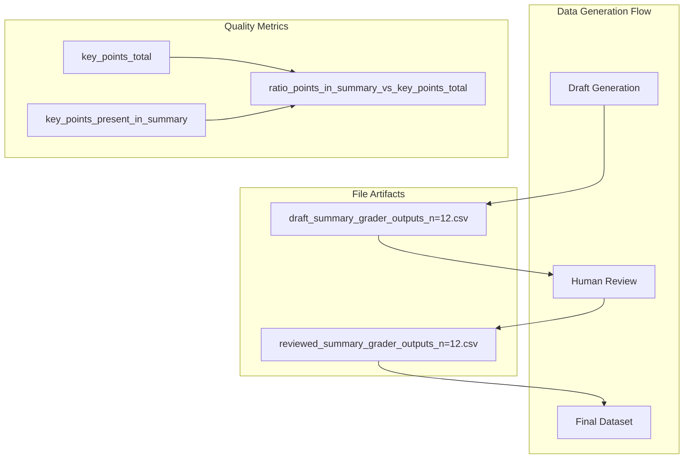
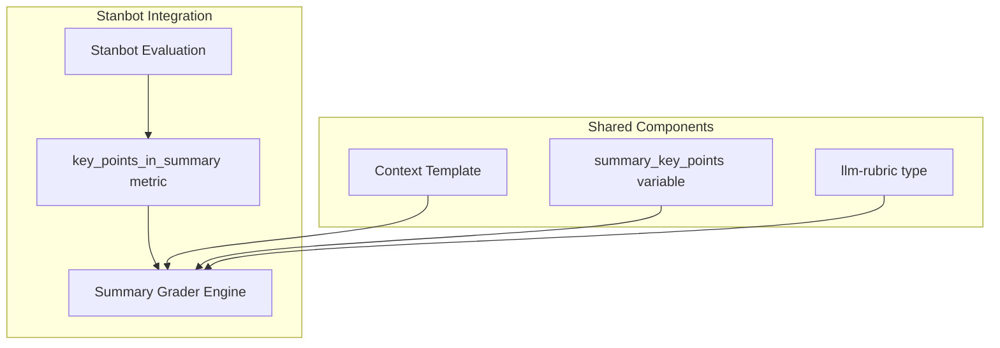

<!-- source: DeepWiki mcp.deepwiki.com · repo openai/build-hours · page 5.4 Summary Grader · fetched 2026-10-26 -->

# Summary Grader

Relevant source files

The following files were used as context for generating this wiki page:

- [8-evals/data/draft_summary_grader_outputs_n=12.csv](8-evals/data/draft_summary_grader_outputs_n=12.csv)
- [8-evals/data/pfoo_eval_stanbot.yaml](8-evals/data/pfoo_eval_stanbot.yaml)
- [8-evals/data/pfoo_eval_summary_grader.yaml](8-evals/data/pfoo_eval_summary_grader.yaml)
- [8-evals/data/reviewed_stanbot_outputs_n=18.csv](8-evals/data/reviewed_stanbot_outputs_n=18.csv)
- [8-evals/data/reviewed_summary_grader_outputs_n=12.csv](8-evals/data/reviewed_summary_grader_outputs_n=12.csv)
- [8-evals/utils/constants.py](8-evals/utils/constants.py)

The Summary Grader is a specialized evaluation tool that assesses the quality and faithfulness of summary generation by measuring how well key points from source content are captured in generated summaries. This system is part of the broader evaluation framework and is specifically designed to validate summary quality for meeting transcripts and other structured content.

For information about the overall evaluation framework, see [Evaluation Framework Overview](#5.1). For dataset generation processes, see [Evaluation Dataset Generation](#5.2).

## Purpose and Architecture

The Summary Grader implements a scoring methodology that evaluates summaries against predefined key points using a fractional scoring system. It assigns full points (1.0) for strong matches, half points (0.5) for partial matches, and zero points for missing content.

Sources: [8-evals/data/pfoo_eval_summary_grader.yaml:1-18](), [8-evals/data/reviewed_summary_grader_outputs_n=12.csv:1-103]()

## Core Evaluation Prompt

The system uses a structured prompt that instructs the LLM to evaluate coverage of key points in summaries. The evaluation logic is implemented through natural language instructions rather than algorithmic code.

Sources: [8-evals/data/pfoo_eval_summary_grader.yaml:2-17]()

## Test Case Categories

The Summary Grader evaluation framework includes four distinct categories of test cases, each designed to validate different aspects of the scoring logic:

| Test Case Category | Description | Expected Behavior |
|-------------------|-------------|-------------------|
| `3-6 key points, accurately captured` | Perfect summary coverage | Ratio = 1.0 |
| `Summary misses some or all key points` | Incomplete coverage | Ratio < 1.0 |
| `0 items in summary_key_points` | Empty key points | Ratio = 0.0 |
| `Ambiguous or borderline inclusion` | Partial matches | Mixed scoring |

Sources: [8-evals/data/reviewed_summary_grader_outputs_n=12.csv:2-103]()

## Provider Configuration

The system supports multiple OpenAI model providers for comparative evaluation:

Sources: [8-evals/data/pfoo_eval_summary_grader.yaml:19-24]()

## Test Assertion Framework

Each test case implements Python-based assertions that validate the final ratio output format and accuracy:

The assertion logic follows this pattern: `'X.X' in output.split('\n')[-1]` where X.X represents the expected fraction value.

Sources: [8-evals/data/pfoo_eval_summary_grader.yaml:27-29]()

## Dataset Generation and Review Process

The Summary Grader uses a structured dataset generation process with human review validation:

Sources: [8-evals/data/draft_summary_grader_outputs_n=12.csv:1-104](), [8-evals/data/reviewed_summary_grader_outputs_n=12.csv:1-103]()

## Integration with Stanbot Evaluation

The Summary Grader integrates with the broader Stanbot evaluation system through the `key_points_in_summary` metric:

The integration uses the same evaluation prompt template across both systems with variable substitution for `{{summary_key_points}}`.

Sources: [8-evals/data/pfoo_eval_stanbot.yaml:140-159]()

## Output Format Requirements

The Summary Grader enforces a strict output format requirement where the final ratio must appear on the last line in the format `"Fraction: X.XX"` with no additional markdown or code block formatting.

Sources: [8-evals/data/pfoo_eval_summary_grader.yaml:15-17]()

---

