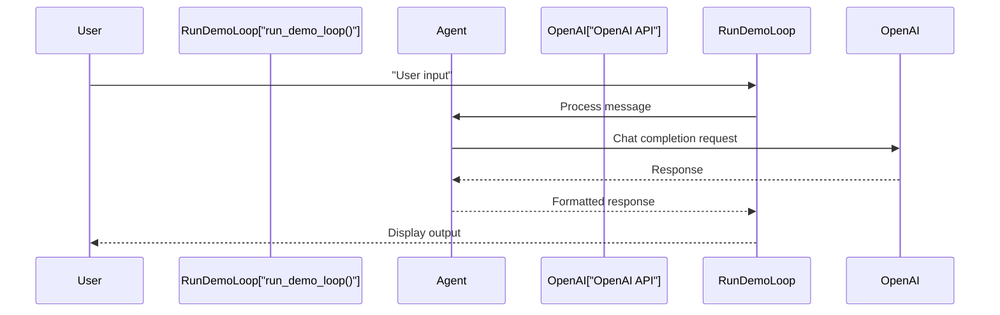
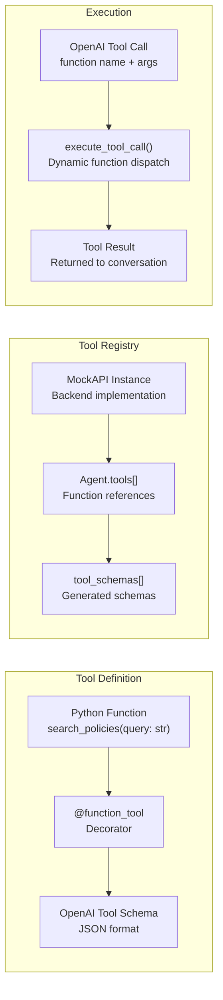
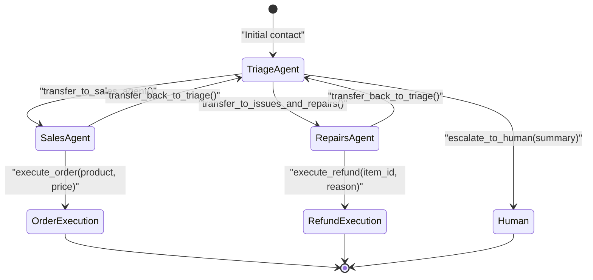
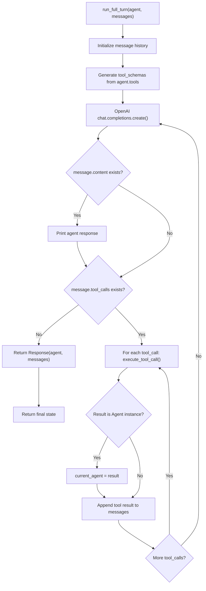
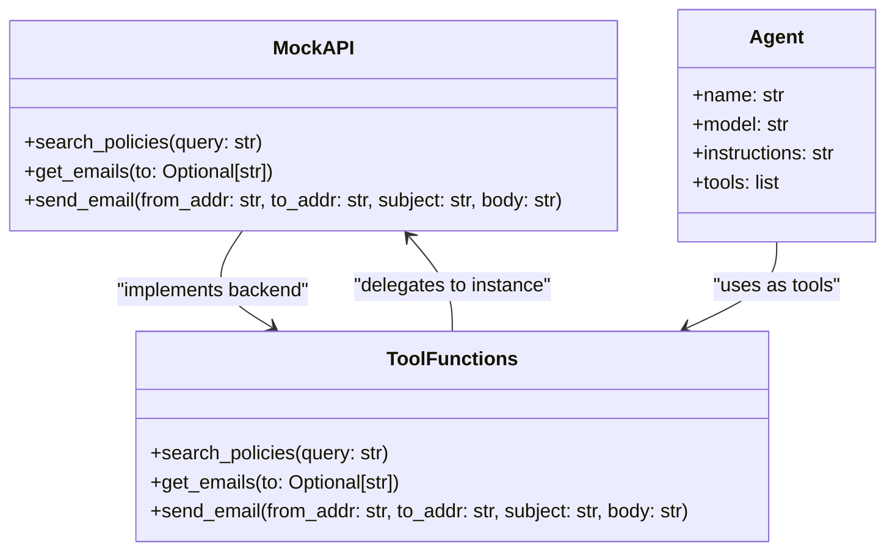

<!-- source: DeepWiki mcp.deepwiki.com · repo openai/build-hours · page 6 Agent Systems · fetched 2026-10-26 -->

# Agent Systems

Relevant source files

The following files were used as context for generating this wiki page:

- [12-agentic-tool-calling/0_task.py](12-agentic-tool-calling/0_task.py)
- [12-agentic-tool-calling/1_agent.py](12-agentic-tool-calling/1_agent.py)
- [12-agentic-tool-calling/2_tools.py](12-agentic-tool-calling/2_tools.py)
- [2-assistants/7_orchestration.py](2-assistants/7_orchestration.py)
- [2-assistants/demo_util.py](2-assistants/demo_util.py)
- [6-structured_outputs/structured-outputs-assistant-final/components/ui/breadcrumb.tsx](6-structured_outputs/structured-outputs-assistant-final/components/ui/breadcrumb.tsx)
- [6-structured_outputs/structured-outputs-assistant-starting-point/components/ui/breadcrumb.tsx](6-structured_outputs/structured-outputs-assistant-starting-point/components/ui/breadcrumb.tsx)

This document covers the comprehensive agent frameworks implemented across the codebase, ranging from basic tool calling patterns to complex multi-agent orchestration systems. The agent systems demonstrate various approaches to LLM integration, tool management, and conversational flows using OpenAI's APIs.

For information about evaluation and testing of agent behaviors, see [Evaluation and Testing](#5). For voice-based agent implementations, see [Realtime Applications](#8).

## Agent Architecture Overview

The codebase implements a layered agent architecture that progresses from simple chat loops to sophisticated multi-agent systems with tool calling and transfer capabilities.

```mermaid
graph TD
    subgraph "Basic Agent Layer"
        Agent["Agent Class<br/>name, model, instructions, tools"]
        RunDemo["run_demo_loop()<br/>Interactive chat interface"]
        OpenAIClient["OpenAI Client<br/>Responses API, Chat Completions"]
    end
    
    subgraph "Tool Integration Layer"
        FunctionTool["@function_tool decorator<br/>Python function to schema"]
        MockAPI["MockAPI<br/>search_policies(), get_emails(), send_email()"]
        ToolSchemas["function_to_schema()<br/>Inspect-based schema generation"]
    end
    
    subgraph "Orchestration Layer"
        RunFullTurn["run_full_turn()<br/>Complete conversation cycle"]
        ExecuteToolCall["execute_tool_call()<br/>Tool execution with result handling"]
        AgentTransfer["Agent Transfer<br/>Dynamic agent switching"]
    end
    
    subgraph "Demo Applications"
        TriageAgent["triage_agent<br/>Customer service routing"]
        SalesAgent["sales_agent<br/>Sales conversation flow"]
        RepairsAgent["issues_and_repairs_agent<br/>Support ticket handling"]
    end
    
    Agent --> RunDemo
    Agent --> OpenAIClient
    FunctionTool --> ToolSchemas
    MockAPI --> FunctionTool
    RunFullTurn --> ExecuteToolCall
    ExecuteToolCall --> AgentTransfer
    TriageAgent --> SalesAgent
    TriageAgent --> RepairsAgent
```

Sources: [12-agentic-tool-calling/1_agent.py:1-11](), [2-assistants/7_orchestration.py:8-13](), [2-assistants/demo_util.py:19-64]()

## Basic Agent Implementation

The foundation of the agent system is the `Agent` class and supporting utilities that provide a simple interface for LLM-powered conversations.

### Core Agent Structure

| Component | File | Purpose |
|-----------|------|---------|
| `Agent` | [2-assistants/7_orchestration.py:8-13]() | Base agent configuration with name, model, instructions, tools |
| `run_demo_loop` | [12-agentic-tool-calling/1_agent.py:10]() | Interactive chat interface for agent testing |
| `OpenAI` client | [12-agentic-tool-calling/0_task.py:3]() | Direct API integration for responses and chat completions |

The simplest agent implementation demonstrates the foundational pattern:

Sources: [12-agentic-tool-calling/1_agent.py:5-10](), [12-agentic-tool-calling/0_task.py:5-9]()

## Tool Calling and Integration

The agent system supports sophisticated tool calling through Python function decorators and automatic schema generation.

### Tool Definition Pattern

The `@function_tool` decorator and `function_to_schema` utility enable seamless integration of Python functions as agent tools:

### Available Tools

| Tool Function | Purpose | Parameters |
|---------------|---------|------------|
| `search_policies` | Query company policy database | `query: str` |
| `get_emails` | Retrieve email messages | `to: Optional[str]` |
| `send_email` | Send email communication | `from_addr, to_addr, subject, body: str` |

Sources: [12-agentic-tool-calling/2_tools.py:9-28](), [2-assistants/demo_util.py:19-64]()

## Multi-Agent Orchestration

The orchestration system enables complex conversational flows with multiple specialized agents and dynamic transfer capabilities.

### Agent Transfer Mechanism

### Agent Specializations

| Agent | Instructions | Tools | Purpose |
|-------|-------------|-------|---------|
| `triage_agent` | Customer service routing | `transfer_to_sales_agent`, `transfer_to_issues_and_repairs`, `escalate_to_human` | Initial contact and routing |
| `sales_agent` | Sales conversation flow | `execute_order`, `transfer_back_to_triage` | Product sales and order processing |
| `issues_and_repairs_agent` | Support ticket handling | `execute_refund`, `look_up_item`, `transfer_back_to_triage` | Issue resolution and refunds |

Sources: [2-assistants/7_orchestration.py:112-188]()

## Conversation Flow Management

The `run_full_turn` function implements the core conversation cycle with tool calling and agent transfer logic.

### Tool Execution Flow

The `execute_tool_call` function handles dynamic tool dispatch and special return types:

| Return Type | Handling | Effect |
|-------------|----------|--------|
| `Agent` instance | Agent transfer | Updates `current_agent` and continues conversation |
| String result | Tool output | Appended to message history as tool result |
| Complex object | Serialized | Converted to string representation |

Sources: [2-assistants/7_orchestration.py:25-81]()

## Mock API Integration

The testing infrastructure uses a `MockAPI` class to simulate external services without requiring actual API connections.

Sources: [12-agentic-tool-calling/2_tools.py:6-22]()

## Utility Functions

The system includes several utility functions that support agent operations and development workflows.

### Schema Generation

The `function_to_schema` utility automatically converts Python functions to OpenAI-compatible tool schemas:

| Feature | Implementation |
|---------|---------------|
| Type mapping | `str → "string"`, `int → "integer"`, `float → "number"`, `bool → "boolean"` |
| Parameter detection | Uses `inspect.signature()` to extract function parameters |
| Required parameters | Identifies parameters without default values |
| Documentation | Extracts docstring as tool description |

### Demo Interface

The demo utilities provide colored terminal output and interactive loops for agent testing:

| Function | Purpose |
|----------|---------|
| `color(text, color)` | Terminal color formatting with ANSI escape codes |
| `run_demo_loop` | Interactive chat interface for agent testing |

Sources: [2-assistants/demo_util.py:4-64]()

---

