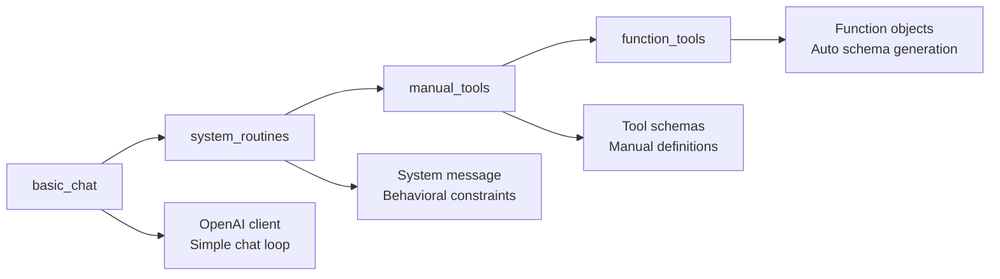
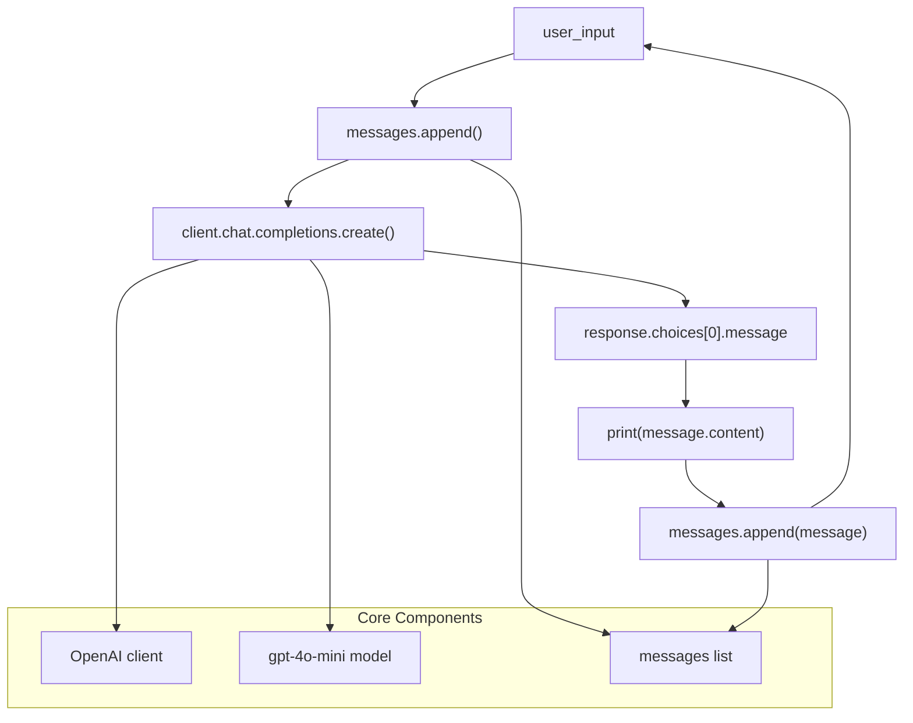
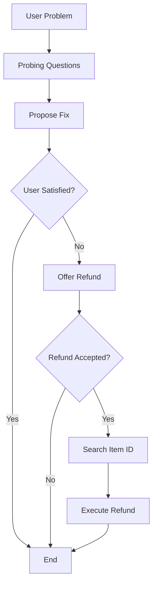
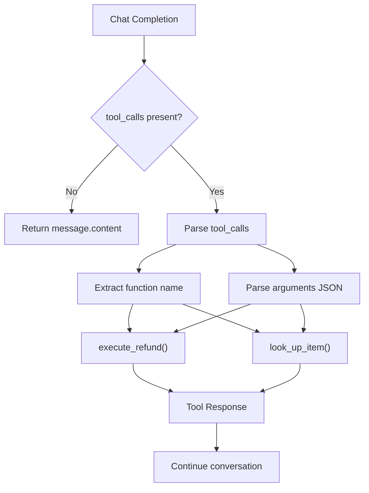
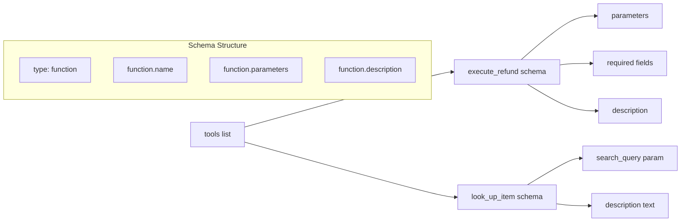
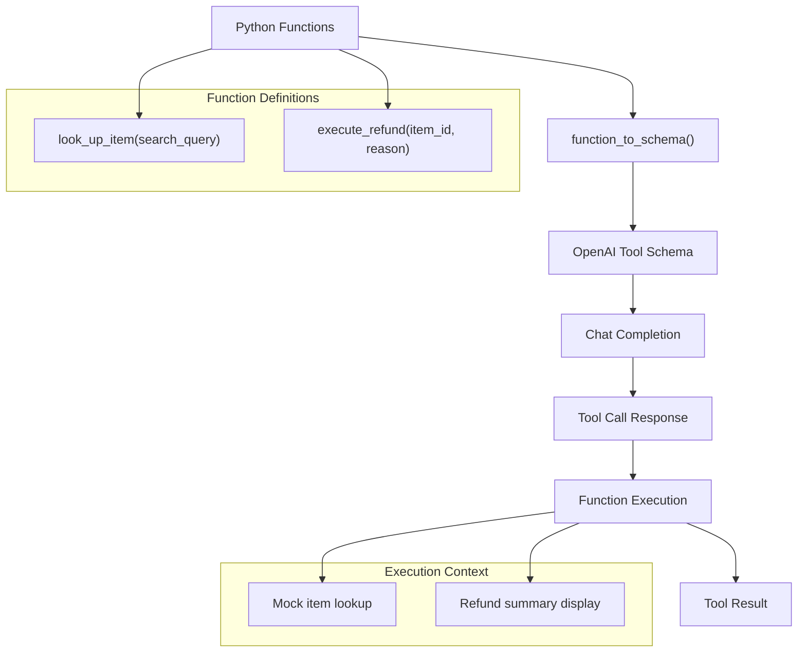
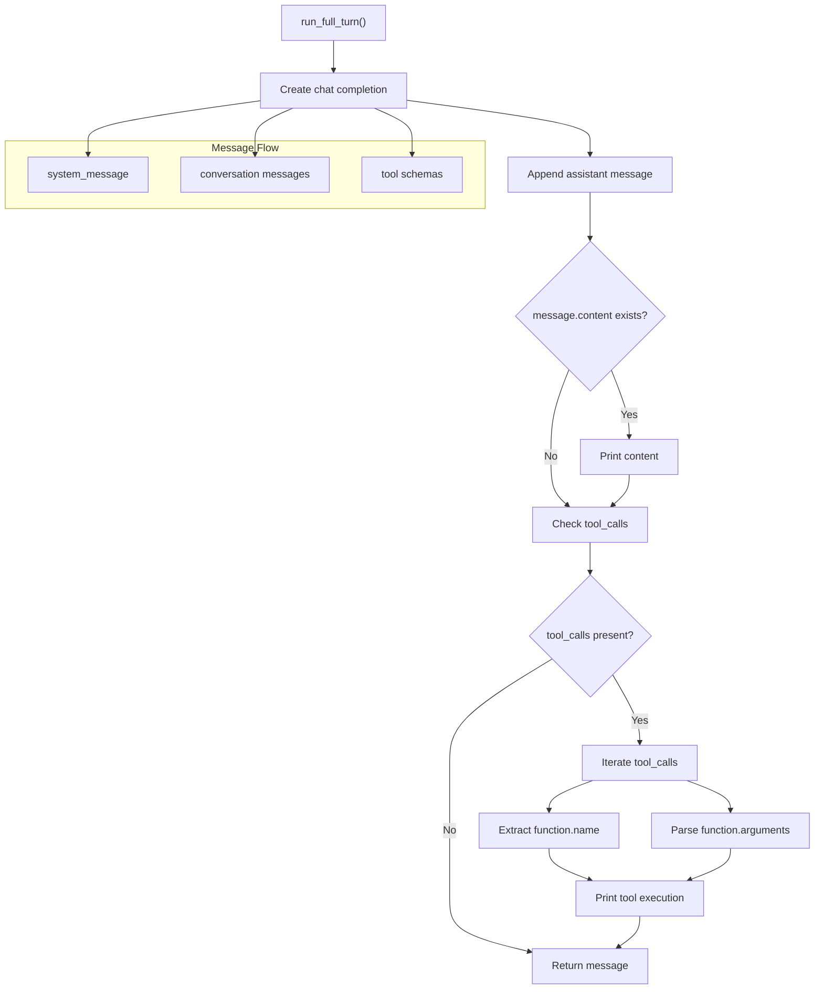

<!-- source: DeepWiki mcp.deepwiki.com · repo openai/build-hours · page 6.1 Basic Assistants and Tool Calling · fetched 2026-10-26 -->

# Basic Assistants and Tool Calling

Relevant source files

The following files were used as context for generating this wiki page:

- [2-assistants/0_setup.py](2-assistants/0_setup.py)
- [2-assistants/1_routines.py](2-assistants/1_routines.py)
- [2-assistants/2_tools.py](2-assistants/2_tools.py)
- [2-assistants/3_tools.py](2-assistants/3_tools.py)
- [2-assistants/README.md](2-assistants/README.md)

This document covers the foundational patterns for building OpenAI-powered assistants, from simple chat completions to tool-enabled agents. It demonstrates the progressive evolution from basic conversational loops to assistants that can execute functions and interact with external systems.

For advanced multi-agent orchestration and transfer mechanisms, see [Advanced Agent Orchestration](#6.2). For server-based implementations with streaming and task queues, see [Server-based Agent Systems](#6.3). For complex tool integration patterns, see [Agent Tool Integration and Delegation](#6.4).

## Assistant Evolution Pattern

The assistant implementations follow a clear progression from basic to advanced functionality:

**Assistant Progression Stages:**
1. **Basic Chat** (`0_setup.py`) - Simple conversational loop
2. **System Routines** (`1_routines.py`) - Structured behavioral patterns
3. **Manual Tools** (`2_tools.py`) - Explicit tool schema definitions
4. **Function Tools** (`3_tools.py`) - Python function-based tool integration

Sources: [2-assistants/0_setup.py:1-28](), [2-assistants/1_routines.py:1-36](), [2-assistants/2_tools.py:1-86](), [2-assistants/3_tools.py:1-80]()

## Basic Assistant Setup

The foundational assistant pattern uses a simple message loop with the OpenAI chat completions API:

**Key Implementation Details:**
- Uses `gpt-4o-mini` model for cost-effective operation
- Maintains conversation history in `messages` list
- Simple input/output loop with colored terminal output
- No tool calling or function execution capabilities

Sources: [2-assistants/0_setup.py:9-27]()

## System Message Routines

System messages provide behavioral constraints and procedural guidelines for assistants:

**Customer Support Routine Structure:**

The system message defines a structured workflow:
1. **Problem Investigation** - Ask probing questions unless reason already provided
2. **Solution Proposal** - Suggest fixes (make one up)
3. **Escalation Path** - Offer refund only if user not satisfied
4. **Refund Execution** - Search for ID then execute refund

Sources: [2-assistants/1_routines.py:10-20]()

## Tool Calling Architecture

Tool calling enables assistants to execute functions and interact with external systems:

**Tool Definition Patterns:**

| Pattern | Schema Source | Example |
|---------|---------------|---------|
| Manual Schema | Hand-written JSON | `2_tools.py` tool definitions |
| Function-based | Auto-generated from Python functions | `3_tools.py` with `function_to_schema()` |

Sources: [2-assistants/2_tools.py:22-50](), [2-assistants/3_tools.py:24-42]()

## Manual Tool Definition

Manual tool definitions provide explicit control over function schemas:

**Tool Schema Components:**
- `execute_refund` - Processes refunds with item_id and optional reason
- `look_up_item` - Searches for items using description or keywords
- JSON schema validation with required parameters
- Static tool definitions passed to chat completion

Sources: [2-assistants/2_tools.py:22-50]()

## Function-Based Tool Generation

The advanced pattern uses Python functions with automatic schema generation:

**Function Implementation Features:**
- Docstring extraction for tool descriptions
- Type hints for parameter validation
- Default parameter values
- Direct function execution from tool calls
- Colored output for tool execution feedback

Sources: [2-assistants/3_tools.py:24-39](), [2-assistants/3_tools.py:41-46]()

## Demo Loop Implementation

The core assistant loop handles tool calling and conversation flow:

**Loop Components:**
- `run_full_turn()` executes single conversation turn
- Tool call detection and parsing
- JSON argument extraction with `json.loads()`
- Colored terminal output for different message types
- Message history maintenance for context

Sources: [2-assistants/2_tools.py:53-77](), [2-assistants/3_tools.py:44-71]()

---

