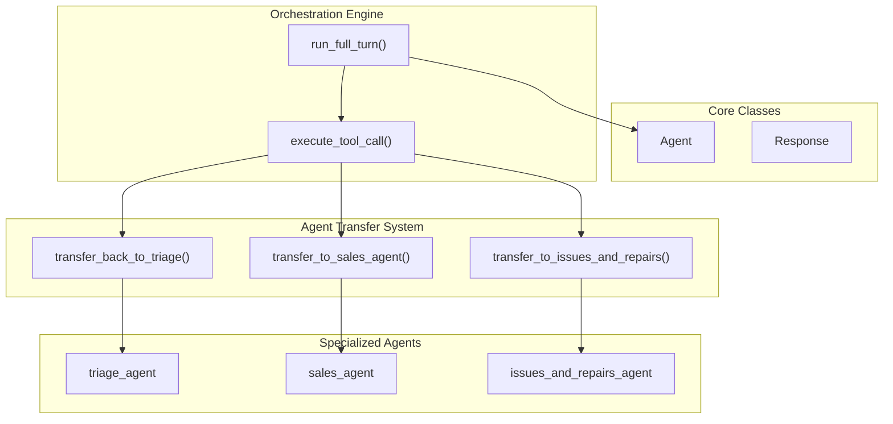
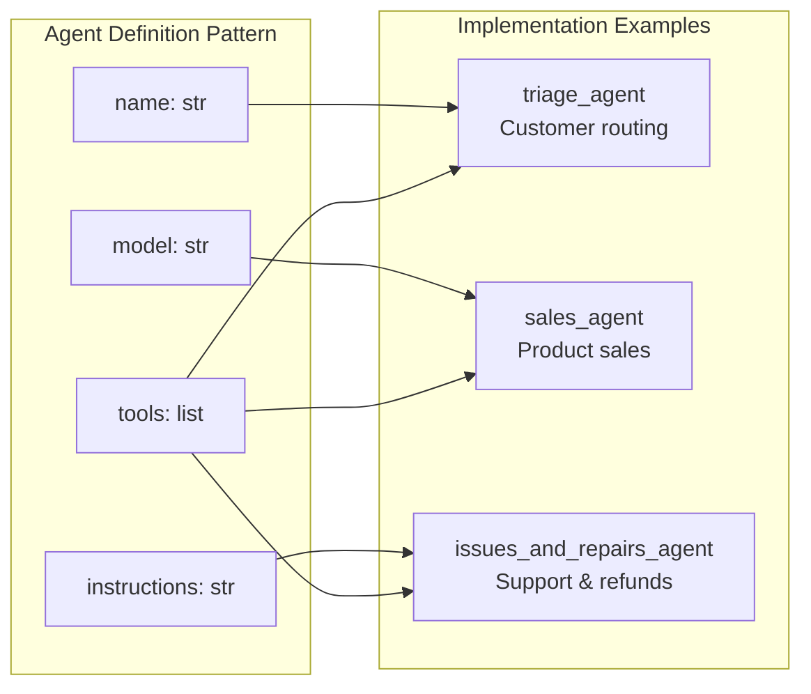
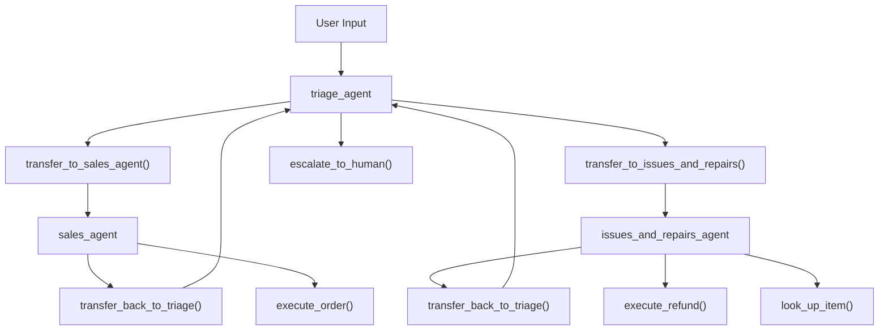
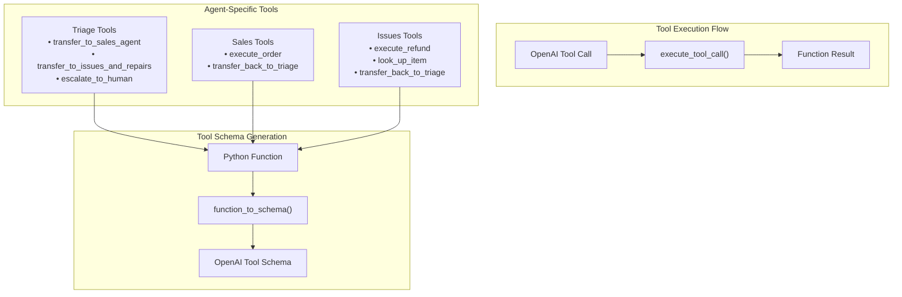
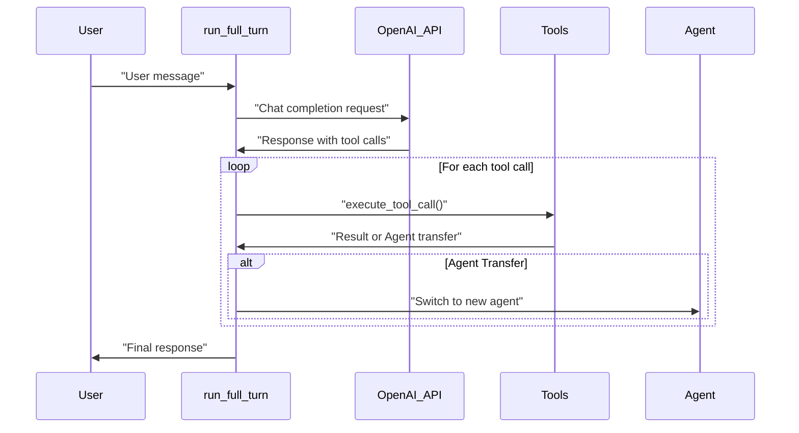
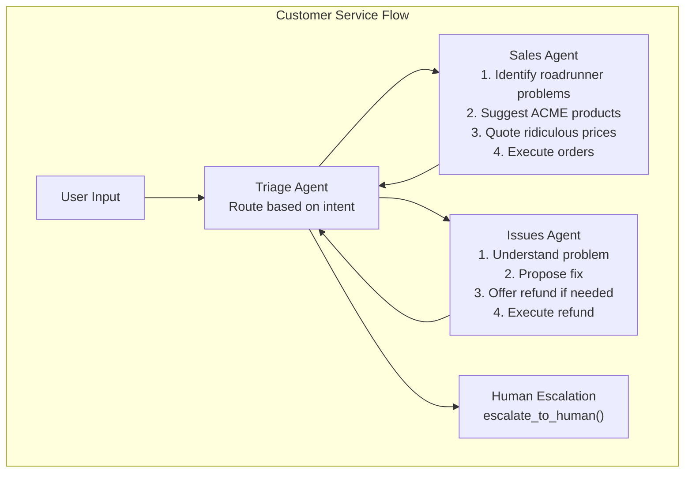

<!-- source: DeepWiki mcp.deepwiki.com · repo openai/build-hours · page 6.2 Advanced Agent Orchestration · fetched 2026-10-26 -->

# Advanced Agent Orchestration

Relevant source files

The following files were used as context for generating this wiki page:

- [2-assistants/7_orchestration.py](2-assistants/7_orchestration.py)
- [2-assistants/demo_util.py](2-assistants/demo_util.py)
- [6-structured_outputs/structured-outputs-assistant-final/components/ui/breadcrumb.tsx](6-structured_outputs/structured-outputs-assistant-final/components/ui/breadcrumb.tsx)
- [6-structured_outputs/structured-outputs-assistant-starting-point/components/ui/breadcrumb.tsx](6-structured_outputs/structured-outputs-assistant-starting-point/components/ui/breadcrumb.tsx)

This document covers multi-agent systems that enable complex conversational flows through agent transfer mechanisms. The system demonstrates how multiple specialized agents can collaborate by transferring conversations between each other based on context and user needs. For basic assistant patterns and simple tool calling, see [Basic Assistants and Tool Calling](#6.1). For server-based implementations with task queues, see [Server-based Agent Systems](#6.3).

## Core Orchestration Architecture

The advanced agent orchestration system is built around a centralized orchestration engine that manages multiple specialized agents and handles seamless transfers between them. The core architecture uses the `Agent` class to define agent capabilities and the `run_full_turn` function to manage the conversation flow.

Sources: [2-assistants/7_orchestration.py:8-18](), [2-assistants/7_orchestration.py:25-72]()

## Agent Architecture and Configuration

Each agent in the system is defined using the `Agent` class which encapsulates the agent's identity, capabilities, and available tools. The system uses Pydantic models for type safety and validation.

| Component | Purpose | Key Fields |
|-----------|---------|------------|
| `Agent.name` | Agent identity for logging and user feedback | String identifier |
| `Agent.model` | OpenAI model to use | Default: "gpt-4o" |
| `Agent.instructions` | System prompt defining agent behavior | Detailed role and procedures |
| `Agent.tools` | Available functions for the agent | List of Python functions |

Sources: [2-assistants/7_orchestration.py:8-13](), [2-assistants/7_orchestration.py:112-121](), [2-assistants/7_orchestration.py:139-154](), [2-assistants/7_orchestration.py:174-188]()

## Transfer Mechanisms and Flow Control

The orchestration system implements agent transfers through specialized transfer functions that return `Agent` objects. When a transfer function is called during tool execution, the orchestration engine switches the active agent and continues the conversation with the new agent's persona.

The transfer mechanism works by detecting when a tool call returns an `Agent` object rather than a string result. The orchestration engine then updates the current agent and injects a transfer message into the conversation context.

Sources: [2-assistants/7_orchestration.py:58-62](), [2-assistants/7_orchestration.py:96-109]()

## Tool Integration and Schema Generation

The system automatically converts Python functions into OpenAI tool schemas using the `function_to_schema` utility. This enables seamless integration between agent capabilities and the underlying function implementations.

The `function_to_schema` function automatically extracts function signatures, parameter types, and docstrings to create valid OpenAI tool definitions, supporting type annotations for `str`, `int`, `float`, `bool`, `list`, `dict`, and `None`.

Sources: [2-assistants/demo_util.py:19-64](), [2-assistants/7_orchestration.py:34-35](), [2-assistants/7_orchestration.py:75-81]()

## Conversation State Management

The orchestration engine maintains conversation state through a message history that persists across agent transfers. The `run_full_turn` function processes the complete interaction cycle from user input through tool execution and agent responses.

| Stage | Function | Purpose |
|-------|----------|---------|
| Schema Generation | `function_to_schema` | Convert agent tools to OpenAI format |
| API Call | `client.chat.completions.create` | Get agent response with tool calls |
| Tool Execution | `execute_tool_call` | Process function calls and transfers |
| State Update | Message appending | Maintain conversation history |
| Transfer Handling | Agent switching | Update active agent context |

Sources: [2-assistants/7_orchestration.py:25-72](), [2-assistants/7_orchestration.py:190-202]()

## Implementation Example

The customer service demonstration implements a three-agent system where customers are triaged and routed to appropriate specialists. The triage agent acts as the central coordinator, while sales and issues agents provide specialized functionality.

The system uses colored terminal output through the `color` utility function to distinguish between different agents and actions, making the conversation flow visible during development and debugging.

Sources: [2-assistants/7_orchestration.py:112-188](), [2-assistants/demo_util.py:4-16](), [2-assistants/7_orchestration.py:190-202]()

---

