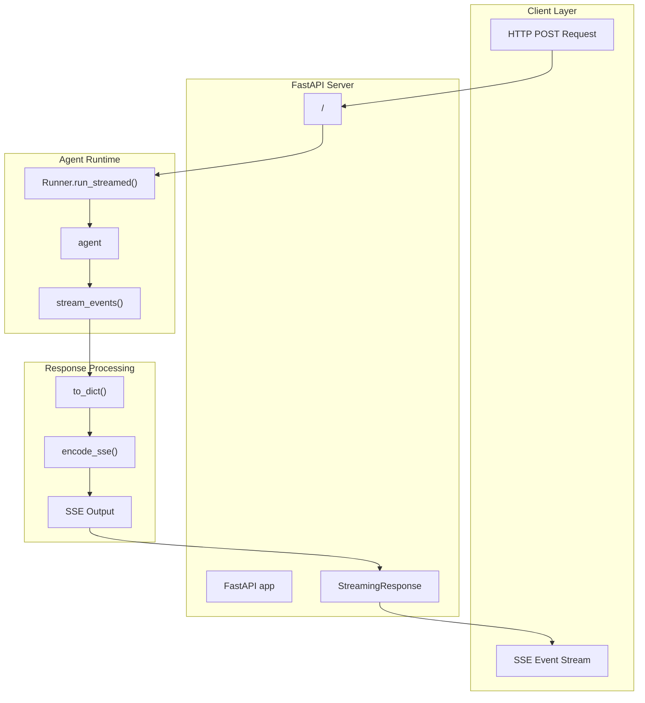
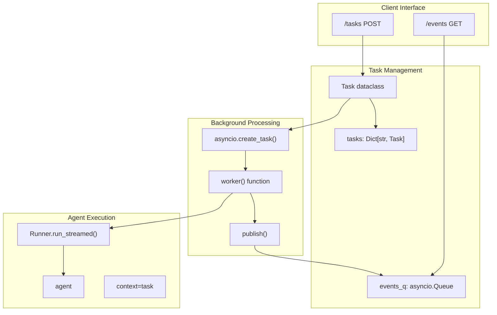
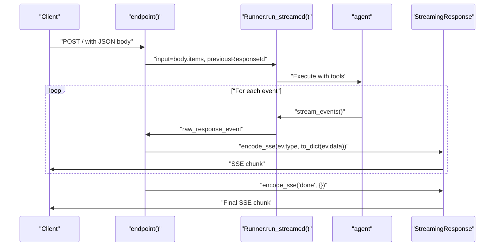
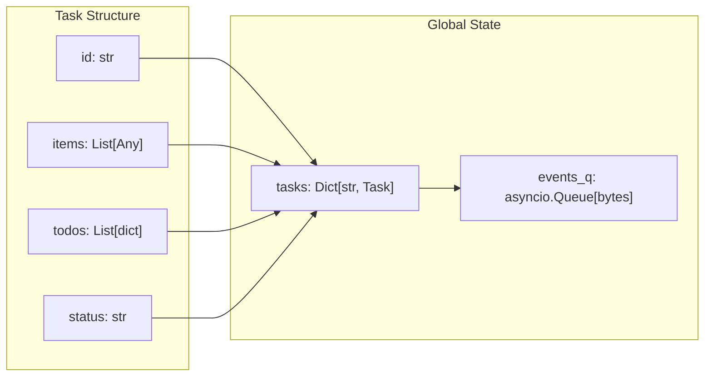
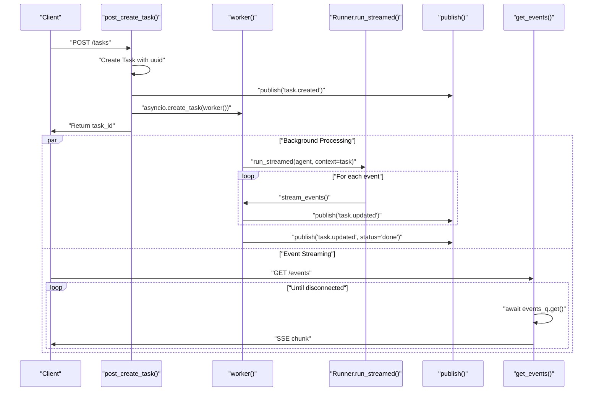
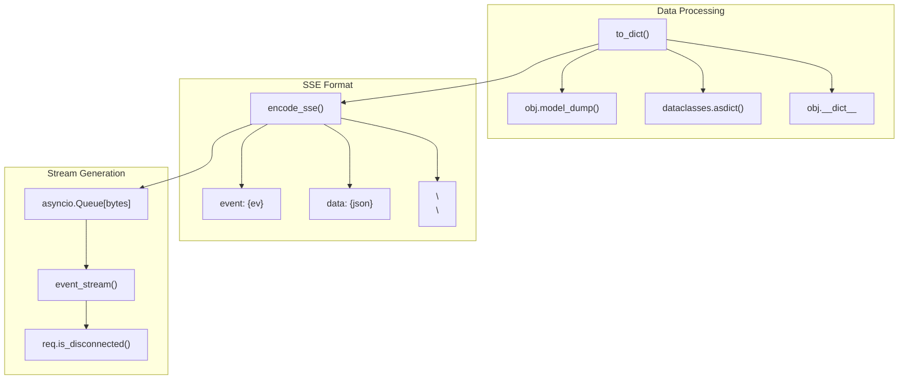
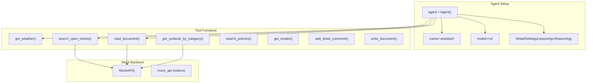
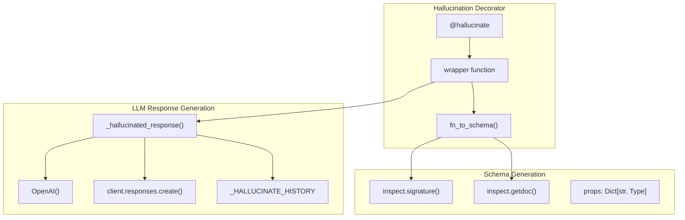

<!-- source: DeepWiki mcp.deepwiki.com · repo openai/build-hours · page 6.3 Server-based Agent Systems · fetched 2026-10-26 -->

# Server-based Agent Systems

Relevant source files

The following files were used as context for generating this wiki page:

- [12-agentic-tool-calling/3_simple_server.py](12-agentic-tool-calling/3_simple_server.py)
- [12-agentic-tool-calling/4_queue_server.py](12-agentic-tool-calling/4_queue_server.py)
- [12-agentic-tool-calling/server.py](12-agentic-tool-calling/server.py)
- [12-agentic-tool-calling/server_agents.py](12-agentic-tool-calling/server_agents.py)
- [12-agentic-tool-calling/utils.py](12-agentic-tool-calling/utils.py)

This document covers the server-based deployment patterns for agent systems in the Build Hours repository, focusing on FastAPI implementations that provide HTTP endpoints for agent interactions with streaming responses and task queue management. The systems demonstrate production-ready patterns for deploying conversational agents with tool calling capabilities.

For basic agent patterns and tool calling fundamentals, see [Basic Assistants and Tool Calling](#6.1). For multi-agent orchestration patterns, see [Advanced Agent Orchestration](#6.2).

## Architecture Overview

The server-based agent systems provide two main deployment patterns: simple streaming servers for direct agent interactions and queue-based servers for asynchronous task processing. Both patterns use Server-Sent Events (SSE) for real-time streaming of agent responses and tool execution updates.

### Simple Streaming Server Architecture

Sources: [12-agentic-tool-calling/3_simple_server.py:1-31]()

### Queue-Based Task Server Architecture

Sources: [12-agentic-tool-calling/4_queue_server.py:1-78]()

## Simple Server Implementation

The basic server implementation provides a single endpoint that accepts agent input and streams responses using Server-Sent Events. This pattern is suitable for direct conversational interactions where immediate responses are expected.

### Core Server Components

The simple server consists of a FastAPI application with a single POST endpoint that processes agent requests:

| Component | Purpose | Location |
|-----------|---------|----------|
| `FastAPI()` | Web server instance | [12-agentic-tool-calling/3_simple_server.py:8]() |
| `endpoint()` | Main request handler | [12-agentic-tool-calling/3_simple_server.py:12-26]() |
| `event_stream()` | SSE generator function | [12-agentic-tool-calling/3_simple_server.py:15-24]() |
| `StreamingResponse` | FastAPI streaming response | [12-agentic-tool-calling/3_simple_server.py:26]() |

### Request Processing Flow

Sources: [12-agentic-tool-calling/3_simple_server.py:12-26]()

## Queue-Based Task Server

The queue-based server provides asynchronous task processing with a separate events endpoint for monitoring task progress. This pattern supports long-running agent tasks and multiple concurrent operations.

### Task Management System

The server maintains task state using a `Task` dataclass and global dictionaries for tracking:

Sources: [12-agentic-tool-calling/4_queue_server.py:16-25]()

### Background Worker Process

The `worker()` function handles agent execution in the background, publishing updates to the global event queue:

| Function | Purpose | Key Features |
|----------|---------|--------------|
| `worker()` | Background task execution | [12-agentic-tool-calling/4_queue_server.py:29-45]() |
| `publish()` | Event publishing to queue | [12-agentic-tool-calling/4_queue_server.py:11-13]() |
| `post_create_task()` | Task creation endpoint | [12-agentic-tool-calling/4_queue_server.py:48-60]() |
| `get_events()` | SSE events endpoint | [12-agentic-tool-calling/4_queue_server.py:63-72]() |

### Task Processing Workflow

Sources: [12-agentic-tool-calling/4_queue_server.py:29-72]()

## Streaming Infrastructure

The server systems rely on utility functions for handling Server-Sent Events and data serialization to enable real-time communication with clients.

### SSE Encoding and Event Streaming

Sources: [12-agentic-tool-calling/utils.py:91-108]()

### Response Event Handling

The systems process different types of response events from the agent runtime:

| Event Type | Handler Function | Purpose |
|------------|------------------|---------|
| `ResponseOutputItemAddedEvent` | `handle_event_added()` | [12-agentic-tool-calling/utils.py:74-77]() |
| `ResponseOutputItemDoneEvent` | `handle_event_done()` | [12-agentic-tool-calling/utils.py:80-88]() |
| `ResponseCompletedEvent` | Track response ID | [12-agentic-tool-calling/utils.py:62-63]() |

## Agent Configuration and Tools

The server agents are configured with comprehensive tool sets and specific instructions for autonomous operation in server environments.

### Server Agent Configuration

Sources: [12-agentic-tool-calling/server_agents.py:73-93]()

### Tool Function Patterns

The agent tools follow a consistent pattern using the `@function_tool` decorator and integration with a `MockAPI` backend:

| Tool Function | API Integration | Return Type |
|---------------|-----------------|-------------|
| `get_weather()` | Static response | `dict` |
| `search_open_tickets()` | `mock_api.search_open_tickets()` | `List[Dict[str, Any]]` |
| `read_document()` | `mock_api.read_document()` | `Optional[Dict[str, Any]]` |
| `get_runbook_by_category()` | `mock_api.get_runbook_by_category()` | `Optional[Dict[str, Any]]` |
| `search_policies()` | `mock_api.search_policies()` | `List[Dict[str, Any]]` |
| `get_emails()` | `mock_api.get_emails()` | `List[Dict[str, Any]]` |
| `add_ticket_comment()` | `mock_api.add_ticket_comment()` | `Optional[List[str]]` |
| `write_document()` | `mock_api.write_document()` | `Dict[str, Any]` |

Sources: [12-agentic-tool-calling/server_agents.py:11-92]()

## Advanced Features

### Function Hallucination System

The utilities include a sophisticated function hallucination system that uses LLMs to generate mock responses for function calls:

Sources: [12-agentic-tool-calling/utils.py:181-207]()

### Demo Loop Integration

The server systems can also run in interactive demo mode using the `run_demo_loop()` function, which provides a command-line interface with the same streaming capabilities:

| Component | Purpose | Implementation |
|-----------|---------|----------------|
| `run_demo_loop()` | Interactive CLI | [12-agentic-tool-calling/utils.py:36-71]() |
| `Runner.run_streamed()` | Agent execution | [12-agentic-tool-calling/utils.py:50-54]() |
| Event handling | Console output | [12-agentic-tool-calling/utils.py:56-66]() |
| Color formatting | Enhanced UX | [12-agentic-tool-calling/utils.py:18-33]() |

Sources: [12-agentic-tool-calling/utils.py:36-89]()

---

