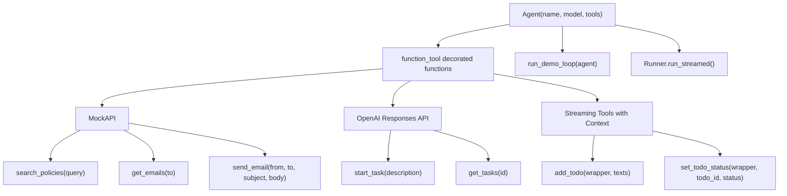
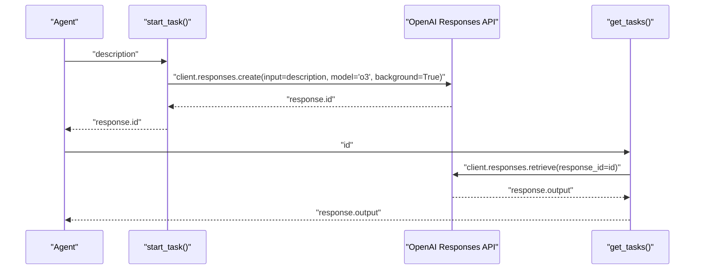
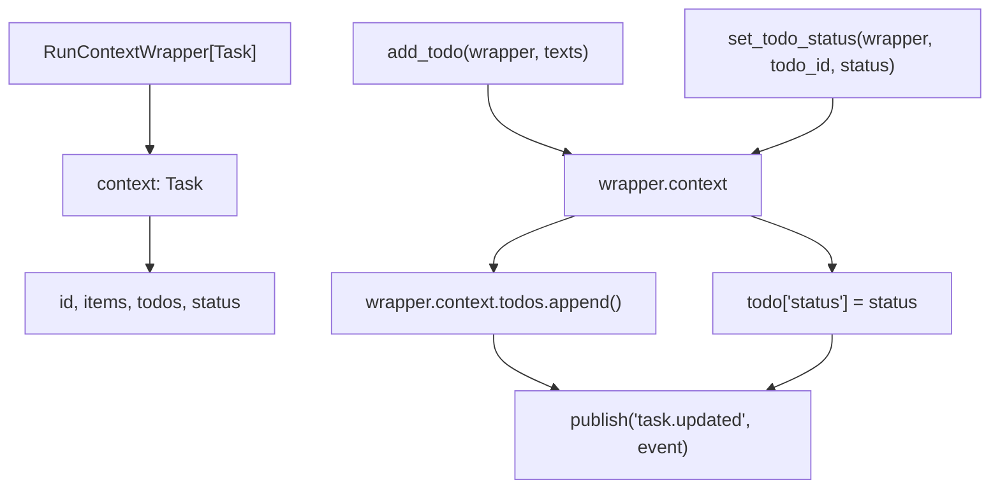
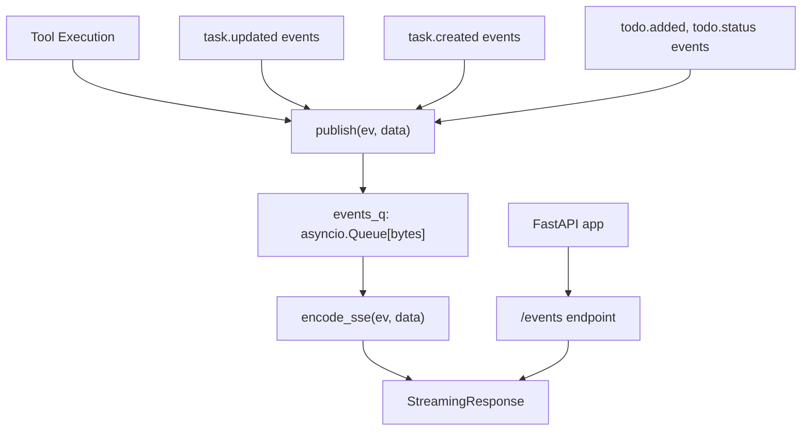
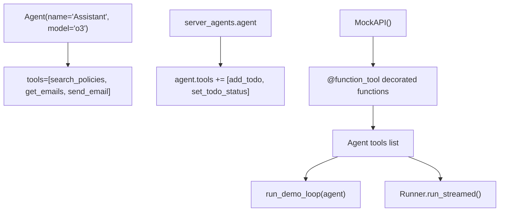

<!-- source: DeepWiki mcp.deepwiki.com · repo openai/build-hours · page 6.4 Agent Tool Integration and Delegation · fetched 2026-10-26 -->

# Agent Tool Integration and Delegation

<details>
<summary>Relevant source files</summary>

The following files were used as context for generating this wiki page:

- [12-agentic-tool-calling/0_task.py](12-agentic-tool-calling/0_task.py)
- [12-agentic-tool-calling/1_agent.py](12-agentic-tool-calling/1_agent.py)
- [12-agentic-tool-calling/2_tools.py](12-agentic-tool-calling/2_tools.py)
- [12-agentic-tool-calling/5_todos.py](12-agentic-tool-calling/5_todos.py)
- [12-agentic-tool-calling/6_delegation.py](12-agentic-tool-calling/6_delegation.py)

</details>


This document covers advanced patterns for agent tool integration and task delegation within the agentic tool calling system. It focuses on how agents can utilize external tools, delegate tasks to background processes, and manage complex workflows with streaming responses and context sharing.

For basic agent patterns and tool calling fundamentals, see [Basic Assistants and Tool Calling](#6.1). For multi-agent orchestration and transfer mechanisms, see [Advanced Agent Orchestration](#6.2). For server-based implementations, see [Server-based Agent Systems](#6.3).

## Tool Integration Architecture

The agent tool integration system provides a framework for agents to interact with external APIs, services, and background processes through a standardized tool interface.

### Tool Integration Flow



**Sources:** [12-agentic-tool-calling/1_agent.py:1-11](), [12-agentic-tool-calling/2_tools.py:9-31](), [12-agentic-tool-calling/5_todos.py:29-74](), [12-agentic-tool-calling/6_delegation.py:9-36]()

### Function Tool Decorator

The `@function_tool` decorator creates standardized tool interfaces that agents can invoke. Tools are defined as regular Python functions with type hints and docstrings that provide metadata for the agent.

| Tool Type | Example Function | Purpose |
|-----------|------------------|---------|
| Mock API Tools | `search_policies`, `get_emails`, `send_email` | Simulated external service interactions |
| Task Delegation | `start_task`, `get_tasks` | Background task management via OpenAI API |
| Context-Aware | `add_todo`, `set_todo_status` | Stateful operations with shared context |

**Sources:** [12-agentic-tool-calling/2_tools.py:9-22](), [12-agentic-tool-calling/6_delegation.py:9-28](), [12-agentic-tool-calling/5_todos.py:29-72]()

## Task Delegation Mechanisms

The system supports delegation of complex tasks to background processes using OpenAI's responses API, enabling long-running operations without blocking the main agent.

### Task Delegation Flow



**Sources:** [12-agentic-tool-calling/6_delegation.py:14-28](), [12-agentic-tool-calling/0_task.py:1-12]()

### Background Task Processing

The delegation system creates background tasks using the o3 model for complex reasoning operations. Tasks are initiated through `start_task()` and monitored via `get_tasks()`.

```python
# Task creation pattern from delegation.py
response = client.responses.create(
    input=description,
    model="o3", 
    background=True,
)
return response.id
```

**Sources:** [12-agentic-tool-calling/6_delegation.py:15-21]()

## Context Management and State Sharing

Advanced tool implementations utilize `RunContextWrapper` to maintain shared state across tool invocations within a single agent session.

### Context Wrapper Architecture



**Sources:** [12-agentic-tool-calling/5_todos.py:16-22](), [12-agentic-tool-calling/5_todos.py:29-72]()

### Task Data Structure

The `Task` dataclass provides the context structure for stateful tool operations:

| Field | Type | Purpose |
|-------|------|---------|
| `id` | `str` | Unique task identifier |
| `items` | `List[Any]` | Input items for processing |
| `todos` | `List[dict]` | Generated todo items with status |
| `status` | `str` | Overall task status ("running", "done") |

**Sources:** [12-agentic-tool-calling/5_todos.py:16-22]()

## Streaming and Event Publishing

The system supports real-time updates through server-sent events (SSE) for dynamic task monitoring and updates.

### Event Publishing System



**Sources:** [12-agentic-tool-calling/5_todos.py:10-14](), [12-agentic-tool-calling/5_todos.py:111-121](), [12-agentic-tool-calling/5_todos.py:43-71]()

### Event Types and Payloads

| Event Type | Payload Structure | Trigger |
|------------|------------------|---------|
| `task.created` | `{"task": {"id": task_id}}` | New task creation |
| `task.updated` | `{"task_id": id, "event": {...}}` | Tool execution results |
| `todo.added` | `{"type": "todo.added", "todo": {...}}` | Todo item creation |
| `todo.status` | `{"type": "todo.status", "todoId": id, "status": status}` | Status updates |

**Sources:** [12-agentic-tool-calling/5_todos.py:43-71](), [12-agentic-tool-calling/5_todos.py:105]()

## Agent and Tool Registration

The system uses a modular approach for registering tools with agents, allowing dynamic tool composition.

### Tool Registration Pattern



**Sources:** [12-agentic-tool-calling/2_tools.py:24-30](), [12-agentic-tool-calling/5_todos.py:74](), [12-agentic-tool-calling/6_delegation.py:30-36]()

The agent tool integration and delegation system demonstrates sophisticated patterns for extending agent capabilities through external tool integration, background task processing, and real-time state management with streaming updates.

---

