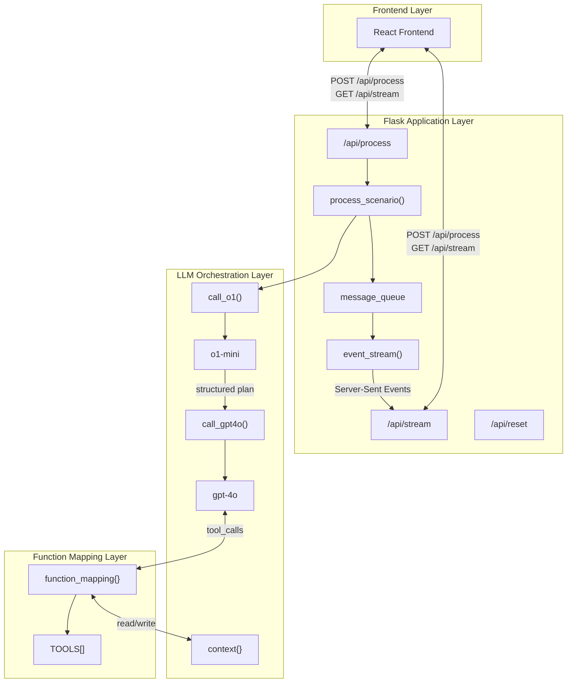
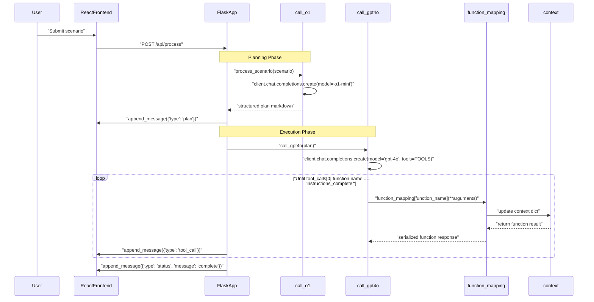
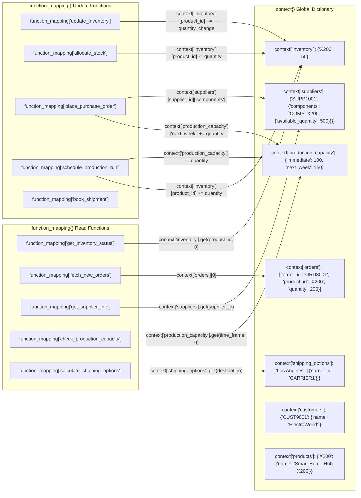

<!-- source: DeepWiki mcp.deepwiki.com · repo openai/build-hours · page 7 Reasoning and Planning · fetched 2026-10-26 -->

# Reasoning and Planning

<details>
<summary>Relevant source files</summary>

The following files were used as context for generating this wiki page:

- [7-reasoning/shipmentPlanning/ReadMe.md](7-reasoning/shipmentPlanning/ReadMe.md)
- [7-reasoning/shipmentPlanning/backend/app.py](7-reasoning/shipmentPlanning/backend/app.py)
- [7-reasoning/shipmentPlanning/backend/functionDefinitions.py](7-reasoning/shipmentPlanning/backend/functionDefinitions.py)

</details>


This page provides an overview of systems in the Build Hours repository that demonstrate how Large Language Models (LLMs) can perform complex reasoning and planning tasks. Specifically, we focus on applications that require multi-step decision making, structured planning, and execution through function calling. For information about the Assistants & Tool Calling Demos, see [Assistant Demos](#6).

## Introduction

Modern LLMs can go beyond simple text generation to perform sophisticated reasoning and planning. The core system featured in this section is the Shipping Planner, which showcases how LLMs can:

1. Generate detailed, structured plans for complex tasks
2. Execute those plans through function calling
3. Maintain and update state throughout a multi-step process
4. Adapt to changing conditions by reevaluating and adjusting plans

This approach to AI planning demonstrates how LLMs can function as reasoning engines for complex business operations.

## System Architecture

The Shipping Planner uses a two-stage approach that separates planning from execution:



Sources: [7-reasoning/shipmentPlanning/backend/app.py:1-396](), [7-reasoning/shipmentPlanning/backend/functionDefinitions.py:1-288]()

### Key Components

1. **Frontend**: A React-based interface for submitting scenarios and viewing real-time results
2. **Backend**: Flask application providing API endpoints and scenario processing
3. **Planner Model (o1-mini)**: Generates a detailed, step-by-step plan
4. **Executor Model (gpt-4o)**: Follows the plan and executes it through function calls
5. **Function Toolkit**: Domain-specific functions for interacting with the simulated environment
6. **Context State**: Central state object that maintains the current state of the environment

## Two-Stage Planning and Execution

The system implements a distinct separation between planning and execution phases:



Sources: [7-reasoning/shipmentPlanning/backend/app.py:304-393](), [7-reasoning/shipmentPlanning/backend/app.py:256-270]()

### Planning Phase with o1-mini

The o1-mini model takes a scenario as input and outputs a structured plan. The planning phase is governed by a detailed system prompt that instructs the model to:

- Break instructions into numbered main actions and lettered sub-actions
- Specify conditions using clear if-then-else statements
- Indicate when functions should be called using backticks
- End with an `instructions_complete` function call

This formatting ensures the plan is detailed and structured enough for the executor model to follow.

Sources: [7-reasoning/shipmentPlanning/backend/app.py:86-144]()

### Execution Phase with gpt-4o

The gpt-4o model follows the plan generated by o1-mini, calling functions to interact with the simulated environment. The execution phase involves:

1. Reading and understanding the plan
2. Identifying the current step in the plan
3. Explaining decision-making rationale
4. Executing required actions through function calls
5. Handling function responses and updating the plan execution accordingly

Sources: [7-reasoning/shipmentPlanning/backend/app.py:146-162](), [7-reasoning/shipmentPlanning/backend/app.py:334-393]()

## Function Toolkit

The system provides a comprehensive set of functions organized by domain area:

```mermaid
graph TD
    subgraph "TOOLS Array Structure"
        subgraph "InventoryTools[0-2]"
            GetInventoryStatus["TOOLS[0]: get_inventory_status"]
            UpdateInventory["TOOLS[1]: update_inventory"]
            GetProductDetails["TOOLS[4]: get_product_details"]
        end
        
        subgraph "OrderTools[2,6]"
            FetchNewOrders["TOOLS[2]: fetch_new_orders"]
            AllocateStock["TOOLS[6]: allocate_stock"]
        end
        
        subgraph "SupplierTools[3,5,7]"
            CheckAvailableSuppliers["TOOLS[3]: check_available_suppliers"]
            GetSupplierInfo["TOOLS[5]: get_supplier_info"]
            PlacePurchaseOrder["TOOLS[7]: place_purchase_order"]
        end
        
        subgraph "ProductionTools[8,9]"
            CheckProductionCapacity["TOOLS[8]: check_production_capacity"]
            ScheduleProductionRun["TOOLS[9]: schedule_production_run"]
        end
        
        subgraph "ShippingTools[10,11,12]"
            CalculateShippingOptions["TOOLS[10]: calculate_shipping_options"]
            BookShipment["TOOLS[11]: book_shipment"]
            SendOrderUpdate["TOOLS[12]: send_order_update"]
        end
        
        InstructionsComplete["TOOLS[13]: instructions_complete"]
    end
    
    GetInventoryStatus --> AllocateStock
    GetProductDetails --> ScheduleProductionRun
    FetchNewOrders --> AllocateStock
    AllocateStock --> UpdateInventory
    CheckAvailableSuppliers --> GetSupplierInfo
    GetSupplierInfo --> PlacePurchaseOrder
    PlacePurchaseOrder --> CheckProductionCapacity
    CheckProductionCapacity --> ScheduleProductionRun
    ScheduleProductionRun --> GetInventoryStatus
    AllocateStock --> CalculateShippingOptions
    CalculateShippingOptions --> BookShipment
    BookShipment --> SendOrderUpdate
    SendOrderUpdate --> InstructionsComplete
```



Sources: [7-reasoning/shipmentPlanning/backend/functionDefinitions.py:1-288]()

### Function Categories

The function toolkit is organized into five main categories:

| Category | Functions | Purpose |
|----------|-----------|---------|
| Inventory Management | `get_inventory_status`, `update_inventory`, `get_product_details` | Check and modify inventory levels, retrieve product details |
| Order Management | `fetch_new_orders`, `allocate_stock` | Retrieve and process customer orders |
| Supplier Management | `check_available_suppliers`, `get_supplier_info`, `place_purchase_order` | Identify suppliers and order components |
| Production Management | `check_production_capacity`, `schedule_production_run` | Check production capacity and schedule manufacturing |
| Shipping Management | `calculate_shipping_options`, `book_shipment`, `send_order_update` | Calculate shipping options, book shipments, and notify customers |

Each function is defined with detailed parameters, requirements, and descriptions to enable the LLM to use them appropriately.

Sources: [7-reasoning/shipmentPlanning/backend/functionDefinitions.py:1-288]()

## State Management

The system uses a central context object to maintain state across the planning and execution process:



Sources: [7-reasoning/shipmentPlanning/backend/app.py:19-81](), [7-reasoning/shipmentPlanning/backend/app.py:256-270]()

The context object includes:

- Current inventory levels
- Pending orders
- Available suppliers and their components
- Production capacity
- Shipping options
- Customer information
- Product details and component requirements

This state is initialized at the start of the process and can be reset between scenarios.

Sources: [7-reasoning/shipmentPlanning/backend/app.py:19-84]()

## End-to-End Process Flow

A typical scenario processed by the system follows this flow:

1. User submits a scenario describing a supply chain challenge
2. The `process_scenario` function sends the scenario to o1-mini
3. o1-mini generates a structured, step-by-step plan
4. The plan is streamed to the frontend
5. The plan is sent to gpt-4o for execution
6. gpt-4o executes the plan by calling functions
7. Each function call and its response is streamed to the frontend
8. When all steps are complete, gpt-4o calls `instructions_complete`
9. The frontend displays the final state

### Flask API Endpoints

The Flask application exposes three main routes:

| Route | Method | Function | Purpose |
|-------|--------|----------|---------|
| `/api/process` | POST | `process()` | Submit scenario, start `threading.Thread(target=process_scenario)` |
| `/api/stream` | GET | `stream()` | Return `Response(event_stream())` with SSE headers |
| `/api/reset` | POST | `reset_state()` | Reset `context = copy.deepcopy(initial_context)` |

The streaming endpoint uses Server-Sent Events with the following message types from `message_queue`:
- `{'type': 'status', 'message': 'Generating plan...'}` 
- `{'type': 'plan', 'content': plan}`
- `{'type': 'assistant', 'content': assistant_message.get('content', '')}`
- `{'type': 'tool_call', 'function_name': function_name, 'arguments': input_arguments_str}`
- `{'type': 'tool_response', 'function_name': function_name, 'response': serialized_output}`

Sources: [7-reasoning/shipmentPlanning/backend/app.py:274-302](), [7-reasoning/shipmentPlanning/backend/app.py:272-273](), [7-reasoning/shipmentPlanning/backend/app.py:364-391]()

## Setup and Usage

To use the Shipping Planner system:

### Backend Setup
1. Set your OpenAI API key as an environment variable: `OPENAI_API_KEY`
2. Navigate to the backend directory
3. Install the required packages: `pip install -r requirements.txt`
4. Run the backend server: `python app.py`

### Frontend Setup
1. Navigate to the frontend directory
2. Ensure you have Node.js version 21 or higher installed
3. Install dependencies: `npm i`
4. Start the frontend server: `npm start`
5. Access the application at http://localhost:3000

Sources: [7-reasoning/shipmentPlanning/ReadMe.md:3-17]()

## Example Scenario

The default scenario used in the system demonstrates a complex supply chain challenge:

```
We just received a major shipment of new orders. Please generate a plan that gets the list of awaiting orders and determines the best policy to fulfill them.

The plan should include checking inventory, ordering necessary components from suppliers, scheduling production runs with available capacity, ordering new components required from suppliers, and arranging shipping to the retailer's distribution center in Los Angeles. Notify the customer before completing.

Prioritize getting any possible orders out that you can while placing orders for any backlog items.
```

Sources: [7-reasoning/shipmentPlanning/ReadMe.md:20-27]()

## Key Design Patterns for LLM Reasoning

The Shipping Planner demonstrates several important design patterns for building LLM reasoning systems:

1. **Two-stage architecture**: Separating planning from execution allows specialization of models
2. **Structured planning prompts**: Clear formatting instructions lead to well-structured plans
3. **Function-based environment**: Enabling interaction with the environment through a well-defined function toolkit
4. **State management**: Maintaining consistent state throughout the process
5. **Real-time feedback**: Streaming results to provide visibility into the planning and execution process

These patterns can be applied to other domains requiring complex reasoning and planning.

## Conclusion

The Shipping Planner system demonstrates a powerful approach to LLM-based reasoning and planning. By separating planning from execution and providing a structured environment through function calling, the system enables complex problem-solving in a supply chain context. This architecture can be extended to other domains that require multi-step planning and orchestrated execution.

---

