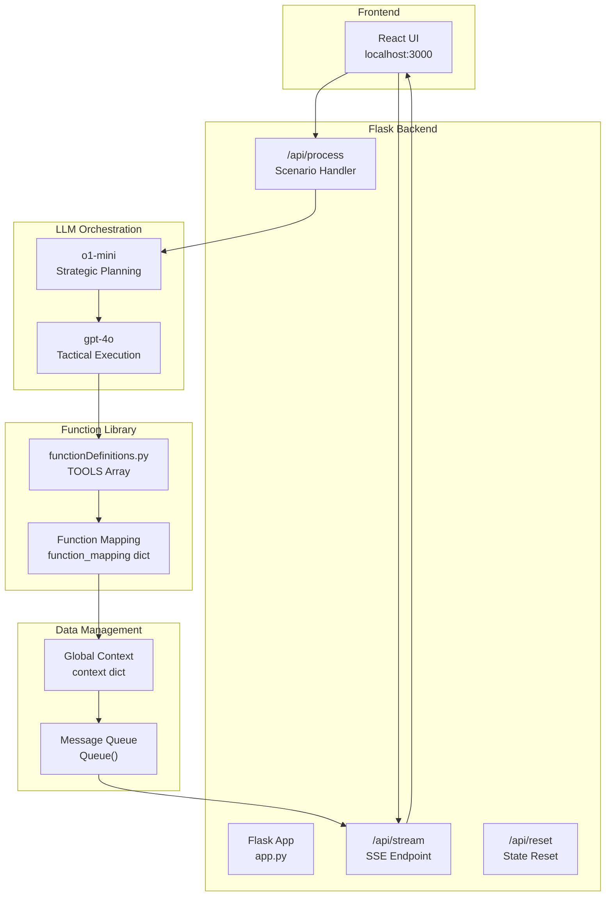
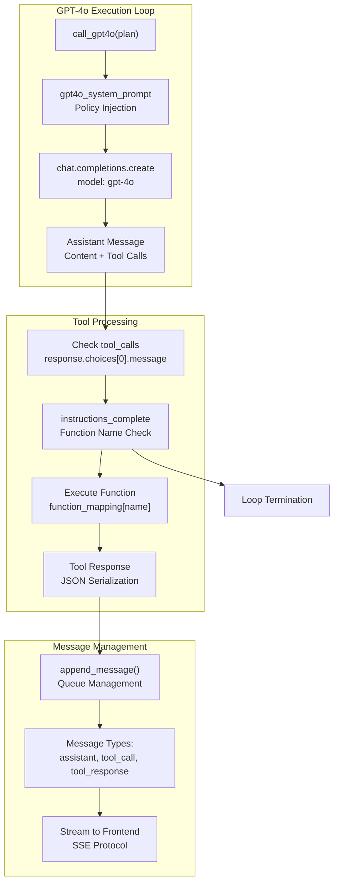
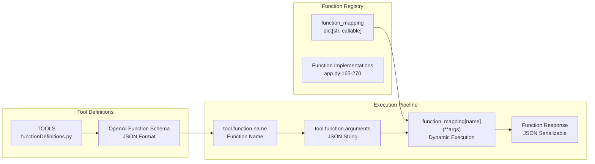
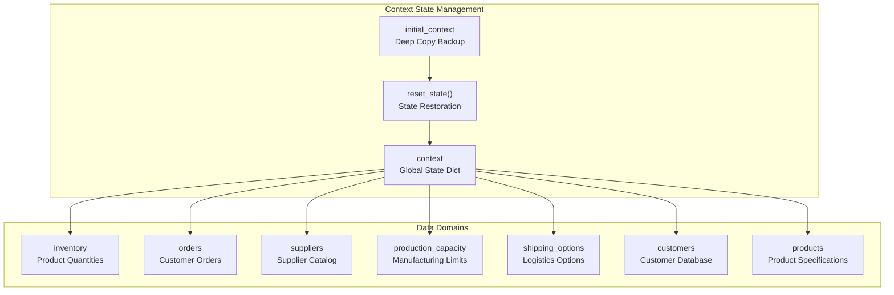
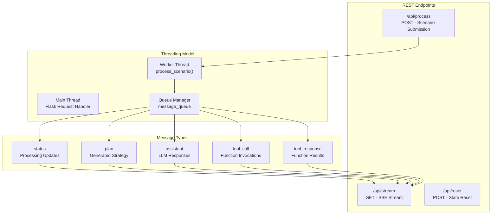
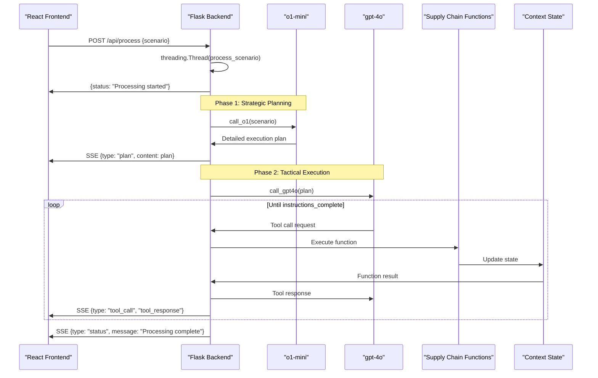

<!-- source: DeepWiki mcp.deepwiki.com · repo openai/build-hours · page 7.1 Supply Chain Planning System · fetched 2026-10-26 -->

# Supply Chain Planning System

Relevant source files

The following files were used as context for generating this wiki page:

- [7-reasoning/shipmentPlanning/ReadMe.md](7-reasoning/shipmentPlanning/ReadMe.md)
- [7-reasoning/shipmentPlanning/backend/app.py](7-reasoning/shipmentPlanning/backend/app.py)
- [7-reasoning/shipmentPlanning/backend/functionDefinitions.py](7-reasoning/shipmentPlanning/backend/functionDefinitions.py)

## Purpose and Scope

The Supply Chain Planning System demonstrates a sophisticated multi-LLM approach to complex reasoning and execution tasks. This system uses OpenAI's o1-mini model for high-level strategic planning and gpt-4o for detailed task execution, orchestrating supply chain operations including inventory management, order fulfillment, production scheduling, and logistics coordination.

This document covers the technical implementation of the dual-LLM architecture, function definitions, data management, and API interfaces. For general agent frameworks and tool calling patterns, see [Agent Systems](#6). For other reasoning applications, see [Reasoning and Planning](#7).

## System Overview

The Supply Chain Planning System operates as a Flask-based web application with a React frontend, implementing a two-stage LLM workflow for supply chain management. The system processes complex scenarios through strategic planning followed by tactical execution.

### High-Level Architecture

Sources: [7-reasoning/shipmentPlanning/backend/app.py:1-396](), [7-reasoning/shipmentPlanning/ReadMe.md:1-27]()

## Two-Phase LLM Architecture

The system implements a sophisticated dual-LLM approach where strategic planning and tactical execution are separated into distinct phases, each optimized for different reasoning capabilities.

### LLM Workflow and Responsibilities

```mermaid
graph LR
    subgraph "Phase 1: Strategic Planning"
        SCENARIO["User Scenario<br/>Complex Supply Chain Task"]
        O1_PROMPT["o1_prompt<br/>Strategic Context"]
        O1_MODEL["o1-mini<br/>call_o1()"]
        PLAN["Detailed Plan<br/>Numbered Steps"]
    end
    
    subgraph "Phase 2: Tactical Execution"
        POLICY["gpt4o_system_prompt<br/>Policy Template"]
        GPT4O_MODEL["gpt-4o<br/>call_gpt4o()"]
        TOOLS_EXEC["Tool Execution<br/>function_mapping"]
        RESULTS["Function Results<br/>JSON Responses"]
    end
    
    subgraph "Communication Layer"
        MSG_QUEUE["message_queue<br/>Queue()"]
        STREAM_API["/api/stream<br/>SSE Response"]
    end
    
    SCENARIO --> O1_PROMPT
    O1_PROMPT --> O1_MODEL
    O1_MODEL --> PLAN
    PLAN --> POLICY
    POLICY --> GPT4O_MODEL
    GPT4O_MODEL --> TOOLS_EXEC
    TOOLS_EXEC --> RESULTS
    RESULTS --> MSG_QUEUE
    MSG_QUEUE --> STREAM_API
```

Sources: [7-reasoning/shipmentPlanning/backend/app.py:304-332](), [7-reasoning/shipmentPlanning/backend/app.py:334-393]()

## Planning Phase (o1-mini)

The planning phase uses o1-mini to generate comprehensive, step-by-step execution plans. The `call_o1()` function handles strategic reasoning with detailed context about available functions and expected output format.

### Planning Prompt Structure

The `o1_prompt` variable [7-reasoning/shipmentPlanning/backend/app.py:87-144]() provides extensive context including:

| Component | Purpose |
|-----------|---------|
| Role Definition | Supply chain management assistant |
| Function Catalog | Detailed descriptions of all available tools |
| Output Format | Numbered steps with lettered sub-actions |
| Conditional Logic | If-then-else statement requirements |
| Function Syntax | Backtick notation for function calls |
| Completion Signal | Mandatory `instructions_complete` function call |

### Planning Output Requirements

The planning phase must generate plans following specific formatting rules:
- **Main actions**: Numbered (1, 2, 3)
- **Sub-actions**: Lettered under main actions (1a, 1b)
- **Conditions**: Clear if-then-else statements
- **Function calls**: Backtick notation with explicit arguments
- **Termination**: Final `instructions_complete` call

Sources: [7-reasoning/shipmentPlanning/backend/app.py:317-332]()

## Execution Phase (gpt-4o)

The execution phase uses gpt-4o to follow the generated plan precisely, making function calls and handling responses through the OpenAI function calling API.

### Execution Loop and Tool Calling

Sources: [7-reasoning/shipmentPlanning/backend/app.py:334-393]()

## Function Library and Tools

The system provides a comprehensive function library for supply chain operations through the `TOOLS` array and `function_mapping` dictionary.

### Function Categories and Implementation

| Category | Functions | Purpose |
|----------|-----------|---------|
| **Inventory Management** | `get_inventory_status`, `update_inventory`, `allocate_stock` | Track and modify product quantities |
| **Order Processing** | `fetch_new_orders`, `send_order_update` | Handle customer orders and communications |
| **Supplier Management** | `check_available_suppliers`, `get_supplier_info`, `place_purchase_order` | Manage supplier relationships and procurement |
| **Production Planning** | `get_product_details`, `check_production_capacity`, `schedule_production_run` | Coordinate manufacturing operations |
| **Logistics** | `calculate_shipping_options`, `book_shipment` | Handle shipping and distribution |
| **System Control** | `instructions_complete` | Signal completion of execution plan |

### Function Mapping Architecture

Sources: [7-reasoning/shipmentPlanning/backend/functionDefinitions.py:1-288](), [7-reasoning/shipmentPlanning/backend/app.py:256-270]()

## Data Context and State Management

The system maintains a global `context` dictionary that represents the complete state of the supply chain environment, including inventory levels, orders, suppliers, and production capacity.

### Context Structure and Initial State

The `context` variable [7-reasoning/shipmentPlanning/backend/app.py:19-81]() contains:

### State Modification Patterns

Functions modify the global context through direct dictionary access:
- **Inventory Updates**: `context['inventory'][product_id] += quantity`
- **Order Allocation**: `context['inventory'][product_id] -= allocated_quantity`
- **Supplier Changes**: `context['suppliers'][supplier_id]['components'][component_id]['available_quantity'] -= quantity`
- **Production Scheduling**: `context['production_capacity'][time_frame] -= scheduled_quantity`

Sources: [7-reasoning/shipmentPlanning/backend/app.py:19-84](), [7-reasoning/shipmentPlanning/backend/app.py:275-279]()

## API and Streaming Interface

The Flask application provides a RESTful API with Server-Sent Events (SSE) for real-time communication with the frontend.

### API Endpoints and Message Flow

### Threading and Asynchronous Processing

The system uses Python threading to separate request handling from LLM processing:
- **Request Thread**: Handles `/api/process` POST requests and immediately returns
- **Worker Thread**: Executes `process_scenario()` function asynchronously
- **Queue System**: `message_queue` coordinates communication between threads
- **SSE Stream**: `/api/stream` endpoint provides real-time updates to frontend

Sources: [7-reasoning/shipmentPlanning/backend/app.py:281-302](), [7-reasoning/shipmentPlanning/backend/app.py:304-316]()

## Integration Flow

The complete system integration demonstrates how multiple components work together to process complex supply chain scenarios.

### End-to-End Processing Flow

Sources: [7-reasoning/shipmentPlanning/backend/app.py:281-288](), [7-reasoning/shipmentPlanning/backend/app.py:304-316]()

---

