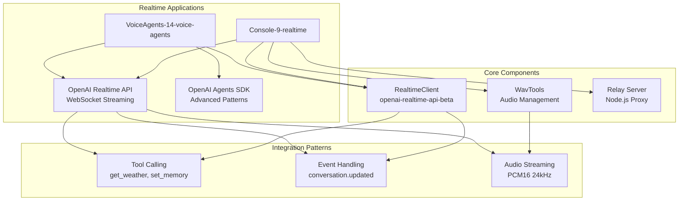
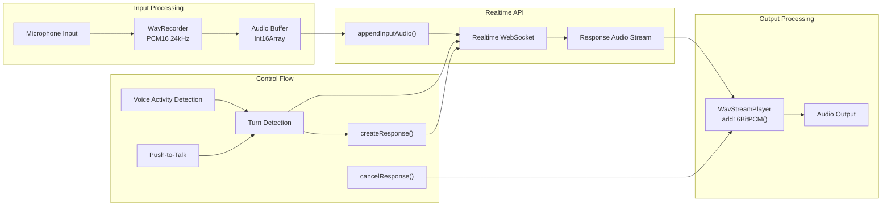
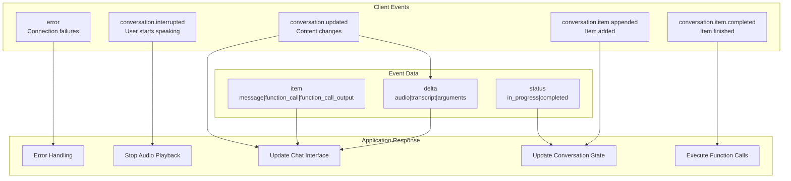
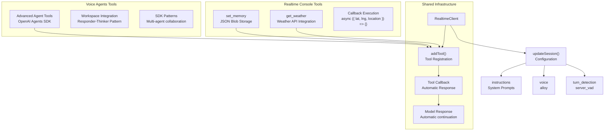
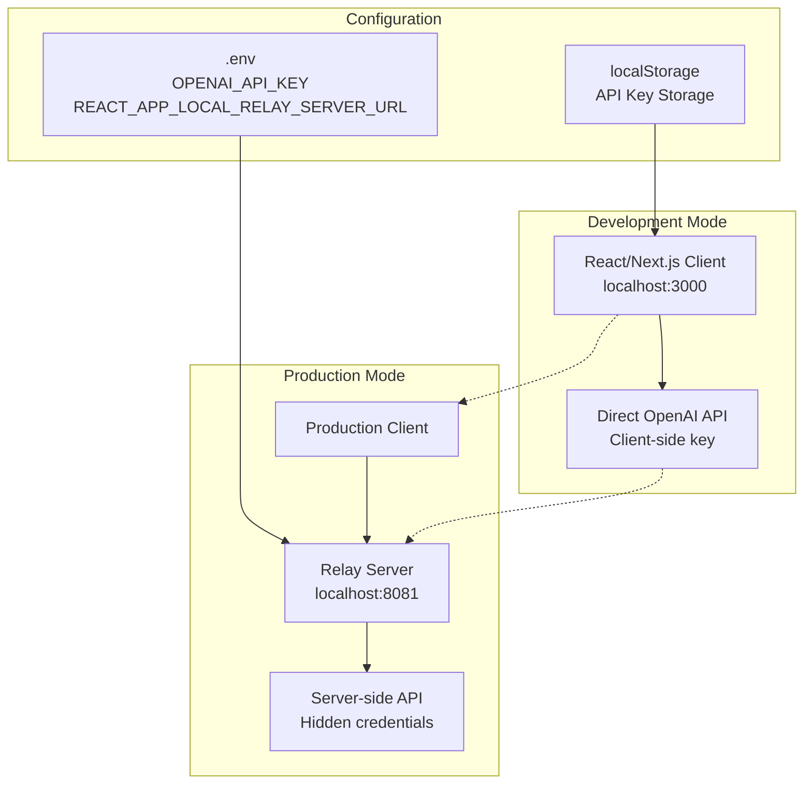

<!-- source: DeepWiki mcp.deepwiki.com · repo openai/build-hours · page 8 Realtime Applications · fetched 2026-10-26 -->

# Realtime Applications

Relevant source files

The following files were used as context for generating this wiki page:

- [14-voice-agents/realtime-workspace-agents/README.md](14-voice-agents/realtime-workspace-agents/README.md)
- [9-realtime/openai-realtime-console-example/README.md](9-realtime/openai-realtime-console-example/README.md)

This section documents the real-time streaming applications in the Build Hours repository that utilize OpenAI's Realtime API for low-latency audio interactions. These systems demonstrate voice-enabled AI applications with streaming audio processing and interactive conversational interfaces.

The realtime applications consist of two distinct implementations: a React-based console for API inspection and development ([Realtime Console](#8.1)) and a Next.js voice agent system with workspace integration ([Voice Agents and Workspace Integration](#8.2)). For agent frameworks without real-time capabilities, see [Agent Systems](#6).

## System Architecture Overview

The realtime applications are built around OpenAI's Realtime API, which provides WebSocket-based streaming for audio input/output and low-latency conversational AI. Both systems share common patterns for audio management, event handling, and tool integration while serving different use cases.

**Realtime Applications Architecture**

Sources: [9-realtime/openai-realtime-console-example/README.md:1-42](), [14-voice-agents/realtime-workspace-agents/README.md:1-30]()

## Key Components and Technologies

Both realtime applications utilize shared core technologies with different implementation approaches and complexity levels.

| Component | Realtime Console | Voice Agents | Purpose |
|-----------|-----------------|--------------|---------|
| **Framework** | React (create-react-app) | Next.js TypeScript | UI Implementation |
| **API Client** | `RealtimeClient` | `RealtimeClient` + Agents SDK | OpenAI Integration |
| **Audio Management** | `WavRecorder`, `WavStreamPlayer` | Built-in SDK tools | Audio I/O |
| **Tool Integration** | Basic (`get_weather`, `set_memory`) | Advanced Agent Tools | Function Calling |
| **Deployment** | Development Console | Production-ready App | Target Use Case |
| **Complexity** | Reference Implementation | Advanced Patterns | Development Approach |

Sources: [9-realtime/openai-realtime-console-example/README.md:14-27](), [14-voice-agents/realtime-workspace-agents/README.md:22-26]()

## Audio Processing Pipeline

Both systems implement similar audio processing patterns using the same underlying libraries and audio formats.

**Audio Processing Flow**

Sources: [9-realtime/openai-realtime-console-example/README.md:144-163](), [9-realtime/openai-realtime-console-example/README.md:285-324](), [9-realtime/openai-realtime-console-example/README.md:326-352]()

## Event Handling and Conversation Management

The realtime systems use an event-driven architecture for managing conversations and handling streaming updates.

**Event System Architecture**

Sources: [9-realtime/openai-realtime-console-example/README.md:230-276]()

## Tool Integration Patterns

Both systems demonstrate different approaches to tool integration with the Realtime API, from basic function calling to advanced agent patterns.

**Tool Integration Comparison**

Sources: [9-realtime/openai-realtime-console-example/README.md:53-61](), [9-realtime/openai-realtime-console-example/README.md:165-205](), [14-voice-agents/realtime-workspace-agents/README.md:5-14](), [14-voice-agents/realtime-workspace-agents/README.md:28-29]()

## Deployment and Development Patterns

The realtime applications demonstrate different deployment strategies and development approaches for realtime AI applications.

| Aspect | Realtime Console | Voice Agents |
|--------|-----------------|--------------|
| **Development Setup** | `npm start` on localhost:3000 | `npm run dev` on localhost:3000 |
| **API Key Management** | localStorage + UI prompt | Environment variables |
| **Relay Server** | Optional Node.js relay on :8081 | Integrated server handling |
| **Production Readiness** | Development/Reference tool | Production application framework |
| **Extensibility** | Manual client modification | SDK-based extension patterns |

**Deployment Architecture**

Sources: [9-realtime/openai-realtime-console-example/README.md:64-109](), [14-voice-agents/realtime-workspace-agents/README.md:20-26]()

---

