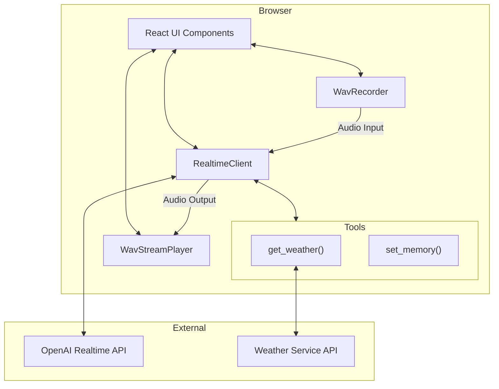
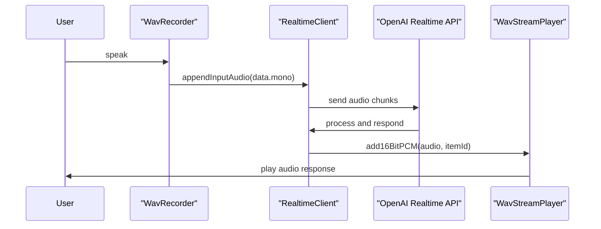
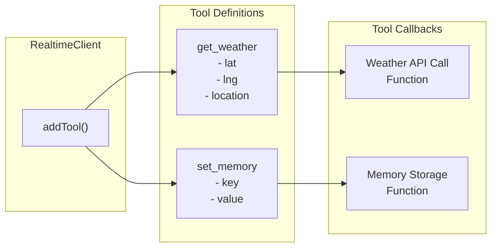
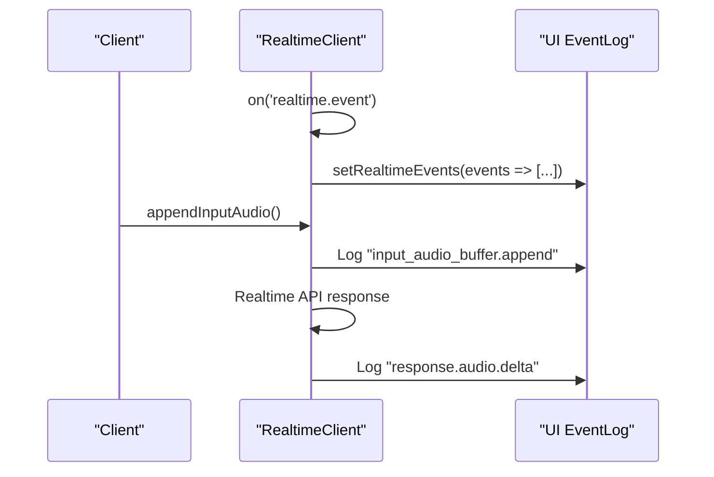
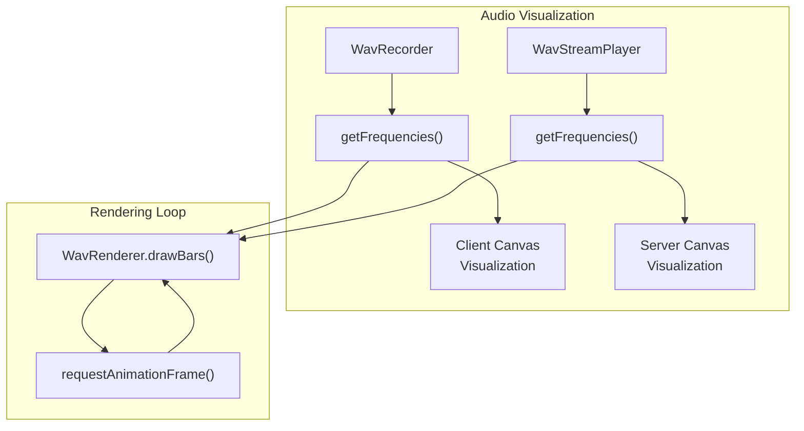

<!-- source: DeepWiki mcp.deepwiki.com · repo openai/build-hours · page 8.1 Realtime Console · fetched 2026-10-26 -->

# Realtime Console

<details>
<summary>Relevant source files</summary>

The following files were used as context for generating this wiki page:

- [9-realtime/openai-realtime-console-example/README.md](9-realtime/openai-realtime-console-example/README.md)

</details>


## Overview

The Realtime Console is an inspector and interactive API reference implementation for the OpenAI Realtime API. It provides a complete browser-based interface for testing voice interactions with OpenAI models in real-time, featuring audio input/output management, conversation tracking, and tool calling capabilities.

This document covers the architecture, components, and usage of the Realtime Console implementation. For information about other real-time applications in the repository, see [Realtime Applications](#7).

Sources: [9-realtime/openai-realtime-console-example/README.md:1-5]()

## Architecture Overview

The Realtime Console integrates several key components to enable voice-based interactions with OpenAI's models. It leverages two main utility libraries:

1. **OpenAI Realtime API Reference Client** - A client library for browser and Node.js that handles WebSocket communication with the OpenAI Realtime API
2. **Wavtools** - A utility library for audio recording and playback in the browser

The diagram below illustrates the high-level architecture of the Realtime Console:



Sources: [9-realtime/openai-realtime-console-example/README.md:3-8](), [9-realtime/openai-realtime-console-example/src/pages/ConsolePage.tsx:76-92]()

## Core Components

### RealtimeClient

The RealtimeClient is the central component that handles communication with the OpenAI Realtime API. It manages the conversation state, sends user audio/text inputs, receives model responses, and handles tool calling.

```mermaid
classDiagram
    class "RealtimeClient" {
        connect()
        disconnect()
        sendUserMessageContent()
        appendInputAudio()
        createResponse()
        cancelResponse()
        updateSession()
        addTool()
        deleteItem()
        on(event, callback)
    }
    
    class "Conversation" {
        getItems()
    }
    
    "RealtimeClient" -- "Conversation"
```

Key methods:
- `connect()` - Establishes a connection to the Realtime API
- `appendInputAudio()` - Adds audio data to the current input buffer
- `createResponse()` - Triggers the model to generate a response
- `addTool()` - Registers a tool function that the model can call
- `updateSession()` - Updates session parameters like instructions or voice settings

Sources: [9-realtime/openai-realtime-console-example/README.md:111-142](), [9-realtime/openai-realtime-console-example/src/pages/ConsolePage.tsx:83-92]()

### Audio Management Components

The console uses two primary components for audio management:

#### WavRecorder

WavRecorder handles microphone access and audio recording from the user's device.

Key methods:
- `begin()` - Requests permissions and connects to the microphone
- `record()` - Starts recording audio with a callback for each chunk
- `pause()` - Stops recording
- `end()` - Disconnects the microphone

#### WavStreamPlayer

WavStreamPlayer handles audio playback of the model's responses.

Key methods:
- `connect()` - Connects to audio output
- `add16BitPCM()` - Adds audio data for playback
- `interrupt()` - Stops current playback
- `getFrequencies()` - Gets frequency data for visualization



Sources: [9-realtime/openai-realtime-console-example/README.md:277-352](), [9-realtime/openai-realtime-console-example/src/pages/ConsolePage.tsx:76-82](), [9-realtime/openai-realtime-console-example/src/pages/ConsolePage.tsx:190-252]()

## Features and Implementation

### Voice Interaction Modes

The console supports two conversation modes:

1. **Manual (Push-to-Talk)** - User must press and hold a button to record audio
2. **Voice Activity Detection (VAD)** - Automatically detects when the user is speaking

The mode can be switched at any time through the UI toggle.

```javascript
// Implementation of mode switching
client.updateSession({
  turn_detection: value === 'none' ? null : { type: 'server_vad' },
});
```

Sources: [9-realtime/openai-realtime-console-example/README.md:44-62](), [9-realtime/openai-realtime-console-example/src/pages/ConsolePage.tsx:255-270]()

### Tool Integration

The console demonstrates tool calling capabilities with several example tools:

1. **get_weather** - Retrieves weather information for a location
2. **set_memory** - Stores user information in a memory object

Tools are registered with the client using the `addTool()` method, specifying both the schema and the callback function.



Sources: [9-realtime/openai-realtime-console-example/README.md:165-205](), [9-realtime/openai-realtime-console-example/src/pages/ConsolePage.tsx:384-456]()

### Event Logging

The console provides detailed event logging to visualize the communication between the client and server. Events are displayed in a chronological list with expandable details.



The event log helps developers understand the sequence of operations and debug communication issues.

Sources: [9-realtime/openai-realtime-console-example/src/pages/ConsolePage.tsx:500-511](), [9-realtime/openai-realtime-console-example/src/pages/ConsolePage.tsx:577-640]()

### Audio Visualization

The console provides visual feedback for both input and output audio through canvas-based visualizations.



Sources: [9-realtime/openai-realtime-console-example/src/pages/ConsolePage.tsx:303-368]()

## Usage Guide

### Setup and Connection

1. **Installation**:
   ```bash
   npm i
   npm start
   ```

2. **API Key**: The console requires an OpenAI API key with access to the Realtime API. You'll be prompted to enter it on startup.

3. **Connection**: Click the "connect" button to establish a connection to the Realtime API. This will request microphone access.

Sources: [9-realtime/openai-realtime-console-example/README.md:14-27](), [9-realtime/openai-realtime-console-example/README.md:44-46]()

### Conversation Interaction

1. **Choose Mode**: Select between "manual" (push-to-talk) or "vad" (voice activity detection) modes.

2. **Start Talking**:
   - In manual mode: Press and hold the "push to talk" button while speaking, release to send
   - In VAD mode: The system automatically detects when you start and stop speaking

3. **Interrupt the Model**: You can freely interrupt the model at any time by starting to speak again.

Sources: [9-realtime/openai-realtime-console-example/README.md:47-62](), [9-realtime/openai-realtime-console-example/src/pages/ConsolePage.tsx:221-252]()

## Using a Relay Server

For more robust implementations or to hide API credentials, the console can be configured to use a relay server:

1. Create a `.env` file with:
   ```
   OPENAI_API_KEY=YOUR_API_KEY
   REACT_APP_LOCAL_RELAY_SERVER_URL=http://localhost:8081
   ```

2. Start the relay server:
   ```bash
   npm run relay
   ```

This server acts as a simple message relay but can be extended to:
- Hide API credentials
- Handle certain calls server-side
- Restrict client event access

Sources: [9-realtime/openai-realtime-console-example/README.md:64-109]()

## Implementation Example

Here's a simplified example of setting up the core components:

```typescript
// Initialize components
const wavRecorder = new WavRecorder({ sampleRate: 24000 });
const wavStreamPlayer = new WavStreamPlayer({ sampleRate: 24000 });
const client = new RealtimeClient({ apiKey: apiKey });

// Configure and connect
client.updateSession({ instructions: "You are a helpful assistant" });
client.updateSession({ input_audio_transcription: { model: "whisper-1" } });
await wavRecorder.begin();
await wavStreamPlayer.connect();
await client.connect();

// Set up recording callback
await wavRecorder.record((data) => client.appendInputAudio(data.mono));

// Handle responses
client.on('conversation.updated', ({ item, delta }) => {
  if (delta?.audio) {
    wavStreamPlayer.add16BitPCM(delta.audio, item.id);
  }
});
```

Sources: [9-realtime/openai-realtime-console-example/src/pages/ConsolePage.tsx:165-194](), [9-realtime/openai-realtime-console-example/src/pages/ConsolePage.tsx:520-534]()

## Conclusion

The Realtime Console provides a complete reference implementation for integrating with the OpenAI Realtime API, demonstrating best practices for audio recording, playback, tool integration, and conversation management. It serves as both a testing tool and a learning resource for developers building real-time voice applications with OpenAI's models.

---

