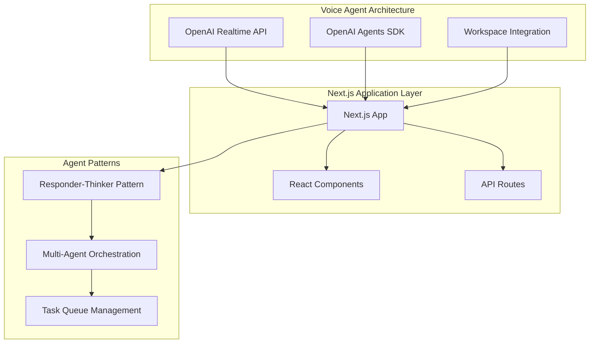
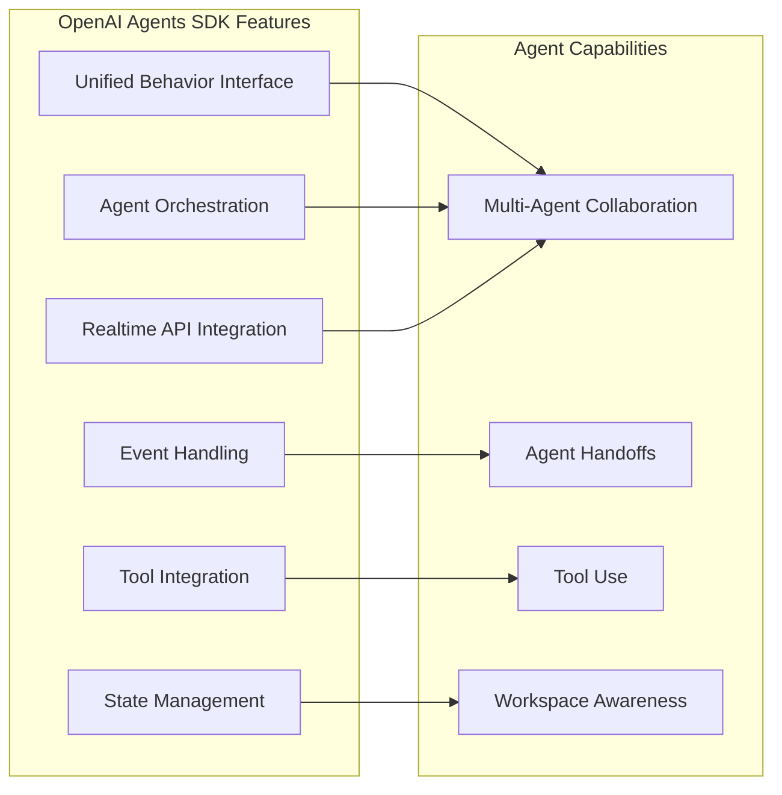
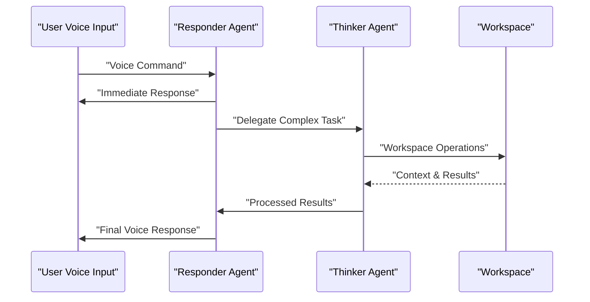
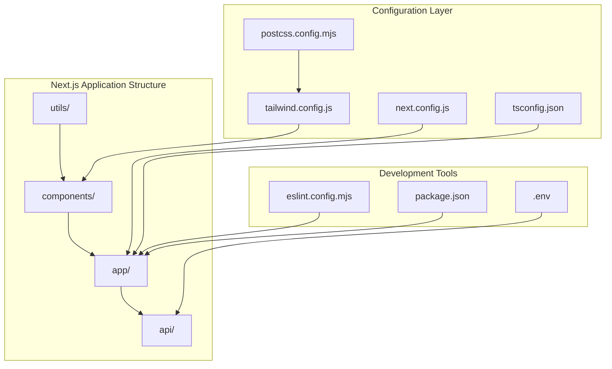
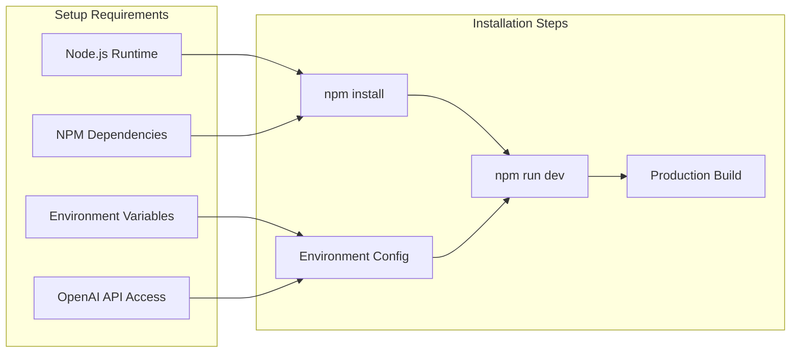
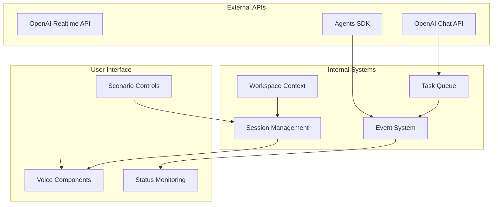

<!-- source: DeepWiki mcp.deepwiki.com · repo openai/build-hours · page 8.2 Voice Agents and Workspace Integration · fetched 2026-10-26 -->

# Voice Agents and Workspace Integration

Relevant source files

The following files were used as context for generating this wiki page:

- [14-voice-agents/realtime-workspace-agents/.env.sample](14-voice-agents/realtime-workspace-agents/.env.sample)
- [14-voice-agents/realtime-workspace-agents/.gitignore](14-voice-agents/realtime-workspace-agents/.gitignore)
- [14-voice-agents/realtime-workspace-agents/LICENSE](14-voice-agents/realtime-workspace-agents/LICENSE)
- [14-voice-agents/realtime-workspace-agents/README.md](14-voice-agents/realtime-workspace-agents/README.md)
- [14-voice-agents/realtime-workspace-agents/postcss.config.mjs](14-voice-agents/realtime-workspace-agents/postcss.config.mjs)
- [14-voice-agents/realtime-workspace-agents/public/arrow.svg](14-voice-agents/realtime-workspace-agents/public/arrow.svg)
- [14-voice-agents/realtime-workspace-agents/public/favicon.ico](14-voice-agents/realtime-workspace-agents/public/favicon.ico)

This document covers the implementation of advanced voice agent patterns using the OpenAI Realtime API and workspace integration capabilities. The system demonstrates sophisticated agent orchestration patterns within a Next.js application framework, focusing on real-time voice interactions and multi-agent collaboration.

For information about basic realtime console functionality, see [Realtime Console](#8.1). For broader agent framework patterns, see [Agent Systems](#6).

## System Overview

The voice agents and workspace integration system is built as a Next.js TypeScript application that leverages the OpenAI Agents SDK for advanced agent management and the OpenAI Realtime API for low-latency voice interactions. The system implements the "Responder-Thinker" agentic pattern, enabling sophisticated multi-agent workflows with workspace-aware capabilities.

**Responder-Thinker Pattern Implementation**
The system implements a sophisticated dual-agent pattern where responder agents handle immediate voice interactions while thinker agents perform deeper reasoning and workspace operations.

Sources: [14-voice-agents/realtime-workspace-agents/README.md:1-30]()

## OpenAI Agents SDK Integration

The system utilizes the OpenAI Agents SDK as its core agent management framework, providing unified interfaces for agent behaviors, tool integrations, state management, and event handling.

**Key SDK Features:**
- **Unified Interface**: Standardized agent behavior definitions and tool integrations
- **State Management**: Built-in support for agent orchestration and state persistence
- **Event Handling**: Comprehensive event system for agent coordination
- **Realtime Integration**: Seamless integration with OpenAI Realtime API for voice interactions
- **Extensible Patterns**: Support for multi-agent collaboration and handoff mechanisms

Sources: [14-voice-agents/realtime-workspace-agents/README.md:5-14]()

## Responder-Thinker Agentic Pattern

The core architectural pattern separates voice interaction responsibilities between two specialized agent types, enabling responsive user experiences while maintaining sophisticated reasoning capabilities.

**Pattern Components:**

| Component | Responsibility | Implementation |
|-----------|---------------|----------------|
| **Responder Agent** | Immediate voice responses, user interaction management | Real-time voice processing, quick acknowledgments |
| **Thinker Agent** | Deep reasoning, workspace operations, complex task execution | Background processing, workspace integration |
| **Coordination Layer** | Task delegation, result aggregation, state synchronization | Event-driven communication between agents |

**Advantages:**
- **Low Latency**: Immediate voice responses maintain conversational flow
- **Deep Processing**: Complex reasoning happens without blocking user interaction
- **Workspace Integration**: Thinker agents can perform workspace-aware operations
- **Scalable Architecture**: Pattern supports multiple concurrent voice sessions

Sources: [14-voice-agents/realtime-workspace-agents/README.md:28-30]()

## Next.js Application Architecture

The voice agent system is implemented as a modern Next.js TypeScript application with comprehensive tooling and configuration for real-time agent interactions.

**Application Configuration:**

| File | Purpose | Key Features |
|------|---------|--------------|
| `next.config.js` | Next.js framework configuration | Production optimizations, API routes |
| `tailwind.config.js` | Styling framework setup | Component styling, responsive design |
| `postcss.config.mjs` | CSS processing pipeline | Tailwind integration, optimization |
| `tsconfig.json` | TypeScript compiler settings | Type safety, modern JavaScript features |

**Development Setup:**
- **Package Management**: NPM-based dependency management with `package.json`
- **Environment Configuration**: `.env` files for API key management
- **Code Quality**: ESLint configuration for consistent code standards
- **Styling**: Tailwind CSS with PostCSS processing pipeline

Sources: [14-voice-agents/realtime-workspace-agents/.gitignore:1-43](), [14-voice-agents/realtime-workspace-agents/postcss.config.mjs:1-9]()

## Project Setup and Configuration

The system requires specific environment configuration and dependencies for proper operation with the OpenAI APIs and agent frameworks.

**Environment Configuration:**
- **OpenAI API Key**: Required for Realtime API and Agents SDK access
- **Development Server**: Runs on `http://localhost:3000` by default
- **Scenario Selection**: Multiple agent configurations accessible via dropdown interface

**Installation Process:**
1. **Dependency Installation**: `npm install` to install required packages
2. **Environment Setup**: Configure `.env` file with `OPENAI_API_KEY`
3. **Development Server**: `npm run dev` to start the development environment
4. **Agent Selection**: Use scenario dropdown to switch between different agent configurations

**Default Configuration:**
- **Primary Agent**: `workspaceBuilder` agent configuration loads by default
- **Scenario Management**: Multiple pre-configured agent scenarios available
- **Real-time Processing**: Immediate voice processing with OpenAI Realtime API integration

Sources: [14-voice-agents/realtime-workspace-agents/README.md:20-26](), [14-voice-agents/realtime-workspace-agents/.env.sample:1]()

## System Integration Points

The voice agents system integrates with multiple external services and internal components to provide comprehensive workspace-aware voice interactions.

**Integration Architecture:**
- **Real-time Voice Processing**: Direct integration with OpenAI Realtime API for voice input/output
- **Agent Orchestration**: OpenAI Agents SDK manages multi-agent workflows and coordination
- **Workspace Context**: System maintains awareness of workspace state and operations
- **Event-Driven Communication**: Comprehensive event system enables agent coordination and user feedback

**Operational Flow:**
1. **Voice Input Capture**: User voice commands processed through Realtime API
2. **Agent Selection**: Scenario-based routing to appropriate agent configurations
3. **Task Processing**: Responder-Thinker pattern manages immediate and background processing
4. **Workspace Integration**: Agents perform workspace-aware operations and context management
5. **Response Generation**: Coordinated voice responses delivered through real-time interface

Sources: [14-voice-agents/realtime-workspace-agents/README.md:3-16]()