# Page: Overview

# Overview

<details>
<summary>Relevant source files</summary>

The following files were used as context for generating this wiki page:

- [README.md](README.md)

</details>


This document provides a comprehensive overview of the Build Hours repository, which contains demonstration systems and reference implementations for leveraging OpenAI's APIs and models across diverse startup use cases. The repository serves as both educational material for monthly Build Hours events and practical reference code for developers building AI-powered applications.

The codebase demonstrates eight major system categories ranging from recommendation engines to real-time voice interactions, each showcasing different aspects of LLM integration patterns, evaluation methodologies, and production deployment considerations. For detailed documentation of specific systems, see the dedicated sections: [Recommendation System](#2), [Fine-tuning Systems](#3), [Image Generation System](#4), [Evaluation and Testing](#5), [Agent Systems](#6), [Reasoning and Planning](#7), and [Realtime Applications](#8).

## Program Purpose and Target Audience

Build Hours are monthly events designed for startup founders and developers to explore specific ideas for leveraging OpenAI's API and models. The program supports startups at every stage from concept to scale, providing practical demonstrations of AI integration patterns and best practices.

**System Architecture Overview**

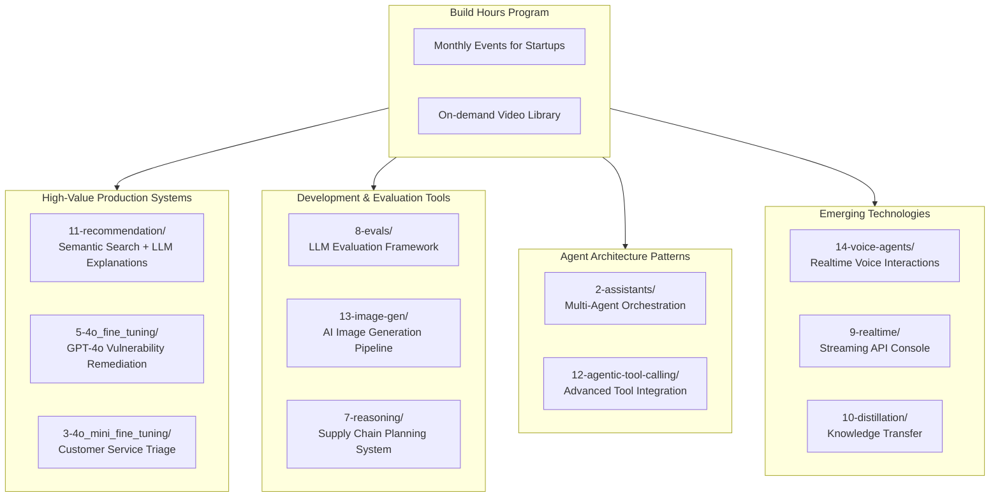

Sources: [README.md:3-5]()

## System Categories and Complexity Levels

The repository organizes AI systems into four complexity tiers, each demonstrating different integration patterns and production readiness levels.

| Complexity Level | Systems | Primary Focus | Target Audience |
|------------------|---------|---------------|-----------------|
| **Production Ready** | Recommendation Engine, Fine-tuning Systems | Business-critical applications with full evaluation pipelines | Startup CTOs, Senior Engineers |
| **Advanced Prototypes** | Image Generation, Supply Chain Planning | Complex multi-step workflows with LLM orchestration | Product Managers, ML Engineers |
| **Development Tools** | Evaluation Framework, Agent Systems | Testing, debugging, and development acceleration | Developer Teams, QA Engineers |
| **Emerging Examples** | Voice Agents, Realtime Console | Cutting-edge capabilities and experimental features | Innovation Teams, Researchers |

**Core Technology Integration Map**

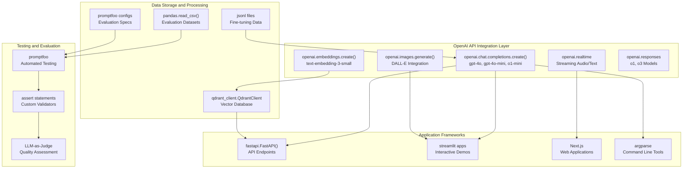

Sources: [README.md:1-9]()

## Repository Structure and Navigation

The codebase follows a numerical organization system where each major system is contained within its own directory. The most critical systems (recommendation engine, fine-tuning) have the highest development activity and most comprehensive documentation.

**System Importance and Development Activity**

| Directory | System Name | Importance Score | Primary Use Case | Key Technologies |
|-----------|-------------|------------------|------------------|------------------|
| `11-recommendation/` | Semantic Search Engine | 10.74 | E-commerce recommendations | Qdrant, embeddings, FastAPI |
| `5-4o_fine_tuning/` | Vulnerability Fixes | 8.47 | Security code analysis | Fine-tuning, promptfoo, semgrep |
| `3-4o_mini_fine_tuning/` | Customer Service | 8.45 | Chat triage automation | Fine-tuning, synthetic data |
| `13-image-gen/` | Image Generation | 6.62 | Creative content pipeline | DALL-E, SVG processing |
| `8-evals/` | Evaluation Framework | 6.44 | LLM testing methodology | promptfoo, pandas |
| `7-reasoning/` | Supply Chain Planning | 5.15 | Multi-LLM orchestration | o1-mini, gpt-4o |
| `12-agentic-tool-calling/` | Agent Tools | 4.62 | Function calling patterns | OpenAI tools, async |
| `2-assistants/` | Multi-Agent Systems | 4.10 | Conversational orchestration | Assistant transfers |
| `10-distillation/` | Model Compression | 3.50 | Cost optimization | Knowledge transfer |
| `14-voice-agents/` | Voice Interactions | 2.98 | Realtime audio processing | Realtime API |
| `9-realtime/` | API Console | 2.23 | Development tooling | WebRTC, streaming |

## Setup and Development Environment

Each system in the repository includes its own setup requirements and dependencies. For comprehensive installation instructions and environment configuration, see [Setup and Requirements](#1.2). The repository requires Python 3.8+ and Node.js for web-based systems, with OpenAI API keys configured for all demonstrations.

Most systems include standalone demo scripts and can be explored independently, though some advanced examples like the recommendation engine require additional infrastructure setup including vector databases and evaluation frameworks.

Sources: [README.md:1-9]()

---

# Page: Key Systems

# Key Systems

<details>
<summary>Relevant source files</summary>

The following files were used as context for generating this wiki page:

- [.gitignore](.gitignore)
- [11-recommendation/README.md](11-recommendation/README.md)
- [11-recommendation/helper_functions.py](11-recommendation/helper_functions.py)
- [11-recommendation/pages/page_1_semantic_search.py](11-recommendation/pages/page_1_semantic_search.py)
- [11-recommendation/pages/page_2_explainable_recommendations.py](11-recommendation/pages/page_2_explainable_recommendations.py)
- [11-recommendation/upload-to-qdrant.py](11-recommendation/upload-to-qdrant.py)
- [13-image-gen/imagegen-demo/README.md](13-image-gen/imagegen-demo/README.md)
- [13-image-gen/imagegen-demo/src/app/api/stream/route.ts](13-image-gen/imagegen-demo/src/app/api/stream/route.ts)
- [3-4o_mini_fine_tuning/0_generate_eval_data.py](3-4o_mini_fine_tuning/0_generate_eval_data.py)
- [3-4o_mini_fine_tuning/prompts/cot3.json](3-4o_mini_fine_tuning/prompts/cot3.json)
- [3-4o_mini_fine_tuning/prompts/verbatim_input.txt](3-4o_mini_fine_tuning/prompts/verbatim_input.txt)
- [5-4o_fine_tuning/README.md](5-4o_fine_tuning/README.md)
- [5-4o_fine_tuning/eval.py](5-4o_fine_tuning/eval.py)
- [5-4o_fine_tuning/example.py](5-4o_fine_tuning/example.py)
- [5-4o_fine_tuning/example_cot.py](5-4o_fine_tuning/example_cot.py)

</details>


This document provides a high-level overview of the most important AI systems demonstrated in the Build Hours repository, organized by complexity, business impact, and technical architecture. These systems showcase practical implementations of OpenAI's APIs across recommendation engines, model fine-tuning, agent frameworks, and real-time applications.

For detailed setup instructions and requirements, see [Setup and Requirements](#1.2). For comprehensive documentation of individual systems, refer to their respective sections: [Recommendation System](#2), [Fine-tuning Systems](#3), [Image Generation System](#4), [Evaluation and Testing](#5), [Agent Systems](#6), [Reasoning and Planning](#7), and [Realtime Applications](#8).

## System Architecture Overview

The repository contains eight primary system categories that demonstrate different aspects of LLM integration and deployment patterns.

### System Architecture by Business Impact

```mermaid
graph TB
    subgraph "Production-Ready Systems"
        REC[11-recommendation<br/>"Semantic Search & LLM Explanations"]
        FT4O[5-4o_fine_tuning<br/>"Vulnerability Fix Training"]
        FT4OMINI[3-4o_mini_fine_tuning<br/>"Customer Service Triage"]
    end
    
    subgraph "Advanced Demonstrations"
        IMG[13-image-gen<br/>"AI Image Generation Pipeline"]
        EVAL[8-evals<br/>"LLM Evaluation Framework"]
        AGENT[12-agentic-tool-calling<br/>"Agent Tool Integration"]
    end
    
    subgraph "Emerging Technologies"
        VOICE[14-voice-agents<br/>"Realtime Voice Interactions"]
        REASON[7-reasoning<br/>"Supply Chain Planning"]
        RT[9-realtime<br/>"Realtime API Console"]
    end
    
    REC --> EVAL
    FT4O --> EVAL
    FT4OMINI --> EVAL
    AGENT --> RT
    VOICE --> RT
```

**Sources:** [.gitignore:1-12](), [5-4o_fine_tuning/README.md:1-58](), [11-recommendation/README.md:1-48](), [13-image-gen/imagegen-demo/README.md:1-88]()

### Core Integration Patterns

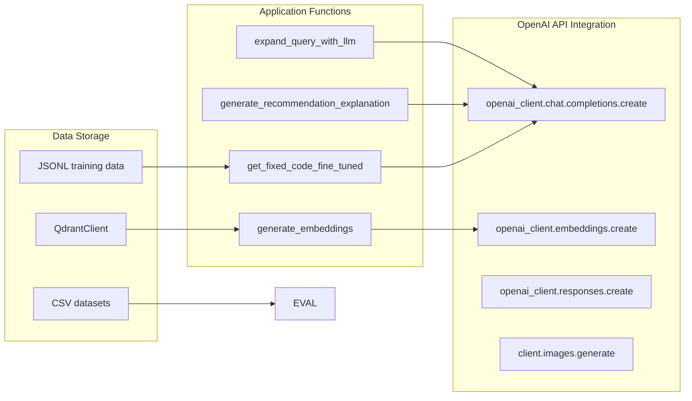

**Sources:** [11-recommendation/helper_functions.py:305-317](), [11-recommendation/helper_functions.py:324-334](), [11-recommendation/helper_functions.py:461-492](), [5-4o_fine_tuning/eval.py:99-134]()

## System Categories by Complexity

### Tier 1: Production-Ready Systems

| System | Primary Function | Key Components | Business Value |
|--------|------------------|----------------|----------------|
| **Recommendation Engine** | Semantic search with LLM explanations | `helper_functions.py`, `QdrantClient`, Streamlit UI | Highest - Revenue impact through personalized recommendations |
| **GPT-4o Fine-tuning** | Vulnerability fix automation | `eval.py`, semgrep integration, dataset processing | High - Security automation for enterprise |
| **GPT-4o-mini Fine-tuning** | Customer service triage | Synthetic data generation, evaluation framework | High - Customer support automation |

### Tier 2: Advanced Demonstrations

| System | Primary Function | Key Components | Innovation Value |
|--------|------------------|----------------|------------------|
| **Image Generation** | AI-powered image creation with post-processing | Next.js API, Sharp library, SVG overlay | Medium - Creative workflow automation |
| **Evaluation Framework** | LLM performance testing | `promptfoo` configs, assertion libraries | Medium - Quality assurance for AI systems |
| **Agent Systems** | Tool-calling and orchestration | FastAPI servers, streaming responses | Medium - AI agent deployment patterns |

### Tier 3: Emerging Technologies

| System | Primary Function | Key Components | Research Value |
|--------|------------------|----------------|----------------|
| **Voice Agents** | Realtime audio interactions | OpenAI Realtime API, workspace integration | Emerging - Next-gen user interfaces |
| **Supply Chain Planning** | Multi-LLM reasoning orchestration | o1-mini planning, gpt-4o execution | Emerging - Complex reasoning systems |
| **Realtime Console** | Interactive streaming interface | Audio management, tool integration | Emerging - Real-time AI interactions |

**Sources:** [11-recommendation/helper_functions.py:1-493](), [5-4o_fine_tuning/eval.py:1-357](), [3-4o_mini_fine_tuning/0_generate_eval_data.py:1-267](), [13-image-gen/imagegen-demo/src/app/api/stream/route.ts:1-89]()

## Core Technical Architecture

### LLM Integration Layer

The repository demonstrates consistent patterns for OpenAI API integration across all systems:

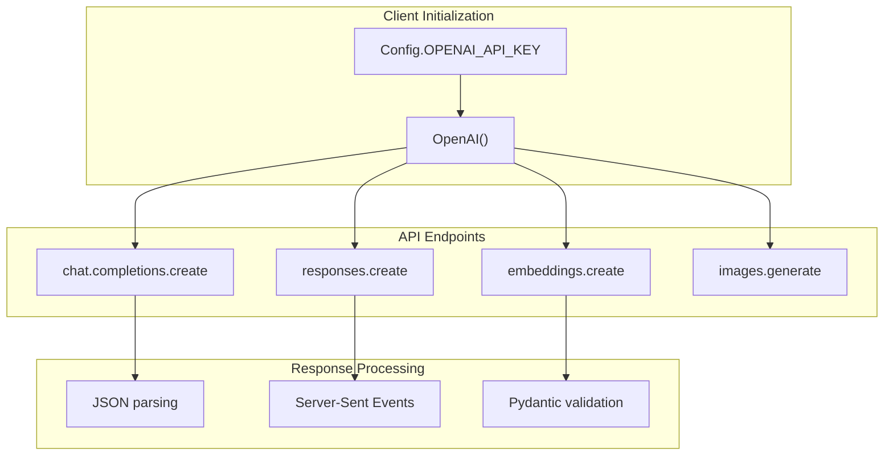

**Sources:** [11-recommendation/helper_functions.py:13-14](), [5-4o_fine_tuning/eval.py:22](), [13-image-gen/imagegen-demo/src/app/api/stream/route.ts:4](), [3-4o_mini_fine_tuning/0_generate_eval_data.py:9]()

### Data Flow Architecture

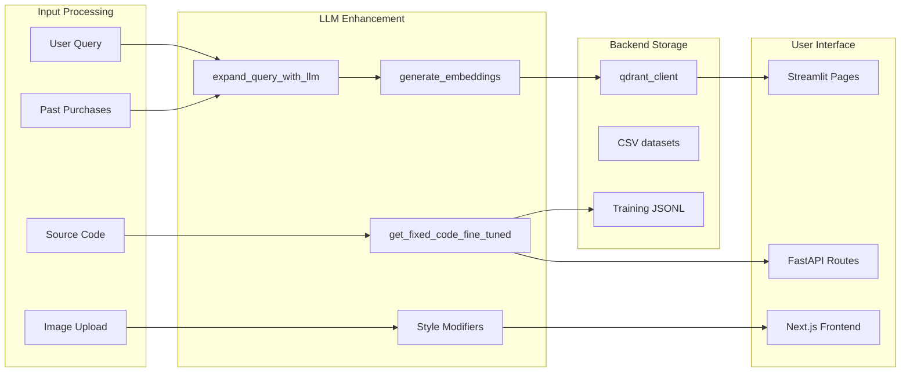

**Sources:** [11-recommendation/helper_functions.py:250-321](), [11-recommendation/upload-to-qdrant.py:65-120](), [5-4o_fine_tuning/eval.py:137-254](), [13-image-gen/imagegen-demo/src/app/api/stream/route.ts:8-87]()

## System Integration Points

### Evaluation and Testing Integration

All major systems integrate with a common evaluation framework:

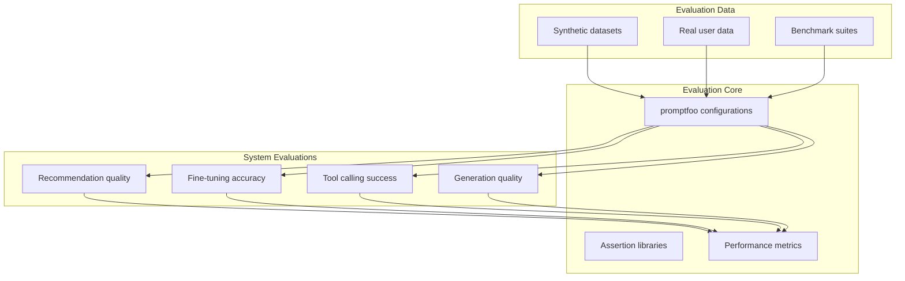

**Sources:** [3-4o_mini_fine_tuning/0_generate_eval_data.py:17-31](), [5-4o_fine_tuning/eval.py:25-91](), [3-4o_mini_fine_tuning/prompts/cot3.json:1-10]()

### Technology Stack Summary

| Layer | Technologies | Primary Systems |
|-------|-------------|----------------|
| **Frontend** | Streamlit, Next.js, React | Recommendation UI, Image Generation |
| **Backend** | FastAPI, Python, Node.js | Agent servers, API endpoints |
| **LLM Integration** | OpenAI SDK, Pydantic validation | All systems |
| **Vector Storage** | Qdrant, embeddings | Recommendation engine |
| **Evaluation** | promptfoo, custom assertions | All systems |
| **Deployment** | Docker, requirements.txt | Infrastructure |

**Sources:** [11-recommendation/README.md:18-48](), [13-image-gen/imagegen-demo/README.md:15-87](), [5-4o_fine_tuning/README.md:9-37](), [11-recommendation/upload-to-qdrant.py:6-16]()

---

# Page: Setup and Requirements

# Setup and Requirements

<details>
<summary>Relevant source files</summary>

The following files were used as context for generating this wiki page:

- [11-recommendation/app.py](11-recommendation/app.py)
- [11-recommendation/config.py](11-recommendation/config.py)
- [11-recommendation/docker-compose.yaml](11-recommendation/docker-compose.yaml)
- [11-recommendation/images.zip](11-recommendation/images.zip)
- [11-recommendation/requirements.txt](11-recommendation/requirements.txt)
- [11-recommendation/upload-data/fake_hardware_data.csv](11-recommendation/upload-data/fake_hardware_data.csv)
- [14-voice-agents/realtime-workspace-agents/.env.sample](14-voice-agents/realtime-workspace-agents/.env.sample)
- [14-voice-agents/realtime-workspace-agents/.gitignore](14-voice-agents/realtime-workspace-agents/.gitignore)
- [14-voice-agents/realtime-workspace-agents/LICENSE](14-voice-agents/realtime-workspace-agents/LICENSE)
- [5-4o_fine_tuning/.gitignore](5-4o_fine_tuning/.gitignore)
- [5-4o_fine_tuning/requirements.txt](5-4o_fine_tuning/requirements.txt)
- [5-4o_fine_tuning/util.py](5-4o_fine_tuning/util.py)

</details>


This page provides comprehensive instructions for setting up the development environment and meeting the requirements for the various systems in the Build Hours repository. For information about specific systems, see their respective pages: [Fine-tuning Systems](#2), [Recommendation System](#3), and [Evaluation Tools](#4).

## Common Setup Requirements

### Python Environment

All systems in this repository require Python 3.8 or newer. We recommend setting up a virtual environment to manage dependencies:

```bash
# Create a virtual environment
python -m venv .venv

# Activate the virtual environment
# On Windows:
.venv\Scripts\activate
# On macOS/Linux:
source .venv/bin/activate
```

### Repository Structure

The repository is organized by system type, with each top-level numbered directory containing a self-contained application or demonstration:

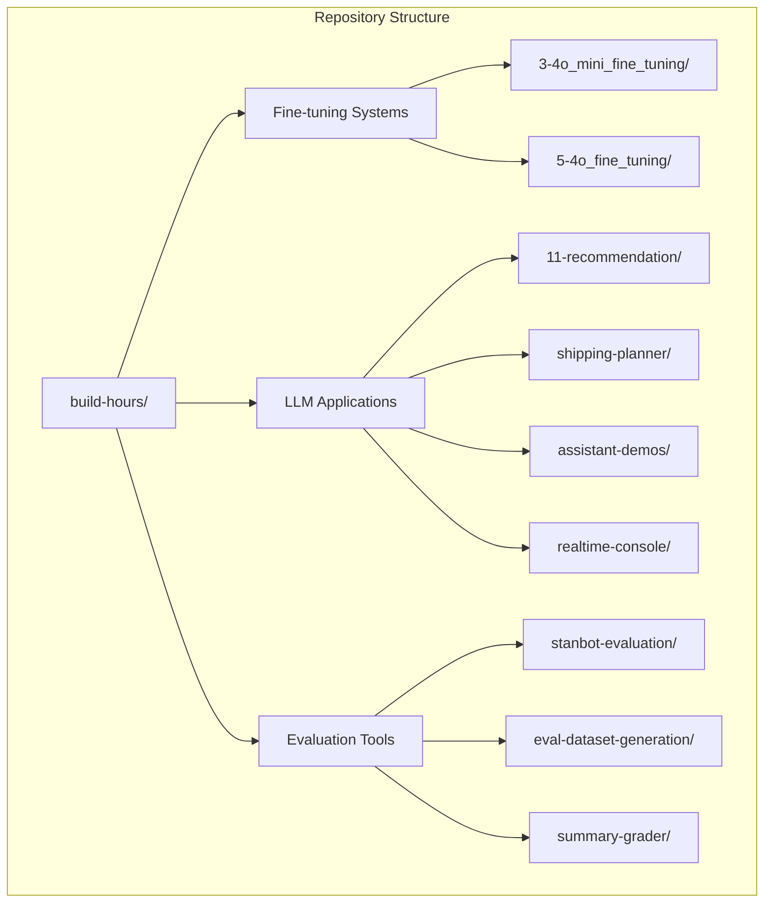

Sources: `.gitignore`

## System-Specific Requirements

### Fine-tuning Systems

The GPT-4o fine-tuning system for vulnerability fixes requires:

1. **Dependencies**: Install the required Python packages:

```bash
cd 5-4o_fine_tuning
pip install -r requirements.txt
```

2. **Semgrep**: The static analysis tool Semgrep (version 1.85.0) is required for vulnerability detection and verification:

```bash
pip install semgrep==1.85.0
# Verify installation
semgrep --version
```

3. **Dataset Access**: The system uses two datasets:
   - `synth-vuln-fixes` for training
   - `static-analysis-eval` for evaluation

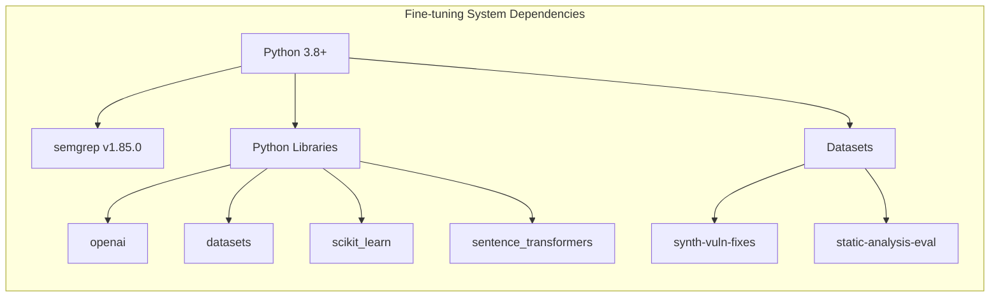

Sources: `5-4o_fine_tuning/requirements.txt`, `5-4o_fine_tuning/util.py`

### Recommendation System

The recommendation system requires:

1. **Dependencies**: Install the required Python packages:

```bash
cd 11-recommendation
pip install -r requirements.txt
```

2. **Qdrant Vector Database**: This system uses Qdrant for vector storage and retrieval.

3. **Product Data**: Sample product data is included in the repository:

```bash
# Upload sample data to Qdrant
cd 11-recommendation
python upload-data/upload-to-qdrant.py
```

4. **Streamlit Interface**: The system uses Streamlit for its user interface:

```bash
cd 11-recommendation
streamlit run app.py
```

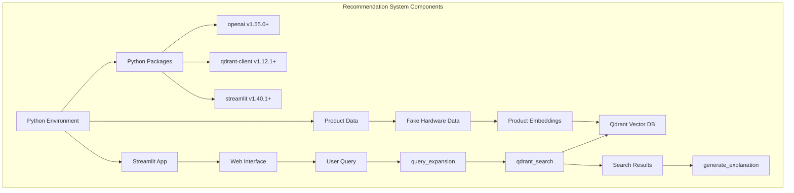

Sources: `11-recommendation/requirements.txt`, `11-recommendation/app.py`, `11-recommendation/upload-data/fake_hardware_data.csv`

## OpenAI API Access

Most systems in the repository require access to OpenAI's API:

1. **API Key**: Store your OpenAI API key in an environment variable:

```bash
# On Windows
set OPENAI_API_KEY=your-api-key-here

# On macOS/Linux
export OPENAI_API_KEY=your-api-key-here
```

2. **Model Access**: Ensure you have access to the required models:
   - GPT-4o (for fine-tuning and applications)
   - GPT-4o-mini (for distillation and lighter applications)
   - Embedding models (for vector operations)

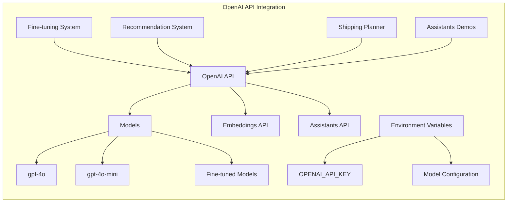

Sources: `5-4o_fine_tuning/util.py`, `11-recommendation/app.py`

## Data Directory Management

Some systems in the repository require specific data directories:

1. **Excluded Directories**: The following directories are excluded from git tracking:
   - `3-4o_mini_fine_tuning/evals/`
   - `3-4o_mini_fine_tuning/data/`
   - `5-4o_fine_tuning/staticeval/`
   - `11-recommendation/images/`

2. **Creating Required Directories**: Some systems may need directories created before they run:

```bash
# For fine-tuning evaluation
mkdir -p 5-4o_fine_tuning/staticeval

# For mini fine-tuning
mkdir -p 3-4o_mini_fine_tuning/data
mkdir -p 3-4o_mini_fine_tuning/evals
```

Sources: `.gitignore`, `5-4o_fine_tuning/.gitignore`

## System Compatibility Matrix

The table below summarizes the key requirements for each system:

| System | Python Version | OpenAI Models | Additional Tools | Data Requirements |
|--------|---------------|--------------|-----------------|-------------------|
| GPT-4o Fine-tuning | 3.8+ | GPT-4o | Semgrep 1.85.0 | synth-vuln-fixes dataset |
| 4o-mini Fine-tuning | 3.8+ | GPT-4o, GPT-4o-mini | - | Customer service dataset |
| Recommendation System | 3.8+ | OpenAI Embeddings | Qdrant, Streamlit | Product data |
| Shipping Planner | 3.8+ | GPT-4o, o1-mini | - | Shipping scenarios |
| Assistants Demos | 3.8+ | Assistants API | - | - |
| Evaluation Tools | 3.8+ | GPT-4o | - | Evaluation datasets |

Sources: `5-4o_fine_tuning/requirements.txt`, `11-recommendation/requirements.txt`

## Troubleshooting Common Setup Issues

- **Semgrep Installation**: If you encounter issues with Semgrep installation, try installing it via pip directly: `pip install semgrep==1.85.0`
- **Qdrant Connection**: Ensure Qdrant server is running if using a local instance, or check connection strings for cloud deployments
- **OpenAI API Limits**: Be aware of rate limits and model access restrictions that may affect system performance
- **Data Directory Access**: Ensure proper permissions for data directories, especially when running evaluation scripts

Sources: `5-4o_fine_tuning/util.py`

---

# Page: Recommendation System

# Recommendation System

<details>
<summary>Relevant source files</summary>

The following files were used as context for generating this wiki page:

- [11-recommendation/README.md](11-recommendation/README.md)
- [11-recommendation/helper_functions.py](11-recommendation/helper_functions.py)
- [11-recommendation/pages/page_1_semantic_search.py](11-recommendation/pages/page_1_semantic_search.py)
- [11-recommendation/pages/page_2_explainable_recommendations.py](11-recommendation/pages/page_2_explainable_recommendations.py)
- [11-recommendation/upload-to-qdrant.py](11-recommendation/upload-to-qdrant.py)

</details>


## Introduction

The Recommendation System is an LLM-enhanced product recommendation platform that combines traditional recommendation techniques with GPT-4o capabilities to provide personalized, explainable product recommendations. The system demonstrates two key enhancements that LLMs bring to recommendation engines:

1. **Contextual Understanding**: Using LLMs to expand user queries with additional context to improve search relevance
2. **Recommendation Explainability**: Generating natural language explanations for why specific products are being recommended

The system is implemented as a Streamlit web application with a Qdrant vector database backend for semantic search capabilities.

Sources: [11-recommendation/README.md:1-5](), [11-recommendation/app.py:13-18]()

## System Architecture

### High-Level Architecture Diagram

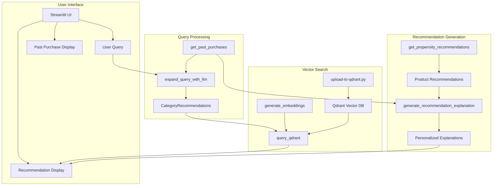

Sources: [11-recommendation/helper_functions.py:19-168](), [11-recommendation/helper_functions.py:246-322](), [11-recommendation/helper_functions.py:323-387](), [11-recommendation/helper_functions.py:390-492](), [11-recommendation/upload-to-qdrant.py:1-132]()

## Core Components

The recommendation system consists of four primary components that work together to deliver personalized product recommendations:

### 1. User Context Management

The system maintains user context through the `get_past_purchases()` function, which retrieves the user's purchase history. This historical data serves as a foundation for personalizing both search results and recommendation explanations.

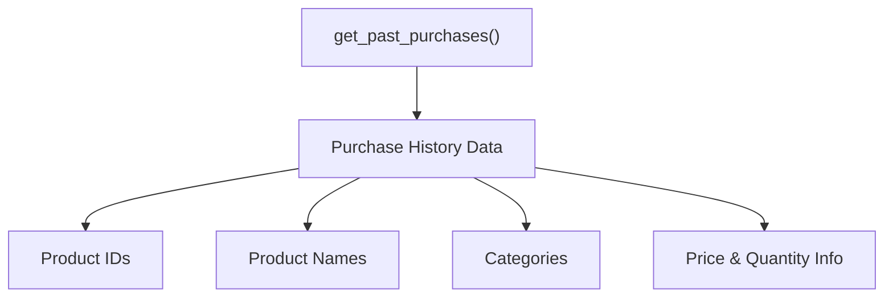

Sources: [11-recommendation/helper_functions.py:19-194]()

### 2. Query Expansion with LLM

The query expansion component uses GPT-4o to analyze user queries and expand them with relevant product categories, enhancing search relevance.

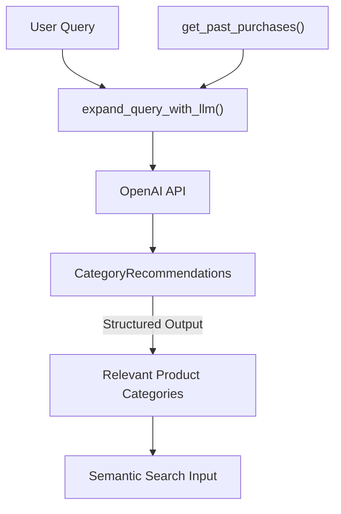

The `expand_query_with_llm()` function:
- Takes a user query and purchase history as inputs
- Uses GPT-4o with structured outputs (via the `CategoryRecommendations` model)
- Returns enriched categories relevant to both the query and purchase history
- Biases recommendations toward categories complementary to past purchases

Sources: [11-recommendation/helper_functions.py:246-322](), [11-recommendation/helper_functions.py:198-245]()

### 3. Vector Database Integration

The system uses Qdrant as a vector database for semantic search, with integration handled by several components:

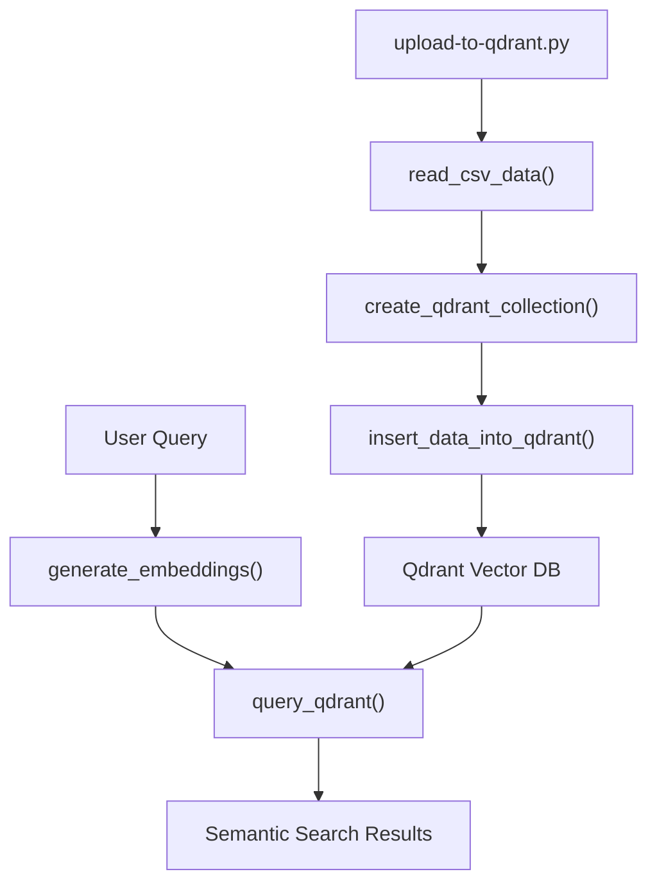

Key functions:
- `generate_embeddings()`: Converts text to vector embeddings using OpenAI's embedding models
- `query_qdrant()`: Performs semantic search on product data using embeddings and category filters
- Data upload process in `upload-to-qdrant.py` creates the collection and loads product data from CSV

Sources: [11-recommendation/helper_functions.py:323-387](), [11-recommendation/upload-to-qdrant.py:1-132]()

### 4. Recommendation Explanation Generation

The recommendation explanation component enhances traditional recommendation algorithms by adding natural language explanations for why products are being recommended.

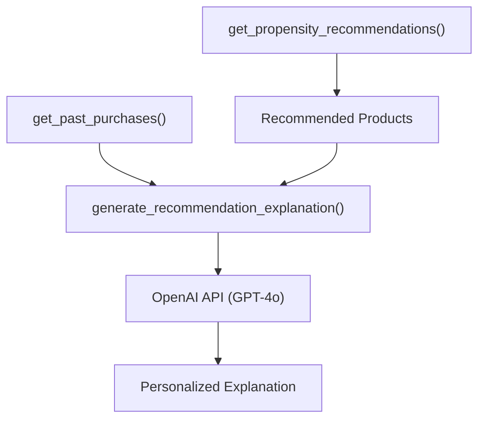

The `generate_recommendation_explanation()` function:
- Takes a recommended product and user's purchase history
- Creates a prompt for GPT-4o that includes product details and purchase context
- Returns a concise, personalized explanation connecting the recommendation to user preferences
- Limits explanations to two sentences for readability

Sources: [11-recommendation/helper_functions.py:461-492](), [11-recommendation/helper_functions.py:390-460]()

## Implementation Details

### Data Model

The system uses several structured data models to organize information:

| Component | Data Structure | Purpose |
|-----------|----------------|---------|
| Product Data | Dictionary | Contains product details including ID, name, category, price |
| Past Purchases | List of Dictionaries | Represents user's purchase history |
| Category Enum | Enum | Defines valid product categories for structured outputs |
| Category | Pydantic Model | Represents a product category with item and description |
| CategoryRecommendations | Pydantic Model | Contains list of Category objects for structured output |

Sources: [11-recommendation/helper_functions.py:198-249](), [11-recommendation/helper_functions.py:19-194]()

### User Interface

The system is implemented as a Streamlit application with two main pages:

1. **Semantic Search Page**
   - Allows users to enter queries
   - Shows expanded categories from LLM processing
   - Displays semantic search results

2. **Explainable Recommendations Page**
   - Displays user's purchase history
   - Shows recommended products with scores
   - Provides on-demand explanations for recommendations

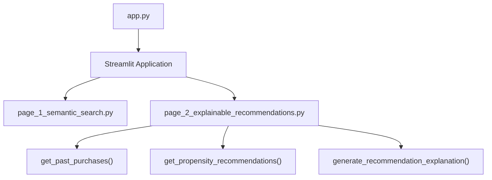

The explainable recommendations page displays both the recommended products and allows users to generate explanations on demand through a button interface.

Sources: [11-recommendation/pages/page_2_explainable_recommendations.py:1-60](), [11-recommendation/app.py:1-18]()

## Configuration and Setup

The recommendation system requires the following components to be configured:

1. **OpenAI API**: For generating embeddings and LLM responses
2. **Qdrant Vector Database**: For storing and querying product vectors
3. **Product Data**: CSV file with product information

Setup steps:
1. Configure environment variables in `config.py`
2. Start Qdrant using Docker
3. Upload product data using `upload-to-qdrant.py`
4. Launch the Streamlit application with `streamlit run app.py`

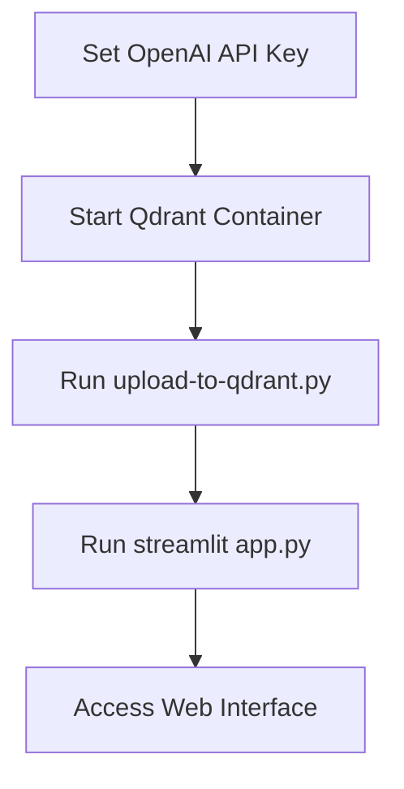

Sources: [11-recommendation/README.md:6-47](), [11-recommendation/upload-to-qdrant.py:120-132]()

## Data Flow

The recommendation system handles data through the following flow:

1. **Setup Phase**:
   - Product data is loaded into Qdrant with embedded descriptions
   - Categories are pre-defined in the `CategoryEnum`

2. **Query Phase**:
   - User enters a query in the Streamlit UI
   - Query is expanded using `expand_query_with_llm()`
   - Expanded categories guide semantic search in Qdrant
   - Results are displayed to the user

3. **Recommendation Phase**:
   - System retrieves propensity-based recommendations
   - User requests explanations for recommendations
   - Explanations are generated using `generate_recommendation_explanation()`
   - Recommendations and explanations are displayed to the user

The system maintains user state across sessions using Streamlit's session state functionality, allowing explanations to persist during user interaction.

Sources: [11-recommendation/helper_functions.py:246-322](), [11-recommendation/helper_functions.py:461-492](), [11-recommendation/pages/page_2_explainable_recommendations.py:15-57]()

---

# Page: Core Recommendation Functions

# Core Recommendation Functions

<details>
<summary>Relevant source files</summary>

The following files were used as context for generating this wiki page:

- [11-recommendation/README.md](11-recommendation/README.md)
- [11-recommendation/helper_functions.py](11-recommendation/helper_functions.py)
- [11-recommendation/pages/page_1_semantic_search.py](11-recommendation/pages/page_1_semantic_search.py)
- [11-recommendation/pages/page_2_explainable_recommendations.py](11-recommendation/pages/page_2_explainable_recommendations.py)
- [11-recommendation/upload-to-qdrant.py](11-recommendation/upload-to-qdrant.py)

</details>


## Purpose and Scope

This document covers the core algorithmic components of the LLM-enhanced recommendation system, including query expansion, semantic search, and explainable recommendations. These functions form the foundation of the recommendation engine by combining traditional vector similarity search with large language model capabilities for improved contextual understanding and user experience.

For information about the vector database setup and configuration, see [Qdrant Vector Database Integration](#2.3). For details about the user interface and system deployment, see [Recommendation System Configuration](#2.4).

## Recommendation System Architecture

The core recommendation system operates through three primary algorithmic pathways: query expansion for contextual understanding, semantic search for product retrieval, and explanation generation for recommendation transparency.

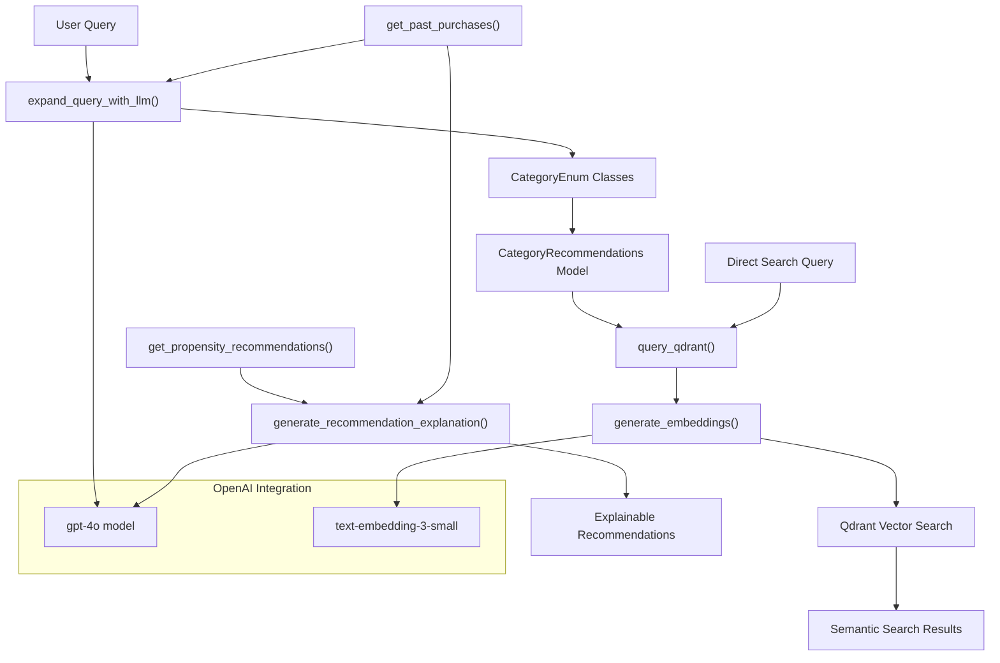

Sources: [11-recommendation/helper_functions.py:1-493](), [11-recommendation/README.md:1-48]()

## Query Expansion System

The query expansion system transforms ambiguous user queries into structured category recommendations using GPT-4o with Pydantic structured outputs. The `expand_query_with_llm()` function processes natural language input and returns categorized recommendations.

### Structured Output Models

The system uses Pydantic models to constrain LLM responses to predefined product categories:

| Model | Purpose | Key Fields |
|-------|---------|------------|
| `CategoryEnum` | Defines valid product categories | 41 predefined categories (Tools, Hardware, Paint, etc.) |
| `Category` | Individual category recommendation | `item` (CategoryEnum), `description` (str) |
| `CategoryRecommendations` | Response container | `categories` (List[Category]) |

### Query Expansion Algorithm

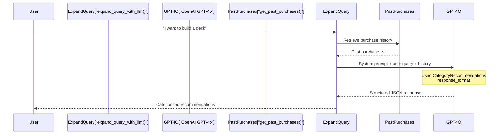

The function incorporates past purchase history to bias recommendations toward complementary products while maintaining relevance to the user's stated goals.

Sources: [11-recommendation/helper_functions.py:250-322](), [11-recommendation/helper_functions.py:201-248]()

## Semantic Search Implementation

The semantic search system combines OpenAI embeddings with Qdrant vector similarity search to retrieve relevant products within specific categories.

### Embedding Generation

The `generate_embeddings()` function creates vector representations using OpenAI's `text-embedding-3-small` model:

```mermaid
graph LR
    TextInput["Search Query Text"] --> OpenAIEmbedding["openai_client.embeddings.create()"]
    OpenAIEmbedding --> EmbeddingModel["text-embedding-3-small"]
    EmbeddingModel --> VectorOutput["List[float] - 1536 dimensions"]
```

### Vector Search Process

The `query_qdrant()` function performs filtered similarity search:

1. **Embedding Generation**: Converts query text to vector using `generate_embeddings()`
2. **Category Filtering**: Applies `models.Filter` with `FieldCondition` for category matching
3. **Similarity Search**: Executes vector search with configurable `top_k` parameter
4. **Result Processing**: Returns product IDs and payload data

```mermaid
graph TD
    QueryText["Query Text"] --> GenEmbeddings["generate_embeddings()"]
    CategoryFilter["Category Filter"] --> QdrantSearch["qdrant_client.search()"]
    GenEmbeddings --> QueryVector["Query Vector"]
    QueryVector --> QdrantSearch
    
    QdrantSearch --> SearchParams["SearchParams(exact=False)"]
    QdrantSearch --> FilterCondition["FieldCondition(key='category')"]
    
    QdrantSearch --> SearchResults["Search Results"]
    SearchResults --> ResultProcessing["Extract ID and Payload"]
    ResultProcessing --> FinalResults["List[Dict[str, Any]]"]
```

Sources: [11-recommendation/helper_functions.py:324-334](), [11-recommendation/helper_functions.py:337-387]()

## Explainable Recommendations

The explanation system generates personalized reasoning for product recommendations by analyzing the relationship between recommended items and user purchase history.

### Recommendation Generation

The `get_propensity_recommendations()` function provides mock propensity-scored recommendations with predicted scores ranging from 0.8 to 1.0. In production systems, this would be replaced with actual machine learning models.

### Explanation Algorithm

The `generate_recommendation_explanation()` function uses GPT-4o to create contextual explanations:

```mermaid
sequenceDiagram
    participant System
    participant GenExplanation["generate_recommendation_explanation()"]
    participant GPT4O["OpenAI GPT-4o"]
    
    System->>GenExplanation: recommended_product + past_purchases
    GenExplanation->>GPT4O: Structured prompt with product details
    Note over GPT4O: Temperature: 0.7<br/>Constraint: Exactly 2 sentences
    GPT4O-->>GenExplanation: Personalized explanation
    GenExplanation-->>System: Explanation string
```

The explanation prompt instructs the model to:
- Reference user preferences from purchase history
- Generate excitement about the recommended product  
- Maintain concise, positive, and engaging tone
- Produce exactly two sentences per explanation

Sources: [11-recommendation/helper_functions.py:390-459](), [11-recommendation/helper_functions.py:461-492]()

## Core Function Integration

The recommendation system integrates multiple functions through a cohesive data flow that processes user input through contextual expansion, semantic search, and explanation generation.

```mermaid
flowchart TD
    subgraph "Input Processing"
        UserInput["User Query"]
        PastData["get_past_purchases()"]
    end
    
    subgraph "Query Enhancement"
        ExpandLLM["expand_query_with_llm()"]
        CategoryEnum["CategoryEnum Validation"]
        StructuredOutput["CategoryRecommendations"]
    end
    
    subgraph "Search Execution"
        Embeddings["generate_embeddings()"]
        VectorSearch["query_qdrant()"]
        QdrantClient["qdrant_client.search()"]
    end
    
    subgraph "Recommendation Explanation"
        PropensityRecs["get_propensity_recommendations()"]
        ExplanationGen["generate_recommendation_explanation()"]
    end
    
    UserInput --> ExpandLLM
    PastData --> ExpandLLM
    ExpandLLM --> CategoryEnum
    CategoryEnum --> StructuredOutput
    
    StructuredOutput --> Embeddings
    Embeddings --> VectorSearch
    VectorSearch --> QdrantClient
    
    PropensityRecs --> ExplanationGen
    PastData --> ExplanationGen
    
    subgraph "OpenAI APIs"
        GPT4O["gpt-4o"]
        EmbedModel["text-embedding-3-small"]
    end
    
    ExpandLLM -.-> GPT4O
    ExplanationGen -.-> GPT4O
    Embeddings -.-> EmbedModel
```

### Function Dependencies

| Function | Dependencies | Input Types | Output Types |
|----------|-------------|-------------|--------------|
| `expand_query_with_llm()` | `openai_client`, `CategoryRecommendations` | `str`, `List[Dict]` | `str` (JSON) |
| `generate_embeddings()` | `openai_client`, `Config.EMBEDDING_MODEL` | `str` | `List[float]` |
| `query_qdrant()` | `qdrant_client`, `generate_embeddings()` | `str`, `str`, `int` | `List[Dict[str, Any]]` |
| `generate_recommendation_explanation()` | `openai_client` | `Dict[str, Any]`, `List[Dict]` | `str` |
| `get_propensity_recommendations()` | None (mock data) | None | `List[Dict[str, Any]]` |

Sources: [11-recommendation/helper_functions.py:1-493](), [11-recommendation/config.py]()

---

# Page: LLM Integration and Semantic Search

# LLM Integration and Semantic Search

<details>
<summary>Relevant source files</summary>

The following files were used as context for generating this wiki page:

- [11-recommendation/README.md](11-recommendation/README.md)
- [11-recommendation/helper_functions.py](11-recommendation/helper_functions.py)
- [11-recommendation/pages/page_1_semantic_search.py](11-recommendation/pages/page_1_semantic_search.py)
- [11-recommendation/pages/page_2_explainable_recommendations.py](11-recommendation/pages/page_2_explainable_recommendations.py)
- [11-recommendation/upload-to-qdrant.py](11-recommendation/upload-to-qdrant.py)

</details>


This document covers the LLM integration components and semantic search capabilities within the recommendation system. It focuses on how OpenAI APIs are leveraged for query expansion, embedding generation, and recommendation explanations. For the core recommendation algorithms, see [Core Recommendation Functions](#2.1). For vector database operations, see [Qdrant Vector Database Integration](#2.3).

## LLM Integration Architecture

The system integrates multiple OpenAI API endpoints to enhance the recommendation experience through natural language understanding and generation.

### OpenAI API Integration Pattern

```mermaid
graph TD
    UserQuery["User Query Input"] --> ExpandQuery["expand_query_with_llm()"]
    ExpandQuery --> ChatAPI["openai_client.beta.chat.completions.parse()"]
    ChatAPI --> StructuredOutput["CategoryRecommendations Pydantic Model"]
    
    SearchQuery["Search Query"] --> GenEmbed["generate_embeddings()"]
    GenEmbed --> EmbedAPI["openai_client.embeddings.create()"]
    EmbedAPI --> VectorDB["Qdrant Vector Search"]
    
    RecommendProduct["Recommended Product"] --> GenExplain["generate_recommendation_explanation()"]
    GenExplain --> ChatComplete["openai_client.chat.completions.create()"]
    ChatComplete --> Explanation["Natural Language Explanation"]
    
    StructuredOutput --> CategorySearch["Category-based Search"]
    VectorDB --> SearchResults["Semantic Search Results"]
```

Sources: [11-recommendation/helper_functions.py:305-318](), [11-recommendation/helper_functions.py:324-334](), [11-recommendation/helper_functions.py:485-492]()

### Core LLM Integration Components

| Component | OpenAI Model | Purpose | Input | Output |
|-----------|--------------|---------|-------|--------|
| `expand_query_with_llm` | `gpt-4o` | Query expansion with structured outputs | User query + past purchases | `CategoryRecommendations` JSON |
| `generate_embeddings` | `text-embedding-3-small` | Vector embedding generation | Text string | List of floats (embeddings) |
| `generate_recommendation_explanation` | `gpt-4o` | Recommendation explanations | Product + purchase history | Natural language explanation |

Sources: [11-recommendation/helper_functions.py:250-321](), [11-recommendation/helper_functions.py:324-334](), [11-recommendation/helper_functions.py:461-492]()

## Query Expansion System

The query expansion system transforms ambiguous user queries into structured category recommendations using OpenAI's structured outputs feature.

### Query Expansion Flow

```mermaid
graph LR
    UserQuery["User Input Query"] --> SystemPrompt["System Prompt with Past Purchases"]
    SystemPrompt --> GPT4o["gpt-4o with response_format"]
    GPT4o --> CategoryEnum["CategoryEnum Validation"]
    CategoryEnum --> CategoryRecommendations["CategoryRecommendations Model"]
    CategoryRecommendations --> JSONOutput["Structured JSON Output"]
    
    PastPurchases["get_past_purchases()"] --> SystemPrompt
    CategoryList["41 Predefined Categories"] --> CategoryEnum
```

Sources: [11-recommendation/helper_functions.py:250-321](), [11-recommendation/helper_functions.py:201-248]()

### Structured Output Schema

The system uses Pydantic models to enforce structured responses from the LLM:

```mermaid
graph TD
    CategoryEnum["CategoryEnum"] --> Category["Category Model"]
    Category --> Item["item: CategoryEnum"]
    Category --> Description["description: str"]
    
    CategoryRecommendations["CategoryRecommendations"] --> Categories["categories: List[Category]"]
    
    Categories --> MaxSeven["Maximum 7 categories"]
    Categories --> Relevance["Relevance to user query"]
    Categories --> PastHistory["Integration with past purchases"]
```

The `CategoryEnum` defines 41 predefined categories including:
- `TOOLS_HAND_TOOLS`, `TOOLS_POWER_TOOLS`, `TOOLS_GARDEN_TOOLS`
- `HARDWARE_FASTENERS`, `HARDWARE_BRACKETS_SUPPORTS`
- `PAINT_INTERIOR_PAINT`, `PAINT_EXTERIOR_PAINT`
- `BUILDING_MATERIALS_LUMBER`, `BUILDING_MATERIALS_DRYWALL`
- `PLUMBING_PIPES_FITTINGS`, `ELECTRICAL_WIRING_CABLES`
- `GARDENING_SOIL_FERTILIZERS`, `OUTDOOR_PATIO_FURNITURE`

Sources: [11-recommendation/helper_functions.py:201-248](), [11-recommendation/helper_functions.py:243-248]()

## Semantic Search Pipeline

The semantic search pipeline combines embedding generation with vector similarity search to find relevant products.

### Embedding Generation Process

```mermaid
graph LR
    TextInput["Text Input"] --> EmbedCall["openai_client.embeddings.create()"]
    EmbedCall --> EmbedModel["model: Config.EMBEDDING_MODEL"]
    EmbedModel --> EmbedResponse["response.data[0].embedding"]
    EmbedResponse --> VectorList["List[float] embeddings"]
    
    ConfigModel["text-embedding-3-small"] --> EmbedModel
    ErrorHandling["Exception handling"] --> EmptyList["Return empty list on failure"]
```

Sources: [11-recommendation/helper_functions.py:324-334]()

### Vector Search Implementation

```mermaid
graph TD
    QueryText["Query String"] --> GenerateEmbeddings["generate_embeddings(query)"]
    CategoryFilter["Category Parameter"] --> QdrantFilter["models.Filter with FieldCondition"]
    
    GenerateEmbeddings --> QueryVector["query_vector: List[float]"]
    QueryVector --> QdrantSearch["qdrant_client.search()"]
    QdrantFilter --> QdrantSearch
    
    QdrantSearch --> CollectionName["collection_name: Config.COLLECTION_NAME"]
    QdrantSearch --> TopK["limit: top_k (default 10)"]
    QdrantSearch --> SearchParams["search_params: models.SearchParams(exact=False)"]
    
    QdrantSearch --> SearchResults["List of hit objects"]
    SearchResults --> ResultDict["Extract id and payload"]
```

Sources: [11-recommendation/helper_functions.py:337-387]()

### Search Result Processing

The `query_qdrant` function returns structured results:

```python
# Result format from query_qdrant()
results = [
    {
        "id": hit.id,
        "payload": hit.payload
    }
    for hit in search_result
]
```

The payload contains:
- `product_id`: Unique product identifier
- `product_name`: Product name for display
- `category`: Product category for filtering
- `price`: Product price
- `detailed_description`: Full product description

Sources: [11-recommendation/helper_functions.py:376-383]()

## Recommendation Explanation System

The explanation system generates natural language explanations for recommended products using the user's purchase history.

### Explanation Generation Flow

```mermaid
graph LR
    RecommendedProduct["Recommended Product Dict"] --> ExplanationPrompt["Formatted Prompt"]
    PastPurchases["Past Purchases List"] --> ExplanationPrompt
    
    ExplanationPrompt --> ChatCompletion["openai_client.chat.completions.create()"]
    ChatCompletion --> GPT4oModel["model: gpt-4o"]
    ChatCompletion --> Temperature["temperature: 0.7"]
    
    GPT4oModel --> ResponseContent["response.choices[0].message.content"]
    ResponseContent --> TwoSentences["Exactly two sentences"]
    TwoSentences --> EngagingExplanation["Positive, engaging explanation"]
```

Sources: [11-recommendation/helper_functions.py:461-492]()

### Explanation Prompt Structure

The explanation prompt template includes:
- Product information (name, category)
- User's past purchase history (JSON format)
- Specific constraints:
  - Exactly two sentences
  - Reference purchase history categories
  - Positive and engaging tone
  - Product excitement focus

Sources: [11-recommendation/helper_functions.py:469-483]()

## Integration with Streamlit Pages

The LLM integration functions are used across two main Streamlit pages:

### Page 1: Semantic Search Implementation

```mermaid
graph TD
    StreamlitForm["User Query Form"] --> ExpandQuery["expand_query_with_llm()"]
    ExpandQuery --> JSONParse["json.loads() expanded_query"]
    JSONParse --> SessionState["st.session_state.expanded_query"]
    
    CategoryDisplay["Display Categories"] --> CategoryForms["Individual Search Forms"]
    CategoryForms --> QdrantQuery["query_qdrant() per category"]
    QdrantQuery --> ResultsDisplay["Display search results with images"]
```

Sources: [11-recommendation/pages/page_1_semantic_search.py:42-56](), [11-recommendation/pages/page_1_semantic_search.py:77-79]()

### Page 2: Explainable Recommendations

```mermaid
graph TD
    PropensityRecs["get_propensity_recommendations()"] --> RecommendationDisplay["Display recommended products"]
    RecommendationDisplay --> ExplanationButton["Generate Explanation Button"]
    ExplanationButton --> GenerateExplanation["generate_recommendation_explanation()"]
    GenerateExplanation --> SessionState["st.session_state.explanations"]
    SessionState --> ExplanationDisplay["Display explanation text"]
    
    PastPurchases["get_past_purchases()"] --> GenerateExplanation
```

Sources: [11-recommendation/pages/page_2_explainable_recommendations.py:44-48](), [11-recommendation/pages/page_2_explainable_recommendations.py:55-57]()

## Configuration and Error Handling

The LLM integration uses configuration settings and implements comprehensive error handling:

### Configuration Dependencies

| Setting | Purpose | Default/Usage |
|---------|---------|---------------|
| `Config.EMBEDDING_MODEL` | OpenAI embedding model | Referenced in `generate_embeddings` |
| `Config.QDRANT_HOST` | Qdrant server host | Used in `QdrantClient` initialization |
| `Config.QDRANT_PORT` | Qdrant server port | Used in `QdrantClient` initialization |
| `Config.COLLECTION_NAME` | Qdrant collection name | Used in search operations |

Sources: [11-recommendation/helper_functions.py:11-14](), [11-recommendation/helper_functions.py:329]()

### Error Handling Patterns

All LLM integration functions implement try-catch error handling:
- `expand_query_with_llm`: Returns original query on LLM failure
- `generate_embeddings`: Returns empty list on API failure
- `query_qdrant`: Returns empty list on search failure
- Comprehensive logging with `logger.error()` and `logger.info()`

Sources: [11-recommendation/helper_functions.py:319-321](), [11-recommendation/helper_functions.py:332-334](), [11-recommendation/helper_functions.py:385-387]()

---

# Page: Qdrant Vector Database Integration

# Qdrant Vector Database Integration

<details>
<summary>Relevant source files</summary>

The following files were used as context for generating this wiki page:

- [11-recommendation/app.py](11-recommendation/app.py)
- [11-recommendation/config.py](11-recommendation/config.py)
- [11-recommendation/docker-compose.yaml](11-recommendation/docker-compose.yaml)
- [11-recommendation/images.zip](11-recommendation/images.zip)
- [11-recommendation/requirements.txt](11-recommendation/requirements.txt)
- [11-recommendation/upload-data/fake_hardware_data.csv](11-recommendation/upload-data/fake_hardware_data.csv)

</details>


This document covers the Qdrant vector database setup and integration within the recommendation system. It details the infrastructure configuration, embedding storage mechanisms, and vector similarity search capabilities that power the semantic search functionality. For core recommendation algorithms and LLM integration, see [Core Recommendation Functions](#2.1). For overall system configuration, see [Recommendation System Configuration](#2.4).

## Infrastructure Setup

The Qdrant vector database runs as a containerized service managed through Docker Compose, providing persistent vector storage and similarity search capabilities for the recommendation engine.

### Docker Configuration

```mermaid
graph TB
    subgraph "Docker Environment"
        DC[docker-compose.yaml] --> QC["qdrant container"]
        QC --> QP["port 6333"]
        QC --> QV["qdrant_storage volume"]
    end
    
    subgraph "Application Layer"
        CONFIG[config.py] --> QH["QDRANT_HOST: localhost"]
        CONFIG --> QP2["QDRANT_PORT: 6333"]
    end
    
    QP --> QH
    QV --> PERSIST["Persistent Storage"]
```

**Docker Service Configuration**

The Qdrant service is defined in [docker-compose.yaml:3-9]() with the following specifications:

- **Image**: `qdrant/qdrant:v1.3.0`
- **Port Mapping**: Host port 6333 maps to container port 6333
- **Volume**: `qdrant_storage` provides data persistence
- **Restart Policy**: `on-failure` ensures service availability

Sources: [11-recommendation/docker-compose.yaml:1-12]()

## Configuration Management

The `Config` class centralizes all Qdrant-related parameters and provides a single point of configuration for the vector database integration.

### Configuration Parameters

```mermaid
graph LR
    subgraph "Config Class"
        CH["QDRANT_HOST = 'localhost'"]
        CP["QDRANT_PORT = 6333"]
        CN["COLLECTION_NAME = 'fake_hardware_data'"]
        EM["EMBEDDING_MODEL = 'text-embedding-3-small'"]
        VS["VECTOR_SIZE = 1536"]
        MW["MAX_WORKERS = 100"]
        BS["BATCH_SIZE = 100"]
    end
    
    subgraph "OpenAI Integration"
        API["OPENAI_API_KEY"]
        EM --> API
    end
    
    subgraph "Data Source"
        CSV["CSV_FILE_PATH = 'upload-data/fake_hardware_data.csv'"]
    end
```

**Key Configuration Values**

| Parameter | Value | Purpose |
|-----------|--------|---------|
| `QDRANT_HOST` | `'localhost'` | Qdrant server hostname |
| `QDRANT_PORT` | `6333` | Qdrant server port |
| `COLLECTION_NAME` | `'fake_hardware_data'` | Vector collection identifier |
| `EMBEDDING_MODEL` | `'text-embedding-3-small'` | OpenAI embedding model |
| `VECTOR_SIZE` | `1536` | Embedding vector dimensions |
| `MAX_WORKERS` | `100` | Concurrent processing limit |
| `BATCH_SIZE` | `100` | Bulk operation batch size |

Sources: [11-recommendation/config.py:3-12]()

## Vector Storage Architecture

The system stores product embeddings in Qdrant with structured metadata, enabling efficient similarity search and filtering capabilities.

### Data Structure and Embedding Format

```mermaid
graph TD
    subgraph "CSV Data Source"
        CSV[fake_hardware_data.csv] --> COLS["id, product_name, category, price, detailed_description, embedded_description"]
    end
    
    subgraph "Embedding Processing"
        COLS --> EMB["embedded_description: [0.005936767440289259, 0.0464303083717823, ...]"]
        EMB --> PARSE["JSON Array Parsing"]
    end
    
    subgraph "Qdrant Collection"
        PARSE --> COLL["fake_hardware_data collection"]
        COLL --> VECS["1536-dimensional vectors"]
        COLL --> META["Metadata: id, product_name, category, price, detailed_description"]
    end
    
    subgraph "Search Operations"
        VECS --> SIM["Similarity Search"]
        META --> FILTER["Metadata Filtering"]
    end
```

**Embedding Data Format**

The CSV contains pre-computed embeddings stored as JSON array strings in the `embedded_description` field. Each embedding is a 1536-dimensional vector generated using OpenAI's `text-embedding-3-small` model, as configured in [config.py:9-10]().

Example embedding structure from [fake_hardware_data.csv:2]():
- **Product ID**: `5a7e545d-9662-4700-a2aa-d4a18a07fb00`
- **Vector**: `[0.005936767440289259, 0.0464303083717823, ...]` (1536 dimensions)
- **Metadata**: Product name, category, price, detailed description

Sources: [11-recommendation/upload-data/fake_hardware_data.csv:1-3](), [11-recommendation/config.py:8-10]()

## Integration with Recommendation Pipeline

The Qdrant integration supports the recommendation system's semantic search capabilities through vector similarity operations and metadata-based filtering.

### Search Flow Architecture

```mermaid
graph TB
    subgraph "Query Processing"
        USER["User Query"] --> EXPAND["Query Expansion"]
        EXPAND --> EMBED["Generate Query Embedding"]
    end
    
    subgraph "Qdrant Operations"
        EMBED --> SEARCH["similarity_search()"]
        SEARCH --> COLLECTION["fake_hardware_data collection"]
        COLLECTION --> VECTORS["Vector Similarity"]
        COLLECTION --> METADATA["Metadata Filtering"]
    end
    
    subgraph "Result Processing"
        VECTORS --> RESULTS["Top-K Results"]
        METADATA --> RESULTS
        RESULTS --> LLM["LLM Explanation Generation"]
    end
    
    subgraph "Response"
        LLM --> RECOMMENDATIONS["Final Recommendations"]
    end
```

**Vector Search Integration Points**

The Qdrant client integrates with the recommendation pipeline through several key operations:

1. **Collection Management**: Creating and configuring the `fake_hardware_data` collection with 1536-dimensional vectors
2. **Bulk Upload**: Processing CSV embeddings and uploading to Qdrant with metadata
3. **Similarity Search**: Performing vector similarity queries with configurable result limits
4. **Metadata Filtering**: Supporting category-based and price-range filtering during search operations

Sources: [11-recommendation/config.py:8](), [11-recommendation/upload-data/fake_hardware_data.csv:1-2]()

## Dependencies and Requirements

The Qdrant integration relies on specific Python packages for client connectivity and data processing.

### Required Packages

```mermaid
graph LR
    subgraph "Qdrant Integration"
        QC["qdrant-client==1.12.1"]
    end
    
    subgraph "Data Processing"
        PD["pandas==2.2.3"]
        NP["numpy==2.1.3"]
    end
    
    subgraph "LLM Integration"
        OAI["openai==1.55.0"]
    end
    
    subgraph "Application Framework"
        ST["streamlit==1.40.1"]
    end
    
    QC --> QDRANT["Qdrant Operations"]
    PD --> CSV["CSV Processing"]
    OAI --> EMBED["Embedding Generation"]
    ST --> UI["User Interface"]
```

**Core Dependencies**

- **qdrant-client v1.12.1**: Primary client library for Qdrant operations
- **pandas v2.2.3**: CSV data processing and manipulation
- **numpy v2.1.3**: Numerical operations for embedding vectors
- **openai v1.55.0**: Embedding generation and LLM integration

Sources: [11-recommendation/requirements.txt:44](), [11-recommendation/requirements.txt:33](), [11-recommendation/requirements.txt:30](), [11-recommendation/requirements.txt:31]()

---

# Page: Recommendation System Configuration

# Recommendation System Configuration

<details>
<summary>Relevant source files</summary>

The following files were used as context for generating this wiki page:

- [11-recommendation/app.py](11-recommendation/app.py)
- [11-recommendation/config.py](11-recommendation/config.py)
- [11-recommendation/docker-compose.yaml](11-recommendation/docker-compose.yaml)
- [11-recommendation/images.zip](11-recommendation/images.zip)
- [11-recommendation/requirements.txt](11-recommendation/requirements.txt)
- [11-recommendation/upload-data/fake_hardware_data.csv](11-recommendation/upload-data/fake_hardware_data.csv)

</details>


This document covers the configuration management, deployment setup, and system architecture for the recommendation system. It details how configuration parameters are managed, how services are deployed, and how the various system components are integrated.

For information about the core recommendation algorithms, see [Core Recommendation Functions](#2.1). For details about LLM integration, see [LLM Integration and Semantic Search](#2.2). For vector database specifics, see [Qdrant Vector Database Integration](#2.3).

## Configuration Management

The recommendation system uses a centralized configuration approach through the `Config` class, which manages all system parameters including API keys, database connections, and operational settings.

### Configuration Parameters

The system configuration is defined in [11-recommendation/config.py:3-13]() with the following key parameters:

| Parameter | Purpose | Default Value |
|-----------|---------|---------------|
| `OPENAI_API_KEY` | OpenAI API authentication | Environment variable |
| `QDRANT_HOST` | Qdrant vector database host | `localhost` |
| `QDRANT_PORT` | Qdrant vector database port | `6333` |
| `CSV_FILE_PATH` | Data source file location | `upload-data/fake_hardware_data.csv` |
| `COLLECTION_NAME` | Qdrant collection identifier | `fake_hardware_data` |
| `EMBEDDING_MODEL` | OpenAI embedding model | `text-embedding-3-small` |
| `VECTOR_SIZE` | Embedding dimension size | `1536` |
| `MAX_WORKERS` | Concurrent processing limit | `100` |
| `BATCH_SIZE` | Batch processing size | `100` |

### Configuration Architecture

```mermaid
graph TB
    subgraph "Configuration Layer"
        Config["Config"]
        ENV["Environment Variables"]
        CONFIG_PARAMS["Configuration Parameters"]
    end
    
    subgraph "Application Components"
        OPENAI_CLIENT["OpenAI Client"]
        QDRANT_CLIENT["Qdrant Client"]
        DATA_LOADER["CSV Data Loader"]
        EMBEDDING_PROCESSOR["Embedding Processor"]
    end
    
    ENV --> Config
    Config --> CONFIG_PARAMS
    
    CONFIG_PARAMS --> OPENAI_CLIENT
    CONFIG_PARAMS --> QDRANT_CLIENT
    CONFIG_PARAMS --> DATA_LOADER
    CONFIG_PARAMS --> EMBEDDING_PROCESSOR
    
    OPENAI_CLIENT --> |"OPENAI_API_KEY"| OPENAI_CLIENT
    QDRANT_CLIENT --> |"QDRANT_HOST, QDRANT_PORT"| QDRANT_CLIENT
    DATA_LOADER --> |"CSV_FILE_PATH"| DATA_LOADER
    EMBEDDING_PROCESSOR --> |"EMBEDDING_MODEL, VECTOR_SIZE"| EMBEDDING_PROCESSOR
```

**Sources:** [11-recommendation/config.py:1-13]()

## Deployment Architecture

The system uses Docker Compose for container orchestration, providing a consistent deployment environment across different platforms.

### Container Services

The deployment configuration is defined in [11-recommendation/docker-compose.yaml:1-12]() and includes:

#### Qdrant Vector Database Service

```mermaid
graph TB
    subgraph "Docker Compose Services"
        QDRANT_SERVICE["qdrant"]
        QDRANT_IMAGE["qdrant/qdrant:v1.3.0"]
        QDRANT_VOLUME["qdrant_storage"]
    end
    
    subgraph "Host System"
        HOST_PORT["Host Port 6333"]
        LOCAL_STORAGE["Local Storage"]
    end
    
    subgraph "Application Layer"
        STREAMLIT_APP["Streamlit App"]
        RECOMMENDATION_ENGINE["Recommendation Engine"]
    end
    
    QDRANT_IMAGE --> QDRANT_SERVICE
    QDRANT_VOLUME --> QDRANT_SERVICE
    HOST_PORT --> |"Port Mapping"| QDRANT_SERVICE
    LOCAL_STORAGE --> |"Volume Mount"| QDRANT_VOLUME
    
    STREAMLIT_APP --> |"qdrant-client"| HOST_PORT
    RECOMMENDATION_ENGINE --> |"Vector Operations"| HOST_PORT
```

The Qdrant service configuration includes:
- **Image**: `qdrant/qdrant:v1.3.0` for vector database functionality
- **Port Mapping**: Host port `6333` mapped to container port `6333`
- **Volume Persistence**: `qdrant_storage` volume for data persistence
- **Restart Policy**: `on-failure` for automatic recovery

**Sources:** [11-recommendation/docker-compose.yaml:1-12]()

## Application Configuration

The Streamlit application provides the user interface and is configured in [11-recommendation/app.py:1-19]() with specific UI settings.

### Streamlit Configuration

The application uses `st.set_page_config()` with the following parameters:

| Setting | Value | Purpose |
|---------|-------|---------|
| `page_title` | "Recommendations with LLMs" | Browser tab title |
| `page_icon` | ":rocket:" | Browser tab icon |
| `layout` | "wide" | Full-width layout |
| `initial_sidebar_state` | "expanded" | Sidebar visibility |

### Application Entry Points

```mermaid
graph LR
    subgraph "Application Structure"
        APP_PY["app.py"]
        STREAMLIT_CONFIG["st.set_page_config"]
        MAIN_CONTENT["Main Content"]
    end
    
    subgraph "UI Components"
        PAGE_TITLE["Page Title"]
        SIDEBAR["Sidebar Navigation"]
        CONTENT_AREA["Content Area"]
    end
    
    APP_PY --> STREAMLIT_CONFIG
    STREAMLIT_CONFIG --> PAGE_TITLE
    STREAMLIT_CONFIG --> SIDEBAR
    STREAMLIT_CONFIG --> CONTENT_AREA
    
    MAIN_CONTENT --> |"st.title, st.write"| CONTENT_AREA
```

**Sources:** [11-recommendation/app.py:6-18]()

## Dependencies and Environment

The system dependencies are managed through [11-recommendation/requirements.txt:1-59]() with key packages for different system components.

### Core Dependencies

| Category | Packages | Purpose |
|----------|----------|---------|
| **AI/ML** | `openai==1.55.0` | OpenAI API integration |
| **Vector Database** | `qdrant-client==1.12.1` | Qdrant vector operations |
| **Web Framework** | `streamlit==1.40.1` | User interface framework |
| **Data Processing** | `pandas==2.2.3`, `numpy==2.1.3` | Data manipulation |
| **HTTP Client** | `httpx==0.27.2`, `requests==2.32.3` | API communication |

### System Integration Dependencies

```mermaid
graph TB
    subgraph "Application Layer"
        STREAMLIT["streamlit==1.40.1"]
        PANDAS["pandas==2.2.3"]
        NUMPY["numpy==2.1.3"]
    end
    
    subgraph "AI/ML Layer"
        OPENAI["openai==1.55.0"]
        EMBEDDING_MODELS["Embedding Models"]
        LLM_CLIENTS["LLM Clients"]
    end
    
    subgraph "Vector Database Layer"
        QDRANT_CLIENT["qdrant-client==1.12.1"]
        GRPC["grpcio==1.68.0"]
        PROTOBUF["protobuf==5.28.3"]
    end
    
    subgraph "Network Layer"
        HTTPX["httpx==0.27.2"]
        REQUESTS["requests==2.32.3"]
        H2["h2==4.1.0"]
    end
    
    STREAMLIT --> PANDAS
    PANDAS --> NUMPY
    OPENAI --> EMBEDDING_MODELS
    OPENAI --> LLM_CLIENTS
    QDRANT_CLIENT --> GRPC
    QDRANT_CLIENT --> PROTOBUF
    OPENAI --> HTTPX
    QDRANT_CLIENT --> REQUESTS
    HTTPX --> H2
```

**Sources:** [11-recommendation/requirements.txt:1-59]()

## System Architecture Overview

The complete system architecture integrates configuration management, deployment infrastructure, and application components into a cohesive recommendation system.

### End-to-End Configuration Flow

```mermaid
graph TB
    subgraph "Configuration Management"
        ENV_VARS["Environment Variables"]
        CONFIG_CLASS["Config Class"]
        PARAMS["System Parameters"]
    end
    
    subgraph "Deployment Infrastructure"
        DOCKER_COMPOSE["docker-compose.yaml"]
        QDRANT_CONTAINER["Qdrant Container"]
        VOLUME_STORAGE["qdrant_storage Volume"]
    end
    
    subgraph "Application Runtime"
        STREAMLIT_APP["Streamlit Application"]
        RECOMMENDATION_API["Recommendation Logic"]
        VECTOR_OPERATIONS["Vector Operations"]
    end
    
    subgraph "Data Sources"
        CSV_DATA["fake_hardware_data.csv"]
        EMBEDDINGS["Pre-computed Embeddings"]
    end
    
    ENV_VARS --> CONFIG_CLASS
    CONFIG_CLASS --> PARAMS
    
    DOCKER_COMPOSE --> QDRANT_CONTAINER
    QDRANT_CONTAINER --> VOLUME_STORAGE
    
    PARAMS --> |"QDRANT_HOST, QDRANT_PORT"| STREAMLIT_APP
    PARAMS --> |"OPENAI_API_KEY, EMBEDDING_MODEL"| RECOMMENDATION_API
    PARAMS --> |"COLLECTION_NAME, VECTOR_SIZE"| VECTOR_OPERATIONS
    
    STREAMLIT_APP --> RECOMMENDATION_API
    RECOMMENDATION_API --> VECTOR_OPERATIONS
    VECTOR_OPERATIONS --> QDRANT_CONTAINER
    
    PARAMS --> |"CSV_FILE_PATH"| CSV_DATA
    CSV_DATA --> EMBEDDINGS
    EMBEDDINGS --> VECTOR_OPERATIONS
```

This architecture ensures:
- **Centralized Configuration**: All system parameters managed through the `Config` class
- **Containerized Deployment**: Consistent runtime environment via Docker Compose
- **Scalable Vector Operations**: Dedicated Qdrant service with persistent storage
- **Modular Application Structure**: Clear separation between UI, business logic, and data layers

**Sources:** [11-recommendation/config.py:1-13](), [11-recommendation/docker-compose.yaml:1-12](), [11-recommendation/app.py:1-19](), [11-recommendation/requirements.txt:1-59]()

---

# Page: Fine-tuning Systems

# Fine-tuning Systems

<details>
<summary>Relevant source files</summary>

The following files were used as context for generating this wiki page:

- [.gitignore](.gitignore)
- [3-4o_mini_fine_tuning/0_generate_eval_data.py](3-4o_mini_fine_tuning/0_generate_eval_data.py)
- [3-4o_mini_fine_tuning/prompts/cot3.json](3-4o_mini_fine_tuning/prompts/cot3.json)
- [3-4o_mini_fine_tuning/prompts/verbatim_input.txt](3-4o_mini_fine_tuning/prompts/verbatim_input.txt)
- [5-4o_fine_tuning/README.md](5-4o_fine_tuning/README.md)
- [5-4o_fine_tuning/eval.py](5-4o_fine_tuning/eval.py)
- [5-4o_fine_tuning/example.py](5-4o_fine_tuning/example.py)
- [5-4o_fine_tuning/example_cot.py](5-4o_fine_tuning/example_cot.py)

</details>


This document provides an overview of the fine-tuning systems implemented in the Build Hours repository. These systems demonstrate practical approaches to specializing large language models for specific tasks through fine-tuning, model distillation, and comprehensive evaluation frameworks.

## Overview

The repository contains three distinct fine-tuning approaches, each targeting different use cases and demonstrating various optimization strategies:

| System | Model | Use Case | Key Features |
|--------|-------|----------|--------------|
| GPT-4o Vulnerability Fixes | `gpt-4o` | Static analysis remediation | Semgrep integration, few-shot examples |
| GPT-4o-mini Customer Service | `gpt-4o-mini` | Chat triage classification | Self-reflection validation, CoT prompting |
| Model Distillation | `gpt-4o` → `gpt-4o-mini` | Knowledge transfer | Cost optimization, performance preservation |

### Fine-tuning Systems Architecture

```mermaid
flowchart TD
    subgraph "5-4o_fine_tuning"
        eval_py["eval.py"]
        get_fixed_code["get_fixed_code_fine_tuned()"]
        process_file["process_file()"]
        fetch_examples["fetch_few_shot_train_examples()"]
    end

    subgraph "3-4o_mini_fine_tuning"
        generate_data["0_generate_eval_data.py"]
        fetch_completion["fetch_chat_completion()"]
        self_reflect["self_reflect_and_validate_case()"]
        cot_prompts["prompts/cot3.json"]
    end

    subgraph "10-distillation"
        plane_notebook["plane.ipynb"]
        itinerary_notebook["itinerary.ipynb"]
    end

    subgraph "External Datasets"
        synth_vuln["patched-codes/synth-vuln-fixes"]
        static_eval["patched-codes/static-analysis-eval"]
        semgrep_tool["semgrep --config auto"]
    end

    eval_py --> process_file
    process_file --> fetch_examples
    process_file --> get_fixed_code
    process_file --> semgrep_tool
    
    generate_data --> fetch_completion
    fetch_completion --> self_reflect
    generate_data --> cot_prompts
    
    fetch_examples --> synth_vuln
    eval_py --> static_eval
```

Sources: [5-4o_fine_tuning/eval.py](), [3-4o_mini_fine_tuning/0_generate_eval_data.py](), [5-4o_fine_tuning/README.md](), [3-4o_mini_fine_tuning/prompts/cot3.json]()

## Core Implementation Components

### Static Analysis Integration

The vulnerability fix system integrates directly with `semgrep` for automated security analysis:

```mermaid
flowchart TD
    subgraph "process_file() Workflow"
        input_file["input_file.py"]
        semgrep_scan["semgrep --config auto"]
        tmp_file["output.json"]
        vulnerability_found["data.results[0]"]
        prompt_construction["vulnerability report + original code"]
        few_shot_retrieval["fetch_few_shot_train_examples()"]
        model_call["get_fixed_code_fine_tuned()"]
        fixed_code["corrected code"]
        verification["semgrep rescan"]
        success_check["len(data.results) == 0"]
    end
    
    input_file --> semgrep_scan
    semgrep_scan --> tmp_file
    tmp_file --> vulnerability_found
    vulnerability_found --> prompt_construction
    prompt_construction --> few_shot_retrieval
    few_shot_retrieval --> model_call
    model_call --> fixed_code
    fixed_code --> verification
    verification --> success_check
```

Sources: [5-4o_fine_tuning/eval.py:137-254]()

### Evaluation Data Generation Pipeline

The customer service triage system uses a sophisticated data generation approach with self-reflection:

```mermaid
flowchart TD
    subgraph "0_generate_eval_data.py Pipeline"
        meta_prompt["SYS_PROMPT + USER_PROMPT"]
        thread_executor["ThreadPoolExecutor"]
        gpt4o_generation["fetch_chat_completion()"]
        initial_cases["all_cases[]"]
        reflection_loop["n_self_reflection_loops"]
        self_critique["self_reflect_and_validate_case()"]
        validation_check["is_original_case_correct"]
        case_correction["updated_case"]
        final_dataset["CSV output"]
    end
    
    meta_prompt --> thread_executor
    thread_executor --> gpt4o_generation
    gpt4o_generation --> initial_cases
    initial_cases --> reflection_loop
    reflection_loop --> self_critique
    self_critique --> validation_check
    validation_check --> case_correction
    case_correction --> final_dataset
```

Sources: [3-4o_mini_fine_tuning/0_generate_eval_data.py:115-267]()

## System Configuration and Parameters

### Vulnerability Fix System Configuration

The `eval.py` script supports multiple evaluation modes:

| Parameter | Default | Description |
|-----------|---------|-------------|
| `--model` | `gpt-4o-mini` | OpenAI model name (base or fine-tuned) |
| `--n_shot` | `0` | Number of few-shot examples |
| `--use_similarity` | `False` | Enable similarity-based example retrieval |

Example usage:
```bash
python eval.py --model gpt-4o --n_shot 5 --use_similarity
```

Sources: [5-4o_fine_tuning/eval.py:298-314](), [5-4o_fine_tuning/README.md:33-37]()

### Customer Service Data Generation Parameters

The data generation script uses configurable parameters:

| Parameter | Value | Purpose |
|-----------|-------|---------|
| `n_samples` | `100` | Number of test cases to generate |
| `n_self_reflection_loops` | `1` | Validation iterations |
| `SYS_PROMPT` | Metaprompt template | Guides test case generation |
| `classes` | 10 categories | Triage classification targets |

Sources: [3-4o_mini_fine_tuning/0_generate_eval_data.py:11-14](), [3-4o_mini_fine_tuning/0_generate_eval_data.py:41-95]()

## Integration with Evaluation Systems

The fine-tuning systems integrate with robust evaluation frameworks to measure performance and ensure quality.

```mermaid
flowchart TD
    subgraph "Fine-tuning Evaluation Lifecycle"
        A["raw_data"] --> B["data_preparation"]
        B --> C["model_training"]
        C --> D["evaluation"]
        D --> E["performance_analysis"]
        E -->|"Improvement Needed"| B
        E -->|"Performance Satisfactory"| F["deployment"]
        
        G["vulnerability_fix_eval"] --> D
        H["customer_service_triage_eval"] --> D
        I["distillation_performance_eval"] --> D
    end
```

Sources: [5-4o_fine_tuning/eval.py](), [3-4o_mini_fine_tuning/0_generate_eval_data.py](), [10-distillation/itinerary.ipynb:230-291]()

## Best Practices and Considerations

The demonstrated fine-tuning systems highlight several best practices:

1. **Data Quality**: Use self-reflection for validation (as in customer service triage)
2. **Few-Shot Learning**: Use similarity-based retrieval for more relevant examples
3. **Task-Specific Prompting**: Design system prompts that clearly define the task boundaries
4. **Evaluation**: Use objective metrics and validation tools (like semgrep for vulnerability fixes)
5. **Model Selection**: Balance quality, cost, and latency based on application needs
6. **Hybrid Approaches**: Combine fine-tuning with distillation for optimal results

For specific applications of these fine-tuning systems, see the documentation on [Recommendation System](#3), [Shipping Planning Agent System](#5.1), and [Assistant Demos](#6).

---

# Page: GPT-4o for Vulnerability Fixes

# GPT-4o for Vulnerability Fixes

<details>
<summary>Relevant source files</summary>

The following files were used as context for generating this wiki page:

- [5-4o_fine_tuning/README.md](5-4o_fine_tuning/README.md)
- [5-4o_fine_tuning/eval.py](5-4o_fine_tuning/eval.py)
- [5-4o_fine_tuning/example.py](5-4o_fine_tuning/example.py)
- [5-4o_fine_tuning/example_cot.py](5-4o_fine_tuning/example_cot.py)
- [5-4o_fine_tuning/logs/ft_gpt-4o-2024-08-06_openai-gtm_vulnfixes0821-long_9ymKVX9n-0-shot_20240825_2220.log](5-4o_fine_tuning/logs/ft_gpt-4o-2024-08-06_openai-gtm_vulnfixes0821-long_9ymKVX9n-0-shot_20240825_2220.log)
- [5-4o_fine_tuning/logs/gpt-4o-5-shot_20240822_2310.log](5-4o_fine_tuning/logs/gpt-4o-5-shot_20240822_2310.log)

</details>


This document covers the GPT-4o fine-tuning system for static analysis vulnerability remediation, demonstrating how to train and evaluate models for automated code security fixes. The system uses synthetic vulnerability datasets to fine-tune GPT-4o for identifying and correcting security issues in Python code.

For general fine-tuning utilities and evaluation tools, see [Fine-tuning Utilities and Evaluation](#3.4). For customer service fine-tuning approaches, see [GPT-4o-mini for Customer Service](#3.2). For broader evaluation frameworks, see [Evaluation and Testing](#5).

## System Overview

The vulnerability fixing system trains GPT-4o to automatically remediate security vulnerabilities identified by static analysis tools. The system integrates with Semgrep for vulnerability detection and uses structured evaluation datasets to measure fix quality.

```mermaid
graph TB
    subgraph "Training Data Sources"
        TD["patched-codes/synth-vuln-fixes<br/>Training Dataset"]
        ED["patched-codes/static-analysis-eval<br/>Evaluation Dataset"]
    end
    
    subgraph "Model Training"
        FT["Fine-tuning Job<br/>GPT-4o Vulnerability Fixes"]
        SM["System Message<br/>Vulnerability Specialist"]
    end
    
    subgraph "Evaluation Pipeline"
        EP["eval.py<br/>Main Evaluation Script"]
        SF["Semgrep Scanner<br/>Vulnerability Detection"]
        FS["fetch_few_shot_train_examples<br/>Example Retrieval"]
        PF["process_file<br/>File Processing"]
    end
    
    subgraph "Fix Generation"
        GF["get_fixed_code_fine_tuned<br/>LLM Fix Generation"]
        CC["clean_code_snippet<br/>Code Cleaning"]
    end
    
    subgraph "Results"
        LF["Log Files<br/>Evaluation Results"]
        MR["Model Performance<br/>Fix Success Rates"]
    end
    
    TD --> FT
    ED --> EP
    FT --> GF
    SM --> GF
    EP --> SF
    EP --> FS
    EP --> PF
    PF --> GF
    GF --> CC
    CC --> SF
    SF --> LF
    LF --> MR
```

Sources: [5-4o_fine_tuning/README.md:1-58](), [5-4o_fine_tuning/eval.py:1-357]()

## Core Evaluation Framework

The evaluation system processes vulnerable code files through a comprehensive pipeline that detects vulnerabilities, generates fixes, and validates the remediation effectiveness.

### Evaluation Pipeline Architecture

```mermaid
graph LR
    subgraph "Input Processing"
        TC["test_case<br/>{source, file_name, cwe}"]
        IF["input_file<br/>staticeval/{file_name}"]
    end
    
    subgraph "Vulnerability Detection"
        SC1["semgrep --config auto<br/>Initial Scan"]
        TF1["tmp_file<br/>{file_name}.output.json"]
        VR["Vulnerability Report<br/>{cwe, lines, message}"]
    end
    
    subgraph "Fix Generation"
        PR["prompt<br/>Vulnerability + Original Code"]
        FSE["fetch_few_shot_train_examples<br/>Similarity-based Retrieval"]
        GFC["get_fixed_code_fine_tuned<br/>LLM Fix Generation"]
        OF["output_file<br/>{file_name}_fixed.py"]
    end
    
    subgraph "Validation"
        SC2["semgrep --config auto<br/>Verification Scan"]
        TF2["tmp_file<br/>Results Validation"]
        FL["fixed_files<br/>Success Tracking"]
    end
    
    TC --> IF
    IF --> SC1
    SC1 --> TF1
    TF1 --> VR
    VR --> PR
    PR --> FSE
    FSE --> GFC
    GFC --> OF
    OF --> SC2
    SC2 --> TF2
    TF2 --> FL
```

Sources: [5-4o_fine_tuning/eval.py:137-254]()

### Key Evaluation Functions

| Function | Purpose | Location |
|----------|---------|----------|
| `process_file` | Main file processing pipeline | [5-4o_fine_tuning/eval.py:137-254]() |
| `fetch_few_shot_train_examples` | Retrieves training examples for prompting | [5-4o_fine_tuning/eval.py:25-92]() |
| `get_fixed_code_fine_tuned` | Generates vulnerability fixes using LLM | [5-4o_fine_tuning/eval.py:98-135]() |
| `create_log_file` | Records evaluation results and metrics | [5-4o_fine_tuning/eval.py:256-295]() |

## Few-Shot Learning System

The system supports configurable few-shot learning with two retrieval modes for selecting relevant training examples.

```mermaid
graph TB
    subgraph "Example Retrieval Modes"
        RS["Random Selection<br/>np.random.choice"]
        SB["Similarity-Based<br/>Two-Stage Retrieval"]
    end
    
    subgraph "Similarity Pipeline"
        RM["retrieval_model<br/>all-MiniLM-L6-v2"]
        RRM["rerank_model<br/>cross-encoder/ms-marco-MiniLM-L-6-v2"]
        PE["prompt_embedding<br/>Encoded Query"]
        CE["corpus_embeddings<br/>Encoded Dataset"]
        CS["cosine_similarity<br/>Initial Ranking"]
        RP["rerank_pairs<br/>Cross-encoder Input"]
        RRS["rerank_scores<br/>Final Ranking"]
    end
    
    subgraph "Output"
        FSM["few_shot_messages<br/>Selected Examples"]
    end
    
    RS --> FSM
    SB --> RM
    RM --> PE
    RM --> CE
    PE --> CS
    CE --> CS
    CS --> RP
    RP --> RRM
    RRM --> RRS
    RRS --> FSM
```

Sources: [5-4o_fine_tuning/eval.py:25-92]()

### Configuration Parameters

| Parameter | Default | Purpose |
|-----------|---------|---------|
| `--model` | `gpt-4o-mini` | OpenAI model name (base or fine-tuned) |
| `--n_shot` | `0` | Number of few-shot examples |
| `--use_similarity` | `False` | Enable similarity-based example retrieval |

Sources: [5-4o_fine_tuning/eval.py:298-315]()

## Training Data Structure

The system uses structured conversation formats for training the vulnerability fixing model.

### System Message Template

The core system message defines the model's role and behavior:

```
You are an AI assistant specialized in fixing code vulnerabilities. 
Your task is to provide corrected code that addresses the reported security issue. 
Always maintain the original functionality while improving security. 
Be precise and make only necessary changes. 
Maintain the original code style and formatting unless it directly relates to the vulnerability. 
Pay attention to data flow between sources and sinks when provided.
```

Sources: [5-4o_fine_tuning/eval.py:111-118](), [5-4o_fine_tuning/example.py:2-9]()

### Prompt Structure

The user prompts follow a standardized format for vulnerability reporting:

```mermaid
graph TB
    subgraph "Vulnerability Report Structure"
        VT["Type: CWE-XXX<br/>Vulnerability Classification"]
        VL["Location: lines X-Y<br/>Source Code Location"]
        VD["Description<br/>Security Issue Details"]
        OC["Original Code<br/>Vulnerable Implementation"]
        TR["Task<br/>Fix Requirements"]
    end
    
    subgraph "Example Types"
        CWE287["CWE-287<br/>JWT Signature Bypass"]
        CWE668["CWE-668<br/>Network Exposure"]
        CWE319["CWE-319<br/>Cleartext Transmission"]
    end
    
    VT --> CWE287
    VT --> CWE668
    VT --> CWE319
```

Sources: [5-4o_fine_tuning/README.md:41-49](), [5-4o_fine_tuning/example.py:12-69](), [5-4o_fine_tuning/example_cot.py:7-32]()

## Performance Results

The evaluation logs show model performance across different configurations:

### Model Comparison

| Model | Configuration | Score | Passing Tests | Total Tests |
|-------|---------------|-------|---------------|-------------|
| Fine-tuned GPT-4o | 0-shot | 61.94% | 70/113 | 113 |
| Base GPT-4o | 5-shot | 56.64% | 64/113 | 113 |

Sources: [5-4o_fine_tuning/logs/ft_gpt-4o-2024-08-06_openai-gtm_vulnfixes0821-long_9ymKVX9n-0-shot_20240825_2220.log:1-81](), [5-4o_fine_tuning/logs/gpt-4o-5-shot_20240822_2310.log:1-75]()

### Evaluation Metrics

The system tracks several key metrics:

```mermaid
graph LR
    subgraph "Success Criteria"
        SG["Semgrep Clean<br/>No Vulnerabilities Detected"]
        CL["Code Length<br/>> 512 characters"]
        NC["Not Commented<br/>!is_fully_commented"]
    end
    
    subgraph "Output Metrics"
        SR["Success Rate<br/>Passing Tests / Total Tests"]
        FF["Fixed Files<br/>List of Successfully Fixed Files"]
        SV["Semgrep Version<br/>Static Analysis Tool Version"]
    end
    
    SG --> SR
    CL --> SR
    NC --> SR
    SR --> FF
    FF --> SV
```

Sources: [5-4o_fine_tuning/eval.py:222-246](), [5-4o_fine_tuning/eval.py:277-295]()

## Integration with Static Analysis

The system integrates with Semgrep for both vulnerability detection and fix validation:

### Semgrep Integration Flow

```mermaid
graph TB
    subgraph "Vulnerability Detection"
        IC["Input Code<br/>Python Source File"]
        SC1["semgrep --config auto<br/>Vulnerability Scanning"]
        VO["Vulnerability Output<br/>JSON Results"]
    end
    
    subgraph "Fix Generation"
        VR["Vulnerability Report<br/>CWE + Location + Description"]
        LLM["LLM Fix Generation<br/>get_fixed_code_fine_tuned"]
        FC["Fixed Code<br/>Remediated Implementation"]
    end
    
    subgraph "Validation"
        SC2["semgrep --config auto<br/>Verification Scan"]
        VV["Vulnerability Validation<br/>Check for Remaining Issues"]
        FR["Fix Result<br/>Success/Failure"]
    end
    
    IC --> SC1
    SC1 --> VO
    VO --> VR
    VR --> LLM
    LLM --> FC
    FC --> SC2
    SC2 --> VV
    VV --> FR
```

Sources: [5-4o_fine_tuning/eval.py:172-246]()

The system validates fixes by ensuring that the remediated code passes Semgrep analysis without triggering the original vulnerability, demonstrating effective security issue resolution.

Sources: [5-4o_fine_tuning/eval.py:232-246](), [5-4o_fine_tuning/README.md:6-7]()

---

# Page: GPT-4o-mini for Customer Service

# GPT-4o-mini for Customer Service

<details>
<summary>Relevant source files</summary>

The following files were used as context for generating this wiki page:

- [.gitignore](.gitignore)
- [3-4o_mini_fine_tuning/0_generate_eval_data.py](3-4o_mini_fine_tuning/0_generate_eval_data.py)
- [3-4o_mini_fine_tuning/1_eval_baseline.py](3-4o_mini_fine_tuning/1_eval_baseline.py)
- [3-4o_mini_fine_tuning/2_fine_tuning.py](3-4o_mini_fine_tuning/2_fine_tuning.py)
- [3-4o_mini_fine_tuning/3_eval_fine_tune.py](3-4o_mini_fine_tuning/3_eval_fine_tune.py)
- [3-4o_mini_fine_tuning/prompts/cot3.json](3-4o_mini_fine_tuning/prompts/cot3.json)
- [3-4o_mini_fine_tuning/prompts/verbatim_input.txt](3-4o_mini_fine_tuning/prompts/verbatim_input.txt)
- [3-4o_mini_fine_tuning/py/assert_last_line_answer.py](3-4o_mini_fine_tuning/py/assert_last_line_answer.py)

</details>


## Purpose and Scope

This system demonstrates fine-tuning GPT-4o-mini for customer service chat triage, specifically for classifying technical support tickets for a SaaS product called "Nile Cloud, Inc." The workflow includes synthetic dataset generation, chain-of-thought reasoning integration, fine-tuning execution, and comprehensive evaluation using promptfoo.

For GPT-4o fine-tuning for vulnerability fixes, see [GPT-4o for Vulnerability Fixes](#3.1). For general evaluation frameworks, see [Evaluation and Testing](#5).

## System Architecture and Workflow

The customer service fine-tuning system follows a four-stage pipeline from synthetic data generation through model evaluation:

### Overall System Flow

```mermaid
graph TD
    subgraph "Data Generation Stage"
        GEN["0_generate_eval_data.py<br/>Synthetic Dataset Creation"]
        REFLECT["Self-Reflection Loop<br/>LLM Validation"]
        CSV["data/*.csv<br/>Generated Test Cases"]
    end
    
    subgraph "Fine-tuning Preparation"
        SPLIT["Train/Test Split<br/>70/30 Distribution"]
        COT["Chain-of-Thought<br/>Reasoning Traces"]
        JSONL["data/*.jsonl<br/>Training Format"]
    end
    
    subgraph "Model Training"
        UPLOAD["OpenAI File Upload<br/>Training Data"]
        FINETUNE["Fine-tuning Job<br/>gpt-4o-mini-2024-07-18"]
        MODEL["Fine-tuned Model<br/>ft:gpt-4o-mini:*"]
    end
    
    subgraph "Evaluation Pipeline"
        BASELINE["1_eval_baseline.py<br/>Pre-training Evaluation"]
        EVALUATE["3_eval_fine_tune.py<br/>Post-training Evaluation"]
        PROMPTFOO["evals/*.yaml<br/>Promptfoo Configs"]
    end
    
    GEN --> REFLECT
    REFLECT --> CSV
    CSV --> SPLIT
    SPLIT --> COT
    COT --> JSONL
    JSONL --> UPLOAD
    UPLOAD --> FINETUNE
    FINETUNE --> MODEL
    CSV --> BASELINE
    MODEL --> EVALUATE
    BASELINE --> PROMPTFOO
    EVALUATE --> PROMPTFOO
```

Sources: [3-4o_mini_fine_tuning/0_generate_eval_data.py:1-267](), [3-4o_mini_fine_tuning/2_fine_tuning.py:1-151](), [3-4o_mini_fine_tuning/1_eval_baseline.py:1-40](), [3-4o_mini_fine_tuning/3_eval_fine_tune.py:1-65]()

## Customer Service Classification Categories

The system classifies customer service tickets into ten predefined categories, each with specific examples and use cases:

| Category | Description | Example Indicators |
|----------|-------------|-------------------|
| Billing and Payments | Invoice and payment issues | "charged twice", "incorrect amount" |
| Cancellation | Service termination requests | "cancel subscription", "end billing cycle" |
| Account Issues | Login and account management | "can't log in", "update email address" |
| Support (Admin Portal) | Administrative interface problems | "admin portal access", "user permissions" |
| Technical Support (Authentication) | Login and security issues | "authentication code", "password reset" |
| Technical Support (Database) | Database-related problems | "query timeouts", "data retrieval errors" |
| Performance and Latency Issues | Speed and responsiveness | "application slow", "loading delays" |
| Technical Support (Web Hosting) | Server and hosting issues | "website down", "deployment help" |
| Security Issues | Security vulnerabilities | "unknown login attempt", "security alert" |
| Legal and Compliance | Regulatory compliance | "GDPR compliance", "data protection laws" |
| Feedback or Feature Request | Product improvements | "new features", "dark mode suggestion" |

Sources: [3-4o_mini_fine_tuning/0_generate_eval_data.py:41-95]()

## Synthetic Data Generation Process

### Data Generation Pipeline

```mermaid
graph TD
    subgraph "LLM-based Generation"
        SYS["SYS_PROMPT<br/>Dataset Creation Instructions"]
        USER["USER_PROMPT<br/>Task Definition Template"]
        GPT4O["gpt-4o<br/>Case Generation"]
    end
    
    subgraph "Self-Reflection Loop"
        CASES["Generated Test Cases<br/>JSON Objects"]
        VALIDATE["self_reflect_and_validate_case()<br/>Correctness Check"]
        CORRECT["Updated Cases<br/>Error Correction"]
    end
    
    subgraph "Quality Control"
        FILTER["Data Filtering<br/>Null Value Removal"]
        TEMPLATE["prompt_template<br/>Final Formatting"]
        SAVE["CSV Export<br/>./data/*.csv"]
    end
    
    SYS --> GPT4O
    USER --> GPT4O
    GPT4O --> CASES
    CASES --> VALIDATE
    VALIDATE --> CORRECT
    CORRECT --> FILTER
    FILTER --> TEMPLATE
    TEMPLATE --> SAVE
```

The system uses `gpt-4o` to generate challenging test cases through the `fetch_chat_completion()` function with `ThreadPoolExecutor` for parallel processing. Each generated case includes reasoning, input text, and correct classification.

**Key Parameters:**
- `n_samples = 100` - Number of test cases to generate
- `n_self_reflection_loops = 1` - Validation iterations
- Response format enforced as JSON objects

Sources: [3-4o_mini_fine_tuning/0_generate_eval_data.py:10-13](), [3-4o_mini_fine_tuning/0_generate_eval_data.py:117-136](), [3-4o_mini_fine_tuning/0_generate_eval_data.py:150-179]()

## Fine-tuning Workflow Implementation

### Training Data Preparation

```mermaid
graph LR
    subgraph "Data Splitting"
        INDICES["Random Indices<br/>Seed 42"]
        TRAIN["Train Split<br/>70% of Data"]
        TEST["Test Split<br/>30% of Data"]
    end
    
    subgraph "Chain-of-Thought Integration"
        COT_SYS["sys_cot<br/>Reasoning System Prompt"]
        ADDENDUM["sys_addendum_with_answer<br/>Correct Output Guidance"]
        MESSAGES["messages_bw_reasoning<br/>Complete Conversations"]
    end
    
    subgraph "OpenAI Integration"
        UPLOAD_TRAIN["Training File Upload<br/>file_resp_train.id"]
        UPLOAD_TEST["Validation File Upload<br/>file_resp_test.id"]
        FT_JOB["Fine-tuning Job<br/>client.fine_tuning.jobs.create()"]
    end
    
    INDICES --> TRAIN
    INDICES --> TEST
    TRAIN --> COT_SYS
    TEST --> COT_SYS
    COT_SYS --> ADDENDUM
    ADDENDUM --> MESSAGES
    MESSAGES --> UPLOAD_TRAIN
    MESSAGES --> UPLOAD_TEST
    UPLOAD_TRAIN --> FT_JOB
    UPLOAD_TEST --> FT_JOB
```

**Chain-of-Thought System Prompt Structure:**
The `sys_cot` prompt guides the model through a 6-step reasoning process:
1. Analyze chat content for primary issues
2. Extract key phrases and concepts
3. Consider each category with confidence scores (1-10)
4. Highlight ambiguity or limitations
5. Synthesize findings and create rationale
6. Output final answer on last line

Sources: [3-4o_mini_fine_tuning/2_fine_tuning.py:21-40](), [3-4o_mini_fine_tuning/2_fine_tuning.py:43-52](), [3-4o_mini_fine_tuning/2_fine_tuning.py:122-137]()

## Evaluation Framework Architecture

### Model Comparison Pipeline

```mermaid
graph TD
    subgraph "Prompt Templates"
        VERBATIM["verbatim_input.txt<br/>Raw Input Only"]
        COT3["cot3.json<br/>Chain-of-Thought Prompt"]
    end
    
    subgraph "Model Providers"
        GPT35["gpt-3.5-turbo<br/>Baseline Model"]
        GPT4OMINI["gpt-4o-mini<br/>Base Model"]
        GPT4O["gpt-4o<br/>Reference Model"]
        FINETUNED["ft:gpt-4o-mini<br/>Fine-tuned Model"]
    end
    
    subgraph "Evaluation Engine"
        PROMPTFOO["promptfoo YAML<br/>Test Configuration"]
        ASSERT["assert_last_line_answer.py<br/>Custom Assertion"]
        RESULTS["Evaluation Results<br/>Pass/Fail Scoring"]
    end
    
    VERBATIM --> GPT35
    VERBATIM --> GPT4OMINI
    VERBATIM --> GPT4O
    COT3 --> GPT35
    COT3 --> GPT4OMINI
    COT3 --> GPT4O
    COT3 --> FINETUNED
    
    GPT35 --> PROMPTFOO
    GPT4OMINI --> PROMPTFOO
    GPT4O --> PROMPTFOO
    FINETUNED --> PROMPTFOO
    
    PROMPTFOO --> ASSERT
    ASSERT --> RESULTS
```

**Custom Assertion Logic:**
The `get_assert()` function in `assert_last_line_answer.py` implements last-line answer extraction with case-insensitive matching against target classifications.

**Evaluation Configuration:**
- Uses YAML format for promptfoo test definitions
- Supports multiple prompt-provider combinations
- Generates comparative performance metrics

Sources: [3-4o_mini_fine_tuning/1_eval_baseline.py:9-29](), [3-4o_mini_fine_tuning/3_eval_fine_tune.py:13-42](), [3-4o_mini_fine_tuning/py/assert_last_line_answer.py:1-21]()

## Core System Components

### File Structure and Responsibilities

```mermaid
graph TB
    subgraph "Data Generation"
        GEN_SCRIPT["0_generate_eval_data.py<br/>• fetch_chat_completion()<br/>• self_reflect_and_validate_case()<br/>• process_self_reflections_parallel()"]
        DATA_DIR["data/<br/>• customer_service_chat_triage_n=100.csv<br/>• *_train.csv, *_test.csv<br/>• *.jsonl training files"]
    end
    
    subgraph "Fine-tuning Pipeline"
        FT_SCRIPT["2_fine_tuning.py<br/>• process_message()<br/>• Train/test splitting<br/>• JSONL generation"]
        PROMPTS_DIR["prompts/<br/>• verbatim_input.txt<br/>• cot3.json"]
    end
    
    subgraph "Evaluation System"
        EVAL_BASE["1_eval_baseline.py<br/>• YAML generation"]
        EVAL_FT["3_eval_fine_tune.py<br/>• Post-training evaluation"]
        EVALS_DIR["evals/<br/>• *.yaml promptfoo configs"]
        PY_DIR["py/<br/>• assert_last_line_answer.py"]
    end
    
    GEN_SCRIPT --> DATA_DIR
    DATA_DIR --> FT_SCRIPT
    FT_SCRIPT --> PROMPTS_DIR
    DATA_DIR --> EVAL_BASE
    EVAL_BASE --> EVALS_DIR
    EVAL_FT --> EVALS_DIR
    EVALS_DIR --> PY_DIR
```

**Key Constants and Configuration:**
- `FT_MODEL = "gpt-4o-mini-2024-07-18"` - Base model for fine-tuning
- `n_samples = 100` - Dataset size
- `random.seed(42)` - Reproducible data splits
- Train/test split ratio: 70/30

Sources: [3-4o_mini_fine_tuning/2_fine_tuning.py:13-14](), [3-4o_mini_fine_tuning/0_generate_eval_data.py:11-14](), [.gitignore:6-7]()

## Integration Points and Dependencies

The system integrates with several external services and internal components:

**OpenAI API Integration:**
- `client.chat.completions.create()` for data generation and reasoning traces
- `client.files.create()` for training data upload  
- `client.fine_tuning.jobs.create()` for model training

**Evaluation Framework:**
- Promptfoo YAML configurations for systematic testing
- Custom Python assertions for answer validation
- Multi-model comparison capabilities

**Data Processing:**
- Pandas for CSV manipulation and data splitting
- ThreadPoolExecutor for parallel LLM calls
- JSON/JSONL format handling for OpenAI compatibility

Sources: [3-4o_mini_fine_tuning/2_fine_tuning.py:4-11](), [3-4o_mini_fine_tuning/0_generate_eval_data.py:2-9](), [3-4o_mini_fine_tuning/1_eval_baseline.py:2-5]()

---

# Page: Model Distillation

# Model Distillation

<details>
<summary>Relevant source files</summary>

The following files were used as context for generating this wiki page:

- [10-distillation/itinerary.ipynb](10-distillation/itinerary.ipynb)
- [10-distillation/plane.ipynb](10-distillation/plane.ipynb)

</details>


This document covers model distillation techniques for transferring knowledge from larger, more capable models to smaller, more cost-effective models. The distillation process involves using outputs from high-performance models like `gpt-4o` and `o1-preview` to create training data for fine-tuning smaller models like `gpt-4o-mini`.

For information about fine-tuning workflows and utilities, see [Fine-tuning Utilities and Evaluation](#3.4). For customer service specific fine-tuning, see [GPT-4o-mini for Customer Service](#3.2).

## Overview

Model distillation enables organizations to achieve similar performance to larger models while significantly reducing costs and latency. The system demonstrates two primary use cases: multi-agent airline support workflows and travel itinerary generation. Both examples follow a consistent pattern of generating high-quality outputs with premium models, then using those outputs to train smaller, specialized models.

## Distillation Workflow

```mermaid
graph TD
    A["Large Models"] --> B["Training Data Generation"]
    B --> C["Fine-tuning Pipeline"]
    C --> D["Distilled Model"]
    
    A1["gpt-4o"] --> B
    A2["o1-preview"] --> B
    
    B --> B1["prompts list"]
    B --> B2["test_prompts list"]
    B1 --> C
    B2 --> E["Evaluation"]
    
    C --> C1["OpenAI Fine-tuning API"]
    C1 --> D1["ft:gpt-4o-mini-2024-07-18"]
    
    D1 --> E
    E --> F["Performance Metrics"]
    F --> F1["Cost Reduction ~1/8x"]
    F --> F2["Latency Improvement"]
```

The distillation process begins with large models generating diverse, high-quality responses. These responses become training data for fine-tuning smaller models, which are then evaluated against test sets to measure knowledge transfer effectiveness.

Sources: [10-distillation/plane.ipynb:1-909](), [10-distillation/itinerary.ipynb:1-316]()

## Airline Support Service Example

The airline support system demonstrates distillation in a multi-agent architecture with two specialized components: a classifier agent and a status agent.

### Classifier Agent Implementation

```mermaid
graph LR
    A["Customer Input"] --> B["classifier_prompt"]
    B --> C["gpt-4o Model"]
    C --> D["JSON Response"]
    D --> E["Category Classification"]
    
    E --> E1["booking"]
    E --> E2["cancellation"] 
    E --> E3["edit"]
    E --> E4["status"]
    E --> E5["escalate"]
    
    F["prompts list"] --> B
    G["test_prompts list"] --> H["Distilled Model Evaluation"]
```

The classifier agent uses `classifier_prompt` to categorize customer requests into five categories. The system processes training data through `gpt-4o` with metadata tracking for project organization.

Sources: [10-distillation/plane.ipynb:27-86](), [10-distillation/plane.ipynb:597-620]()

### Status Agent with Tool Calling

```mermaid
graph TD
    A["Status Request"] --> B["status_prompt"]
    B --> C["Tool Selection"]
    C --> D["check_in Function"]
    C --> E["inquire_baggage_status Function"]
    
    D --> D1["passenger_id Parameter"]
    D --> D2["departure_date Parameter"]
    
    E --> E1["passenger_id Parameter"]
    E --> E2["flight_number Parameter"]
    
    F["tools Array"] --> C
    G["example_prompts"] --> B
    H["status_test"] --> I["Model Evaluation"]
```

The status agent demonstrates distillation with function calling capabilities. It uses structured tools defined in the `tools` array to handle check-in and baggage status requests.

Sources: [10-distillation/plane.ipynb:670-763](), [10-distillation/plane.ipynb:891-909]()

## Trip Itinerary Generation System

The itinerary system showcases distillation for content generation tasks, comparing outputs across multiple model tiers.

### Training Data Generation Pipeline

```mermaid
graph TD
    A["itinerary_prompt System Message"] --> B["Model Execution"]
    B --> C["gpt-4o Training Run"]
    B --> D["o1-preview Training Run"] 
    B --> E["gpt-4o-mini Baseline"]
    
    F["prompts List[52]"] --> C
    F --> D
    F --> E
    
    C --> G["Training Data Collection"]
    D --> G
    E --> G
    
    G --> H["Fine-tuning Process"]
    H --> I["ft:gpt-4o-mini-2024-07-18:openai-devday-team:itinerary-test:ASZ0s97c"]
    
    J["test_prompts List[42]"] --> K["Model Evaluation"]
    I --> K
```

The system generates training data using 52 diverse prompts across three models, then evaluates the distilled model against 42 test prompts. Each execution includes metadata for tracking and organization.

Sources: [10-distillation/itinerary.ipynb:18-44](), [10-distillation/itinerary.ipynb:184-216]()

### Performance Optimization Analysis

```mermaid
graph LR
    A["Cost Analysis"] --> B["GPT-4o Pricing"]
    A --> C["Fine-tuned 4o-mini Pricing"]
    
    B --> B1["$2.5/1M input tokens"]
    B --> B2["$10/1M output tokens"]
    
    C --> C1["$0.3/1M input tokens"]
    C --> C2["$1.2/1M output tokens"]
    
    D["Latency Measurement"] --> E["time.time() Timing"]
    E --> F["latencies List"]
    E --> G["latencies_new_model List"]
    
    H["Performance Metrics"] --> I["~1/8 Cost Reduction"]
    H --> J["Latency Improvement"]
```

The system includes comprehensive performance analysis, measuring both cost efficiency and response latency between the original and distilled models.

Sources: [10-distillation/itinerary.ipynb:247-291]()

## Implementation Patterns

### Metadata and Tracking

Both examples use consistent metadata patterns for experiment tracking:

```python
metadata = {"model": model, "stage": "classifier", "project": "airplane", "run": "2"}
metadata = {"model": model, "project": "itinerary", "run": "1"}
```

This enables systematic comparison and evaluation across different model configurations and distillation experiments.

### Model Configuration

The distillation workflow supports multiple model types:
- **Source Models**: `gpt-4o`, `o1-preview` for high-quality training data generation
- **Target Models**: `gpt-4o-mini` fine-tuned variants for production deployment
- **Evaluation**: Direct comparison using `test_prompts` arrays

### Cost-Performance Trade-offs

The distillation approach achieves approximately 8x cost reduction while maintaining comparable quality. The `latencies` measurement system quantifies the performance improvements, typically showing significant latency reductions alongside cost savings.

Sources: [10-distillation/plane.ipynb:608-614](), [10-distillation/itinerary.ipynb:194-195](), [10-distillation/itinerary.ipynb:257-291]()

---

# Page: Fine-tuning Utilities and Evaluation

# Fine-tuning Utilities and Evaluation

<details>
<summary>Relevant source files</summary>

The following files were used as context for generating this wiki page:

- [5-4o_fine_tuning/.gitignore](5-4o_fine_tuning/.gitignore)
- [5-4o_fine_tuning/requirements.txt](5-4o_fine_tuning/requirements.txt)
- [5-4o_fine_tuning/util.py](5-4o_fine_tuning/util.py)

</details>


This document covers the supporting utilities, dataset preparation tools, and evaluation infrastructure that enable fine-tuning workflows across the repository. These utilities provide essential functions for dataset management, code analysis, and evaluation processes that support the fine-tuning systems documented in sections [3.1](#3.1) and [3.2](#3.2).

For information about specific fine-tuning implementations, see [GPT-4o for Vulnerability Fixes](#3.1) and [GPT-4o-mini for Customer Service](#3.2). For model distillation approaches, see [Model Distillation](#3.3).

## Core Utility Functions

The fine-tuning utilities provide essential data processing and analysis capabilities through a centralized `util.py` module. These functions handle common tasks across different fine-tuning workflows including dataset conversion, code analysis, and text preprocessing.

### Dataset Management Functions

The primary dataset utility is `_load_hf_dataset_and_export_to_jsonl()` which converts HuggingFace datasets to JSONL format required for OpenAI fine-tuning jobs. This function specifically targets vulnerability fix datasets:

- `patched-codes/synth-vuln-fixes` training dataset
- `patched-codes/static-analysis-eval` evaluation dataset

The function preserves data ordering using `OrderedDict` and provides error handling for dataset loading operations.

### Code Analysis Utilities

Code preprocessing utilities support vulnerability fix workflows:

- `clean_code_snippet()` removes markdown code block delimiters from LLM responses
- `is_fully_commented()` validates whether code snippets are entirely commented out
- `get_semgrep_version()` retrieves the version of semgrep static analysis tool

Sources: [5-4o_fine_tuning/util.py:64-89](), [5-4o_fine_tuning/util.py:43-61](), [5-4o_fine_tuning/util.py:26-40](), [5-4o_fine_tuning/util.py:8-23]()

## Utility Function Architecture

```mermaid
graph TD
    subgraph "Dataset Utilities"
        hf_load["_load_hf_dataset_and_export_to_jsonl()"]
        synth_vuln["patched-codes/synth-vuln-fixes"]
        static_eval["patched-codes/static-analysis-eval"]
        jsonl_train["synth-vuln-fixes-train.jsonl"]
        jsonl_eval["static-vuln-fixes-eval.jsonl"]
    end
    
    subgraph "Code Processing Utilities"
        clean_snippet["clean_code_snippet()"]
        check_comments["is_fully_commented()"]
        get_version["get_semgrep_version()"]
    end
    
    subgraph "External Dependencies"
        datasets["datasets library"]
        semgrep["semgrep==1.85.0"]
        subprocess["subprocess module"]
    end
    
    hf_load --> synth_vuln
    hf_load --> static_eval
    synth_vuln --> jsonl_train
    static_eval --> jsonl_eval
    
    hf_load --> datasets
    get_version --> semgrep
    get_version --> subprocess
    
    clean_snippet --> "Markdown code block removal"
    check_comments --> "Comment validation"
```

Sources: [5-4o_fine_tuning/util.py:64-89](), [5-4o_fine_tuning/util.py:8-23](), [5-4o_fine_tuning/requirements.txt:1-9]()

## Evaluation Infrastructure

The evaluation infrastructure supports comprehensive testing of fine-tuned models through static analysis integration and dataset validation. The system uses semgrep for static code analysis and provides utilities for validating training data quality.

### Static Analysis Integration

The `get_semgrep_version()` function enables version tracking and compatibility checking for semgrep static analysis tool. This integration supports vulnerability detection evaluation workflows where models are assessed on their ability to identify and fix security issues.

### Dataset Validation

The utility functions provide validation mechanisms for training datasets:

| Function | Purpose | Input | Output |
|----------|---------|-------|--------|
| `is_fully_commented()` | Validates code commenting | Code string | Boolean |
| `clean_code_snippet()` | Removes markdown artifacts | Raw LLM response | Clean code |
| `_load_hf_dataset_and_export_to_jsonl()` | Converts dataset format | HuggingFace dataset | JSONL file |

Sources: [5-4o_fine_tuning/util.py:26-40](), [5-4o_fine_tuning/util.py:43-61](), [5-4o_fine_tuning/util.py:64-89]()

## Dependency Management

The fine-tuning utilities rely on a specific set of dependencies managed through `requirements.txt`. These dependencies support different aspects of the fine-tuning workflow:

### Core Dependencies

- `openai` - OpenAI API integration for fine-tuning jobs
- `datasets` - HuggingFace datasets library for data loading
- `pydantic` - Data validation and serialization
- `tiktoken` - Token counting and text processing

### Analysis and Evaluation Dependencies

- `semgrep==1.85.0` - Static analysis tool (pinned version)
- `scikit_learn` - Machine learning evaluation metrics
- `sentence_transformers` - Embedding generation for evaluation

### Application Dependencies

- `streamlit` - Web interface for evaluation tools
- `tenacity` - Retry logic for API calls

Sources: [5-4o_fine_tuning/requirements.txt:1-9]()

## Integration with Fine-tuning Workflows

```mermaid
graph LR
    subgraph "Data Preparation"
        hf_datasets["HuggingFace Datasets"]
        util_convert["util._load_hf_dataset_and_export_to_jsonl()"]
        jsonl_files["JSONL Training Files"]
    end
    
    subgraph "Code Processing Pipeline"
        raw_code["Raw Code Responses"]
        clean_util["util.clean_code_snippet()"]
        comment_check["util.is_fully_commented()"]
        processed_code["Processed Code"]
    end
    
    subgraph "Static Analysis"
        semgrep_check["util.get_semgrep_version()"]
        semgrep_tool["semgrep static analysis"]
        vuln_detection["Vulnerability Detection"]
    end
    
    subgraph "Fine-tuning Jobs"
        openai_api["OpenAI Fine-tuning API"]
        model_training["Model Training"]
        evaluation_runs["Evaluation Runs"]
    end
    
    hf_datasets --> util_convert
    util_convert --> jsonl_files
    jsonl_files --> openai_api
    
    raw_code --> clean_util
    clean_util --> comment_check
    comment_check --> processed_code
    processed_code --> model_training
    
    semgrep_check --> semgrep_tool
    semgrep_tool --> vuln_detection
    vuln_detection --> evaluation_runs
    
    openai_api --> model_training
    model_training --> evaluation_runs
```

Sources: [5-4o_fine_tuning/util.py:64-89](), [5-4o_fine_tuning/util.py:43-61](), [5-4o_fine_tuning/util.py:8-23](), [5-4o_fine_tuning/requirements.txt:1-9]()

## File Organization

The fine-tuning utilities are organized within the `5-4o_fine_tuning` directory structure:

- `util.py` - Core utility functions for dataset and code processing
- `requirements.txt` - Dependency specifications
- `.gitignore` - Excludes `staticeval/` directory from version control

The excluded `staticeval/` directory likely contains generated evaluation data or temporary files from static analysis runs.

Sources: [5-4o_fine_tuning/.gitignore:1](), [5-4o_fine_tuning/util.py:1-89](), [5-4o_fine_tuning/requirements.txt:1-9]()

---

# Page: Image Generation System

# Image Generation System

<details>
<summary>Relevant source files</summary>

The following files were used as context for generating this wiki page:

- [13-image-gen/imagegen-demo/README.md](13-image-gen/imagegen-demo/README.md)
- [13-image-gen/imagegen-demo/src/app/api/stream/route.ts](13-image-gen/imagegen-demo/src/app/api/stream/route.ts)

</details>


## Purpose and Scope

The Image Generation System is a Next.js web application that provides AI-powered image generation and post-processing capabilities using OpenAI's image generation APIs. The system allows users to upload reference images, apply custom style modifiers, and generate stylized images through a streaming interface. Additionally, it provides post-processing functionality to overlay SVG borders on images.

This system was originally developed for the OpenAI SF Frontiers event and has been repurposed for Build Hours demonstrations. For information about other AI model integrations, see [Fine-tuning Systems](#3). For agent-based systems, see [Agent Systems](#6).

## System Architecture

The Image Generation System is built as a Next.js application with API routes handling image generation and processing. The system integrates with OpenAI's responses API using the `gpt-4.1` model and image generation tools.

### Core Components Architecture

```mermaid
graph TB
    subgraph "Next.js Application"
        UI["Interactive UI"]
        API_STREAM["api/stream/route.ts"]
        API_GENERATE["api/generate"]
        API_PROCESS["api/process"]
    end
    
    subgraph "OpenAI Integration"
        RESPONSES_API["responses.create()"]
        IMAGE_GEN_TOOL["image_generation tool"]
        GPT41["gpt-4.1 model"]
    end
    
    subgraph "Processing Pipeline"
        MODIFIER_MAP["modifierPrompts mapping"]
        STREAM_HANDLER["TransformStream"]
        SVG_OVERLAY["Sharp + SVG border"]
    end
    
    subgraph "File System"
        SVG_FILE["public/OpenAI_Frontiers-2025.svg"]
        ENV_FILE[".env.local"]
    end
    
    UI --> API_STREAM
    UI --> API_GENERATE
    UI --> API_PROCESS
    
    API_STREAM --> MODIFIER_MAP
    API_STREAM --> RESPONSES_API
    RESPONSES_API --> IMAGE_GEN_TOOL
    RESPONSES_API --> GPT41
    
    API_STREAM --> STREAM_HANDLER
    API_PROCESS --> SVG_OVERLAY
    API_PROCESS --> SVG_FILE
    
    ENV_FILE --> API_STREAM
```

Sources: [13-image-gen/imagegen-demo/README.md:1-88](), [13-image-gen/imagegen-demo/src/app/api/stream/route.ts:1-89]()

## Style Modifier System

The system implements a comprehensive style modifier mapping that transforms user-selected modifiers into detailed prompts for image generation. Each modifier corresponds to a specific artistic style or theme.

### Style Modifier Mapping

| Modifier Key | Style Description | Primary Theme |
|--------------|-------------------|---------------|
| `ghibli-style` | Studio Ghibli aesthetic | Soft colors, dreamy atmosphere, magical elements |
| `paperback` | 1980s sci-fi book cover | Vintage paperback with dramatic lighting |
| `action-figure` | Retro toy packaging | 1980s-1990s action figure box design |
| `lego-minifigure-style` | LEGO aesthetic | Blocky proportions, glossy plastic texture |
| `japanese-anime-movie-poster` | Anime theatrical poster | Hand-painted cel-style, dramatic gradients |
| `80s-cave` | Retro-futurist arcade | CRT monitors, circuit boards, neon lighting |
| `mission-patch` | NASA mission patch | Embroidered design with OpenAI branding |
| `knitted-cozy-scene` | Cozy textile art | Chunky yarn, fireplace setting |
| `comic-panel` | Comic book format | Multi-panel story narrative |

### Modifier Processing Flow

```mermaid
graph LR
    subgraph "Input Processing"
        IMAGE_UPLOAD["FormData image"]
        MODIFIER_SELECT["FormData modifier"]
    end
    
    subgraph "Prompt Generation"
        MODIFIER_LOOKUP["modifierPrompts[modifier]"]
        PROMPT_BUILD["mappedPrompt construction"]
        FALLBACK["Generic prompt fallback"]
    end
    
    subgraph "OpenAI Request"
        BASE64_CONV["Buffer.from().toString('base64')"]
        DATA_URL["data:image/type;base64,content"]
        RESPONSES_CREATE["client.responses.create()"]
    end
    
    IMAGE_UPLOAD --> BASE64_CONV
    MODIFIER_SELECT --> MODIFIER_LOOKUP
    MODIFIER_LOOKUP --> PROMPT_BUILD
    MODIFIER_LOOKUP --> FALLBACK
    
    BASE64_CONV --> DATA_URL
    PROMPT_BUILD --> RESPONSES_CREATE
    DATA_URL --> RESPONSES_CREATE
```

Sources: [13-image-gen/imagegen-demo/src/app/api/stream/route.ts:15-36]()

## Streaming Image Generation

The system implements streaming image generation using OpenAI's responses API with real-time partial image updates. This provides users with progressive feedback during the generation process.

### Streaming Implementation

The streaming process uses the `responses.create()` method with specific configuration for image generation:

```mermaid
graph TB
    subgraph "Request Configuration"
        MODEL["model: 'gpt-4.1'"]
        INPUT_CONTENT["input: text + image_url"]
        TOOLS_CONFIG["tools: image_generation"]
        STREAM_ENABLE["stream: true"]
    end
    
    subgraph "Tool Parameters"
        PARTIAL_IMAGES["partial_images: 3"]
        SIZE["size: '1024x1024'"]
        QUALITY["quality: 'high'"]
        MODERATION["moderation: 'low'"]
        TOOL_CHOICE["tool_choice: 'required'"]
    end
    
    subgraph "Stream Processing"
        TRANSFORM_STREAM["TransformStream()"]
        EVENT_LOOP["for await (event of openaiStream)"]
        PARTIAL_HANDLER["response.image_generation_call.partial_image"]
        COMPLETE_HANDLER["response.image_generation_call.completed"]
    end
    
    MODEL --> INPUT_CONTENT
    INPUT_CONTENT --> TOOLS_CONFIG
    TOOLS_CONFIG --> PARTIAL_IMAGES
    PARTIAL_IMAGES --> SIZE
    
    STREAM_ENABLE --> TRANSFORM_STREAM
    TRANSFORM_STREAM --> EVENT_LOOP
    EVENT_LOOP --> PARTIAL_HANDLER
    EVENT_LOOP --> COMPLETE_HANDLER
```

### Event Processing

The streaming handler processes two main event types:

1. **Partial Image Events** (`response.image_generation_call.partial_image`): Provides incremental image updates as base64 data
2. **Completion Events** (`response.image_generation_call.completed`): Signals final image generation completion

Sources: [13-image-gen/imagegen-demo/src/app/api/stream/route.ts:37-87]()

## Post-processing Pipeline

The system includes image post-processing capabilities using the Sharp library to overlay SVG borders on generated or uploaded images. This functionality is accessible through the `/api/process` endpoint.

### SVG Overlay Configuration

The post-processing system expects an SVG border file located at `public/OpenAI_Frontiers-2025.svg`. This path can be customized by modifying the configuration in the process route handler.

### Processing Workflow

```mermaid
graph LR
    subgraph "Input"
        ORIG_IMAGE["Original image upload"]
        SVG_BORDER["SVG border file"]
    end
    
    subgraph "Sharp Processing"
        SHARP_LOAD["Sharp.load()"]
        SVG_OVERLAY["composite() overlay"]
        OUTPUT_FORMAT["format conversion"]
    end
    
    subgraph "Output"
        PROCESSED_IMAGE["Image with border"]
        DOWNLOAD["Download response"]
    end
    
    ORIG_IMAGE --> SHARP_LOAD
    SVG_BORDER --> SVG_OVERLAY
    SHARP_LOAD --> SVG_OVERLAY
    SVG_OVERLAY --> OUTPUT_FORMAT
    OUTPUT_FORMAT --> PROCESSED_IMAGE
    PROCESSED_IMAGE --> DOWNLOAD
```

Sources: [13-image-gen/imagegen-demo/README.md:61-66]()

## API Endpoints and Configuration

The Image Generation System exposes three main API endpoints for different functionality:

### API Endpoint Structure

| Endpoint | Method | Purpose | Key Features |
|----------|--------|---------|--------------|
| `/api/stream` | POST | Streaming image generation | Real-time partial updates, style modifiers |
| `/api/generate` | POST | Standard image generation | Batch processing, style application |
| `/api/process` | POST | Image post-processing | SVG overlay, Sharp integration |

### Environment Configuration

The system requires OpenAI API key configuration through environment variables:

```mermaid
graph TB
    subgraph "Environment Setup"
        ENV_LOCAL[".env.local"]
        OPENAI_KEY["OPENAI_API_KEY"]
        NEXT_CONFIG["Next.js configuration"]
    end
    
    subgraph "Runtime Configuration"
        EDGE_RUNTIME["export const runtime = 'edge'"]
        OPENAI_CLIENT["new OpenAI()"]
        API_ROUTES["API route handlers"]
    end
    
    ENV_LOCAL --> OPENAI_KEY
    OPENAI_KEY --> OPENAI_CLIENT
    NEXT_CONFIG --> EDGE_RUNTIME
    EDGE_RUNTIME --> API_ROUTES
    OPENAI_CLIENT --> API_ROUTES
```

### Deployment and Development

The system supports both development and production deployment configurations:

- **Development**: `npm run dev` starts the development server with hot reloading
- **Production**: `npm run build && npm run start` creates optimized production build
- **Deployment**: Compatible with Vercel deployment platform

Sources: [13-image-gen/imagegen-demo/README.md:33-87](), [13-image-gen/imagegen-demo/src/app/api/stream/route.ts:1-6]()

---

# Page: Image Generation API

# Image Generation API

<details>
<summary>Relevant source files</summary>

The following files were used as context for generating this wiki page:

- [13-image-gen/imagegen-demo/README.md](13-image-gen/imagegen-demo/README.md)
- [13-image-gen/imagegen-demo/src/app/api/stream/route.ts](13-image-gen/imagegen-demo/src/app/api/stream/route.ts)

</details>


This document covers the streaming image generation API that integrates with OpenAI's image generation capabilities and implements a style modifier system. The API accepts uploaded images and applies AI-generated style transformations using predefined prompts.

For information about SVG overlay processing and image manipulation workflows, see [Post-processing Pipeline](#4.2).

## Overview

The Image Generation API provides a streaming endpoint that processes uploaded images through OpenAI's Responses API using the `gpt-4.1` model with image generation tools. The system supports multiple predefined style modifiers that transform images according to specific artistic and thematic prompts.

## API Architecture

The core API is implemented as a Next.js Edge Runtime route that handles image uploads, applies style modifiers, and streams partial image results back to the client.

```mermaid
graph TD
    Client[Client] --> FormData["FormData with image + modifier"]
    FormData --> StreamRoute["/api/stream route"]
    StreamRoute --> ImageValidation["Image & modifier validation"]
    ImageValidation --> Base64Conversion["Base64 image conversion"]
    Base64Conversion --> ModifierMapping["Modifier-to-prompt mapping"]
    ModifierMapping --> OpenAIRequest["OpenAI Responses API call"]
    OpenAIRequest --> ResponsesAPI["gpt-4.1 + image_generation tool"]
    ResponsesAPI --> StreamProcessor["Stream event processor"]
    StreamProcessor --> PartialImages["Partial image events"]
    StreamProcessor --> FinalImages["Final image completion"]
    PartialImages --> ClientStream["Streaming JSON response"]
    FinalImages --> ClientStream
```

Sources: [13-image-gen/imagegen-demo/src/app/api/stream/route.ts:1-89]()

## Request Processing Flow

The API follows a structured request processing pipeline that converts form data into streaming image generation responses:

| Stage | Component | Description |
|-------|-----------|-------------|
| Input | `FormData` processing | Extracts uploaded image file and style modifier |
| Validation | Parameter validation | Ensures both image and modifier are present |
| Conversion | Base64 encoding | Converts image to data URL format |
| Mapping | Prompt generation | Maps modifier to detailed generation prompt |
| Generation | OpenAI API call | Streams image generation with partial results |
| Output | JSON streaming | Returns partial and final image events |

```mermaid
sequenceDiagram
    participant C as Client
    participant R as route.ts
    participant M as modifierPrompts
    participant O as OpenAI_API
    
    C->>R: POST /api/stream (FormData)
    R->>R: Extract image + modifier
    R->>R: Convert to base64 dataUrl
    R->>M: Look up modifier prompt
    M->>R: Return detailed prompt
    R->>O: responses.create() with gpt-4.1
    O->>R: Stream partial_image events
    R->>C: JSON stream with partial URLs
    O->>R: Stream completed event
    R->>C: JSON stream with final ID
```

Sources: [13-image-gen/imagegen-demo/src/app/api/stream/route.ts:8-35]()

## Style Modifier System

The system implements a comprehensive style modifier mapping that converts simple modifier keys into detailed generation prompts:

```mermaid
graph LR
    ModifierInput["modifier string"] --> ModifierPrompts["modifierPrompts Record"]
    ModifierPrompts --> GhibliStyle["ghibli-style"]
    ModifierPrompts --> Paperback["paperback"]
    ModifierPrompts --> ActionFigure["action-figure"]
    ModifierPrompts --> LegoStyle["lego-minifigure-style"]
    ModifierPrompts --> AnimeStyle["japanese-anime-movie-poster"]
    ModifierPrompts --> CaveStyle["80s-cave"]
    ModifierPrompts --> MissionPatch["mission-patch"]
    ModifierPrompts --> KnittedScene["knitted-cozy-scene"]
    ModifierPrompts --> ComicPanel["comic-panel"]
    
    GhibliStyle --> DetailedPrompt["Detailed generation prompt"]
    Paperback --> DetailedPrompt
    ActionFigure --> DetailedPrompt
    LegoStyle --> DetailedPrompt
    AnimeStyle --> DetailedPrompt
    CaveStyle --> DetailedPrompt
    MissionPatch --> DetailedPrompt
    KnittedScene --> DetailedPrompt
    ComicPanel --> DetailedPrompt
```

Sources: [13-image-gen/imagegen-demo/src/app/api/stream/route.ts:15-26]()

### Modifier Prompt Examples

The system includes nine predefined style modifiers, each with detailed artistic direction:

| Modifier Key | Style Description | Key Elements |
|--------------|-------------------|--------------|
| `ghibli-style` | Studio Ghibli aesthetic | Soft colors, dreamy atmosphere, OpenAI logo cloud |
| `paperback` | 1980s sci-fi book cover | Vintage typography, "BUILD HOUR" title, GPU background |
| `action-figure` | Retro toy packaging | 1980s-90s blister pack, accessories, toy aesthetics |
| `lego-minifigure-style` | LEGO character style | Blocky proportions, plastic texture, San Francisco setting |
| `japanese-anime-movie-poster` | Vintage anime poster | Hand-painted cel shading, dramatic gradients, wear effects |

Sources: [13-image-gen/imagegen-demo/src/app/api/stream/route.ts:16-25]()

## OpenAI Integration

The API integrates with OpenAI's Responses API using the `gpt-4.1` model and image generation tools:

```mermaid
graph TD
    ImageData["base64 dataUrl"] --> ResponsesCreate["client.responses.create()"]
    ModifierPrompt["Mapped prompt text"] --> ResponsesCreate
    ResponsesCreate --> ModelConfig["gpt-4.1 model"]
    ResponsesCreate --> ToolConfig["image_generation tool"]
    ToolConfig --> PartialImages["partial_images: 3"]
    ToolConfig --> ImageSize["size: 1024x1024"]
    ToolConfig --> Quality["quality: high"]
    ToolConfig --> Moderation["moderation: low"]
    ModelConfig --> StreamResponse["stream: true"]
    StreamResponse --> EventLoop["for await event loop"]
```

### API Configuration

The OpenAI integration uses specific configuration parameters optimized for streaming image generation:

```typescript
// Configuration from route.ts
model: "gpt-4.1"
tools: [{
  type: "image_generation",
  partial_images: 3,
  size: "1024x1024", 
  quality: "high",
  moderation: "low"
}]
stream: true
tool_choice: 'required'
```

Sources: [13-image-gen/imagegen-demo/src/app/api/stream/route.ts:37-59]()

## Streaming Response Handling

The API implements a Transform Stream to process OpenAI's streaming events and convert them to client-consumable JSON:

```mermaid
graph TD
    OpenAIStream["OpenAI stream events"] --> EventProcessor["Event type processor"]
    EventProcessor --> PartialEvent["response.image_generation_call.partial_image"]
    EventProcessor --> CompletedEvent["response.image_generation_call.completed"]
    EventProcessor --> OtherEvents["Other event types"]
    
    PartialEvent --> PartialImageData["Extract partial_image_b64"]
    PartialImageData --> PartialResponse["JSON: {type: 'partial', url}"]
    
    CompletedEvent --> ImageId["Extract item_id/id"]
    ImageId --> FinalResponse["JSON: {type: 'final', id}"]
    
    OtherEvents --> ConsoleLog["Console logging"]
    
    PartialResponse --> ClientStream["Newline-delimited JSON stream"]
    FinalResponse --> ClientStream
```

### Stream Event Processing

The system handles two primary event types from the OpenAI stream:

| Event Type | Data Extracted | Response Format |
|------------|----------------|-----------------|
| `response.image_generation_call.partial_image` | `partial_image_b64` | `{type: "partial", url: "data:image/png;base64,..."}` |
| `response.image_generation_call.completed` | `item_id` or `id` | `{type: "final", id: "..."}` |

Sources: [13-image-gen/imagegen-demo/src/app/api/stream/route.ts:61-87]()

## Edge Runtime Configuration

The API is configured to run on Vercel's Edge Runtime for optimal performance and global distribution:

```typescript
export const runtime = "edge";
```

This configuration enables:
- Reduced cold start times
- Global edge deployment
- Streaming response optimization
- Minimal resource overhead

Sources: [13-image-gen/imagegen-demo/src/app/api/stream/route.ts:6]()

## Error Handling

The API implements basic validation to ensure required parameters are provided:

```mermaid
graph TD
    FormDataExtraction["Extract image & modifier"] --> ValidationCheck{"Both present?"}
    ValidationCheck -->|No| ErrorResponse["400 Bad Request"]
    ValidationCheck -->|Yes| ProcessRequest["Continue processing"]
    ErrorResponse --> ClientError["JSON error response"]
```

Sources: [13-image-gen/imagegen-demo/src/app/api/stream/route.ts:12-14]()

---

# Page: Post-processing Pipeline

# Post-processing Pipeline

<details>
<summary>Relevant source files</summary>

The following files were used as context for generating this wiki page:

- [13-image-gen/imagegen-demo/README.md](13-image-gen/imagegen-demo/README.md)
- [13-image-gen/imagegen-demo/src/app/api/stream/route.ts](13-image-gen/imagegen-demo/src/app/api/stream/route.ts)

</details>


The post-processing pipeline provides image manipulation capabilities for the AI image generation system, specifically focused on overlaying SVG borders and enhancing generated or uploaded images. This system uses the Sharp library to perform high-performance image transformations and compositing operations.

For information about the core image generation and streaming capabilities, see [Image Generation API](#4.1).

## Overview

The post-processing pipeline operates as a standalone component that accepts images and applies visual enhancements through programmatic image manipulation. The primary function is overlaying decorative SVG borders onto images, though the architecture supports extensible post-processing operations.

### Core Pipeline Architecture

```mermaid
graph TD
    UI["User Interface"] --> ProcessAPI["/api/process"]
    ProcessAPI --> Sharp["Sharp Library"]
    ProcessAPI --> SVGLoader["SVG File Loader"]
    
    SVGLoader --> SVGFile["public/OpenAI_Frontiers-2025.svg"]
    Sharp --> ImageBuffer["Image Buffer Processing"]
    ImageBuffer --> Composite["SVG Overlay Composite"]
    Composite --> ProcessedImage["Processed Image Output"]
    
    ProcessedImage --> Download["Download Response"]
```

**Pipeline Data Flow**
The system processes images through a linear transformation pipeline where each stage operates on image buffers and metadata.

Sources: [13-image-gen/imagegen-demo/README.md:10-12](), [13-image-gen/imagegen-demo/README.md:61-66]()

### Sharp Library Integration

The pipeline leverages the Sharp library for high-performance image processing operations. Sharp provides the core image manipulation capabilities including format conversion, resizing, and compositing operations required for SVG overlay functionality.

```mermaid
graph LR
    Input["Input Image"] --> SharpInstance["sharp()"]
    SVGOverlay["SVG Border"] --> SharpComposite["composite()"]
    SharpInstance --> ImageProcessing["Buffer Processing"]
    ImageProcessing --> SharpComposite
    SharpComposite --> OutputBuffer["Processed Image Buffer"]
```

**Sharp Operation Chain**
The Sharp library provides chainable operations for efficient image processing with minimal memory overhead.

Sources: [13-image-gen/imagegen-demo/README.md:11]()

## API Endpoint Architecture

The post-processing functionality is exposed through a Next.js API route that handles image uploads and SVG overlay operations.

### Process Route Implementation

```mermaid
graph TD
    Client["Client Request"] --> RouteHandler["src/app/api/process/route.ts"]
    RouteHandler --> FormDataParser["FormData Parsing"]
    FormDataParser --> ImageValidation["Image Validation"]
    ImageValidation --> SVGLoad["Load SVG Border"]
    SVGLoad --> SharpProcess["Sharp Processing"]
    SharpProcess --> ResponseGeneration["Response Generation"]
    
    SVGLoad --> SVGPath["public/OpenAI_Frontiers-2025.svg"]
    ResponseGeneration --> DownloadResponse["Image Download Response"]
```

**API Route Processing Flow**
The `/api/process` endpoint coordinates the entire post-processing workflow from request parsing to response generation.

Sources: [13-image-gen/imagegen-demo/README.md:61](), [13-image-gen/imagegen-demo/README.md:65]()

### Configuration and Asset Management

The pipeline expects specific SVG assets to be available in the public directory structure. The default configuration uses a predefined border design that can be customized by replacing the SVG file.

| Component | Path | Purpose |
|-----------|------|---------|
| SVG Border | `public/OpenAI_Frontiers-2025.svg` | Default border overlay design |
| Process Route | `src/app/api/process/route.ts` | API endpoint implementation |
| Sharp Config | Internal to route handler | Image processing parameters |

**Asset Configuration**
The system uses file-based configuration where SVG assets are loaded from the public directory during processing operations.

Sources: [13-image-gen/imagegen-demo/README.md:65-66]()

## User Interface Integration

The post-processing pipeline integrates with the web interface through dedicated UI controls that trigger the post-processing workflow.

### UI Workflow Integration

```mermaid
graph LR
    ImageUpload["Image Upload"] --> UIDisplay["Image Display"]
    UIDisplay --> ProcessButton["Download Image with Border"]
    ProcessButton --> APICall["POST /api/process"]
    APICall --> ProcessingStatus["Processing Status"]
    ProcessingStatus --> DownloadTrigger["Download Trigger"]
```

**User Interaction Flow**
The interface provides a streamlined workflow where users can immediately post-process images after upload or generation.

Sources: [13-image-gen/imagegen-demo/README.md:61]()

## System Dependencies and Requirements

The post-processing pipeline requires specific Node.js packages and system capabilities for image processing operations.

### Technical Requirements

| Dependency | Purpose | Version Requirement |
|------------|---------|-------------------|
| Sharp | Image processing | Latest stable |
| Next.js | API route framework | v18+ |
| Node.js | Runtime environment | v18+ |

**Runtime Dependencies**
The Sharp library requires native binaries for optimal performance and may need platform-specific compilation.

Sources: [13-image-gen/imagegen-demo/README.md:17-18]()

### Performance Characteristics

The pipeline is optimized for single-image processing with minimal memory overhead. Sharp's streaming architecture enables efficient processing of large images without excessive memory consumption.

```mermaid
graph TD
    InputImage["Input Image"] --> MemoryBuffer["Memory Buffer"]
    MemoryBuffer --> SharpStream["Sharp Stream Processing"]
    SharpStream --> CompositeOp["Composite Operation"]
    CompositeOp --> OutputStream["Output Stream"]
    OutputStream --> ResponseBuffer["Response Buffer"]
```

**Memory Management Flow**
The system uses streaming operations to minimize memory footprint during image processing operations.

Sources: [13-image-gen/imagegen-demo/README.md:11]()

---

# Page: Evaluation and Testing

# Evaluation and Testing

<details>
<summary>Relevant source files</summary>

The following files were used as context for generating this wiki page:

- [8-evals/01_create_stanbot_draft_datasett.py](8-evals/01_create_stanbot_draft_datasett.py)
- [8-evals/03_create_summary_grader_dataset.py](8-evals/03_create_summary_grader_dataset.py)
- [8-evals/04_summary_grader_eval.py](8-evals/04_summary_grader_eval.py)
- [8-evals/data/draft_stanbot_outputs_n=18.csv](8-evals/data/draft_stanbot_outputs_n=18.csv)
- [8-evals/data/draft_summary_grader_outputs_n=12.csv](8-evals/data/draft_summary_grader_outputs_n=12.csv)
- [8-evals/data/pfoo_eval_stanbot.yaml](8-evals/data/pfoo_eval_stanbot.yaml)
- [8-evals/data/pfoo_eval_summary_grader.yaml](8-evals/data/pfoo_eval_summary_grader.yaml)
- [8-evals/data/reviewed_stanbot_outputs_n=18.csv](8-evals/data/reviewed_stanbot_outputs_n=18.csv)
- [8-evals/data/reviewed_summary_grader_outputs_n=12.csv](8-evals/data/reviewed_summary_grader_outputs_n=12.csv)
- [8-evals/utils/constants.py](8-evals/utils/constants.py)

</details>


This document covers the comprehensive LLM evaluation framework within the Build Hours repository. This system provides automated testing and quality assessment for various LLM-powered applications, with a focus on synthetic dataset generation, multi-model evaluation, and structured performance metrics.

For information about the specific systems being evaluated, see [Fine-tuning Systems](#3), [Recommendation System](#2), and [Agent Systems](#6).

## Evaluation Framework Overview

The evaluation system is built around a two-phase approach: synthetic dataset generation using advanced LLMs, followed by systematic evaluation across multiple models using the promptfoo framework. The system focuses on testing information extraction tasks, summary quality assessment, and meeting transcript processing.

```mermaid
graph TB
    subgraph "Dataset Generation Phase"
        A["prompt_create_eval_dataset"] --> B["o1-preview Model"]
        B --> C["Synthetic Test Cases"]
        C --> D["CSV Storage"]
    end
    
    subgraph "Evaluation Phase"
        D --> E["promptfoo YAML Config"]
        E --> F["Multiple Model Testing"]
        F --> G["Assertion Framework"]
        G --> H["Performance Metrics"]
    end
    
    subgraph "Test Case Types"
        I["Stanbot Evaluation"]
        J["Summary Grader"]
        K["Context Faithfulness"]
    end
    
    C --> I
    C --> J
    C --> K
    
    style A fill:#f9f9f9
    style E fill:#f9f9f9
    style G fill:#f9f9f9
```

**Evaluation Framework Architecture**

The system supports multiple evaluation patterns including Python-based assertions, LLM-rubric evaluations, and custom metrics validation. Each evaluation type generates structured test cases that can be executed across different model configurations.

Sources: [8-evals/utils/constants.py:1-34](), [8-evals/04_summary_grader_eval.py:62-66]()

## Dataset Generation System

The evaluation framework uses a sophisticated dataset generation approach where advanced LLMs create synthetic test cases based on specified difficulty patterns and edge cases.

```mermaid
graph LR
    subgraph "Generation Process"
        A["request_new_sample"] --> B["prompt_create_eval_dataset"]
        B --> C["OpenAI API Call"]
        C --> D["JSON Response"]
        D --> E["Validation & Storage"]
    end
    
    subgraph "Hard Case Patterns"
        F["Clear Project Names"]
        G["Complex Date Revisions"]
        H["Missing Information"]
        I["Ambiguous Content"]
        J["Irrelevant Transcripts"]
        K["Poor Quality Audio"]
    end
    
    F --> A
    G --> A
    H --> A
    I --> A
    J --> A
    K --> A
    
    subgraph "Concurrent Generation"
        L["ThreadPoolExecutor"]
        M["15 Max Workers"]
        N["Progress Tracking"]
    end
    
    A --> L
    L --> M
    M --> N
```

**Synthetic Dataset Generation Pipeline**

The `request_new_sample` function handles the core generation logic, utilizing templated prompts that specify task context, example inputs, and desired output columns. The system generates multiple variations of each test case type to ensure comprehensive coverage.

| Hard Case Type | Purpose | Example Scenario |
|----------------|---------|------------------|
| Project name clearly mentioned | Baseline positive case | "Apollo Project" explicitly referenced |
| Complex date/status revisions | Timeline confusion testing | Multiple date changes in one meeting |
| Missing project information | Negative case handling | No project name mentioned |
| Ambiguous content | Edge case robustness | Vague references to deliverables |
| Irrelevant transcripts | False positive prevention | Non-engineering conversations |
| Poor transcript quality | Real-world conditions | Background noise, interruptions |

Sources: [8-evals/01_create_stanbot_draft_datasett.py:39-46](), [8-evals/03_create_summary_grader_dataset.py:31-36](), [8-evals/01_create_stanbot_draft_datasett.py:74-97]()

## Stanbot Evaluation

The Stanbot evaluation system tests LLM performance on extracting structured information from software engineering standup meeting transcripts. This evaluation focuses on project name extraction, target date identification, and status assessment.

```mermaid
graph TB
    subgraph "Input Processing"
        A["Meeting Transcript"] --> B["project_name Extraction"]
        A --> C["project_target_date Identification"]
        A --> D["project_status Assessment"]
        A --> E["summary Generation"]
    end
    
    subgraph "Schema Validation"
        F["standup_notes_object"] --> G["JSON Schema Strict Mode"]
        G --> H["Required Fields Validation"]
        H --> I["Enum Constraints"]
    end
    
    B --> F
    C --> F
    D --> F
    E --> F
    
    subgraph "Assertion Types"
        J["Python Value Matching"]
        K["LLM Rubric Evaluation"]
        L["Context Faithfulness Check"]
        M["Key Points Coverage"]
    end
    
    I --> J
    I --> K
    I --> L
    I --> M
    
    subgraph "Model Testing"
        N["gpt-4o-2024-08-06"]
        O["Multiple Provider Configs"]
        P["Response Format Control"]
    end
    
    J --> N
    K --> N
    L --> N
    M --> N
    N --> O
    O --> P
```

**Stanbot Evaluation Pipeline**

The system uses structured JSON schema validation through the `standup_notes_object` schema, which enforces strict typing and required fields. The evaluation includes both deterministic Python assertions and LLM-based rubric scoring for subjective quality measures.

### Schema Definition

The evaluation schema defines four core extraction targets:

- `project_name`: Title case project names with "Project" word excluded
- `project_target_date`: MM/DD/YYYY format dates with inference capability  
- `project_status`: Enumerated values (Complete, On Track, At Risk, Not Found)
- `reasoning`: Step-by-step analysis for explainability

Sources: [8-evals/utils/constants.py:36-73](), [8-evals/data/pfoo_eval_stanbot.yaml:49-91]()

### Evaluation Metrics

The system implements multiple assertion types to comprehensively evaluate model performance:

| Metric Type | Implementation | Purpose |
|-------------|----------------|---------|
| `project_name` | Python equality check | Exact match validation |
| `project_target_date` | String comparison | Date extraction accuracy |
| `project_status` | Enum validation | Status classification correctness |
| `context-faithfulness` | LLM rubric | Hallucination detection |
| `key_points_in_summary` | LLM scoring | Content coverage assessment |

Sources: [8-evals/data/pfoo_eval_stanbot.yaml:92-159]()

## Summary Grader Evaluation

The Summary Grader evaluation system assesses how well LLMs can determine the fraction of key points that appear in a given summary. This evaluation type focuses on content coverage analysis and partial matching capabilities.

```mermaid
graph LR
    subgraph "Input Structure"
        A["summary_key_points"] --> B["XML Delimited List"]
        C["summary"] --> D["Prose Text"]
        B --> E["Point Matching Task"]
        D --> E
    end
    
    subgraph "Scoring Logic"
        E --> F["Full Match = 1.0"]
        E --> G["Partial Match = 0.5"]
        E --> H["No Match = 0.0"]
        F --> I["Ratio Calculation"]
        G --> I
        H --> I
    end
    
    subgraph "Edge Case Handling"
        J["Zero Key Points"] --> K["Ratio = 0.0"]
        L["Ambiguous References"] --> M["Borderline Scoring"]
        N["Missing Points"] --> O["Accurate Detection"]
    end
    
    I --> P["Fraction Output"]
    K --> P
    M --> P
    O --> P
    
    subgraph "Model Evaluation"
        P --> Q["gpt-3.5-turbo"]
        P --> R["gpt-4o-mini"] 
        P --> S["gpt-4o-2024-08-06"]
        P --> T["o1-mini"]
        P --> U["o1-preview"]
    end
```

**Summary Grader Evaluation Flow**

The evaluation prompt instructs models to analyze coverage between key points and summaries, with specific guidance on partial matching and ratio calculation. The system tests across five different OpenAI models to assess consistency and capability differences.

### Test Case Categories

The summary grader includes four distinct test case categories designed to challenge different aspects of content analysis:

1. **Accurate Capture (3-6 points)**: All key points clearly present in summary
2. **Missing Points**: Summary omits some or all key points  
3. **Zero Key Points**: Empty key points list with summary present
4. **Ambiguous Inclusion**: Borderline cases requiring judgment calls

Sources: [8-evals/03_create_summary_grader_dataset.py:31-36](), [8-evals/04_summary_grader_eval.py:32-41]()

### Prompt Design and Output Format

The evaluation prompt emphasizes step-by-step reasoning and requires a specific output format: `"Fraction: 0.25"` with no additional markdown. This structured output enables reliable parsing and metric calculation across different model responses.

```mermaid
graph TB
    subgraph "Prompt Components"
        A["Task Instructions"] --> B["Context Tags"]
        B --> C["Scoring Guidelines"]
        C --> D["Output Format Requirements"]
    end
    
    subgraph "Assertion Validation"
        E["Python String Parsing"] --> F["Fraction Extraction"]
        F --> G["Numeric Comparison"]
        G --> H["Pass/Fail Determination"]
    end
    
    D --> E
    
    subgraph "Provider Testing"
        I["Multi-Model Execution"]
        J["Response Consistency"]
        K["Performance Comparison"]
    end
    
    H --> I
    I --> J
    J --> K
```

**Summary Grader Prompt and Validation Architecture**

Sources: [8-evals/04_summary_grader_eval.py:14-28](), [8-evals/data/pfoo_eval_summary_grader.yaml:1-18]()

## Evaluation Execution and Configuration

The evaluation system uses promptfoo as the underlying execution framework, with YAML configuration files defining test suites, prompts, providers, and assertions. This approach enables reproducible, automated evaluation across multiple models and test cases.

### Promptfoo Integration

The system generates structured YAML configurations that specify the complete evaluation setup:

- **Tests**: Individual test cases with input variables and expected outputs
- **Prompts**: Template strings with variable substitution  
- **Providers**: Model configurations and API endpoints
- **Assertions**: Validation logic for automated scoring

### Concurrent Processing

Dataset generation utilizes `ThreadPoolExecutor` with 15 concurrent workers to efficiently create large evaluation datasets. Progress tracking through `tqdm` provides visibility into generation status and completion estimates.

```mermaid
graph LR
    subgraph "Generation Workflow"
        A["case_repeats = 3"] --> B["sample_cases Expansion"]
        B --> C["ThreadPoolExecutor(15)"]
        C --> D["concurrent.futures"]
        D --> E["Progress Tracking"]
        E --> F["Results Collection"]
    end
    
    subgraph "Error Handling"
        G["JSON Validation"] --> H["None Filtering"]
        H --> I["Error Reporting"]
    end
    
    F --> G
    
    subgraph "Output Storage"
        J["DataFrame Creation"] --> K["CSV Export"]
        K --> L["Filename Generation"]
    end
    
    I --> J
```

**Concurrent Dataset Generation Pipeline**

The system implements robust error handling for malformed JSON responses and provides detailed logging for debugging failed generation attempts. Generated datasets are saved with descriptive filenames including record counts for easy identification.

Sources: [8-evals/01_create_stanbot_draft_datasett.py:81-97](), [8-evals/03_create_summary_grader_dataset.py:74-97](), [8-evals/04_summary_grader_eval.py:68-75]()

---

# Page: Evaluation Framework Overview

# Evaluation Framework Overview

<details>
<summary>Relevant source files</summary>

The following files were used as context for generating this wiki page:

- [8-evals/01_create_stanbot_draft_datasett.py](8-evals/01_create_stanbot_draft_datasett.py)
- [8-evals/03_create_summary_grader_dataset.py](8-evals/03_create_summary_grader_dataset.py)
- [8-evals/04_summary_grader_eval.py](8-evals/04_summary_grader_eval.py)
- [8-evals/data/draft_stanbot_outputs_n=18.csv](8-evals/data/draft_stanbot_outputs_n=18.csv)

</details>


This document covers the high-level architecture and design patterns of the LLM evaluation framework within the build-hours repository. The framework provides systematic approaches for generating synthetic evaluation datasets, configuring multi-model testing scenarios, and measuring LLM performance across different tasks.

For detailed information about specific evaluation implementations, see [Stanbot Evaluation](#5.3) and [Summary Grader](#5.4). For synthetic dataset creation techniques, see [Evaluation Dataset Generation](#5.2).

## Purpose and Scope

The evaluation framework serves as the foundation for systematic LLM testing across multiple applications in the build-hours repository. It provides:

- **Synthetic Dataset Generation**: LLM-driven creation of evaluation datasets with controllable difficulty scenarios
- **Multi-Model Benchmarking**: Standardized testing across different OpenAI models using promptfoo integration  
- **Assertion Framework**: Both Python-based and LLM-based evaluation metrics
- **Reproducible Evaluation Pipelines**: Standardized workflows for dataset creation, configuration generation, and results analysis

## Evaluation Framework Architecture

The evaluation system follows a three-stage pipeline architecture with clear separation between data generation, configuration management, and execution.

```mermaid
graph TB
    subgraph "Data Generation Stage"
        PED["prompt_create_eval_dataset template"]
        RNS["request_new_sample() function"]
        HC["hard_cases scenarios"]
        LLM["o1-preview model"]
    end
    
    subgraph "Configuration Stage"
        CSV["CSV datasets"]
        YAML["promptfoo YAML configs"]
        TESTS["test configurations"]
        ASSERT["assertion definitions"]
    end
    
    subgraph "Execution Stage"
        PFOO["promptfoo evaluation engine"]
        MODELS["multiple OpenAI models"]
        RESULTS["evaluation results"]
        METRICS["performance metrics"]
    end
    
    subgraph "Storage Layer"
        DRAFTCSV["draft_*_outputs_n=*.csv"]
        REVIEWCSV["reviewed_*_outputs_n=*.csv"] 
        PFYAML["pfoo_eval_*.yaml"]
    end
    
    PED --> RNS
    HC --> RNS
    RNS --> LLM
    LLM --> CSV
    
    CSV --> YAML
    TESTS --> YAML
    ASSERT --> YAML
    
    YAML --> PFOO
    PFOO --> MODELS
    MODELS --> RESULTS
    RESULTS --> METRICS
    
    CSV --> DRAFTCSV
    CSV --> REVIEWCSV
    YAML --> PFYAML
```

Sources: [8-evals/01_create_stanbot_draft_datasett.py:1-121](), [8-evals/03_create_summary_grader_dataset.py:1-112](), [8-evals/04_summary_grader_eval.py:1-76]()

## Synthetic Dataset Generation Pipeline

The framework uses a systematic approach to generate challenging evaluation scenarios through LLM-based data synthesis with controllable difficulty parameters.

```mermaid
graph LR
    subgraph "Template System"
        TEMPLATE["prompt_create_eval_dataset"]
        CONTEXT["task_context"]
        EXAMPLES["example_inputs"]
        OUTPUTS["output_columns"]
    end
    
    subgraph "Scenario Generation"
        HARDCASES["hard_cases array"]
        REPEATS["case_repeats = 3"]
        SAMPLES["sample_cases list"]
    end
    
    subgraph "Parallel Execution"
        EXECUTOR["ThreadPoolExecutor(max_workers=15)"]
        FUTURES["concurrent futures"]
        TQDM["progress tracking"]
    end
    
    subgraph "Data Processing"
        JSON["JSON validation"]
        PANDAS["DataFrame creation"]
        SORT["sort_values(by='new_input_case')"]
        CSVOUT["CSV output files"]
    end
    
    TEMPLATE --> EXECUTOR
    HARDCASES --> SAMPLES
    REPEATS --> SAMPLES
    SAMPLES --> EXECUTOR
    
    EXECUTOR --> FUTURES
    FUTURES --> TQDM
    TQDM --> JSON
    
    JSON --> PANDAS
    PANDAS --> SORT
    SORT --> CSVOUT
```

Sources: [8-evals/01_create_stanbot_draft_datasett.py:47-108](), [8-evals/03_create_summary_grader_dataset.py:47-108]()

## Evaluation Configuration and Execution

The framework transforms generated datasets into promptfoo evaluation configurations with standardized assertion patterns and multi-model testing.

```mermaid
graph TB
    subgraph "Data Input"
        CSVFILE["reviewed_*_outputs_n=*.csv"]
        DFREAD["pd.read_csv()"]
        ITERROWS["df.iterrows()"]
    end
    
    subgraph "Test Configuration"
        TESTARRAY["tests array"]
        DESCRIPTION["description field"]
        VARS["vars dictionary"]
        ASSERTARRAY["assert array"]
    end
    
    subgraph "Assertion Types"
        PYTHON["type: python"]
        METRIC["metric field"]
        VALUE["value expression"]
    end
    
    subgraph "Model Providers"
        GPT35["openai:gpt-3.5-turbo"]
        GPT4MINI["openai:gpt-4o-mini"]
        GPT4["openai:gpt-4o-2024-08-06"]
        O1MINI["openai:o1-mini"]
        O1PREV["openai:o1-preview"]
    end
    
    subgraph "Output Generation"
        PFCONFIG["promptfoo_config dict"]
        YAMLWRITE["yaml.dump()"]
        PFYAMLFILE["pfoo_eval_*.yaml"]
    end
    
    CSVFILE --> DFREAD
    DFREAD --> ITERROWS
    ITERROWS --> TESTARRAY
    
    TESTARRAY --> DESCRIPTION
    TESTARRAY --> VARS
    TESTARRAY --> ASSERTARRAY
    
    ASSERTARRAY --> PYTHON
    PYTHON --> METRIC
    PYTHON --> VALUE
    
    GPT35 --> PFCONFIG
    GPT4MINI --> PFCONFIG
    GPT4 --> PFCONFIG
    O1MINI --> PFCONFIG
    O1PREV --> PFCONFIG
    
    TESTARRAY --> PFCONFIG
    PFCONFIG --> YAMLWRITE
    YAMLWRITE --> PFYAMLFILE
```

Sources: [8-evals/04_summary_grader_eval.py:7-76]()

## Hard Case Scenarios and Difficulty Patterns

The evaluation framework implements systematic difficulty progression through predefined scenario categories that test different failure modes and edge cases.

| Scenario Type | Example Hard Cases | Purpose |
|---------------|-------------------|---------|
| **Stanbot Evaluation** | "Project name mentioned clearly" | Test basic extraction capability |
| | "Project info with complex date revisions" | Test parsing with multiple date changes |
| | "Project name not mentioned at all" | Test negative cases and robustness |
| | "Transcript unrelated to engineering" | Test classification accuracy |
| | "Long transcript with irrelevant info" | Test information filtering |
| | "Bad transcript quality" | Test noise robustness |
| **Summary Grader** | "3-6 key points accurately captured" | Test baseline performance |
| | "Summary misses some/all key points" | Test precision measurement |
| | "0 items in summary_key_points" | Test edge case handling |
| | "Ambiguous or borderline inclusion" | Test nuanced evaluation |

Sources: [8-evals/01_create_stanbot_draft_datasett.py:39-46](), [8-evals/03_create_summary_grader_dataset.py:31-36]()

## Integration with Build Hours Ecosystem

The evaluation framework integrates with the broader build-hours repository through standardized patterns for model testing, data management, and quality assurance across different AI applications.

```mermaid
graph TB
    subgraph "Build Hours Applications"
        REC["Recommendation System"]
        FINE["Fine-tuning Systems"] 
        AGENTS["Agent Systems"]
        REASONING["Reasoning Systems"]
    end
    
    subgraph "Evaluation Framework Core"
        DATAGEN["Dataset Generation"]
        EVAL["Evaluation Pipeline"]
        METRICS["Performance Metrics"]
    end
    
    subgraph "Shared Infrastructure"
        OPENAI["OpenAI API Integration"]
        CSVDATA["CSV Data Management"]
        YAMLCONFIG["YAML Configuration"]
        PROMPTFOO["promptfoo Integration"]
    end
    
    subgraph "Quality Assurance"
        MULTIMODEL["Multi-Model Testing"]
        ASSERTIONS["Assertion Framework"]
        REPRODUCIBLE["Reproducible Results"]
    end
    
    REC --> EVAL
    FINE --> EVAL
    AGENTS --> EVAL
    REASONING --> EVAL
    
    EVAL --> DATAGEN
    EVAL --> METRICS
    
    DATAGEN --> OPENAI
    EVAL --> CSVDATA
    EVAL --> YAMLCONFIG
    EVAL --> PROMPTFOO
    
    EVAL --> MULTIMODEL
    EVAL --> ASSERTIONS
    EVAL --> REPRODUCIBLE
```

Sources: [8-evals/01_create_stanbot_draft_datasett.py:1-121](), [8-evals/03_create_summary_grader_dataset.py:1-112](), [8-evals/04_summary_grader_eval.py:1-76]()

---

# Page: Evaluation Dataset Generation

# Evaluation Dataset Generation

<details>
<summary>Relevant source files</summary>

The following files were used as context for generating this wiki page:

- [.gitignore](.gitignore)
- [3-4o_mini_fine_tuning/0_generate_eval_data.py](3-4o_mini_fine_tuning/0_generate_eval_data.py)
- [3-4o_mini_fine_tuning/prompts/cot3.json](3-4o_mini_fine_tuning/prompts/cot3.json)
- [3-4o_mini_fine_tuning/prompts/verbatim_input.txt](3-4o_mini_fine_tuning/prompts/verbatim_input.txt)
- [8-evals/01_create_stanbot_draft_datasett.py](8-evals/01_create_stanbot_draft_datasett.py)
- [8-evals/03_create_summary_grader_dataset.py](8-evals/03_create_summary_grader_dataset.py)
- [8-evals/04_summary_grader_eval.py](8-evals/04_summary_grader_eval.py)
- [8-evals/data/draft_stanbot_outputs_n=18.csv](8-evals/data/draft_stanbot_outputs_n=18.csv)

</details>


This document covers the synthetic dataset generation system used to create evaluation data for LLM performance testing. The system uses meta-prompting techniques with self-reflection loops to generate challenging test cases across multiple domains including meeting transcript processing, summary grading, and customer service triage.

For information about the broader evaluation framework that consumes these datasets, see [Evaluation Framework Overview](#5.1). For specific evaluation implementations like Stanbot, see [Stanbot Evaluation](#5.3).

## Meta-Prompt Architecture

The evaluation dataset generation system employs a meta-prompting approach where LLMs are used to generate evaluation datasets by providing task definitions, examples, and difficulty specifications.

```mermaid
graph TB
    subgraph "Meta-Prompt Components"
        TD[Task Definition] --> PP[Prompt Template]
        EX[Example Inputs] --> PP
        HC[Hard Cases] --> PP
        OC[Output Columns] --> PP
    end
    
    subgraph "Generation Process"
        PP --> LLM[LLM Generation]
        LLM --> JSON[JSON Output]
        JSON --> VAL[Validation]
        VAL --> SR[Self Reflection]
        SR --> LLM
    end
    
    subgraph "Output Dataset"
        VAL --> CSV[CSV Dataset]
        CSV --> EVAL[Evaluation Framework]
    end
```

**Meta-Prompt System Architecture**

The core template structure is defined in `utils.constants.prompt_create_eval_dataset` and follows this pattern:

- **Task Context**: Detailed description of the evaluation task
- **Example Inputs**: Representative examples in the expected format  
- **Hard Cases**: Specific difficulty scenarios to target
- **Output Format**: Structured specification of expected output fields

Sources: [8-evals/01_create_stanbot_draft_datasett.py:32-54](), [8-evals/03_create_summary_grader_dataset.py:25-42](), [3-4o_mini_fine_tuning/0_generate_eval_data.py:97-111]()

## Dataset Generation Types

The system supports multiple evaluation domains, each with specialized generation parameters and difficulty cases.

| Dataset Type | Purpose | Hard Cases | Output Fields |
|---|---|---|---|
| Stanbot | Meeting transcript processing | Project name clarity, complex status revisions, irrelevant information | `project_name`, `project_target_date`, `project_status`, `summary_key_points`, `summary` |
| Summary Grader | Summary quality assessment | Missing key points, ambiguous inclusion, zero points | `key_points_total`, `key_points_present_in_summary`, `ratio_points_in_summary_vs_key_points_total` |
| Customer Service Triage | Chat classification | Technical jargon, missing information, multiple categories | `case`, `reasoning`, `input`, `correct_output` |

### Stanbot Dataset Generation

The stanbot dataset targets meeting transcript summarization with emphasis on project extraction:

```mermaid
graph LR
    subgraph "Hard Cases"
        HC1["Project name mentioned clearly"]
        HC2["Project info with complex revisions"]
        HC3["No project name mentioned"]
        HC4["Unrelated to engineering standup"]
        HC5["Long transcript with irrelevant info"]
        HC6["Bad transcript quality"]
    end
    
    subgraph "Generation"
        HC1 --> GEN[request_new_sample]
        HC2 --> GEN
        HC3 --> GEN
        HC4 --> GEN
        HC5 --> GEN
        HC6 --> GEN
    end
    
    subgraph "Output"
        GEN --> OUT[Stanbot Dataset]
        OUT --> CSV["draft_stanbot_outputs_n=18.csv"]
    end
```

**Stanbot Dataset Generation Flow**

Sources: [8-evals/01_create_stanbot_draft_datasett.py:39-46](), [8-evals/data/draft_stanbot_outputs_n=18.csv:1-507]()

### Summary Grader Dataset Generation  

The summary grader dataset focuses on evaluating how well summaries capture key points:

```python
# Hard cases designed to test edge conditions
hard_cases = [
    "1. 3-6 key points, accurately captured in summary",
    "2. Summary misses some or all key points", 
    "3. 0 items in summary_key_points, but summary present",
    "4. 3-6 items in summary_key_points, with ambiguous or borderline inclusion in the summary",
]
```

The `request_new_sample` function generates cases using the `o1-preview` model for higher quality reasoning about summary-key point relationships.

Sources: [8-evals/03_create_summary_grader_dataset.py:31-36](), [8-evals/03_create_summary_grader_dataset.py:47-66]()

## Self-Reflection Validation System

The generation system includes a self-reflection mechanism to validate and correct generated test cases before finalizing the dataset.

```mermaid
graph TB
    subgraph "Initial Generation"
        IG[Initial Case Generation] --> cases[Generated Cases]
    end
    
    subgraph "Self-Reflection Loop"
        cases --> SR[self_reflect_and_validate_case]
        SR --> Analysis[Analysis & Corrections]
        Analysis --> Update[Updated Cases]
        Update --> Check{All Correct?}
        Check -->|No| SR
        Check -->|Yes| Final[Final Dataset]
    end
    
    subgraph "Reflection Process"
        SR --> RP[Reflection Prompt]
        RP --> Eval[Correctness Evaluation]
        Eval --> JSON[Updated JSON Output]
    end
```

**Self-Reflection Validation Flow**

The reflection system analyzes each generated case and provides structured feedback:

```python
{
    original_case: <case>,
    analysis: "",
    corrections_needed: ""
    is_original_case_correct: <bool>,
    updated_case: <updated_case>,
}
```

This process continues for `n_self_reflection_loops` iterations until the fraction of incorrect cases reaches zero or the maximum iterations are reached.

Sources: [3-4o_mini_fine_tuning/0_generate_eval_data.py:150-193](), [3-4o_mini_fine_tuning/0_generate_eval_data.py:196-229]()

## Parallel Generation Architecture

The system uses `concurrent.futures.ThreadPoolExecutor` to generate multiple samples in parallel, significantly reducing generation time.

```mermaid
graph LR
    subgraph "Configuration"
        CR[case_repeats = 3]
        HC[hard_cases]
        SC[sample_cases]
    end
    
    subgraph "Parallel Execution"
        SC --> TE[ThreadPoolExecutor]
        TE --> F1[Future 1]
        TE --> F2[Future 2] 
        TE --> F3[Future N]
        F1 --> R1[Result 1]
        F2 --> R2[Result 2]
        F3 --> RN[Result N]
    end
    
    subgraph "Collection"
        R1 --> TQDM[Progress Tracking]
        R2 --> TQDM
        RN --> TQDM
        TQDM --> Results[Collected Results]
    end
```

**Parallel Generation Architecture**

The parallel generation pattern is consistent across all dataset types:

1. **Case Expansion**: Each hard case is repeated `case_repeats` times
2. **Future Submission**: Each case is submitted as a separate future to the executor
3. **Progress Tracking**: `tqdm` provides real-time progress updates
4. **Result Collection**: Results are collected and filtered for valid JSON

Sources: [8-evals/01_create_stanbot_draft_datasett.py:82-108](), [8-evals/03_create_summary_grader_dataset.py:75-97](), [3-4o_mini_fine_tuning/0_generate_eval_data.py:138-145]()

## Output Formats and Data Processing

Generated datasets follow standardized formats optimized for downstream evaluation frameworks.

### Dataset Schema

Each generated sample contains:
- **Input fields**: Raw data to be processed (transcripts, summaries, chat messages)
- **Expected outputs**: Ground truth labels and structured responses
- **Metadata**: Generation parameters, difficulty case, reasoning

### Quality Control Pipeline

```mermaid
graph LR
    subgraph "Generation Output"
        JSON[JSON Responses] --> Filter[Filter Invalid JSON]
        Filter --> Valid[Valid Cases]
    end
    
    subgraph "Data Processing"
        Valid --> DF[pandas DataFrame]
        DF --> Clean[Remove Null Inputs]
        Clean --> Prompt[Add Prompt Templates]
    end
    
    subgraph "Output"
        Prompt --> CSV[CSV Export]
        CSV --> Count[Row Count Reporting]
    end
```

**Data Processing Pipeline**

The quality control process includes:

1. **JSON Validation**: Invalid JSON responses are filtered out with error reporting
2. **Null Filtering**: Cases with missing inputs are removed
3. **Template Application**: Prompt templates are applied to create evaluation-ready formats
4. **Metrics Reporting**: Final dataset statistics are logged

Sources: [3-4o_mini_fine_tuning/0_generate_eval_data.py:232-266](), [8-evals/01_create_stanbot_draft_datasett.py:106-119]()

## Integration with Evaluation Framework  

Generated datasets integrate seamlessly with the promptfoo evaluation framework through standardized YAML configuration generation.

### Promptfoo Configuration Generation

The `summary_grader_eval.py` demonstrates the conversion process:

```python
tests = []
for idx, row in df.iterrows():
    tests.append({
        "description": "Test if summary is correct",
        "vars": {"input": row["input"]},
        "assert": [{
            "type": "python",
            "metric": "frac_key_points_in_summary", 
            "value": f"'{row['ratio_points_in_summary_vs_key_points_total']}' in output.split('\\n')[-1]",
        }],
    })
```

The system generates comprehensive evaluation configurations with:
- **Test Cases**: Individual test specifications with input variables
- **Prompts**: Evaluation prompt templates for different tasks
- **Providers**: Multiple LLM providers for comparative evaluation
- **Assertions**: Python and LLM-based validation logic

Sources: [8-evals/04_summary_grader_eval.py:11-76]()

## Configuration and Customization

The generation system supports extensive customization through parameter modification:

- **Sample Count**: `n_samples` controls dataset size
- **Self-Reflection**: `n_self_reflection_loops` determines validation iterations  
- **Concurrency**: `max_workers` in ThreadPoolExecutor controls parallelism
- **Model Selection**: Different models can be used for generation vs validation
- **Hard Cases**: Domain-specific difficulty scenarios can be customized

This flexibility enables the system to generate targeted evaluation datasets for specific LLM capabilities and use cases.

Sources: [3-4o_mini_fine_tuning/0_generate_eval_data.py:11-13](), [8-evals/01_create_stanbot_draft_datasett.py:82-83]()

---

# Page: Stanbot Evaluation

# Stanbot Evaluation

<details>
<summary>Relevant source files</summary>

The following files were used as context for generating this wiki page:

- [8-evals/02_stanbot_eval.py](8-evals/02_stanbot_eval.py)
- [8-evals/data/draft_summary_grader_outputs_n=12.csv](8-evals/data/draft_summary_grader_outputs_n=12.csv)
- [8-evals/data/pfoo_eval_stanbot.yaml](8-evals/data/pfoo_eval_stanbot.yaml)
- [8-evals/data/pfoo_eval_summary_grader.yaml](8-evals/data/pfoo_eval_summary_grader.yaml)
- [8-evals/data/reviewed_stanbot_outputs_n=18.csv](8-evals/data/reviewed_stanbot_outputs_n=18.csv)
- [8-evals/data/reviewed_summary_grader_outputs_n=12.csv](8-evals/data/reviewed_summary_grader_outputs_n=12.csv)
- [8-evals/utils/constants.py](8-evals/utils/constants.py)

</details>


## Purpose and Scope

The Stanbot Evaluation system tests an AI system that extracts project information from engineering standup meeting transcripts. This document covers the evaluation framework, test dataset generation, and metrics used to assess the accuracy of project information extraction from conversational meeting transcripts.

For information about other evaluation systems in the codebase, see [Evaluation Framework Overview](#5.1) and [Summary Grader](#5.4).

## System Overview

Stanbot is an AI system that processes engineering standup meeting transcripts and extracts structured project information. The evaluation system tests Stanbot's ability to accurately identify and extract key project details from natural language conversations.

### Core Extraction Tasks

The system extracts four primary data points from meeting transcripts:

| Field | Description | Format | Fallback Value |
|-------|-------------|--------|----------------|
| `project_name` | Name of the project or initiative | Title Case, excluding "Project" | "Not Found" |
| `project_target_date` | Planned release/completion date | mm/dd/yyyy | "Not Found" |
| `project_status` | Current project state | Complete, On Track, At Risk, Not Found | "Not Found" |
| `summary` | Key points and progress summary | Free text | N/A |

### Stanbot Data Flow

```mermaid
graph TD
    Input["Meeting Transcript"] --> Parser["gpt-4o-2024-08-06"]
    Parser --> Schema["standup_notes_object JSON Schema"]
    Schema --> Output["Structured Project Data"]
    
    Parser --> Reasoning["reasoning field"]
    Parser --> ProjectName["project_name field"]
    Parser --> TargetDate["project_target_date field"]
    Parser --> Status["project_status field"]
    Parser --> Summary["summary field"]
    
    Output --> Evaluation["promptfoo Evaluation"]
    Evaluation --> PythonAsserts["Python Assertions"]
    Evaluation --> LLMRubrics["LLM-based Rubrics"]
```

**Sources:** [8-evals/02_stanbot_eval.py:123-166](), [8-evals/utils/constants.py:36-73]()

## Evaluation Dataset

The evaluation dataset contains 18 manually reviewed test cases covering diverse scenarios that challenge the extraction system. Each test case includes a meeting transcript, expected outputs, and ground truth annotations.

### Test Case Categories

The dataset is organized into six primary test case categories:

#### 1. Clear Project Information (3 cases)
- **Description:** Project name mentioned explicitly in transcript
- **Example:** "Remember, we're focusing on the Apollo Project this week"
- **Expected Performance:** High accuracy on all extraction fields

#### 2. Complex Information Context (3 cases)  
- **Description:** Project info embedded within numerous tasks and date revisions
- **Example:** Multiple date changes, status updates, and task discussions
- **Challenge:** Distinguishing project-level from task-level information

#### 3. Missing Project Information (3 cases)
- **Description:** No project name mentioned in transcript
- **Expected Output:** `project_name: "Not Found"`
- **Challenge:** Avoiding false positive extractions

#### 4. Non-Engineering Content (3 cases)
- **Description:** Conversations unrelated to engineering standups
- **Example:** Friends planning camping trips using engineering terminology
- **Expected Output:** All fields should be "Not Found"

#### 5. Information Overload (3 cases)
- **Description:** Long transcripts with extensive irrelevant information
- **Challenge:** Filtering signal from noise in verbose conversations

#### 6. Poor Transcript Quality (3 cases)
- **Description:** Transcripts with background noise, incomplete sentences, typos
- **Challenge:** Robust extraction despite data quality issues

### Dataset Structure

```mermaid
graph LR
    CSV["reviewed_stanbot_outputs_n=18.csv"] --> TestCase["Individual Test Case"]
    TestCase --> Input["input: Meeting Transcript"]
    TestCase --> Expected["Expected Outputs"]
    TestCase --> Metadata["Test Metadata"]
    
    Expected --> ProjectName["project_name"]
    Expected --> TargetDate["project_target_date"] 
    Expected --> Status["project_status"]
    Expected --> KeyPoints["summary_key_points"]
    Expected --> Summary["summary"]
    
    Metadata --> Case["new_input_case"]
    Metadata --> Rationale["rationale"]
```

**Sources:** [8-evals/data/reviewed_stanbot_outputs_n=18.csv:1-502]()

## Evaluation Framework

The evaluation system uses `promptfoo` to systematically test Stanbot's extraction capabilities across the curated dataset. The framework generates YAML configuration files that define prompts, providers, and assertion criteria.

### Prompt Variants

The system tests two different prompt approaches:

#### 1. Basic Extraction Prompt
```
Consider this transcript and extract the following information.
# Transcript:
{{context}}
```

#### 2. Expert Extraction Prompt with Detailed Rules
- Explicit project status definitions (Complete, On Track, At Risk)
- Target date extraction guidelines with examples
- Project name identification rules with exclusions
- Summary formatting requirements

### Provider Configuration

```mermaid
graph TD
    PromptfooConfig["promptfoo_config"] --> Providers["providers"]
    PromptfooConfig --> Prompts["prompts"]
    PromptfooConfig --> Tests["tests"]
    
    Providers --> GPT4o["openai:gpt-4o-2024-08-06"]
    GPT4o --> JSONSchema["standup_notes_object schema"]
    
    Tests --> PythonAsserts["Python Assertions"]
    Tests --> LLMRubrics["LLM Rubrics"]
    
    PythonAsserts --> ExactMatch["Exact Field Matching"]
    LLMRubrics --> Faithfulness["Context Faithfulness"]
    LLMRubrics --> KeyPointsCoverage["Key Points Coverage"]
```

**Sources:** [8-evals/02_stanbot_eval.py:168-180](), [8-evals/data/pfoo_eval_stanbot.yaml:49-91]()

## Metrics and Assertions

The evaluation framework employs multiple assertion types to comprehensively assess extraction quality:

### Python Assertions

Exact match assertions verify precise field extraction:

```python
{
    "metric": "project_name",
    "type": "python", 
    "value": f"output.get('project_name').lower() == '{row['project_name'].lower()}'"
}
```

Applied to:
- `project_name` field matching
- `project_target_date` field matching  
- `project_status` field matching

### LLM-based Rubrics

#### Context Faithfulness Assessment
- **Purpose:** Detect hallucinations in extracted information
- **Method:** Compare extraction output against source transcript
- **Output:** "factual" or "hallucinated" classification
- **Source:** Arize evaluation methodology

#### Key Points Coverage Analysis
- **Purpose:** Measure summary completeness against expected key points
- **Scoring:** Full point (1.0) for strong match, half point (0.5) for partial match
- **Output:** Ratio format "Fraction: 0.25"

### Evaluation Execution

```mermaid
graph TD
    DatasetCSV["reviewed_stanbot_outputs_n=18.csv"] --> ScriptGeneration["02_stanbot_eval.py"]
    ScriptGeneration --> YAMLConfig["pfoo_eval_stanbot.yaml"]
    
    YAMLConfig --> PromptfooEval["promptfoo eval command"]
    PromptfooEval --> Results["Evaluation Results"]
    
    ScriptGeneration --> TestGeneration["Test Case Generation"]
    TestGeneration --> AssertionCreation["Assertion Creation"]
    AssertionCreation --> YAMLConfig
```

**Sources:** [8-evals/02_stanbot_eval.py:13-69](), [8-evals/02_stanbot_eval.py:184-192]()

## Configuration and Execution

### Schema Definition

The system uses OpenAI's structured output with a strict JSON schema to ensure consistent extraction format:

```json
{
  "type": "object",
  "required": ["reasoning", "project_name", "project_target_date", "project_status", "summary"],
  "properties": {
    "reasoning": {"type": "string"},
    "project_name": {"type": "string"},
    "project_target_date": {"type": "string"}, 
    "project_status": {"enum": ["Complete", "On Track", "At Risk", "Not Found"]},
    "summary": {"type": "string"}
  }
}
```

### Execution Workflow

1. **Dataset Loading:** Load test cases from `reviewed_stanbot_outputs_n=18.csv`
2. **Test Generation:** Transform CSV rows into promptfoo test format
3. **Configuration Export:** Generate `pfoo_eval_stanbot.yaml` configuration
4. **Evaluation Execution:** Run `promptfoo eval -c pfoo_eval_stanbot.yaml`
5. **Results Analysis:** Review assertion pass/fail rates and rubric scores

### File Structure

```mermaid
graph TD
    EvalScript["02_stanbot_eval.py"] --> DataFiles["Data Files"]
    EvalScript --> ConfigFiles["Configuration Files"]
    EvalScript --> UtilFiles["Utility Files"]
    
    DataFiles --> ReviewedCSV["reviewed_stanbot_outputs_n=18.csv"]
    DataFiles --> SummaryCSV["reviewed_summary_grader_outputs_n=12.csv"]
    
    ConfigFiles --> StanbotYAML["pfoo_eval_stanbot.yaml"]
    ConfigFiles --> SummaryYAML["pfoo_eval_summary_grader.yaml"]
    
    UtilFiles --> Constants["constants.py"]
    Constants --> Schemas["JSON Schemas"]
    Constants --> Prompts["Evaluation Prompts"]
```

**Sources:** [8-evals/02_stanbot_eval.py:1-195](), [8-evals/utils/constants.py:1-113]()

---

# Page: Summary Grader

# Summary Grader

<details>
<summary>Relevant source files</summary>

The following files were used as context for generating this wiki page:

- [8-evals/data/draft_summary_grader_outputs_n=12.csv](8-evals/data/draft_summary_grader_outputs_n=12.csv)
- [8-evals/data/pfoo_eval_stanbot.yaml](8-evals/data/pfoo_eval_stanbot.yaml)
- [8-evals/data/pfoo_eval_summary_grader.yaml](8-evals/data/pfoo_eval_summary_grader.yaml)
- [8-evals/data/reviewed_stanbot_outputs_n=18.csv](8-evals/data/reviewed_stanbot_outputs_n=18.csv)
- [8-evals/data/reviewed_summary_grader_outputs_n=12.csv](8-evals/data/reviewed_summary_grader_outputs_n=12.csv)
- [8-evals/utils/constants.py](8-evals/utils/constants.py)

</details>


The Summary Grader is a specialized evaluation tool that assesses the quality and faithfulness of summary generation by measuring how well key points from source content are captured in generated summaries. This system is part of the broader evaluation framework and is specifically designed to validate summary quality for meeting transcripts and other structured content.

For information about the overall evaluation framework, see [Evaluation Framework Overview](#5.1). For dataset generation processes, see [Evaluation Dataset Generation](#5.2).

## Purpose and Architecture

The Summary Grader implements a scoring methodology that evaluates summaries against predefined key points using a fractional scoring system. It assigns full points (1.0) for strong matches, half points (0.5) for partial matches, and zero points for missing content.

```mermaid
graph TB
    subgraph "Summary Grader System"
        SG["Summary Grader"]
        PE["Prompt Engine"]
        TS["Test Suite"]
        DS["Dataset"]
    end
    
    subgraph "Input Processing"
        SKP["summary_key_points"]
        SUM["summary"]
        CTX["context"]
    end
    
    subgraph "Evaluation Logic"
        SM["Strong Match (1.0)"]
        PM["Partial Match (0.5)"]
        NM["No Match (0.0)"]
        FR["Final Ratio"]
    end
    
    subgraph "Output Format"
        FO["Fraction: X.XX"]
    end
    
    SKP --> SG
    SUM --> SG
    CTX --> SG
    
    SG --> SM
    SG --> PM
    SG --> NM
    
    SM --> FR
    PM --> FR
    NM --> FR
    
    FR --> FO
    
    PE --> SG
    TS --> SG
    DS --> SG
```

Sources: [8-evals/data/pfoo_eval_summary_grader.yaml:1-18](), [8-evals/data/reviewed_summary_grader_outputs_n=12.csv:1-103]()

## Core Evaluation Prompt

The system uses a structured prompt that instructs the LLM to evaluate coverage of key points in summaries. The evaluation logic is implemented through natural language instructions rather than algorithmic code.

```mermaid
graph LR
    subgraph "Prompt Structure"
        PI["Prompt Input"]
        EP["Evaluation Process"]
        SO["Score Output"]
    end
    
    subgraph "Scoring Rules"
        SR1["Full Point (1.0): Strong Match"]
        SR2["Half Point (0.5): Partial Match"]
        SR3["Zero Points (0.0): No Match"]
        SR4["Edge Case: Empty Key Points = 0.0"]
    end
    
    PI --> EP
    EP --> SR1
    EP --> SR2
    EP --> SR3
    EP --> SR4
    SR1 --> SO
    SR2 --> SO
    SR3 --> SO
    SR4 --> SO
```

Sources: [8-evals/data/pfoo_eval_summary_grader.yaml:2-17]()

## Test Case Categories

The Summary Grader evaluation framework includes four distinct categories of test cases, each designed to validate different aspects of the scoring logic:

| Test Case Category | Description | Expected Behavior |
|-------------------|-------------|-------------------|
| `3-6 key points, accurately captured` | Perfect summary coverage | Ratio = 1.0 |
| `Summary misses some or all key points` | Incomplete coverage | Ratio < 1.0 |
| `0 items in summary_key_points` | Empty key points | Ratio = 0.0 |
| `Ambiguous or borderline inclusion` | Partial matches | Mixed scoring |

Sources: [8-evals/data/reviewed_summary_grader_outputs_n=12.csv:2-103]()

## Provider Configuration

The system supports multiple OpenAI model providers for comparative evaluation:

```mermaid
graph TB
    subgraph "Model Providers"
        GPT35["openai:gpt-3.5-turbo"]
        GPT4O_MINI["openai:gpt-4o-mini"]
        GPT4O["openai:gpt-4o-2024-08-06"]
        O1_MINI["openai:o1-mini"]
        O1_PREV["openai:o1-preview"]
    end
    
    subgraph "Evaluation Process"
        EP["pfoo_eval_summary_grader.yaml"]
    end
    
    GPT35 --> EP
    GPT4O_MINI --> EP
    GPT4O --> EP
    O1_MINI --> EP
    O1_PREV --> EP
```

Sources: [8-evals/data/pfoo_eval_summary_grader.yaml:19-24]()

## Test Assertion Framework

Each test case implements Python-based assertions that validate the final ratio output format and accuracy:

```mermaid
graph LR
    subgraph "Assertion Logic"
        PY["Python Assertion"]
        OS["Output String"]
        FR["Final Ratio"]
    end
    
    subgraph "Validation Process"
        SP["Split by newline"]
        LL["Last line"]
        FC["Fraction check"]
    end
    
    OS --> SP
    SP --> LL
    LL --> FC
    FC --> PY
    PY --> FR
```

The assertion logic follows this pattern: `'X.X' in output.split('\n')[-1]` where X.X represents the expected fraction value.

Sources: [8-evals/data/pfoo_eval_summary_grader.yaml:27-29]()

## Dataset Generation and Review Process

The Summary Grader uses a structured dataset generation process with human review validation:

```mermaid
graph TB
    subgraph "Data Generation Flow"
        DG["Draft Generation"]
        HR["Human Review"]
        FD["Final Dataset"]
    end
    
    subgraph "File Artifacts"
        DRAFT["draft_summary_grader_outputs_n=12.csv"]
        REVIEW["reviewed_summary_grader_outputs_n=12.csv"]
    end
    
    subgraph "Quality Metrics"
        KPT["key_points_total"]
        KPP["key_points_present_in_summary"]
        RSK["ratio_points_in_summary_vs_key_points_total"]
    end
    
    DG --> DRAFT
    DRAFT --> HR
    HR --> REVIEW
    REVIEW --> FD
    
    KPT --> RSK
    KPP --> RSK
```

Sources: [8-evals/data/draft_summary_grader_outputs_n=12.csv:1-104](), [8-evals/data/reviewed_summary_grader_outputs_n=12.csv:1-103]()

## Integration with Stanbot Evaluation

The Summary Grader integrates with the broader Stanbot evaluation system through the `key_points_in_summary` metric:

```mermaid
graph TB
    subgraph "Stanbot Integration"
        STE["Stanbot Evaluation"]
        KPM["key_points_in_summary metric"]
        SGE["Summary Grader Engine"]
    end
    
    subgraph "Shared Components"
        CTX["Context Template"]
        SKP["summary_key_points variable"]
        LLM_RUB["llm-rubric type"]
    end
    
    STE --> KPM
    KPM --> SGE
    CTX --> SGE
    SKP --> SGE
    LLM_RUB --> SGE
```

The integration uses the same evaluation prompt template across both systems with variable substitution for `{{summary_key_points}}`.

Sources: [8-evals/data/pfoo_eval_stanbot.yaml:140-159]()

## Output Format Requirements

The Summary Grader enforces a strict output format requirement where the final ratio must appear on the last line in the format `"Fraction: X.XX"` with no additional markdown or code block formatting.

Sources: [8-evals/data/pfoo_eval_summary_grader.yaml:15-17]()

---

# Page: Agent Systems

# Agent Systems

<details>
<summary>Relevant source files</summary>

The following files were used as context for generating this wiki page:

- [12-agentic-tool-calling/0_task.py](12-agentic-tool-calling/0_task.py)
- [12-agentic-tool-calling/1_agent.py](12-agentic-tool-calling/1_agent.py)
- [12-agentic-tool-calling/2_tools.py](12-agentic-tool-calling/2_tools.py)
- [2-assistants/7_orchestration.py](2-assistants/7_orchestration.py)
- [2-assistants/demo_util.py](2-assistants/demo_util.py)
- [6-structured_outputs/structured-outputs-assistant-final/components/ui/breadcrumb.tsx](6-structured_outputs/structured-outputs-assistant-final/components/ui/breadcrumb.tsx)
- [6-structured_outputs/structured-outputs-assistant-starting-point/components/ui/breadcrumb.tsx](6-structured_outputs/structured-outputs-assistant-starting-point/components/ui/breadcrumb.tsx)

</details>


This document covers the comprehensive agent frameworks implemented across the codebase, ranging from basic tool calling patterns to complex multi-agent orchestration systems. The agent systems demonstrate various approaches to LLM integration, tool management, and conversational flows using OpenAI's APIs.

For information about evaluation and testing of agent behaviors, see [Evaluation and Testing](#5). For voice-based agent implementations, see [Realtime Applications](#8).

## Agent Architecture Overview

The codebase implements a layered agent architecture that progresses from simple chat loops to sophisticated multi-agent systems with tool calling and transfer capabilities.

```mermaid
graph TD
    subgraph "Basic Agent Layer"
        Agent["Agent Class<br/>name, model, instructions, tools"]
        RunDemo["run_demo_loop()<br/>Interactive chat interface"]
        OpenAIClient["OpenAI Client<br/>Responses API, Chat Completions"]
    end
    
    subgraph "Tool Integration Layer"
        FunctionTool["@function_tool decorator<br/>Python function to schema"]
        MockAPI["MockAPI<br/>search_policies(), get_emails(), send_email()"]
        ToolSchemas["function_to_schema()<br/>Inspect-based schema generation"]
    end
    
    subgraph "Orchestration Layer"
        RunFullTurn["run_full_turn()<br/>Complete conversation cycle"]
        ExecuteToolCall["execute_tool_call()<br/>Tool execution with result handling"]
        AgentTransfer["Agent Transfer<br/>Dynamic agent switching"]
    end
    
    subgraph "Demo Applications"
        TriageAgent["triage_agent<br/>Customer service routing"]
        SalesAgent["sales_agent<br/>Sales conversation flow"]
        RepairsAgent["issues_and_repairs_agent<br/>Support ticket handling"]
    end
    
    Agent --> RunDemo
    Agent --> OpenAIClient
    FunctionTool --> ToolSchemas
    MockAPI --> FunctionTool
    RunFullTurn --> ExecuteToolCall
    ExecuteToolCall --> AgentTransfer
    TriageAgent --> SalesAgent
    TriageAgent --> RepairsAgent
```

Sources: [12-agentic-tool-calling/1_agent.py:1-11](), [2-assistants/7_orchestration.py:8-13](), [2-assistants/demo_util.py:19-64]()

## Basic Agent Implementation

The foundation of the agent system is the `Agent` class and supporting utilities that provide a simple interface for LLM-powered conversations.

### Core Agent Structure

| Component | File | Purpose |
|-----------|------|---------|
| `Agent` | [2-assistants/7_orchestration.py:8-13]() | Base agent configuration with name, model, instructions, tools |
| `run_demo_loop` | [12-agentic-tool-calling/1_agent.py:10]() | Interactive chat interface for agent testing |
| `OpenAI` client | [12-agentic-tool-calling/0_task.py:3]() | Direct API integration for responses and chat completions |

The simplest agent implementation demonstrates the foundational pattern:

```mermaid
sequenceDiagram
    participant User
    participant RunDemoLoop["run_demo_loop()"]
    participant Agent
    participant OpenAI["OpenAI API"]
    
    User->>RunDemoLoop: "User input"
    RunDemoLoop->>Agent: Process message
    Agent->>OpenAI: Chat completion request
    OpenAI-->>Agent: Response
    Agent-->>RunDemoLoop: Formatted response
    RunDemoLoop-->>User: Display output
```

Sources: [12-agentic-tool-calling/1_agent.py:5-10](), [12-agentic-tool-calling/0_task.py:5-9]()

## Tool Calling and Integration

The agent system supports sophisticated tool calling through Python function decorators and automatic schema generation.

### Tool Definition Pattern

The `@function_tool` decorator and `function_to_schema` utility enable seamless integration of Python functions as agent tools:

```mermaid
graph LR
    subgraph "Tool Definition"
        PythonFunc["Python Function<br/>search_policies(query: str)"]
        FunctionTool["@function_tool<br/>Decorator"]
        Schema["OpenAI Tool Schema<br/>JSON format"]
    end
    
    subgraph "Tool Registry"
        MockAPI["MockAPI Instance<br/>Backend implementation"]
        ToolList["Agent.tools[]<br/>Function references"]
        ToolSchemas["tool_schemas[]<br/>Generated schemas"]
    end
    
    subgraph "Execution"
        ToolCall["OpenAI Tool Call<br/>function name + args"]
        ExecuteCall["execute_tool_call()<br/>Dynamic function dispatch"]
        Result["Tool Result<br/>Returned to conversation"]
    end
    
    PythonFunc --> FunctionTool
    FunctionTool --> Schema
    MockAPI --> ToolList
    ToolList --> ToolSchemas
    ToolCall --> ExecuteCall
    ExecuteCall --> Result
```

### Available Tools

| Tool Function | Purpose | Parameters |
|---------------|---------|------------|
| `search_policies` | Query company policy database | `query: str` |
| `get_emails` | Retrieve email messages | `to: Optional[str]` |
| `send_email` | Send email communication | `from_addr, to_addr, subject, body: str` |

Sources: [12-agentic-tool-calling/2_tools.py:9-28](), [2-assistants/demo_util.py:19-64]()

## Multi-Agent Orchestration

The orchestration system enables complex conversational flows with multiple specialized agents and dynamic transfer capabilities.

### Agent Transfer Mechanism

```mermaid
stateDiagram-v2
    [*] --> TriageAgent: "Initial contact"
    
    TriageAgent --> SalesAgent: "transfer_to_sales_agent()"
    TriageAgent --> RepairsAgent: "transfer_to_issues_and_repairs()"
    TriageAgent --> Human: "escalate_to_human(summary)"
    
    SalesAgent --> TriageAgent: "transfer_back_to_triage()"
    RepairsAgent --> TriageAgent: "transfer_back_to_triage()"
    
    SalesAgent --> OrderExecution: "execute_order(product, price)"
    RepairsAgent --> RefundExecution: "execute_refund(item_id, reason)"
    
    OrderExecution --> [*]
    RefundExecution --> [*]
    Human --> [*]
```

### Agent Specializations

| Agent | Instructions | Tools | Purpose |
|-------|-------------|-------|---------|
| `triage_agent` | Customer service routing | `transfer_to_sales_agent`, `transfer_to_issues_and_repairs`, `escalate_to_human` | Initial contact and routing |
| `sales_agent` | Sales conversation flow | `execute_order`, `transfer_back_to_triage` | Product sales and order processing |
| `issues_and_repairs_agent` | Support ticket handling | `execute_refund`, `look_up_item`, `transfer_back_to_triage` | Issue resolution and refunds |

Sources: [2-assistants/7_orchestration.py:112-188]()

## Conversation Flow Management

The `run_full_turn` function implements the core conversation cycle with tool calling and agent transfer logic.

```mermaid
flowchart TD
    Start["run_full_turn(agent, messages)"] --> InitMessages["Initialize message history"]
    InitMessages --> CreateSchemas["Generate tool_schemas from agent.tools"]
    CreateSchemas --> ChatCompletion["OpenAI chat.completions.create()"]
    
    ChatCompletion --> HasContent{"message.content exists?"}
    HasContent -->|Yes| PrintResponse["Print agent response"]
    HasContent -->|No| CheckTools
    PrintResponse --> CheckTools{"message.tool_calls exists?"}
    
    CheckTools -->|No| ReturnResponse["Return Response(agent, messages)"]
    CheckTools -->|Yes| ExecuteTools["For each tool_call: execute_tool_call()"]
    
    ExecuteTools --> CheckTransfer{"Result is Agent instance?"}
    CheckTransfer -->|Yes| UpdateAgent["current_agent = result"]
    CheckTransfer -->|No| AppendResult["Append tool result to messages"]
    UpdateAgent --> AppendResult
    
    AppendResult --> MoreTools{"More tool_calls?"}
    MoreTools -->|Yes| ExecuteTools
    MoreTools -->|No| ChatCompletion
    
    ReturnResponse --> End["Return final state"]
```

### Tool Execution Flow

The `execute_tool_call` function handles dynamic tool dispatch and special return types:

| Return Type | Handling | Effect |
|-------------|----------|--------|
| `Agent` instance | Agent transfer | Updates `current_agent` and continues conversation |
| String result | Tool output | Appended to message history as tool result |
| Complex object | Serialized | Converted to string representation |

Sources: [2-assistants/7_orchestration.py:25-81]()

## Mock API Integration

The testing infrastructure uses a `MockAPI` class to simulate external services without requiring actual API connections.

```mermaid
classDiagram
    class MockAPI {
        +search_policies(query: str)
        +get_emails(to: Optional[str])
        +send_email(from_addr: str, to_addr: str, subject: str, body: str)
    }
    
    class Agent {
        +name: str
        +model: str
        +instructions: str
        +tools: list
    }
    
    class ToolFunctions {
        +search_policies(query: str)
        +get_emails(to: Optional[str])
        +send_email(from_addr: str, to_addr: str, subject: str, body: str)
    }
    
    MockAPI --> ToolFunctions : "implements backend"
    Agent --> ToolFunctions : "uses as tools"
    ToolFunctions --> MockAPI : "delegates to instance"
```

Sources: [12-agentic-tool-calling/2_tools.py:6-22]()

## Utility Functions

The system includes several utility functions that support agent operations and development workflows.

### Schema Generation

The `function_to_schema` utility automatically converts Python functions to OpenAI-compatible tool schemas:

| Feature | Implementation |
|---------|---------------|
| Type mapping | `str → "string"`, `int → "integer"`, `float → "number"`, `bool → "boolean"` |
| Parameter detection | Uses `inspect.signature()` to extract function parameters |
| Required parameters | Identifies parameters without default values |
| Documentation | Extracts docstring as tool description |

### Demo Interface

The demo utilities provide colored terminal output and interactive loops for agent testing:

| Function | Purpose |
|----------|---------|
| `color(text, color)` | Terminal color formatting with ANSI escape codes |
| `run_demo_loop` | Interactive chat interface for agent testing |

Sources: [2-assistants/demo_util.py:4-64]()

---

# Page: Basic Assistants and Tool Calling

# Basic Assistants and Tool Calling

<details>
<summary>Relevant source files</summary>

The following files were used as context for generating this wiki page:

- [2-assistants/0_setup.py](2-assistants/0_setup.py)
- [2-assistants/1_routines.py](2-assistants/1_routines.py)
- [2-assistants/2_tools.py](2-assistants/2_tools.py)
- [2-assistants/3_tools.py](2-assistants/3_tools.py)
- [2-assistants/README.md](2-assistants/README.md)

</details>


This document covers the foundational patterns for building OpenAI-powered assistants, from simple chat completions to tool-enabled agents. It demonstrates the progressive evolution from basic conversational loops to assistants that can execute functions and interact with external systems.

For advanced multi-agent orchestration and transfer mechanisms, see [Advanced Agent Orchestration](#6.2). For server-based implementations with streaming and task queues, see [Server-based Agent Systems](#6.3). For complex tool integration patterns, see [Agent Tool Integration and Delegation](#6.4).

## Assistant Evolution Pattern

The assistant implementations follow a clear progression from basic to advanced functionality:

```mermaid
graph LR
    A[basic_chat] --> B[system_routines]
    B --> C[manual_tools]
    C --> D[function_tools]
    
    A --> A1["OpenAI client<br/>Simple chat loop"]
    B --> B1["System message<br/>Behavioral constraints"]
    C --> C1["Tool schemas<br/>Manual definitions"]
    D --> D1["Function objects<br/>Auto schema generation"]
```

**Assistant Progression Stages:**
1. **Basic Chat** (`0_setup.py`) - Simple conversational loop
2. **System Routines** (`1_routines.py`) - Structured behavioral patterns
3. **Manual Tools** (`2_tools.py`) - Explicit tool schema definitions
4. **Function Tools** (`3_tools.py`) - Python function-based tool integration

Sources: [2-assistants/0_setup.py:1-28](), [2-assistants/1_routines.py:1-36](), [2-assistants/2_tools.py:1-86](), [2-assistants/3_tools.py:1-80]()

## Basic Assistant Setup

The foundational assistant pattern uses a simple message loop with the OpenAI chat completions API:

```mermaid
graph TD
    A[user_input] --> B["messages.append()"]
    B --> C["client.chat.completions.create()"]
    C --> D["response.choices[0].message"]
    D --> E["print(message.content)"]
    E --> F["messages.append(message)"]
    F --> A
    
    subgraph "Core Components"
        G["OpenAI client"]
        H["gpt-4o-mini model"]
        I["messages list"]
    end
    
    C --> G
    C --> H
    B --> I
    F --> I
```

**Key Implementation Details:**
- Uses `gpt-4o-mini` model for cost-effective operation
- Maintains conversation history in `messages` list
- Simple input/output loop with colored terminal output
- No tool calling or function execution capabilities

Sources: [2-assistants/0_setup.py:9-27]()

## System Message Routines

System messages provide behavioral constraints and procedural guidelines for assistants:

**Customer Support Routine Structure:**
```mermaid
graph TD
    A["User Problem"] --> B["Probing Questions"]
    B --> C["Propose Fix"]
    C --> D{"User Satisfied?"}
    D -->|No| E["Offer Refund"]
    D -->|Yes| F["End"]
    E --> G{"Refund Accepted?"}
    G -->|Yes| H["Search Item ID"]
    G -->|No| F
    H --> I["Execute Refund"]
    I --> F
```

The system message defines a structured workflow:
1. **Problem Investigation** - Ask probing questions unless reason already provided
2. **Solution Proposal** - Suggest fixes (make one up)
3. **Escalation Path** - Offer refund only if user not satisfied
4. **Refund Execution** - Search for ID then execute refund

Sources: [2-assistants/1_routines.py:10-20]()

## Tool Calling Architecture

Tool calling enables assistants to execute functions and interact with external systems:

```mermaid
graph TD
    A["Chat Completion"] --> B{"tool_calls present?"}
    B -->|No| C["Return message.content"]
    B -->|Yes| D["Parse tool_calls"]
    D --> E["Extract function name"]
    D --> F["Parse arguments JSON"]
    E --> G["execute_refund()"]
    E --> H["look_up_item()"]
    F --> G
    F --> H
    G --> I["Tool Response"]
    H --> I
    I --> J["Continue conversation"]
```

**Tool Definition Patterns:**

| Pattern | Schema Source | Example |
|---------|---------------|---------|
| Manual Schema | Hand-written JSON | `2_tools.py` tool definitions |
| Function-based | Auto-generated from Python functions | `3_tools.py` with `function_to_schema()` |

Sources: [2-assistants/2_tools.py:22-50](), [2-assistants/3_tools.py:24-42]()

## Manual Tool Definition

Manual tool definitions provide explicit control over function schemas:

```mermaid
graph LR
    A["tools list"] --> B["execute_refund schema"]
    A --> C["look_up_item schema"]
    
    B --> B1["parameters"]
    B --> B2["required fields"]
    B --> B3["description"]
    
    C --> C1["search_query param"]
    C --> C2["description text"]
    
    subgraph "Schema Structure"
        D["type: function"]
        E["function.name"]
        F["function.parameters"]
        G["function.description"]
    end
```

**Tool Schema Components:**
- `execute_refund` - Processes refunds with item_id and optional reason
- `look_up_item` - Searches for items using description or keywords
- JSON schema validation with required parameters
- Static tool definitions passed to chat completion

Sources: [2-assistants/2_tools.py:22-50]()

## Function-Based Tool Generation

The advanced pattern uses Python functions with automatic schema generation:

```mermaid
graph TD
    A["Python Functions"] --> B["function_to_schema()"]
    B --> C["OpenAI Tool Schema"]
    C --> D["Chat Completion"]
    D --> E["Tool Call Response"]
    E --> F["Function Execution"]
    F --> G["Tool Result"]
    
    subgraph "Function Definitions"
        H["look_up_item(search_query)"]
        I["execute_refund(item_id, reason)"]
    end
    
    subgraph "Execution Context"
        J["Mock item lookup"]
        K["Refund summary display"]
    end
    
    A --> H
    A --> I
    F --> J
    F --> K
```

**Function Implementation Features:**
- Docstring extraction for tool descriptions
- Type hints for parameter validation
- Default parameter values
- Direct function execution from tool calls
- Colored output for tool execution feedback

Sources: [2-assistants/3_tools.py:24-39](), [2-assistants/3_tools.py:41-46]()

## Demo Loop Implementation

The core assistant loop handles tool calling and conversation flow:

```mermaid
graph TD
    A["run_full_turn()"] --> B["Create chat completion"]
    B --> C["Append assistant message"]
    C --> D{"message.content exists?"}
    D -->|Yes| E["Print content"]
    D -->|No| F["Check tool_calls"]
    E --> F
    F --> G{"tool_calls present?"}
    G -->|No| H["Return message"]
    G -->|Yes| I["Iterate tool_calls"]
    I --> J["Extract function.name"]
    I --> K["Parse function.arguments"]
    J --> L["Print tool execution"]
    K --> L
    L --> H
    
    subgraph "Message Flow"
        M["system_message"]
        N["conversation messages"]
        O["tool schemas"]
    end
    
    B --> M
    B --> N
    B --> O
```

**Loop Components:**
- `run_full_turn()` executes single conversation turn
- Tool call detection and parsing
- JSON argument extraction with `json.loads()`
- Colored terminal output for different message types
- Message history maintenance for context

Sources: [2-assistants/2_tools.py:53-77](), [2-assistants/3_tools.py:44-71]()

---

# Page: Advanced Agent Orchestration

# Advanced Agent Orchestration

<details>
<summary>Relevant source files</summary>

The following files were used as context for generating this wiki page:

- [2-assistants/7_orchestration.py](2-assistants/7_orchestration.py)
- [2-assistants/demo_util.py](2-assistants/demo_util.py)
- [6-structured_outputs/structured-outputs-assistant-final/components/ui/breadcrumb.tsx](6-structured_outputs/structured-outputs-assistant-final/components/ui/breadcrumb.tsx)
- [6-structured_outputs/structured-outputs-assistant-starting-point/components/ui/breadcrumb.tsx](6-structured_outputs/structured-outputs-assistant-starting-point/components/ui/breadcrumb.tsx)

</details>


This document covers multi-agent systems that enable complex conversational flows through agent transfer mechanisms. The system demonstrates how multiple specialized agents can collaborate by transferring conversations between each other based on context and user needs. For basic assistant patterns and simple tool calling, see [Basic Assistants and Tool Calling](#6.1). For server-based implementations with task queues, see [Server-based Agent Systems](#6.3).

## Core Orchestration Architecture

The advanced agent orchestration system is built around a centralized orchestration engine that manages multiple specialized agents and handles seamless transfers between them. The core architecture uses the `Agent` class to define agent capabilities and the `run_full_turn` function to manage the conversation flow.

```mermaid
graph TD
    subgraph "Core Classes"
        Agent["Agent"]
        Response["Response"]
    end
    
    subgraph "Orchestration Engine"
        run_full_turn["run_full_turn()"]
        execute_tool_call["execute_tool_call()"]
    end
    
    subgraph "Agent Transfer System"
        transfer_to_sales["transfer_to_sales_agent()"]
        transfer_to_issues["transfer_to_issues_and_repairs()"]
        transfer_back_triage["transfer_back_to_triage()"]
    end
    
    subgraph "Specialized Agents"
        triage_agent["triage_agent"]
        sales_agent["sales_agent"] 
        issues_agent["issues_and_repairs_agent"]
    end
    
    run_full_turn --> Agent
    run_full_turn --> execute_tool_call
    execute_tool_call --> transfer_to_sales
    execute_tool_call --> transfer_to_issues
    execute_tool_call --> transfer_back_triage
    
    transfer_to_sales --> sales_agent
    transfer_to_issues --> issues_agent
    transfer_back_triage --> triage_agent
```

Sources: [2-assistants/7_orchestration.py:8-18](), [2-assistants/7_orchestration.py:25-72]()

## Agent Architecture and Configuration

Each agent in the system is defined using the `Agent` class which encapsulates the agent's identity, capabilities, and available tools. The system uses Pydantic models for type safety and validation.

| Component | Purpose | Key Fields |
|-----------|---------|------------|
| `Agent.name` | Agent identity for logging and user feedback | String identifier |
| `Agent.model` | OpenAI model to use | Default: "gpt-4o" |
| `Agent.instructions` | System prompt defining agent behavior | Detailed role and procedures |
| `Agent.tools` | Available functions for the agent | List of Python functions |

```mermaid
graph LR
    subgraph "Agent Definition Pattern"
        name["name: str"]
        model["model: str"] 
        instructions["instructions: str"]
        tools["tools: list"]
    end
    
    subgraph "Implementation Examples"
        triage["triage_agent<br/>Customer routing"]
        sales["sales_agent<br/>Product sales"]
        issues["issues_and_repairs_agent<br/>Support & refunds"]
    end
    
    name --> triage
    model --> sales  
    instructions --> issues
    tools --> triage
    tools --> sales
    tools --> issues
```

Sources: [2-assistants/7_orchestration.py:8-13](), [2-assistants/7_orchestration.py:112-121](), [2-assistants/7_orchestration.py:139-154](), [2-assistants/7_orchestration.py:174-188]()

## Transfer Mechanisms and Flow Control

The orchestration system implements agent transfers through specialized transfer functions that return `Agent` objects. When a transfer function is called during tool execution, the orchestration engine switches the active agent and continues the conversation with the new agent's persona.

```mermaid
flowchart TD
    start["User Input"] --> triage["triage_agent"]
    
    triage --> sales_transfer["transfer_to_sales_agent()"]
    triage --> issues_transfer["transfer_to_issues_and_repairs()"]
    triage --> escalate["escalate_to_human()"]
    
    sales_transfer --> sales["sales_agent"]
    issues_transfer --> issues["issues_and_repairs_agent"]
    
    sales --> back_to_triage1["transfer_back_to_triage()"]
    issues --> back_to_triage2["transfer_back_to_triage()"]
    
    back_to_triage1 --> triage
    back_to_triage2 --> triage
    
    sales --> execute_order["execute_order()"]
    issues --> execute_refund["execute_refund()"]
    issues --> look_up_item["look_up_item()"]
```

The transfer mechanism works by detecting when a tool call returns an `Agent` object rather than a string result. The orchestration engine then updates the current agent and injects a transfer message into the conversation context.

Sources: [2-assistants/7_orchestration.py:58-62](), [2-assistants/7_orchestration.py:96-109]()

## Tool Integration and Schema Generation

The system automatically converts Python functions into OpenAI tool schemas using the `function_to_schema` utility. This enables seamless integration between agent capabilities and the underlying function implementations.

```mermaid
graph TD
    subgraph "Tool Schema Generation"
        python_func["Python Function"]
        function_to_schema["function_to_schema()"]
        openai_schema["OpenAI Tool Schema"]
    end
    
    subgraph "Tool Execution Flow"
        tool_call["OpenAI Tool Call"]
        execute_tool_call_func["execute_tool_call()"]
        function_result["Function Result"]
    end
    
    subgraph "Agent-Specific Tools"
        triage_tools["Triage Tools<br/>• transfer_to_sales_agent<br/>• transfer_to_issues_and_repairs<br/>• escalate_to_human"]
        sales_tools["Sales Tools<br/>• execute_order<br/>• transfer_back_to_triage"]  
        issues_tools["Issues Tools<br/>• execute_refund<br/>• look_up_item<br/>• transfer_back_to_triage"]
    end
    
    python_func --> function_to_schema
    function_to_schema --> openai_schema
    
    tool_call --> execute_tool_call_func
    execute_tool_call_func --> function_result
    
    triage_tools --> python_func
    sales_tools --> python_func
    issues_tools --> python_func
```

The `function_to_schema` function automatically extracts function signatures, parameter types, and docstrings to create valid OpenAI tool definitions, supporting type annotations for `str`, `int`, `float`, `bool`, `list`, `dict`, and `None`.

Sources: [2-assistants/demo_util.py:19-64](), [2-assistants/7_orchestration.py:34-35](), [2-assistants/7_orchestration.py:75-81]()

## Conversation State Management

The orchestration engine maintains conversation state through a message history that persists across agent transfers. The `run_full_turn` function processes the complete interaction cycle from user input through tool execution and agent responses.

| Stage | Function | Purpose |
|-------|----------|---------|
| Schema Generation | `function_to_schema` | Convert agent tools to OpenAI format |
| API Call | `client.chat.completions.create` | Get agent response with tool calls |
| Tool Execution | `execute_tool_call` | Process function calls and transfers |
| State Update | Message appending | Maintain conversation history |
| Transfer Handling | Agent switching | Update active agent context |

```mermaid
sequenceDiagram
    participant User
    participant run_full_turn
    participant OpenAI_API
    participant Tools
    participant Agent
    
    User->>run_full_turn: "User message"
    run_full_turn->>OpenAI_API: "Chat completion request"
    OpenAI_API->>run_full_turn: "Response with tool calls"
    
    loop For each tool call
        run_full_turn->>Tools: "execute_tool_call()"
        Tools->>run_full_turn: "Result or Agent transfer"
        alt Agent Transfer
            run_full_turn->>Agent: "Switch to new agent"
        end
    end
    
    run_full_turn->>User: "Final response"
```

Sources: [2-assistants/7_orchestration.py:25-72](), [2-assistants/7_orchestration.py:190-202]()

## Implementation Example

The customer service demonstration implements a three-agent system where customers are triaged and routed to appropriate specialists. The triage agent acts as the central coordinator, while sales and issues agents provide specialized functionality.

```mermaid
graph TD
    subgraph "Customer Service Flow"
        user_input["User Input"]
        triage_logic["Triage Agent<br/>Route based on intent"]
        
        sales_flow["Sales Agent<br/>1. Identify roadrunner problems<br/>2. Suggest ACME products<br/>3. Quote ridiculous prices<br/>4. Execute orders"]
        
        issues_flow["Issues Agent<br/>1. Understand problem<br/>2. Propose fix<br/>3. Offer refund if needed<br/>4. Execute refund"]
        
        escalation["Human Escalation<br/>escalate_to_human()"]
    end
    
    user_input --> triage_logic
    triage_logic --> sales_flow
    triage_logic --> issues_flow
    triage_logic --> escalation
    
    sales_flow --> triage_logic
    issues_flow --> triage_logic
```

The system uses colored terminal output through the `color` utility function to distinguish between different agents and actions, making the conversation flow visible during development and debugging.

Sources: [2-assistants/7_orchestration.py:112-188](), [2-assistants/demo_util.py:4-16](), [2-assistants/7_orchestration.py:190-202]()

---

# Page: Server-based Agent Systems

# Server-based Agent Systems

<details>
<summary>Relevant source files</summary>

The following files were used as context for generating this wiki page:

- [12-agentic-tool-calling/3_simple_server.py](12-agentic-tool-calling/3_simple_server.py)
- [12-agentic-tool-calling/4_queue_server.py](12-agentic-tool-calling/4_queue_server.py)
- [12-agentic-tool-calling/server.py](12-agentic-tool-calling/server.py)
- [12-agentic-tool-calling/server_agents.py](12-agentic-tool-calling/server_agents.py)
- [12-agentic-tool-calling/utils.py](12-agentic-tool-calling/utils.py)

</details>


This document covers the server-based deployment patterns for agent systems in the Build Hours repository, focusing on FastAPI implementations that provide HTTP endpoints for agent interactions with streaming responses and task queue management. The systems demonstrate production-ready patterns for deploying conversational agents with tool calling capabilities.

For basic agent patterns and tool calling fundamentals, see [Basic Assistants and Tool Calling](#6.1). For multi-agent orchestration patterns, see [Advanced Agent Orchestration](#6.2).

## Architecture Overview

The server-based agent systems provide two main deployment patterns: simple streaming servers for direct agent interactions and queue-based servers for asynchronous task processing. Both patterns use Server-Sent Events (SSE) for real-time streaming of agent responses and tool execution updates.

### Simple Streaming Server Architecture

```mermaid
graph TB
    subgraph "Client Layer"
        HTTP["HTTP POST Request"]
        SSE["SSE Event Stream"]
    end
    
    subgraph "FastAPI Server"
        APP["FastAPI app"]
        ENDPOINT["/"]
        STREAM["StreamingResponse"]
    end
    
    subgraph "Agent Runtime"
        RUNNER["Runner.run_streamed()"]
        AGENT["agent"]
        EVENTS["stream_events()"]
    end
    
    subgraph "Response Processing"
        ENCODE["encode_sse()"]
        TODICT["to_dict()"]
        OUTPUT["SSE Output"]
    end
    
    HTTP --> ENDPOINT
    ENDPOINT --> RUNNER
    RUNNER --> AGENT
    AGENT --> EVENTS
    EVENTS --> TODICT
    TODICT --> ENCODE
    ENCODE --> OUTPUT
    OUTPUT --> STREAM
    STREAM --> SSE
```

Sources: [12-agentic-tool-calling/3_simple_server.py:1-31]()

### Queue-Based Task Server Architecture

```mermaid
graph TB
    subgraph "Client Interface"
        CREATE["/tasks POST"]
        EVENTSEP["/events GET"]
    end
    
    subgraph "Task Management"
        TASK["Task dataclass"]
        TASKS["tasks: Dict[str, Task]"]
        QUEUE["events_q: asyncio.Queue"]
    end
    
    subgraph "Background Processing"
        WORKER["worker() function"]
        ASYNCTASK["asyncio.create_task()"]
        PUBLISH["publish()"]
    end
    
    subgraph "Agent Execution"
        RUNSTREAM["Runner.run_streamed()"]
        AGENTINST["agent"]
        CONTEXT["context=task"]
    end
    
    CREATE --> TASK
    TASK --> TASKS
    TASK --> ASYNCTASK
    ASYNCTASK --> WORKER
    WORKER --> RUNSTREAM
    RUNSTREAM --> AGENTINST
    WORKER --> PUBLISH
    PUBLISH --> QUEUE
    EVENTSEP --> QUEUE
```

Sources: [12-agentic-tool-calling/4_queue_server.py:1-78]()

## Simple Server Implementation

The basic server implementation provides a single endpoint that accepts agent input and streams responses using Server-Sent Events. This pattern is suitable for direct conversational interactions where immediate responses are expected.

### Core Server Components

The simple server consists of a FastAPI application with a single POST endpoint that processes agent requests:

| Component | Purpose | Location |
|-----------|---------|----------|
| `FastAPI()` | Web server instance | [12-agentic-tool-calling/3_simple_server.py:8]() |
| `endpoint()` | Main request handler | [12-agentic-tool-calling/3_simple_server.py:12-26]() |
| `event_stream()` | SSE generator function | [12-agentic-tool-calling/3_simple_server.py:15-24]() |
| `StreamingResponse` | FastAPI streaming response | [12-agentic-tool-calling/3_simple_server.py:26]() |

### Request Processing Flow

```mermaid
sequenceDiagram
    participant C as "Client"
    participant E as "endpoint()"
    participant R as "Runner.run_streamed()"
    participant A as "agent"
    participant S as "StreamingResponse"
    
    C->>E: "POST / with JSON body"
    E->>R: "input=body.items, previousResponseId"
    R->>A: "Execute with tools"
    loop "For each event"
        A->>R: "stream_events()"
        R->>E: "raw_response_event"
        E->>S: "encode_sse(ev.type, to_dict(ev.data))"
        S->>C: "SSE chunk"
    end
    E->>S: "encode_sse('done', {})"
    S->>C: "Final SSE chunk"
```

Sources: [12-agentic-tool-calling/3_simple_server.py:12-26]()

## Queue-Based Task Server

The queue-based server provides asynchronous task processing with a separate events endpoint for monitoring task progress. This pattern supports long-running agent tasks and multiple concurrent operations.

### Task Management System

The server maintains task state using a `Task` dataclass and global dictionaries for tracking:

```mermaid
graph LR
    subgraph "Task Structure"
        TASKID["id: str"]
        ITEMS["items: List[Any]"]
        TODOS["todos: List[dict]"]
        STATUS["status: str"]
    end
    
    subgraph "Global State"
        TASKSDICT["tasks: Dict[str, Task]"]
        EVENTSQ["events_q: asyncio.Queue[bytes]"]
    end
    
    TASKID --> TASKSDICT
    ITEMS --> TASKSDICT
    TODOS --> TASKSDICT
    STATUS --> TASKSDICT
    TASKSDICT --> EVENTSQ
```

Sources: [12-agentic-tool-calling/4_queue_server.py:16-25]()

### Background Worker Process

The `worker()` function handles agent execution in the background, publishing updates to the global event queue:

| Function | Purpose | Key Features |
|----------|---------|--------------|
| `worker()` | Background task execution | [12-agentic-tool-calling/4_queue_server.py:29-45]() |
| `publish()` | Event publishing to queue | [12-agentic-tool-calling/4_queue_server.py:11-13]() |
| `post_create_task()` | Task creation endpoint | [12-agentic-tool-calling/4_queue_server.py:48-60]() |
| `get_events()` | SSE events endpoint | [12-agentic-tool-calling/4_queue_server.py:63-72]() |

### Task Processing Workflow

```mermaid
sequenceDiagram
    participant C as "Client"
    participant POST as "post_create_task()"
    participant W as "worker()"
    participant R as "Runner.run_streamed()"
    participant P as "publish()"
    participant GET as "get_events()"
    
    C->>POST: "POST /tasks"
    POST->>POST: "Create Task with uuid"
    POST->>P: "publish('task.created')"
    POST->>W: "asyncio.create_task(worker())"
    POST->>C: "Return task_id"
    
    par "Background Processing"
        W->>R: "run_streamed(agent, context=task)"
        loop "For each event"
            R->>W: "stream_events()"
            W->>P: "publish('task.updated')"
        end
        W->>P: "publish('task.updated', status='done')"
    and "Event Streaming"
        C->>GET: "GET /events"
        loop "Until disconnected"
            GET->>GET: "await events_q.get()"
            GET->>C: "SSE chunk"
        end
    end
```

Sources: [12-agentic-tool-calling/4_queue_server.py:29-72]()

## Streaming Infrastructure

The server systems rely on utility functions for handling Server-Sent Events and data serialization to enable real-time communication with clients.

### SSE Encoding and Event Streaming

```mermaid
graph TD
    subgraph "Data Processing"
        TODICT["to_dict()"]
        MODELDUMP["obj.model_dump()"]
        DATACLASS["dataclasses.asdict()"]
        FALLBACK["obj.__dict__"]
    end
    
    subgraph "SSE Format"
        ENCODESSE["encode_sse()"]
        EVENTTYPE["event: {ev}"]
        DATAJSON["data: {json}"]
        ENDING["\\n\\n"]
    end
    
    subgraph "Stream Generation"
        EVENTSTREAM["event_stream()"]
        ASYNCQUEUE["asyncio.Queue[bytes]"]
        REQCHECK["req.is_disconnected()"]
    end
    
    TODICT --> MODELDUMP
    TODICT --> DATACLASS
    TODICT --> FALLBACK
    TODICT --> ENCODESSE
    ENCODESSE --> EVENTTYPE
    ENCODESSE --> DATAJSON
    ENCODESSE --> ENDING
    ENCODESSE --> ASYNCQUEUE
    ASYNCQUEUE --> EVENTSTREAM
    EVENTSTREAM --> REQCHECK
```

Sources: [12-agentic-tool-calling/utils.py:91-108]()

### Response Event Handling

The systems process different types of response events from the agent runtime:

| Event Type | Handler Function | Purpose |
|------------|------------------|---------|
| `ResponseOutputItemAddedEvent` | `handle_event_added()` | [12-agentic-tool-calling/utils.py:74-77]() |
| `ResponseOutputItemDoneEvent` | `handle_event_done()` | [12-agentic-tool-calling/utils.py:80-88]() |
| `ResponseCompletedEvent` | Track response ID | [12-agentic-tool-calling/utils.py:62-63]() |

## Agent Configuration and Tools

The server agents are configured with comprehensive tool sets and specific instructions for autonomous operation in server environments.

### Server Agent Configuration

```mermaid
graph TB
    subgraph "Agent Setup"
        AGENT["agent = Agent()"]
        NAME["name='assistant'"]
        MODEL["model='o3'"]
        SETTINGS["ModelSettings(reasoning=Reasoning)"]
    end
    
    subgraph "Tool Functions"
        WEATHER["get_weather()"]
        TICKETS["search_open_tickets()"]
        DOCS["read_document()"]
        RUNBOOK["get_runbook_by_category()"]
        POLICIES["search_policies()"]
        EMAILS["get_emails()"]
        COMMENTS["add_ticket_comment()"]
        WRITE["write_document()"]
    end
    
    subgraph "Mock Backend"
        MOCKAPI["MockAPI()"]
        MOCK["mock_api instance"]
    end
    
    AGENT --> NAME
    AGENT --> MODEL
    AGENT --> SETTINGS
    AGENT --> WEATHER
    AGENT --> TICKETS
    AGENT --> DOCS
    TICKETS --> MOCKAPI
    DOCS --> MOCKAPI
    RUNBOOK --> MOCKAPI
```

Sources: [12-agentic-tool-calling/server_agents.py:73-93]()

### Tool Function Patterns

The agent tools follow a consistent pattern using the `@function_tool` decorator and integration with a `MockAPI` backend:

| Tool Function | API Integration | Return Type |
|---------------|-----------------|-------------|
| `get_weather()` | Static response | `dict` |
| `search_open_tickets()` | `mock_api.search_open_tickets()` | `List[Dict[str, Any]]` |
| `read_document()` | `mock_api.read_document()` | `Optional[Dict[str, Any]]` |
| `get_runbook_by_category()` | `mock_api.get_runbook_by_category()` | `Optional[Dict[str, Any]]` |
| `search_policies()` | `mock_api.search_policies()` | `List[Dict[str, Any]]` |
| `get_emails()` | `mock_api.get_emails()` | `List[Dict[str, Any]]` |
| `add_ticket_comment()` | `mock_api.add_ticket_comment()` | `Optional[List[str]]` |
| `write_document()` | `mock_api.write_document()` | `Dict[str, Any]` |

Sources: [12-agentic-tool-calling/server_agents.py:11-92]()

## Advanced Features

### Function Hallucination System

The utilities include a sophisticated function hallucination system that uses LLMs to generate mock responses for function calls:

```mermaid
graph TD
    subgraph "Hallucination Decorator"
        HALLUCINATE["@hallucinate"]
        WRAPPER["wrapper function"]
        SCHEMA["fn_to_schema()"]
    end
    
    subgraph "Schema Generation"
        INSPECT["inspect.signature()"]
        DOCSTRING["inspect.getdoc()"]
        PROPS["props: Dict[str, Type]"]
    end
    
    subgraph "LLM Response Generation"
        HALRESPONSE["_hallucinated_response()"]
        CLIENT["OpenAI()"]
        RESPONSES["client.responses.create()"]
        HISTORY["_HALLUCINATE_HISTORY"]
    end
    
    HALLUCINATE --> WRAPPER
    WRAPPER --> SCHEMA
    SCHEMA --> INSPECT
    SCHEMA --> DOCSTRING
    WRAPPER --> HALRESPONSE
    HALRESPONSE --> CLIENT
    HALRESPONSE --> RESPONSES
    HALRESPONSE --> HISTORY
```

Sources: [12-agentic-tool-calling/utils.py:181-207]()

### Demo Loop Integration

The server systems can also run in interactive demo mode using the `run_demo_loop()` function, which provides a command-line interface with the same streaming capabilities:

| Component | Purpose | Implementation |
|-----------|---------|----------------|
| `run_demo_loop()` | Interactive CLI | [12-agentic-tool-calling/utils.py:36-71]() |
| `Runner.run_streamed()` | Agent execution | [12-agentic-tool-calling/utils.py:50-54]() |
| Event handling | Console output | [12-agentic-tool-calling/utils.py:56-66]() |
| Color formatting | Enhanced UX | [12-agentic-tool-calling/utils.py:18-33]() |

Sources: [12-agentic-tool-calling/utils.py:36-89]()

---

# Page: Agent Tool Integration and Delegation

# Agent Tool Integration and Delegation

<details>
<summary>Relevant source files</summary>

The following files were used as context for generating this wiki page:

- [12-agentic-tool-calling/0_task.py](12-agentic-tool-calling/0_task.py)
- [12-agentic-tool-calling/1_agent.py](12-agentic-tool-calling/1_agent.py)
- [12-agentic-tool-calling/2_tools.py](12-agentic-tool-calling/2_tools.py)
- [12-agentic-tool-calling/5_todos.py](12-agentic-tool-calling/5_todos.py)
- [12-agentic-tool-calling/6_delegation.py](12-agentic-tool-calling/6_delegation.py)

</details>


This document covers advanced patterns for agent tool integration and task delegation within the agentic tool calling system. It focuses on how agents can utilize external tools, delegate tasks to background processes, and manage complex workflows with streaming responses and context sharing.

For basic agent patterns and tool calling fundamentals, see [Basic Assistants and Tool Calling](#6.1). For multi-agent orchestration and transfer mechanisms, see [Advanced Agent Orchestration](#6.2). For server-based implementations, see [Server-based Agent Systems](#6.3).

## Tool Integration Architecture

The agent tool integration system provides a framework for agents to interact with external APIs, services, and background processes through a standardized tool interface.

### Tool Integration Flow

```mermaid
flowchart TD
    Agent["Agent(name, model, tools)"] --> ToolCall["function_tool decorated functions"]
    ToolCall --> MockAPI["MockAPI"]
    ToolCall --> OpenAIAPI["OpenAI Responses API"]
    ToolCall --> StreamingTools["Streaming Tools with Context"]
    
    MockAPI --> SearchPolicies["search_policies(query)"]
    MockAPI --> GetEmails["get_emails(to)"]
    MockAPI --> SendEmail["send_email(from, to, subject, body)"]
    
    OpenAIAPI --> StartTask["start_task(description)"]
    OpenAIAPI --> GetTasks["get_tasks(id)"]
    
    StreamingTools --> AddTodo["add_todo(wrapper, texts)"]
    StreamingTools --> SetTodoStatus["set_todo_status(wrapper, todo_id, status)"]
    
    Agent --> RunDemoLoop["run_demo_loop(agent)"]
    Agent --> Runner["Runner.run_streamed()"]
```

**Sources:** [12-agentic-tool-calling/1_agent.py:1-11](), [12-agentic-tool-calling/2_tools.py:9-31](), [12-agentic-tool-calling/5_todos.py:29-74](), [12-agentic-tool-calling/6_delegation.py:9-36]()

### Function Tool Decorator

The `@function_tool` decorator creates standardized tool interfaces that agents can invoke. Tools are defined as regular Python functions with type hints and docstrings that provide metadata for the agent.

| Tool Type | Example Function | Purpose |
|-----------|------------------|---------|
| Mock API Tools | `search_policies`, `get_emails`, `send_email` | Simulated external service interactions |
| Task Delegation | `start_task`, `get_tasks` | Background task management via OpenAI API |
| Context-Aware | `add_todo`, `set_todo_status` | Stateful operations with shared context |

**Sources:** [12-agentic-tool-calling/2_tools.py:9-22](), [12-agentic-tool-calling/6_delegation.py:9-28](), [12-agentic-tool-calling/5_todos.py:29-72]()

## Task Delegation Mechanisms

The system supports delegation of complex tasks to background processes using OpenAI's responses API, enabling long-running operations without blocking the main agent.

### Task Delegation Flow

```mermaid
sequenceDiagram
    participant Agent as "Agent"
    participant StartTask as "start_task()"
    participant OpenAI as "OpenAI Responses API"
    participant GetTasks as "get_tasks()"
    
    Agent->>StartTask: "description"
    StartTask->>OpenAI: "client.responses.create(input=description, model='o3', background=True)"
    OpenAI-->>StartTask: "response.id"
    StartTask-->>Agent: "response.id"
    
    Agent->>GetTasks: "id"
    GetTasks->>OpenAI: "client.responses.retrieve(response_id=id)"
    OpenAI-->>GetTasks: "response.output"
    GetTasks-->>Agent: "response.output"
```

**Sources:** [12-agentic-tool-calling/6_delegation.py:14-28](), [12-agentic-tool-calling/0_task.py:1-12]()

### Background Task Processing

The delegation system creates background tasks using the o3 model for complex reasoning operations. Tasks are initiated through `start_task()` and monitored via `get_tasks()`.

```python
# Task creation pattern from delegation.py
response = client.responses.create(
    input=description,
    model="o3", 
    background=True,
)
return response.id
```

**Sources:** [12-agentic-tool-calling/6_delegation.py:15-21]()

## Context Management and State Sharing

Advanced tool implementations utilize `RunContextWrapper` to maintain shared state across tool invocations within a single agent session.

### Context Wrapper Architecture

```mermaid
flowchart TD
    RunContextWrapper["RunContextWrapper[Task]"] --> Context["context: Task"]
    Context --> TaskFields["id, items, todos, status"]
    
    AddTodoTool["add_todo(wrapper, texts)"] --> WrapperContext["wrapper.context"]
    SetStatusTool["set_todo_status(wrapper, todo_id, status)"] --> WrapperContext
    
    WrapperContext --> ModifyTodos["wrapper.context.todos.append()"]
    WrapperContext --> UpdateStatus["todo['status'] = status"]
    
    ModifyTodos --> PublishEvent["publish('task.updated', event)"]
    UpdateStatus --> PublishEvent
```

**Sources:** [12-agentic-tool-calling/5_todos.py:16-22](), [12-agentic-tool-calling/5_todos.py:29-72]()

### Task Data Structure

The `Task` dataclass provides the context structure for stateful tool operations:

| Field | Type | Purpose |
|-------|------|---------|
| `id` | `str` | Unique task identifier |
| `items` | `List[Any]` | Input items for processing |
| `todos` | `List[dict]` | Generated todo items with status |
| `status` | `str` | Overall task status ("running", "done") |

**Sources:** [12-agentic-tool-calling/5_todos.py:16-22]()

## Streaming and Event Publishing

The system supports real-time updates through server-sent events (SSE) for dynamic task monitoring and updates.

### Event Publishing System

```mermaid
flowchart TD
    ToolExecution["Tool Execution"] --> Publish["publish(ev, data)"]
    Publish --> EventsQueue["events_q: asyncio.Queue[bytes]"]
    
    EventsQueue --> EncodeSSE["encode_sse(ev, data)"]
    EncodeSSE --> SSEStream["StreamingResponse"]
    
    FastAPIApp["FastAPI app"] --> GetEvents["/events endpoint"]
    GetEvents --> SSEStream
    
    TaskUpdates["task.updated events"] --> Publish
    TaskCreated["task.created events"] --> Publish
    TodoEvents["todo.added, todo.status events"] --> Publish
```

**Sources:** [12-agentic-tool-calling/5_todos.py:10-14](), [12-agentic-tool-calling/5_todos.py:111-121](), [12-agentic-tool-calling/5_todos.py:43-71]()

### Event Types and Payloads

| Event Type | Payload Structure | Trigger |
|------------|------------------|---------|
| `task.created` | `{"task": {"id": task_id}}` | New task creation |
| `task.updated` | `{"task_id": id, "event": {...}}` | Tool execution results |
| `todo.added` | `{"type": "todo.added", "todo": {...}}` | Todo item creation |
| `todo.status` | `{"type": "todo.status", "todoId": id, "status": status}` | Status updates |

**Sources:** [12-agentic-tool-calling/5_todos.py:43-71](), [12-agentic-tool-calling/5_todos.py:105]()

## Agent and Tool Registration

The system uses a modular approach for registering tools with agents, allowing dynamic tool composition.

### Tool Registration Pattern

```mermaid
flowchart TD
    BaseAgent["Agent(name='Assistant', model='o3')"] --> InitialTools["tools=[search_policies, get_emails, send_email]"]
    
    ServerAgent["server_agents.agent"] --> ExtendTools["agent.tools += [add_todo, set_todo_status]"]
    
    MockAPI["MockAPI()"] --> ToolFunctions["@function_tool decorated functions"]
    ToolFunctions --> AgentTools["Agent tools list"]
    
    AgentTools --> RunDemoLoop["run_demo_loop(agent)"]
    AgentTools --> RunnerStreamed["Runner.run_streamed()"]
```

**Sources:** [12-agentic-tool-calling/2_tools.py:24-30](), [12-agentic-tool-calling/5_todos.py:74](), [12-agentic-tool-calling/6_delegation.py:30-36]()

The agent tool integration and delegation system demonstrates sophisticated patterns for extending agent capabilities through external tool integration, background task processing, and real-time state management with streaming updates.

---

# Page: Reasoning and Planning

# Reasoning and Planning

<details>
<summary>Relevant source files</summary>

The following files were used as context for generating this wiki page:

- [7-reasoning/shipmentPlanning/ReadMe.md](7-reasoning/shipmentPlanning/ReadMe.md)
- [7-reasoning/shipmentPlanning/backend/app.py](7-reasoning/shipmentPlanning/backend/app.py)
- [7-reasoning/shipmentPlanning/backend/functionDefinitions.py](7-reasoning/shipmentPlanning/backend/functionDefinitions.py)

</details>


This page provides an overview of systems in the Build Hours repository that demonstrate how Large Language Models (LLMs) can perform complex reasoning and planning tasks. Specifically, we focus on applications that require multi-step decision making, structured planning, and execution through function calling. For information about the Assistants & Tool Calling Demos, see [Assistant Demos](#6).

## Introduction

Modern LLMs can go beyond simple text generation to perform sophisticated reasoning and planning. The core system featured in this section is the Shipping Planner, which showcases how LLMs can:

1. Generate detailed, structured plans for complex tasks
2. Execute those plans through function calling
3. Maintain and update state throughout a multi-step process
4. Adapt to changing conditions by reevaluating and adjusting plans

This approach to AI planning demonstrates how LLMs can function as reasoning engines for complex business operations.

## System Architecture

The Shipping Planner uses a two-stage approach that separates planning from execution:

```mermaid
flowchart TD
    subgraph "Frontend Layer"
        ReactUI["React Frontend"]
    end
    
    subgraph "Flask Application Layer"
        ProcessEndpoint["/api/process"]
        StreamEndpoint["/api/stream"]
        ResetEndpoint["/api/reset"]
        ProcessScenario["process_scenario()"]
        EventStream["event_stream()"]
        MessageQueue["message_queue"]
    end
    
    subgraph "LLM Orchestration Layer"
        CallO1["call_o1()"]
        CallGPT4O["call_gpt4o()"]
        O1Model["o1-mini"]
        GPT4OModel["gpt-4o"]
        ContextObj["context{}"]
    end
    
    subgraph "Function Mapping Layer"
        FunctionMapping["function_mapping{}"]
        ToolsArray["TOOLS[]"]
    end
    
    ReactUI <-->|"POST /api/process\nGET /api/stream"| ProcessEndpoint & StreamEndpoint
    ProcessEndpoint --> ProcessScenario
    ProcessScenario --> CallO1
    CallO1 --> O1Model
    O1Model -->|"structured plan"| CallGPT4O
    CallGPT4O --> GPT4OModel
    GPT4OModel <-->|"tool_calls"| FunctionMapping
    FunctionMapping <-->|"read/write"| ContextObj
    ProcessScenario --> MessageQueue
    MessageQueue --> EventStream
    EventStream -->|"Server-Sent Events"| StreamEndpoint
    FunctionMapping --> ToolsArray
```

Sources: [7-reasoning/shipmentPlanning/backend/app.py:1-396](), [7-reasoning/shipmentPlanning/backend/functionDefinitions.py:1-288]()

### Key Components

1. **Frontend**: A React-based interface for submitting scenarios and viewing real-time results
2. **Backend**: Flask application providing API endpoints and scenario processing
3. **Planner Model (o1-mini)**: Generates a detailed, step-by-step plan
4. **Executor Model (gpt-4o)**: Follows the plan and executes it through function calls
5. **Function Toolkit**: Domain-specific functions for interacting with the simulated environment
6. **Context State**: Central state object that maintains the current state of the environment

## Two-Stage Planning and Execution

The system implements a distinct separation between planning and execution phases:

```mermaid
sequenceDiagram
    participant User
    participant ReactFrontend
    participant FlaskApp
    participant call_o1
    participant call_gpt4o
    participant function_mapping
    participant context
    
    User->>ReactFrontend: "Submit scenario"
    ReactFrontend->>FlaskApp: "POST /api/process"
    
    Note over FlaskApp,call_o1: Planning Phase
    FlaskApp->>call_o1: "process_scenario(scenario)"
    call_o1->>call_o1: "client.chat.completions.create(model='o1-mini')"
    call_o1-->>FlaskApp: "structured plan markdown"
    FlaskApp->>ReactFrontend: "append_message({'type': 'plan'})"
    
    Note over FlaskApp,call_gpt4o: Execution Phase
    FlaskApp->>call_gpt4o: "call_gpt4o(plan)"
    call_gpt4o->>call_gpt4o: "client.chat.completions.create(model='gpt-4o', tools=TOOLS)"
    
    loop "Until tool_calls[0].function.name == 'instructions_complete'"
        call_gpt4o->>function_mapping: "function_mapping[function_name](**arguments)"
        function_mapping->>context: "update context dict"
        context-->>function_mapping: "return function result"
        function_mapping-->>call_gpt4o: "serialized function response"
        FlaskApp->>ReactFrontend: "append_message({'type': 'tool_call'})"
    end
    
    FlaskApp->>ReactFrontend: "append_message({'type': 'status', 'message': 'complete'})"
```

Sources: [7-reasoning/shipmentPlanning/backend/app.py:304-393](), [7-reasoning/shipmentPlanning/backend/app.py:256-270]()

### Planning Phase with o1-mini

The o1-mini model takes a scenario as input and outputs a structured plan. The planning phase is governed by a detailed system prompt that instructs the model to:

- Break instructions into numbered main actions and lettered sub-actions
- Specify conditions using clear if-then-else statements
- Indicate when functions should be called using backticks
- End with an `instructions_complete` function call

This formatting ensures the plan is detailed and structured enough for the executor model to follow.

Sources: [7-reasoning/shipmentPlanning/backend/app.py:86-144]()

### Execution Phase with gpt-4o

The gpt-4o model follows the plan generated by o1-mini, calling functions to interact with the simulated environment. The execution phase involves:

1. Reading and understanding the plan
2. Identifying the current step in the plan
3. Explaining decision-making rationale
4. Executing required actions through function calls
5. Handling function responses and updating the plan execution accordingly

Sources: [7-reasoning/shipmentPlanning/backend/app.py:146-162](), [7-reasoning/shipmentPlanning/backend/app.py:334-393]()

## Function Toolkit

The system provides a comprehensive set of functions organized by domain area:

```mermaid
graph TD
    subgraph "TOOLS Array Structure"
        subgraph "InventoryTools[0-2]"
            GetInventoryStatus["TOOLS[0]: get_inventory_status"]
            UpdateInventory["TOOLS[1]: update_inventory"]
            GetProductDetails["TOOLS[4]: get_product_details"]
        end
        
        subgraph "OrderTools[2,6]"
            FetchNewOrders["TOOLS[2]: fetch_new_orders"]
            AllocateStock["TOOLS[6]: allocate_stock"]
        end
        
        subgraph "SupplierTools[3,5,7]"
            CheckAvailableSuppliers["TOOLS[3]: check_available_suppliers"]
            GetSupplierInfo["TOOLS[5]: get_supplier_info"]
            PlacePurchaseOrder["TOOLS[7]: place_purchase_order"]
        end
        
        subgraph "ProductionTools[8,9]"
            CheckProductionCapacity["TOOLS[8]: check_production_capacity"]
            ScheduleProductionRun["TOOLS[9]: schedule_production_run"]
        end
        
        subgraph "ShippingTools[10,11,12]"
            CalculateShippingOptions["TOOLS[10]: calculate_shipping_options"]
            BookShipment["TOOLS[11]: book_shipment"]
            SendOrderUpdate["TOOLS[12]: send_order_update"]
        end
        
        InstructionsComplete["TOOLS[13]: instructions_complete"]
    end
    
    GetInventoryStatus --> AllocateStock
    GetProductDetails --> ScheduleProductionRun
    FetchNewOrders --> AllocateStock
    AllocateStock --> UpdateInventory
    CheckAvailableSuppliers --> GetSupplierInfo
    GetSupplierInfo --> PlacePurchaseOrder
    PlacePurchaseOrder --> CheckProductionCapacity
    CheckProductionCapacity --> ScheduleProductionRun
    ScheduleProductionRun --> GetInventoryStatus
    AllocateStock --> CalculateShippingOptions
    CalculateShippingOptions --> BookShipment
    BookShipment --> SendOrderUpdate
    SendOrderUpdate --> InstructionsComplete
```

Sources: [7-reasoning/shipmentPlanning/backend/functionDefinitions.py:1-288]()

### Function Categories

The function toolkit is organized into five main categories:

| Category | Functions | Purpose |
|----------|-----------|---------|
| Inventory Management | `get_inventory_status`, `update_inventory`, `get_product_details` | Check and modify inventory levels, retrieve product details |
| Order Management | `fetch_new_orders`, `allocate_stock` | Retrieve and process customer orders |
| Supplier Management | `check_available_suppliers`, `get_supplier_info`, `place_purchase_order` | Identify suppliers and order components |
| Production Management | `check_production_capacity`, `schedule_production_run` | Check production capacity and schedule manufacturing |
| Shipping Management | `calculate_shipping_options`, `book_shipment`, `send_order_update` | Calculate shipping options, book shipments, and notify customers |

Each function is defined with detailed parameters, requirements, and descriptions to enable the LLM to use them appropriately.

Sources: [7-reasoning/shipmentPlanning/backend/functionDefinitions.py:1-288]()

## State Management

The system uses a central context object to maintain state across the planning and execution process:

```mermaid
graph LR
    subgraph "context{} Global Dictionary"
        ContextInventory["context['inventory']: {'X200': 50}"]
        ContextOrders["context['orders']: [{'order_id': 'ORD3001', 'product_id': 'X200', 'quantity': 200}]"]
        ContextSuppliers["context['suppliers']: {'SUPP1001': {'components': {'COMP_X200': {'available_quantity': 500}}}}"]
        ContextProdCap["context['production_capacity']: {'immediate': 100, 'next_week': 150}"]
        ContextShipping["context['shipping_options']: {'Los Angeles': [{'carrier_id': 'CARRIER1'}]}"]
        ContextCustomers["context['customers']: {'CUST9001': {'name': 'ElectroWorld'}}"]
        ContextProducts["context['products']: {'X200': {'name': 'Smart Home Hub X200'}}"]
    end
    
    subgraph "function_mapping{} Read Functions"
        GetInventoryStatusFunc["function_mapping['get_inventory_status']"]
        FetchNewOrdersFunc["function_mapping['fetch_new_orders']"]
        GetSupplierInfoFunc["function_mapping['get_supplier_info']"]
        CheckProductionCapacityFunc["function_mapping['check_production_capacity']"]
        CalculateShippingOptionsFunc["function_mapping['calculate_shipping_options']"]
    end
    
    subgraph "function_mapping{} Update Functions"
        UpdateInventoryFunc["function_mapping['update_inventory']"]
        AllocateStockFunc["function_mapping['allocate_stock']"]
        PlacePurchaseOrderFunc["function_mapping['place_purchase_order']"]
        ScheduleProductionRunFunc["function_mapping['schedule_production_run']"]
        BookShipmentFunc["function_mapping['book_shipment']"]
    end
    
    GetInventoryStatusFunc -->|"context['inventory'].get(product_id, 0)"| ContextInventory
    FetchNewOrdersFunc -->|"context['orders'][0]"| ContextOrders
    GetSupplierInfoFunc -->|"context['suppliers'].get(supplier_id)"| ContextSuppliers
    CheckProductionCapacityFunc -->|"context['production_capacity'].get(time_frame, 0)"| ContextProdCap
    CalculateShippingOptionsFunc -->|"context['shipping_options'].get(destination)"| ContextShipping
    
    UpdateInventoryFunc -->|"context['inventory'][product_id] += quantity_change"| ContextInventory
    AllocateStockFunc -->|"context['inventory'][product_id] -= quantity"| ContextInventory
    PlacePurchaseOrderFunc -->|"context['suppliers'][supplier_id]['components']"| ContextSuppliers
    PlacePurchaseOrderFunc -->|"context['production_capacity']['next_week'] += quantity"| ContextProdCap
    ScheduleProductionRunFunc -->|"context['production_capacity'] -= quantity"| ContextProdCap
    ScheduleProductionRunFunc -->|"context['inventory'][product_id] += quantity"| ContextInventory
```

Sources: [7-reasoning/shipmentPlanning/backend/app.py:19-81](), [7-reasoning/shipmentPlanning/backend/app.py:256-270]()

The context object includes:

- Current inventory levels
- Pending orders
- Available suppliers and their components
- Production capacity
- Shipping options
- Customer information
- Product details and component requirements

This state is initialized at the start of the process and can be reset between scenarios.

Sources: [7-reasoning/shipmentPlanning/backend/app.py:19-84]()

## End-to-End Process Flow

A typical scenario processed by the system follows this flow:

1. User submits a scenario describing a supply chain challenge
2. The `process_scenario` function sends the scenario to o1-mini
3. o1-mini generates a structured, step-by-step plan
4. The plan is streamed to the frontend
5. The plan is sent to gpt-4o for execution
6. gpt-4o executes the plan by calling functions
7. Each function call and its response is streamed to the frontend
8. When all steps are complete, gpt-4o calls `instructions_complete`
9. The frontend displays the final state

### Flask API Endpoints

The Flask application exposes three main routes:

| Route | Method | Function | Purpose |
|-------|--------|----------|---------|
| `/api/process` | POST | `process()` | Submit scenario, start `threading.Thread(target=process_scenario)` |
| `/api/stream` | GET | `stream()` | Return `Response(event_stream())` with SSE headers |
| `/api/reset` | POST | `reset_state()` | Reset `context = copy.deepcopy(initial_context)` |

The streaming endpoint uses Server-Sent Events with the following message types from `message_queue`:
- `{'type': 'status', 'message': 'Generating plan...'}` 
- `{'type': 'plan', 'content': plan}`
- `{'type': 'assistant', 'content': assistant_message.get('content', '')}`
- `{'type': 'tool_call', 'function_name': function_name, 'arguments': input_arguments_str}`
- `{'type': 'tool_response', 'function_name': function_name, 'response': serialized_output}`

Sources: [7-reasoning/shipmentPlanning/backend/app.py:274-302](), [7-reasoning/shipmentPlanning/backend/app.py:272-273](), [7-reasoning/shipmentPlanning/backend/app.py:364-391]()

## Setup and Usage

To use the Shipping Planner system:

### Backend Setup
1. Set your OpenAI API key as an environment variable: `OPENAI_API_KEY`
2. Navigate to the backend directory
3. Install the required packages: `pip install -r requirements.txt`
4. Run the backend server: `python app.py`

### Frontend Setup
1. Navigate to the frontend directory
2. Ensure you have Node.js version 21 or higher installed
3. Install dependencies: `npm i`
4. Start the frontend server: `npm start`
5. Access the application at http://localhost:3000

Sources: [7-reasoning/shipmentPlanning/ReadMe.md:3-17]()

## Example Scenario

The default scenario used in the system demonstrates a complex supply chain challenge:

```
We just received a major shipment of new orders. Please generate a plan that gets the list of awaiting orders and determines the best policy to fulfill them.

The plan should include checking inventory, ordering necessary components from suppliers, scheduling production runs with available capacity, ordering new components required from suppliers, and arranging shipping to the retailer's distribution center in Los Angeles. Notify the customer before completing.

Prioritize getting any possible orders out that you can while placing orders for any backlog items.
```

Sources: [7-reasoning/shipmentPlanning/ReadMe.md:20-27]()

## Key Design Patterns for LLM Reasoning

The Shipping Planner demonstrates several important design patterns for building LLM reasoning systems:

1. **Two-stage architecture**: Separating planning from execution allows specialization of models
2. **Structured planning prompts**: Clear formatting instructions lead to well-structured plans
3. **Function-based environment**: Enabling interaction with the environment through a well-defined function toolkit
4. **State management**: Maintaining consistent state throughout the process
5. **Real-time feedback**: Streaming results to provide visibility into the planning and execution process

These patterns can be applied to other domains requiring complex reasoning and planning.

## Conclusion

The Shipping Planner system demonstrates a powerful approach to LLM-based reasoning and planning. By separating planning from execution and providing a structured environment through function calling, the system enables complex problem-solving in a supply chain context. This architecture can be extended to other domains that require multi-step planning and orchestrated execution.

---

# Page: Supply Chain Planning System

# Supply Chain Planning System

<details>
<summary>Relevant source files</summary>

The following files were used as context for generating this wiki page:

- [7-reasoning/shipmentPlanning/ReadMe.md](7-reasoning/shipmentPlanning/ReadMe.md)
- [7-reasoning/shipmentPlanning/backend/app.py](7-reasoning/shipmentPlanning/backend/app.py)
- [7-reasoning/shipmentPlanning/backend/functionDefinitions.py](7-reasoning/shipmentPlanning/backend/functionDefinitions.py)

</details>


## Purpose and Scope

The Supply Chain Planning System demonstrates a sophisticated multi-LLM approach to complex reasoning and execution tasks. This system uses OpenAI's o1-mini model for high-level strategic planning and gpt-4o for detailed task execution, orchestrating supply chain operations including inventory management, order fulfillment, production scheduling, and logistics coordination.

This document covers the technical implementation of the dual-LLM architecture, function definitions, data management, and API interfaces. For general agent frameworks and tool calling patterns, see [Agent Systems](#6). For other reasoning applications, see [Reasoning and Planning](#7).

## System Overview

The Supply Chain Planning System operates as a Flask-based web application with a React frontend, implementing a two-stage LLM workflow for supply chain management. The system processes complex scenarios through strategic planning followed by tactical execution.

### High-Level Architecture

```mermaid
graph TB
    subgraph "Frontend"
        UI["React UI<br/>localhost:3000"]
    end
    
    subgraph "Flask Backend"
        API["Flask App<br/>app.py"]
        STREAM["/api/stream<br/>SSE Endpoint"]
        PROC["/api/process<br/>Scenario Handler"]
        RESET["/api/reset<br/>State Reset"]
    end
    
    subgraph "LLM Orchestration"
        O1["o1-mini<br/>Strategic Planning"]
        GPT4O["gpt-4o<br/>Tactical Execution"]
    end
    
    subgraph "Function Library"
        TOOLS["functionDefinitions.py<br/>TOOLS Array"]
        FUNCS["Function Mapping<br/>function_mapping dict"]
    end
    
    subgraph "Data Management"
        CTX["Global Context<br/>context dict"]
        QUEUE["Message Queue<br/>Queue()"]
    end
    
    UI --> PROC
    UI --> STREAM
    PROC --> O1
    O1 --> GPT4O
    GPT4O --> TOOLS
    TOOLS --> FUNCS
    FUNCS --> CTX
    CTX --> QUEUE
    QUEUE --> STREAM
    STREAM --> UI
```

Sources: [7-reasoning/shipmentPlanning/backend/app.py:1-396](), [7-reasoning/shipmentPlanning/ReadMe.md:1-27]()

## Two-Phase LLM Architecture

The system implements a sophisticated dual-LLM approach where strategic planning and tactical execution are separated into distinct phases, each optimized for different reasoning capabilities.

### LLM Workflow and Responsibilities

```mermaid
graph LR
    subgraph "Phase 1: Strategic Planning"
        SCENARIO["User Scenario<br/>Complex Supply Chain Task"]
        O1_PROMPT["o1_prompt<br/>Strategic Context"]
        O1_MODEL["o1-mini<br/>call_o1()"]
        PLAN["Detailed Plan<br/>Numbered Steps"]
    end
    
    subgraph "Phase 2: Tactical Execution"
        POLICY["gpt4o_system_prompt<br/>Policy Template"]
        GPT4O_MODEL["gpt-4o<br/>call_gpt4o()"]
        TOOLS_EXEC["Tool Execution<br/>function_mapping"]
        RESULTS["Function Results<br/>JSON Responses"]
    end
    
    subgraph "Communication Layer"
        MSG_QUEUE["message_queue<br/>Queue()"]
        STREAM_API["/api/stream<br/>SSE Response"]
    end
    
    SCENARIO --> O1_PROMPT
    O1_PROMPT --> O1_MODEL
    O1_MODEL --> PLAN
    PLAN --> POLICY
    POLICY --> GPT4O_MODEL
    GPT4O_MODEL --> TOOLS_EXEC
    TOOLS_EXEC --> RESULTS
    RESULTS --> MSG_QUEUE
    MSG_QUEUE --> STREAM_API
```

Sources: [7-reasoning/shipmentPlanning/backend/app.py:304-332](), [7-reasoning/shipmentPlanning/backend/app.py:334-393]()

## Planning Phase (o1-mini)

The planning phase uses o1-mini to generate comprehensive, step-by-step execution plans. The `call_o1()` function handles strategic reasoning with detailed context about available functions and expected output format.

### Planning Prompt Structure

The `o1_prompt` variable [7-reasoning/shipmentPlanning/backend/app.py:87-144]() provides extensive context including:

| Component | Purpose |
|-----------|---------|
| Role Definition | Supply chain management assistant |
| Function Catalog | Detailed descriptions of all available tools |
| Output Format | Numbered steps with lettered sub-actions |
| Conditional Logic | If-then-else statement requirements |
| Function Syntax | Backtick notation for function calls |
| Completion Signal | Mandatory `instructions_complete` function call |

### Planning Output Requirements

The planning phase must generate plans following specific formatting rules:
- **Main actions**: Numbered (1, 2, 3)
- **Sub-actions**: Lettered under main actions (1a, 1b)
- **Conditions**: Clear if-then-else statements
- **Function calls**: Backtick notation with explicit arguments
- **Termination**: Final `instructions_complete` call

Sources: [7-reasoning/shipmentPlanning/backend/app.py:317-332]()

## Execution Phase (gpt-4o)

The execution phase uses gpt-4o to follow the generated plan precisely, making function calls and handling responses through the OpenAI function calling API.

### Execution Loop and Tool Calling

```mermaid
graph TD
    subgraph "GPT-4o Execution Loop"
        START["call_gpt4o(plan)"]
        SYSTEM["gpt4o_system_prompt<br/>Policy Injection"]
        CHAT["chat.completions.create<br/>model: gpt-4o"]
        MSG["Assistant Message<br/>Content + Tool Calls"]
    end
    
    subgraph "Tool Processing"
        TOOL_CHECK["Check tool_calls<br/>response.choices[0].message"]
        COMPLETE_CHECK["instructions_complete<br/>Function Name Check"]
        TOOL_EXEC["Execute Function<br/>function_mapping[name]"]
        TOOL_RESP["Tool Response<br/>JSON Serialization"]
    end
    
    subgraph "Message Management"
        APPEND_MSG["append_message()<br/>Queue Management"]
        MSG_TYPES["Message Types:<br/>assistant, tool_call, tool_response"]
        STREAM_OUT["Stream to Frontend<br/>SSE Protocol"]
    end
    
    START --> SYSTEM
    SYSTEM --> CHAT
    CHAT --> MSG
    MSG --> TOOL_CHECK
    TOOL_CHECK --> COMPLETE_CHECK
    COMPLETE_CHECK --> TOOL_EXEC
    TOOL_EXEC --> TOOL_RESP
    TOOL_RESP --> APPEND_MSG
    APPEND_MSG --> MSG_TYPES
    MSG_TYPES --> STREAM_OUT
    COMPLETE_CHECK --> END["Loop Termination"]
```

Sources: [7-reasoning/shipmentPlanning/backend/app.py:334-393]()

## Function Library and Tools

The system provides a comprehensive function library for supply chain operations through the `TOOLS` array and `function_mapping` dictionary.

### Function Categories and Implementation

| Category | Functions | Purpose |
|----------|-----------|---------|
| **Inventory Management** | `get_inventory_status`, `update_inventory`, `allocate_stock` | Track and modify product quantities |
| **Order Processing** | `fetch_new_orders`, `send_order_update` | Handle customer orders and communications |
| **Supplier Management** | `check_available_suppliers`, `get_supplier_info`, `place_purchase_order` | Manage supplier relationships and procurement |
| **Production Planning** | `get_product_details`, `check_production_capacity`, `schedule_production_run` | Coordinate manufacturing operations |
| **Logistics** | `calculate_shipping_options`, `book_shipment` | Handle shipping and distribution |
| **System Control** | `instructions_complete` | Signal completion of execution plan |

### Function Mapping Architecture

```mermaid
graph LR
    subgraph "Tool Definitions"
        TOOLS_ARRAY["TOOLS<br/>functionDefinitions.py"]
        OPENAI_SCHEMA["OpenAI Function Schema<br/>JSON Format"]
    end
    
    subgraph "Function Registry"
        FUNC_MAP["function_mapping<br/>dict[str, callable]"]
        IMPL["Function Implementations<br/>app.py:165-270"]
    end
    
    subgraph "Execution Pipeline"
        TOOL_CALL["tool.function.name<br/>Function Name"]
        ARGS["tool.function.arguments<br/>JSON String"]
        EXEC["function_mapping[name](**args)<br/>Dynamic Execution"]
        RESP["Function Response<br/>JSON Serializable"]
    end
    
    TOOLS_ARRAY --> OPENAI_SCHEMA
    OPENAI_SCHEMA --> TOOL_CALL
    FUNC_MAP --> EXEC
    TOOL_CALL --> ARGS
    ARGS --> EXEC
    EXEC --> RESP
```

Sources: [7-reasoning/shipmentPlanning/backend/functionDefinitions.py:1-288](), [7-reasoning/shipmentPlanning/backend/app.py:256-270]()

## Data Context and State Management

The system maintains a global `context` dictionary that represents the complete state of the supply chain environment, including inventory levels, orders, suppliers, and production capacity.

### Context Structure and Initial State

The `context` variable [7-reasoning/shipmentPlanning/backend/app.py:19-81]() contains:

```mermaid
graph TB
    subgraph "Context State Management"
        CTX["context<br/>Global State Dict"]
        INIT["initial_context<br/>Deep Copy Backup"]
        RESET["reset_state()<br/>State Restoration"]
    end
    
    subgraph "Data Domains"
        INV["inventory<br/>Product Quantities"]
        ORD["orders<br/>Customer Orders"]
        SUPP["suppliers<br/>Supplier Catalog"]
        PROD["production_capacity<br/>Manufacturing Limits"]
        SHIP["shipping_options<br/>Logistics Options"]
        CUST["customers<br/>Customer Database"]
        PRODUCTS["products<br/>Product Specifications"]
    end
    
    CTX --> INV
    CTX --> ORD
    CTX --> SUPP
    CTX --> PROD
    CTX --> SHIP
    CTX --> CUST
    CTX --> PRODUCTS
    INIT --> RESET
    RESET --> CTX
```

### State Modification Patterns

Functions modify the global context through direct dictionary access:
- **Inventory Updates**: `context['inventory'][product_id] += quantity`
- **Order Allocation**: `context['inventory'][product_id] -= allocated_quantity`
- **Supplier Changes**: `context['suppliers'][supplier_id]['components'][component_id]['available_quantity'] -= quantity`
- **Production Scheduling**: `context['production_capacity'][time_frame] -= scheduled_quantity`

Sources: [7-reasoning/shipmentPlanning/backend/app.py:19-84](), [7-reasoning/shipmentPlanning/backend/app.py:275-279]()

## API and Streaming Interface

The Flask application provides a RESTful API with Server-Sent Events (SSE) for real-time communication with the frontend.

### API Endpoints and Message Flow

```mermaid
graph TB
    subgraph "REST Endpoints"
        PROCESS["/api/process<br/>POST - Scenario Submission"]
        STREAM["/api/stream<br/>GET - SSE Stream"]
        RESET["/api/reset<br/>POST - State Reset"]
    end
    
    subgraph "Threading Model"
        MAIN["Main Thread<br/>Flask Request Handler"]
        WORKER["Worker Thread<br/>process_scenario()"]
        QUEUE_MGR["Queue Manager<br/>message_queue"]
    end
    
    subgraph "Message Types"
        STATUS["status<br/>Processing Updates"]
        PLAN["plan<br/>Generated Strategy"]
        ASSISTANT["assistant<br/>LLM Responses"]
        TOOL_CALL["tool_call<br/>Function Invocations"]
        TOOL_RESP["tool_response<br/>Function Results"]
    end
    
    PROCESS --> WORKER
    WORKER --> QUEUE_MGR
    QUEUE_MGR --> STATUS
    QUEUE_MGR --> PLAN
    QUEUE_MGR --> ASSISTANT
    QUEUE_MGR --> TOOL_CALL
    QUEUE_MGR --> TOOL_RESP
    STATUS --> STREAM
    PLAN --> STREAM
    ASSISTANT --> STREAM
    TOOL_CALL --> STREAM
    TOOL_RESP --> STREAM
```

### Threading and Asynchronous Processing

The system uses Python threading to separate request handling from LLM processing:
- **Request Thread**: Handles `/api/process` POST requests and immediately returns
- **Worker Thread**: Executes `process_scenario()` function asynchronously
- **Queue System**: `message_queue` coordinates communication between threads
- **SSE Stream**: `/api/stream` endpoint provides real-time updates to frontend

Sources: [7-reasoning/shipmentPlanning/backend/app.py:281-302](), [7-reasoning/shipmentPlanning/backend/app.py:304-316]()

## Integration Flow

The complete system integration demonstrates how multiple components work together to process complex supply chain scenarios.

### End-to-End Processing Flow

```mermaid
sequenceDiagram
    participant UI as "React Frontend"
    participant API as "Flask Backend"
    participant O1 as "o1-mini"
    participant GPT4O as "gpt-4o"
    participant FUNCS as "Supply Chain Functions"
    participant CTX as "Context State"
    
    UI->>API: POST /api/process {scenario}
    API->>API: threading.Thread(process_scenario)
    API->>UI: {status: "Processing started"}
    
    Note over API,O1: Phase 1: Strategic Planning
    API->>O1: call_o1(scenario)
    O1->>API: Detailed execution plan
    API->>UI: SSE {type: "plan", content: plan}
    
    Note over API,GPT4O: Phase 2: Tactical Execution  
    API->>GPT4O: call_gpt4o(plan)
    
    loop Until instructions_complete
        GPT4O->>API: Tool call request
        API->>FUNCS: Execute function
        FUNCS->>CTX: Update state
        CTX->>API: Function result
        API->>GPT4O: Tool response
        API->>UI: SSE {type: "tool_call", "tool_response"}
    end
    
    API->>UI: SSE {type: "status", message: "Processing complete"}
```

Sources: [7-reasoning/shipmentPlanning/backend/app.py:281-288](), [7-reasoning/shipmentPlanning/backend/app.py:304-316]()

---

# Page: Realtime Applications

# Realtime Applications

<details>
<summary>Relevant source files</summary>

The following files were used as context for generating this wiki page:

- [14-voice-agents/realtime-workspace-agents/README.md](14-voice-agents/realtime-workspace-agents/README.md)
- [9-realtime/openai-realtime-console-example/README.md](9-realtime/openai-realtime-console-example/README.md)

</details>


This section documents the real-time streaming applications in the Build Hours repository that utilize OpenAI's Realtime API for low-latency audio interactions. These systems demonstrate voice-enabled AI applications with streaming audio processing and interactive conversational interfaces.

The realtime applications consist of two distinct implementations: a React-based console for API inspection and development ([Realtime Console](#8.1)) and a Next.js voice agent system with workspace integration ([Voice Agents and Workspace Integration](#8.2)). For agent frameworks without real-time capabilities, see [Agent Systems](#6).

## System Architecture Overview

The realtime applications are built around OpenAI's Realtime API, which provides WebSocket-based streaming for audio input/output and low-latency conversational AI. Both systems share common patterns for audio management, event handling, and tool integration while serving different use cases.

**Realtime Applications Architecture**
```mermaid
graph TD
    subgraph "Realtime Applications"
        Console[Console-9-realtime] --> RealtimeAPI["OpenAI Realtime API<br/>WebSocket Streaming"]
        VoiceAgents[VoiceAgents-14-voice-agents] --> RealtimeAPI
        VoiceAgents --> AgentsSDK["OpenAI Agents SDK<br/>Advanced Patterns"]
    end
    
    subgraph "Core Components"
        RealtimeClient["RealtimeClient<br/>openai-realtime-api-beta"]
        WavTools["WavTools<br/>Audio Management"]
        RelayServer["Relay Server<br/>Node.js Proxy"]
    end
    
    subgraph "Integration Patterns"
        Tools["Tool Calling<br/>get_weather, set_memory"]
        Events["Event Handling<br/>conversation.updated"]
        Audio["Audio Streaming<br/>PCM16 24kHz"]
    end
    
    Console --> RealtimeClient
    Console --> WavTools
    Console --> RelayServer
    VoiceAgents --> RealtimeClient
    
    RealtimeClient --> Tools
    RealtimeClient --> Events
    WavTools --> Audio
    
    RealtimeAPI --> Audio
    RealtimeAPI --> Events
    RealtimeAPI --> Tools
```

Sources: [9-realtime/openai-realtime-console-example/README.md:1-42](), [14-voice-agents/realtime-workspace-agents/README.md:1-30]()

## Key Components and Technologies

Both realtime applications utilize shared core technologies with different implementation approaches and complexity levels.

| Component | Realtime Console | Voice Agents | Purpose |
|-----------|-----------------|--------------|---------|
| **Framework** | React (create-react-app) | Next.js TypeScript | UI Implementation |
| **API Client** | `RealtimeClient` | `RealtimeClient` + Agents SDK | OpenAI Integration |
| **Audio Management** | `WavRecorder`, `WavStreamPlayer` | Built-in SDK tools | Audio I/O |
| **Tool Integration** | Basic (`get_weather`, `set_memory`) | Advanced Agent Tools | Function Calling |
| **Deployment** | Development Console | Production-ready App | Target Use Case |
| **Complexity** | Reference Implementation | Advanced Patterns | Development Approach |

Sources: [9-realtime/openai-realtime-console-example/README.md:14-27](), [14-voice-agents/realtime-workspace-agents/README.md:22-26]()

## Audio Processing Pipeline

Both systems implement similar audio processing patterns using the same underlying libraries and audio formats.

**Audio Processing Flow**
```mermaid
graph LR
    subgraph "Input Processing"
        Microphone["Microphone Input"] --> WavRecorder["WavRecorder<br/>PCM16 24kHz"]
        WavRecorder --> AudioBuffer["Audio Buffer<br/>Int16Array"]
    end
    
    subgraph "Realtime API"
        AudioBuffer --> appendInputAudio["appendInputAudio()"]
        appendInputAudio --> RealtimeWS["Realtime WebSocket"]
        RealtimeWS --> ResponseAudio["Response Audio Stream"]
    end
    
    subgraph "Output Processing"
        ResponseAudio --> WavStreamPlayer["WavStreamPlayer<br/>add16BitPCM()"]
        WavStreamPlayer --> AudioOutput["Audio Output"]
    end
    
    subgraph "Control Flow"
        VAD["Voice Activity Detection"] --> TurnDetection["Turn Detection"]
        Manual["Push-to-Talk"] --> TurnDetection
        TurnDetection --> createResponse["createResponse()"]
        Interrupt["cancelResponse()"] --> WavStreamPlayer
    end
    
    TurnDetection --> RealtimeWS
    createResponse --> RealtimeWS
```

Sources: [9-realtime/openai-realtime-console-example/README.md:144-163](), [9-realtime/openai-realtime-console-example/README.md:285-324](), [9-realtime/openai-realtime-console-example/README.md:326-352]()

## Event Handling and Conversation Management

The realtime systems use an event-driven architecture for managing conversations and handling streaming updates.

**Event System Architecture**
```mermaid
graph TD
    subgraph "Client Events"
        Error["error<br/>Connection failures"]
        Interrupted["conversation.interrupted<br/>User starts speaking"]
        Updated["conversation.updated<br/>Content changes"]
        Appended["conversation.item.appended<br/>Item added"]
        Completed["conversation.item.completed<br/>Item finished"]
    end
    
    subgraph "Event Data"
        Item["item<br/>message|function_call|function_call_output"]
        Delta["delta<br/>audio|transcript|arguments"]
        Status["status<br/>in_progress|completed"]
    end
    
    subgraph "Application Response"
        ErrorHandler["Error Handling"]
        AudioStop["Stop Audio Playback"]
        UIUpdate["Update Chat Interface"]
        ToolExecution["Execute Function Calls"]
        ConversationState["Update Conversation State"]
    end
    
    Error --> ErrorHandler
    Interrupted --> AudioStop
    Updated --> UIUpdate
    Updated --> Delta
    Appended --> ConversationState
    Completed --> ToolExecution
    
    Item --> UIUpdate
    Delta --> UIUpdate
    Status --> ConversationState
```

Sources: [9-realtime/openai-realtime-console-example/README.md:230-276]()

## Tool Integration Patterns

Both systems demonstrate different approaches to tool integration with the Realtime API, from basic function calling to advanced agent patterns.

**Tool Integration Comparison**
```mermaid
graph TB
    subgraph "Realtime Console Tools"
        GetWeather["get_weather<br/>Weather API Integration"]
        SetMemory["set_memory<br/>JSON Blob Storage"]
        BasicCallback["Callback Execution<br/>async ({ lat, lng, location }) => {}"]
    end
    
    subgraph "Voice Agents Tools"
        AgentTools["Advanced Agent Tools<br/>OpenAI Agents SDK"]
        WorkspaceIntegration["Workspace Integration<br/>Responder-Thinker Pattern"]
        SDKPatterns["SDK Patterns<br/>Multi-agent collaboration"]
    end
    
    subgraph "Shared Infrastructure"
        RealtimeClient --> addTool["addTool()<br/>Tool Registration"]
        addTool --> ToolCallback["Tool Callback<br/>Automatic Response"]
        ToolCallback --> ModelResponse["Model Response<br/>Automatic continuation"]
    end
    
    GetWeather --> addTool
    SetMemory --> addTool
    AgentTools --> addTool
    
    RealtimeClient --> updateSession["updateSession()<br/>Configuration"]
    updateSession --> Instructions["instructions<br/>System Prompts"]
    updateSession --> Voice["voice<br/>alloy"]
    updateSession --> TurnDetection["turn_detection<br/>server_vad"]
```

Sources: [9-realtime/openai-realtime-console-example/README.md:53-61](), [9-realtime/openai-realtime-console-example/README.md:165-205](), [14-voice-agents/realtime-workspace-agents/README.md:5-14](), [14-voice-agents/realtime-workspace-agents/README.md:28-29]()

## Deployment and Development Patterns

The realtime applications demonstrate different deployment strategies and development approaches for realtime AI applications.

| Aspect | Realtime Console | Voice Agents |
|--------|-----------------|--------------|
| **Development Setup** | `npm start` on localhost:3000 | `npm run dev` on localhost:3000 |
| **API Key Management** | localStorage + UI prompt | Environment variables |
| **Relay Server** | Optional Node.js relay on :8081 | Integrated server handling |
| **Production Readiness** | Development/Reference tool | Production application framework |
| **Extensibility** | Manual client modification | SDK-based extension patterns |

**Deployment Architecture**
```mermaid
graph TD
    subgraph "Development Mode"
        DevClient["React/Next.js Client<br/>localhost:3000"]
        DevAPI["Direct OpenAI API<br/>Client-side key"]
    end
    
    subgraph "Production Mode"
        ProdClient["Production Client"]
        RelayServer["Relay Server<br/>localhost:8081"]
        ServerAPI["Server-side API<br/>Hidden credentials"]
    end
    
    subgraph "Configuration"
        EnvFile[".env<br/>OPENAI_API_KEY<br/>REACT_APP_LOCAL_RELAY_SERVER_URL"]
        LocalStorage["localStorage<br/>API Key Storage"]
    end
    
    DevClient --> DevAPI
    ProdClient --> RelayServer
    RelayServer --> ServerAPI
    
    EnvFile --> RelayServer
    LocalStorage --> DevClient
    
    DevClient -.-> ProdClient
    DevAPI -.-> RelayServer
```

Sources: [9-realtime/openai-realtime-console-example/README.md:64-109](), [14-voice-agents/realtime-workspace-agents/README.md:20-26]()

---

# Page: Realtime Console

# Realtime Console

<details>
<summary>Relevant source files</summary>

The following files were used as context for generating this wiki page:

- [9-realtime/openai-realtime-console-example/README.md](9-realtime/openai-realtime-console-example/README.md)

</details>


## Overview

The Realtime Console is an inspector and interactive API reference implementation for the OpenAI Realtime API. It provides a complete browser-based interface for testing voice interactions with OpenAI models in real-time, featuring audio input/output management, conversation tracking, and tool calling capabilities.

This document covers the architecture, components, and usage of the Realtime Console implementation. For information about other real-time applications in the repository, see [Realtime Applications](#7).

Sources: [9-realtime/openai-realtime-console-example/README.md:1-5]()

## Architecture Overview

The Realtime Console integrates several key components to enable voice-based interactions with OpenAI's models. It leverages two main utility libraries:

1. **OpenAI Realtime API Reference Client** - A client library for browser and Node.js that handles WebSocket communication with the OpenAI Realtime API
2. **Wavtools** - A utility library for audio recording and playback in the browser

The diagram below illustrates the high-level architecture of the Realtime Console:

```mermaid
flowchart TD
    subgraph "Browser"
        UI["React UI Components"]
        RC["RealtimeClient"]
        WR["WavRecorder"]
        WSP["WavStreamPlayer"]
        
        subgraph "Tools"
            GW["get_weather()"]
            SM["set_memory()"]
        end
        
        UI <--> RC
        UI <--> WR
        UI <--> WSP
        RC <--> Tools
    end
    
    subgraph "External"
        ORA["OpenAI Realtime API"]
        WS["Weather Service API"]
    end
    
    RC <--> ORA
    GW <--> WS
    
    WR -- "Audio Input" --> RC
    RC -- "Audio Output" --> WSP
```

Sources: [9-realtime/openai-realtime-console-example/README.md:3-8](), [9-realtime/openai-realtime-console-example/src/pages/ConsolePage.tsx:76-92]()

## Core Components

### RealtimeClient

The RealtimeClient is the central component that handles communication with the OpenAI Realtime API. It manages the conversation state, sends user audio/text inputs, receives model responses, and handles tool calling.

```mermaid
classDiagram
    class "RealtimeClient" {
        connect()
        disconnect()
        sendUserMessageContent()
        appendInputAudio()
        createResponse()
        cancelResponse()
        updateSession()
        addTool()
        deleteItem()
        on(event, callback)
    }
    
    class "Conversation" {
        getItems()
    }
    
    "RealtimeClient" -- "Conversation"
```

Key methods:
- `connect()` - Establishes a connection to the Realtime API
- `appendInputAudio()` - Adds audio data to the current input buffer
- `createResponse()` - Triggers the model to generate a response
- `addTool()` - Registers a tool function that the model can call
- `updateSession()` - Updates session parameters like instructions or voice settings

Sources: [9-realtime/openai-realtime-console-example/README.md:111-142](), [9-realtime/openai-realtime-console-example/src/pages/ConsolePage.tsx:83-92]()

### Audio Management Components

The console uses two primary components for audio management:

#### WavRecorder

WavRecorder handles microphone access and audio recording from the user's device.

Key methods:
- `begin()` - Requests permissions and connects to the microphone
- `record()` - Starts recording audio with a callback for each chunk
- `pause()` - Stops recording
- `end()` - Disconnects the microphone

#### WavStreamPlayer

WavStreamPlayer handles audio playback of the model's responses.

Key methods:
- `connect()` - Connects to audio output
- `add16BitPCM()` - Adds audio data for playback
- `interrupt()` - Stops current playback
- `getFrequencies()` - Gets frequency data for visualization

```mermaid
sequenceDiagram
    participant User
    participant WR as "WavRecorder"
    participant RC as "RealtimeClient"
    participant API as "OpenAI Realtime API"
    participant WSP as "WavStreamPlayer"
    
    User->>WR: speak
    WR->>RC: appendInputAudio(data.mono)
    RC->>API: send audio chunks
    API->>RC: process and respond
    RC->>WSP: add16BitPCM(audio, itemId)
    WSP->>User: play audio response
```

Sources: [9-realtime/openai-realtime-console-example/README.md:277-352](), [9-realtime/openai-realtime-console-example/src/pages/ConsolePage.tsx:76-82](), [9-realtime/openai-realtime-console-example/src/pages/ConsolePage.tsx:190-252]()

## Features and Implementation

### Voice Interaction Modes

The console supports two conversation modes:

1. **Manual (Push-to-Talk)** - User must press and hold a button to record audio
2. **Voice Activity Detection (VAD)** - Automatically detects when the user is speaking

The mode can be switched at any time through the UI toggle.

```javascript
// Implementation of mode switching
client.updateSession({
  turn_detection: value === 'none' ? null : { type: 'server_vad' },
});
```

Sources: [9-realtime/openai-realtime-console-example/README.md:44-62](), [9-realtime/openai-realtime-console-example/src/pages/ConsolePage.tsx:255-270]()

### Tool Integration

The console demonstrates tool calling capabilities with several example tools:

1. **get_weather** - Retrieves weather information for a location
2. **set_memory** - Stores user information in a memory object

Tools are registered with the client using the `addTool()` method, specifying both the schema and the callback function.

```mermaid
flowchart LR
    subgraph "RealtimeClient"
        AT["addTool()"]
    end
    
    subgraph "Tool Definitions"
        GW["get_weather
        - lat
        - lng
        - location"]
        
        SM["set_memory
        - key
        - value"]
    end
    
    subgraph "Tool Callbacks"
        GWC["Weather API Call
        Function"]
        
        SMC["Memory Storage
        Function"]
    end
    
    AT --> GW
    AT --> SM
    GW --> GWC
    SM --> SMC
```

Sources: [9-realtime/openai-realtime-console-example/README.md:165-205](), [9-realtime/openai-realtime-console-example/src/pages/ConsolePage.tsx:384-456]()

### Event Logging

The console provides detailed event logging to visualize the communication between the client and server. Events are displayed in a chronological list with expandable details.

```mermaid
sequenceDiagram
    participant C as "Client"
    participant RC as "RealtimeClient"
    participant UI as "UI EventLog"
    
    RC->>RC: on('realtime.event')
    RC->>UI: setRealtimeEvents(events => [...])
    C->>RC: appendInputAudio()
    RC->>UI: Log "input_audio_buffer.append"
    RC->>RC: Realtime API response
    RC->>UI: Log "response.audio.delta"
```

The event log helps developers understand the sequence of operations and debug communication issues.

Sources: [9-realtime/openai-realtime-console-example/src/pages/ConsolePage.tsx:500-511](), [9-realtime/openai-realtime-console-example/src/pages/ConsolePage.tsx:577-640]()

### Audio Visualization

The console provides visual feedback for both input and output audio through canvas-based visualizations.

```mermaid
flowchart TD
    subgraph "Audio Visualization"
        WR["WavRecorder"] --> FR["getFrequencies()"]
        WSP["WavStreamPlayer"] --> FP["getFrequencies()"]
        
        FR --> CVC["Client Canvas
        Visualization"]
        FP --> SVC["Server Canvas
        Visualization"]
    end
    
    subgraph "Rendering Loop"
        RAF["requestAnimationFrame()"]
        DRAW["WavRenderer.drawBars()"]
    end
    
    FR --> DRAW
    FP --> DRAW
    DRAW --> RAF
    RAF --> DRAW
```

Sources: [9-realtime/openai-realtime-console-example/src/pages/ConsolePage.tsx:303-368]()

## Usage Guide

### Setup and Connection

1. **Installation**:
   ```bash
   npm i
   npm start
   ```

2. **API Key**: The console requires an OpenAI API key with access to the Realtime API. You'll be prompted to enter it on startup.

3. **Connection**: Click the "connect" button to establish a connection to the Realtime API. This will request microphone access.

Sources: [9-realtime/openai-realtime-console-example/README.md:14-27](), [9-realtime/openai-realtime-console-example/README.md:44-46]()

### Conversation Interaction

1. **Choose Mode**: Select between "manual" (push-to-talk) or "vad" (voice activity detection) modes.

2. **Start Talking**:
   - In manual mode: Press and hold the "push to talk" button while speaking, release to send
   - In VAD mode: The system automatically detects when you start and stop speaking

3. **Interrupt the Model**: You can freely interrupt the model at any time by starting to speak again.

Sources: [9-realtime/openai-realtime-console-example/README.md:47-62](), [9-realtime/openai-realtime-console-example/src/pages/ConsolePage.tsx:221-252]()

## Using a Relay Server

For more robust implementations or to hide API credentials, the console can be configured to use a relay server:

1. Create a `.env` file with:
   ```
   OPENAI_API_KEY=YOUR_API_KEY
   REACT_APP_LOCAL_RELAY_SERVER_URL=http://localhost:8081
   ```

2. Start the relay server:
   ```bash
   npm run relay
   ```

This server acts as a simple message relay but can be extended to:
- Hide API credentials
- Handle certain calls server-side
- Restrict client event access

Sources: [9-realtime/openai-realtime-console-example/README.md:64-109]()

## Implementation Example

Here's a simplified example of setting up the core components:

```typescript
// Initialize components
const wavRecorder = new WavRecorder({ sampleRate: 24000 });
const wavStreamPlayer = new WavStreamPlayer({ sampleRate: 24000 });
const client = new RealtimeClient({ apiKey: apiKey });

// Configure and connect
client.updateSession({ instructions: "You are a helpful assistant" });
client.updateSession({ input_audio_transcription: { model: "whisper-1" } });
await wavRecorder.begin();
await wavStreamPlayer.connect();
await client.connect();

// Set up recording callback
await wavRecorder.record((data) => client.appendInputAudio(data.mono));

// Handle responses
client.on('conversation.updated', ({ item, delta }) => {
  if (delta?.audio) {
    wavStreamPlayer.add16BitPCM(delta.audio, item.id);
  }
});
```

Sources: [9-realtime/openai-realtime-console-example/src/pages/ConsolePage.tsx:165-194](), [9-realtime/openai-realtime-console-example/src/pages/ConsolePage.tsx:520-534]()

## Conclusion

The Realtime Console provides a complete reference implementation for integrating with the OpenAI Realtime API, demonstrating best practices for audio recording, playback, tool integration, and conversation management. It serves as both a testing tool and a learning resource for developers building real-time voice applications with OpenAI's models.

---

# Page: Voice Agents and Workspace Integration

# Voice Agents and Workspace Integration

<details>
<summary>Relevant source files</summary>

The following files were used as context for generating this wiki page:

- [14-voice-agents/realtime-workspace-agents/.env.sample](14-voice-agents/realtime-workspace-agents/.env.sample)
- [14-voice-agents/realtime-workspace-agents/.gitignore](14-voice-agents/realtime-workspace-agents/.gitignore)
- [14-voice-agents/realtime-workspace-agents/LICENSE](14-voice-agents/realtime-workspace-agents/LICENSE)
- [14-voice-agents/realtime-workspace-agents/README.md](14-voice-agents/realtime-workspace-agents/README.md)
- [14-voice-agents/realtime-workspace-agents/postcss.config.mjs](14-voice-agents/realtime-workspace-agents/postcss.config.mjs)
- [14-voice-agents/realtime-workspace-agents/public/arrow.svg](14-voice-agents/realtime-workspace-agents/public/arrow.svg)
- [14-voice-agents/realtime-workspace-agents/public/favicon.ico](14-voice-agents/realtime-workspace-agents/public/favicon.ico)

</details>


This document covers the implementation of advanced voice agent patterns using the OpenAI Realtime API and workspace integration capabilities. The system demonstrates sophisticated agent orchestration patterns within a Next.js application framework, focusing on real-time voice interactions and multi-agent collaboration.

For information about basic realtime console functionality, see [Realtime Console](#8.1). For broader agent framework patterns, see [Agent Systems](#6).

## System Overview

The voice agents and workspace integration system is built as a Next.js TypeScript application that leverages the OpenAI Agents SDK for advanced agent management and the OpenAI Realtime API for low-latency voice interactions. The system implements the "Responder-Thinker" agentic pattern, enabling sophisticated multi-agent workflows with workspace-aware capabilities.

```mermaid
graph TB
    subgraph "Voice Agent Architecture"
        RTA["OpenAI Realtime API"]
        ASDK["OpenAI Agents SDK"]
        WS["Workspace Integration"]
    end
    
    subgraph "Next.js Application Layer"
        APP["Next.js App"]
        UI["React Components"]
        API["API Routes"]
    end
    
    subgraph "Agent Patterns"
        RT["Responder-Thinker Pattern"]
        MA["Multi-Agent Orchestration"]
        TQ["Task Queue Management"]
    end
    
    RTA --> APP
    ASDK --> APP
    WS --> APP
    APP --> UI
    APP --> API
    RT --> MA
    MA --> TQ
    
    APP --> RT
```

**Responder-Thinker Pattern Implementation**
The system implements a sophisticated dual-agent pattern where responder agents handle immediate voice interactions while thinker agents perform deeper reasoning and workspace operations.

Sources: [14-voice-agents/realtime-workspace-agents/README.md:1-30]()

## OpenAI Agents SDK Integration

The system utilizes the OpenAI Agents SDK as its core agent management framework, providing unified interfaces for agent behaviors, tool integrations, state management, and event handling.

```mermaid
graph LR
    subgraph "OpenAI Agents SDK Features"
        UBI["Unified Behavior Interface"]
        TI["Tool Integration"]
        SM["State Management"] 
        EH["Event Handling"]
        AO["Agent Orchestration"]
        RTA["Realtime API Integration"]
    end
    
    subgraph "Agent Capabilities"
        MC["Multi-Agent Collaboration"]
        AH["Agent Handoffs"]
        TU["Tool Use"]
        WA["Workspace Awareness"]
    end
    
    UBI --> MC
    TI --> TU
    SM --> WA
    EH --> AH
    AO --> MC
    RTA --> MC
```

**Key SDK Features:**
- **Unified Interface**: Standardized agent behavior definitions and tool integrations
- **State Management**: Built-in support for agent orchestration and state persistence
- **Event Handling**: Comprehensive event system for agent coordination
- **Realtime Integration**: Seamless integration with OpenAI Realtime API for voice interactions
- **Extensible Patterns**: Support for multi-agent collaboration and handoff mechanisms

Sources: [14-voice-agents/realtime-workspace-agents/README.md:5-14]()

## Responder-Thinker Agentic Pattern

The core architectural pattern separates voice interaction responsibilities between two specialized agent types, enabling responsive user experiences while maintaining sophisticated reasoning capabilities.

```mermaid
sequenceDiagram
    participant U as "User Voice Input"
    participant R as "Responder Agent"
    participant T as "Thinker Agent"
    participant W as "Workspace"
    
    U->>R: "Voice Command"
    R->>U: "Immediate Response"
    R->>T: "Delegate Complex Task"
    T->>W: "Workspace Operations"
    W-->>T: "Context & Results"
    T->>R: "Processed Results"
    R->>U: "Final Voice Response"
```

**Pattern Components:**

| Component | Responsibility | Implementation |
|-----------|---------------|----------------|
| **Responder Agent** | Immediate voice responses, user interaction management | Real-time voice processing, quick acknowledgments |
| **Thinker Agent** | Deep reasoning, workspace operations, complex task execution | Background processing, workspace integration |
| **Coordination Layer** | Task delegation, result aggregation, state synchronization | Event-driven communication between agents |

**Advantages:**
- **Low Latency**: Immediate voice responses maintain conversational flow
- **Deep Processing**: Complex reasoning happens without blocking user interaction
- **Workspace Integration**: Thinker agents can perform workspace-aware operations
- **Scalable Architecture**: Pattern supports multiple concurrent voice sessions

Sources: [14-voice-agents/realtime-workspace-agents/README.md:28-30]()

## Next.js Application Architecture

The voice agent system is implemented as a modern Next.js TypeScript application with comprehensive tooling and configuration for real-time agent interactions.

```mermaid
graph TB
    subgraph "Next.js Application Structure"
        APP["app/"]
        COMP["components/"]
        API["api/"]
        UTIL["utils/"]
    end
    
    subgraph "Configuration Layer"
        NC["next.config.js"]
        TC["tailwind.config.js"] 
        PC["postcss.config.mjs"]
        TS["tsconfig.json"]
    end
    
    subgraph "Development Tools"
        ESL["eslint.config.mjs"]
        PKG["package.json"]
        ENV[".env"]
    end
    
    APP --> API
    COMP --> APP
    UTIL --> COMP
    NC --> APP
    TC --> COMP
    PC --> TC
    TS --> APP
    ESL --> APP
    PKG --> APP
    ENV --> API
```

**Application Configuration:**

| File | Purpose | Key Features |
|------|---------|--------------|
| `next.config.js` | Next.js framework configuration | Production optimizations, API routes |
| `tailwind.config.js` | Styling framework setup | Component styling, responsive design |
| `postcss.config.mjs` | CSS processing pipeline | Tailwind integration, optimization |
| `tsconfig.json` | TypeScript compiler settings | Type safety, modern JavaScript features |

**Development Setup:**
- **Package Management**: NPM-based dependency management with `package.json`
- **Environment Configuration**: `.env` files for API key management
- **Code Quality**: ESLint configuration for consistent code standards
- **Styling**: Tailwind CSS with PostCSS processing pipeline

Sources: [14-voice-agents/realtime-workspace-agents/.gitignore:1-43](), [14-voice-agents/realtime-workspace-agents/postcss.config.mjs:1-9]()

## Project Setup and Configuration

The system requires specific environment configuration and dependencies for proper operation with the OpenAI APIs and agent frameworks.

```mermaid
graph LR
    subgraph "Setup Requirements"
        NODE["Node.js Runtime"]
        NPM["NPM Dependencies"]
        ENV["Environment Variables"]
        API["OpenAI API Access"]
    end
    
    subgraph "Installation Steps"
        INST["npm install"]
        CONF["Environment Config"]
        DEV["npm run dev"]
        DEPLOY["Production Build"]
    end
    
    NODE --> INST
    NPM --> INST
    ENV --> CONF
    API --> CONF
    INST --> DEV
    CONF --> DEV
    DEV --> DEPLOY
```

**Environment Configuration:**
- **OpenAI API Key**: Required for Realtime API and Agents SDK access
- **Development Server**: Runs on `http://localhost:3000` by default
- **Scenario Selection**: Multiple agent configurations accessible via dropdown interface

**Installation Process:**
1. **Dependency Installation**: `npm install` to install required packages
2. **Environment Setup**: Configure `.env` file with `OPENAI_API_KEY`
3. **Development Server**: `npm run dev` to start the development environment
4. **Agent Selection**: Use scenario dropdown to switch between different agent configurations

**Default Configuration:**
- **Primary Agent**: `workspaceBuilder` agent configuration loads by default
- **Scenario Management**: Multiple pre-configured agent scenarios available
- **Real-time Processing**: Immediate voice processing with OpenAI Realtime API integration

Sources: [14-voice-agents/realtime-workspace-agents/README.md:20-26](), [14-voice-agents/realtime-workspace-agents/.env.sample:1]()

## System Integration Points

The voice agents system integrates with multiple external services and internal components to provide comprehensive workspace-aware voice interactions.

```mermaid
graph TB
    subgraph "External APIs"
        RTAPI["OpenAI Realtime API"]
        CHATAPI["OpenAI Chat API"]
        ASDK["Agents SDK"]
    end
    
    subgraph "Internal Systems"
        WS["Workspace Context"]
        SM["Session Management"]
        TQ["Task Queue"]
        ES["Event System"]
    end
    
    subgraph "User Interface"
        VC["Voice Components"]
        SC["Scenario Controls"]
        SM_UI["Status Monitoring"]
    end
    
    RTAPI --> VC
    CHATAPI --> TQ
    ASDK --> ES
    WS --> SM
    SM --> VC
    TQ --> ES
    ES --> SM_UI
    SC --> SM
```

**Integration Architecture:**
- **Real-time Voice Processing**: Direct integration with OpenAI Realtime API for voice input/output
- **Agent Orchestration**: OpenAI Agents SDK manages multi-agent workflows and coordination
- **Workspace Context**: System maintains awareness of workspace state and operations
- **Event-Driven Communication**: Comprehensive event system enables agent coordination and user feedback

**Operational Flow:**
1. **Voice Input Capture**: User voice commands processed through Realtime API
2. **Agent Selection**: Scenario-based routing to appropriate agent configurations
3. **Task Processing**: Responder-Thinker pattern manages immediate and background processing
4. **Workspace Integration**: Agents perform workspace-aware operations and context management
5. **Response Generation**: Coordinated voice responses delivered through real-time interface

Sources: [14-voice-agents/realtime-workspace-agents/README.md:3-16]()