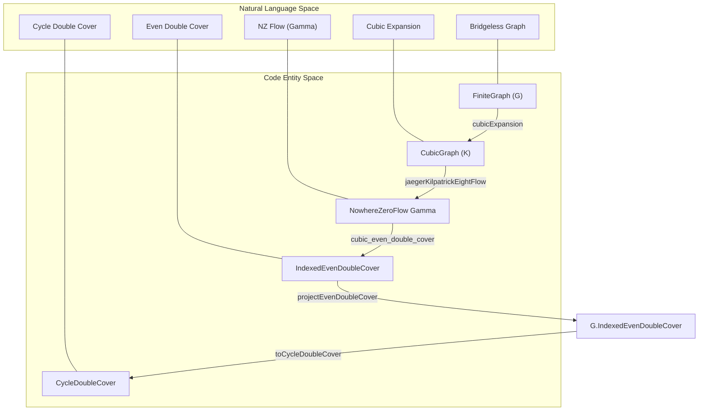
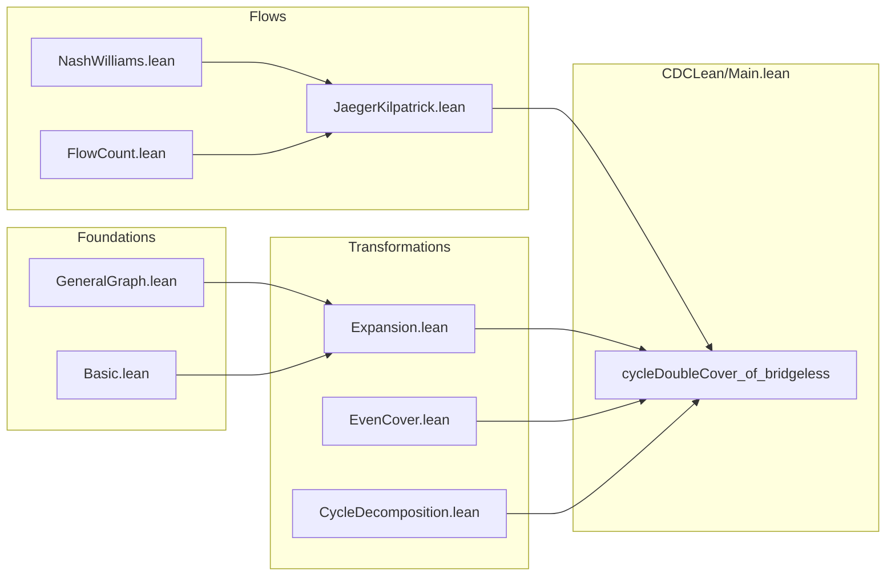

<!-- source: DeepWiki mcp.deepwiki.com · repo openai/cdc-lean · page 1 Overview · fetched 2026-10-26 -->

# Overview

Relevant source files

The following files were used as context for generating this wiki page:

- [CDCLean.lean](CDCLean.lean)
- [CDCLean/Audit.lean](CDCLean/Audit.lean)
- [CDCLean/Main.lean](CDCLean/Main.lean)
- [README.md](README.md)
- [VERIFICATION.md](VERIFICATION.md)

The **CDCLean** project provides a formal verification of the Cycle Double Cover (CDC) conjecture for finite loopless bridgeless multigraphs. The project establishes that every such graph possesses a cycle double cover by leveraging a formalized version of the Jaeger–Kilpatrick eight-flow theorem and a constructive pipeline that transforms flows into even covers.

The project is implemented in Lean 4 and is designed to be self-contained, with all major graph-theoretic reductions—such as cubic expansion, coefficient transfer, and circuit decomposition—proved internally within the library.

### Core Proof Strategy
The proof follows a multi-stage transformation process:
1.  **Expansion**: An arbitrary bridgeless graph is expanded into a 3-regular (cubic) graph while preserving bridgelessness.
2.  **Flow Acquisition**: A nowhere-zero flow is obtained for the cubic expansion. This is done either via the internal Jaeger–Kilpatrick theorem (producing a $\mathbb{Z}_2^3$ flow) or by assuming Seymour’s 6-flow theorem.
3.  **Even Cover Construction**: The flow is used to construct an `IndexedEvenDoubleCover` on the cubic graph.
4.  **Projection & Decomposition**: The cover is projected back to the original graph and decomposed into a collection of cycles.

The following diagram maps the high-level logic to the primary code entities:

**Logic to Code Entity Map**

**Sources:** [CDCLean/Main.lean:24-68](), [CDCLean/Expansion.lean:1-10](), [CDCLean/JaegerKilpatrick.lean:1-13]()

---

### Project Structure and Subsystems

The codebase is organized into several major subsystems, each responsible for a specific layer of the proof.

| Subsystem | Primary Files | Responsibility |
| :--- | :--- | :--- |
| **Top-Level Theorems** | `Main.lean` | Assembles the full pipeline into `cycleDoubleCover_of_bridgeless`. |
| **Graph Theory** | `GeneralGraph.lean`, `Basic.lean` | Defines `FiniteGraph` and `CubicGraph` structures. |
| **Flow Theory** | `FlowCount.lean`, `PathCut.lean` | Implements Tutte’s group-order transfer and path-cut dualities. |
| **Expansion** | `Expansion.lean` | Handles the `RotationSystem` and `cubicExpansion` logic. |
| **Flow Construction** | `JaegerKilpatrick.lean`, `NashWilliams.lean` | Proves the existence of flows via spanning tree packings. |
| **Cover Construction** | `EvenCover.lean`, `CubicLabeling.lean` | Converts flows into edge covers. |
| **Decomposition** | `CycleDecomposition.lean` | Decomposes even edge sets into cycles. |

**Subsystem Inter-dependency**

**Sources:** [CDCLean.lean:1-15](), [CDCLean/Main.lean:1-6]()

---

### Build and Verification

The project enforces strict hygiene and axiom standards. The final theorem, `cycleDoubleCover_of_bridgeless`, is verified to depend only on Lean's standard axioms: `propext`, `Classical.choice`, and `Quot.sound`.

*   **Toolchain**: Lean `v4.31.0`.
*   **Audit**: Uses `CDCLean/Audit.lean` to print axioms for critical theorems.
*   **Hygiene**: A source scan ensures no `sorry`, `admit`, or `native_decide` commands are used.

For detailed instructions on setting up the environment and running the verification scripts, see **[Getting Started: Build and Verification](#1.1)**.

**Sources:** [README.md:1-40](), [VERIFICATION.md:1-30](), [CDCLean/Audit.lean:1-21]()

---

### Entry Points

The primary entry points for users looking to understand or utilize the proof are located in `CDCLean/Main.lean`. These include:
*   `cycleDoubleCover_of_bridgeless`: The main unconditional result.
*   `cycleDoubleCover_of_sixFlow`: A conditional result taking Seymour's 6-flow theorem as an argument.
*   `cycleDoubleCover_of_gammaFlow`: A construction starting from a pre-existing $\mathbb{Z}_2^3$ flow.

For a technical breakdown of these signatures and their logical roles, see **[Top-Level Theorems and Proof Entry Points](#1.2)**.

**Sources:** [CDCLean/Main.lean:24-68]()

---

