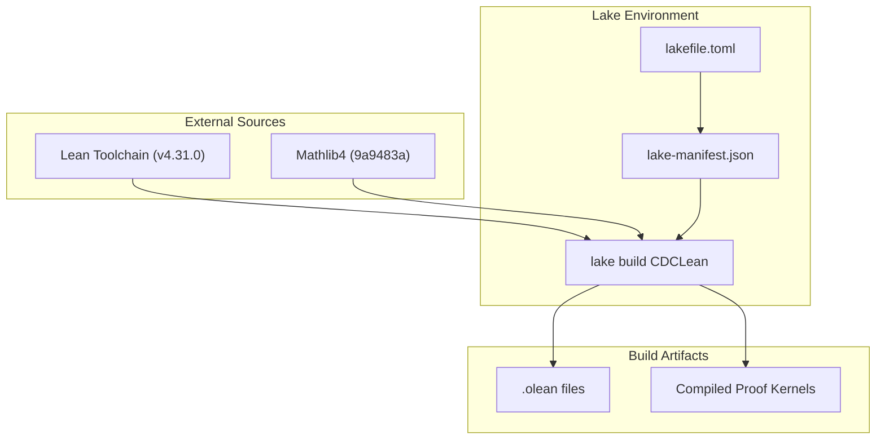
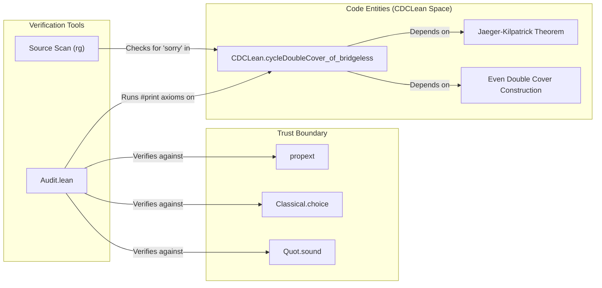

<!-- source: DeepWiki mcp.deepwiki.com · repo openai/cdc-lean · page 1.1 Getting Started: Build and Verification · fetched 2026-10-26 -->

# Getting Started: Build and Verification

<details>
<summary>Relevant source files</summary>

The following files were used as context for generating this wiki page:

- [README.md](README.md)
- [VERIFICATION.md](VERIFICATION.md)
- [lake-manifest.json](lake-manifest.json)
- [lakefile.toml](lakefile.toml)
- [lean-toolchain](lean-toolchain)

</details>


This page provides technical instructions for setting up the CDCLean environment, building the library using the Lake build system, and executing the formal verification suite to ensure the proof of the Cycle Double Cover theorem is logically sound and free of unvetted axioms.

## Toolchain Pinning and Dependencies

The CDCLean project is pinned to specific versions of the Lean 4 compiler and Mathlib to ensure reproducible builds and proof stability. The project relies on a consistent environment to verify the `cycleDoubleCover_of_bridgeless` theorem.

| Component | Version / Revision |
| :--- | :--- |
| **Lean Toolchain** | `v4.31.0` |
| **Mathlib4** | `9a9483a92959bc92bd6a60176dd1fe597298c1f8` |

Sources: [lean-toolchain:1-1](), [lakefile.toml:7-8](), [lake-manifest.json:8-8](), [VERIFICATION.md:7-8]()

## Build Process

The project uses `lake`, the Lean build tool, to manage dependencies and compile the source files. The build process involves approximately 1727 jobs when compiling from scratch.

### Step-by-Step Installation

1.  **Install Elan**: If `elan` (the Lean version manager) is not installed, use the official installer:
    ```bash
    curl https://raw.githubusercontent.com/leanprover/elan/master/elan-init.sh -sSf | sh
    source "$HOME/.elan/env"
    ```
2.  **Clone and Update**:
    ```bash
    git clone https://github.com/openai/cdc-lean.git
    cd cdc-lean
    lake update
    ```
3.  **Fetch Cache**: To avoid compiling all of Mathlib from source, fetch the pre-built cloud cache:
    ```bash
    lake exe cache get
    ```
4.  **Build Library**: Compile the `CDCLean` target:
    ```bash
    lake build CDCLean
    ```

Sources: [README.md:11-26](), [VERIFICATION.md:20-20]()

### Build Data Flow
The following diagram illustrates how Lake orchestrates the build using the pinned toolchain and external dependencies.

**Lake Build Pipeline**

Sources: [lake-manifest.json:1-96](), [lakefile.toml:1-12](), [README.md:20-25]()

## Verification and Axiom Audit

Verification in CDCLean consists of two primary phases: a **Kernel Audit** using Lean's `#print axioms` command and a **Source Hygiene Scan** using `grep` (or `rg`).

### 1. Kernel Audit (Axiom Check)
The kernel audit ensures that the final proof of `CDCLean.cycleDoubleCover_of_bridgeless` and its dependencies do not rely on "cheats" (like `sorry`) or unvetted logical axioms.

Run the audit module:
```bash
lake env lean CDCLean/Audit.lean
```

**Permitted Axioms:**
The Lean kernel must report exactly these three standard axioms:
*   `propext`: Propositional Extensionality.
*   `Classical.choice`: The Axiom of Choice.
*   `Quot.sound`: Quotient Soundness.

Any other axioms (e.g., project-specific `axiom` or `opaque` definitions) indicate a gap in the formalization.

Sources: [README.md:31-39](), [VERIFICATION.md:22-24]()

### 2. Source Hygiene Scan
The source scan is a secondary check to ensure no "unsafe" Lean keywords are used in the `.lean` files.

Run the following command from the repository root:
```bash
rg -n '\bsorry\b|\badmit\b|\bnative_decide\b|^\s*(axiom|opaque|unsafe)\b' --glob '*.lean' .
```

This scan targets:
*   `sorry` / `admit`: Incomplete proofs.
*   `native_decide`: External solvers that bypass the Lean kernel.
*   `axiom` / `opaque`: Unproven assumptions.
*   `unsafe`: Code that bypasses Lean's memory or logic safety.

Sources: [README.md:35-36](), [VERIFICATION.md:15-15]()

## Interpreting the Verification Record

The file `VERIFICATION.md` serves as a timestamped record of the library's integrity. It documents the exact environment and results of the audit process.

**Verification Artifacts and Code Entities**
The following diagram maps the verification process to the specific files and theorems checked within the codebase.

**Verification Mapping**

Sources: [VERIFICATION.md:1-30](), [README.md:1-7](), [CDCLean/Audit.lean (referenced)]()

### Success Criteria
A successful verification is confirmed when:
1.  `lake build` completes with 0 warnings and 0 errors.
2.  The source scan returns no matches.
3.  The axiom audit for the final theorem reports only the three permitted standard axioms.

Sources: [VERIFICATION.md:18-24]()

---

