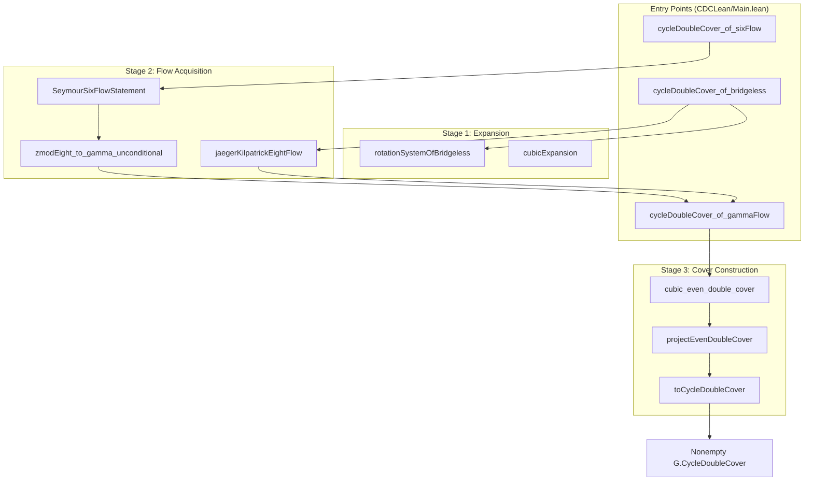
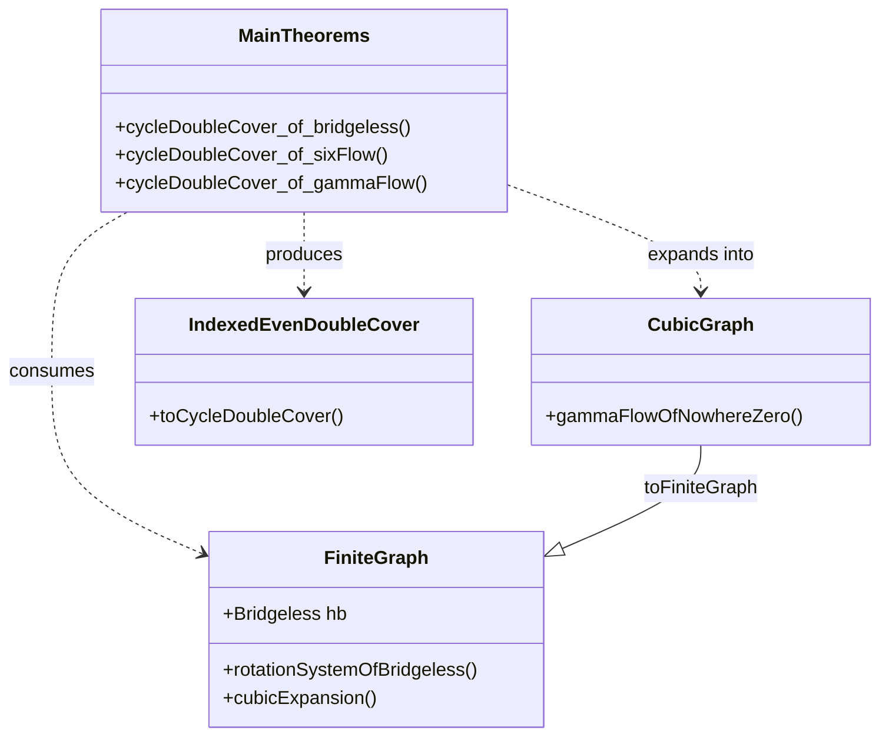

<!-- source: DeepWiki mcp.deepwiki.com · repo openai/cdc-lean · page 1.2 Top-Level Theorems and Proof Entry Points · fetched 2026-10-26 -->

# Top-Level Theorems and Proof Entry Points

Relevant source files

The following files were used as context for generating this wiki page:

- [CDCLean.lean](CDCLean.lean)
- [CDCLean/Audit.lean](CDCLean/Audit.lean)
- [CDCLean/Main.lean](CDCLean/Main.lean)

This page documents the primary entry points for the Cycle Double Cover (CDC) proof within the `CDCLean` library. The implementation is centered in `CDCLean/Main.lean`, which serves as the assembly point for the various subsystems (expansion, flow theory, and even cover construction).

The project provides three distinct paths to the CDC result, depending on the starting premise: a generic bridgeless graph, a graph equipped with a 6-flow, or a cubic expansion equipped with a $\Gamma$-flow.

## The Proof Pipeline

The transformation from a bridgeless graph to a Cycle Double Cover follows a multi-stage pipeline. The top-level theorems in `CDCLean/Main.lean` orchestrate this data flow.

### Logical Data Flow Diagram

The following diagram illustrates how a `FiniteGraph` is processed through the three main entry points to reach a `CycleDoubleCover`.

"Proof Pipeline and Entry Points"

**Sources:** [CDCLean/Main.lean:24-68](), [CDCLean/Main.lean:10-12]()

---

## Primary Entry Points

### 1. `cycleDoubleCover_of_bridgeless`
This is the most general result. It proves that every finite bridgeless graph has a cycle double cover by utilizing the internal formalization of the Jaeger–Kilpatrick eight-flow theorem.

*   **Signature:** [CDCLean/Main.lean:58-61]()
*   **Logical Role:** Combines the cubic expansion of a bridgeless graph with the `jaegerKilpatrickEightFlow` to obtain a $\Gamma$-flow, which is then passed to the $\Gamma$-flow entry point.
*   **Key Dependencies:**
    *   `rotationSystemOfBridgeless`: Generates a rotation system for the expansion [CDCLean/Main.lean:62]().
    *   `cubicExpansion`: Constructs a `CubicGraph` [CDCLean/Main.lean:63]().
    *   `jaegerKilpatrickEightFlow`: Provides the nowhere-zero $\Gamma$-flow (where $\Gamma = \mathbb{F}_2^3$) [CDCLean/Main.lean:66]().

### 2. `cycleDoubleCover_of_sixFlow`
This theorem serves as the bridge to Seymour's 6-flow theorem. It takes an external proof of Seymour's theorem as an argument to avoid adding it as a global axiom.

*   **Signature:** [CDCLean/Main.lean:24-27]()
*   **Logical Role:** Demonstrates that if Seymour's 6-flow theorem holds, then the Cycle Double Cover conjecture holds. It uses Tutte's coefficient transfer to convert a 6-flow (modeled via `ZMod 8`) into a $\Gamma$-flow.
*   **Key Dependencies:**
    *   `SeymourSixFlowStatement`: The type of the external premise [CDCLean/Main.lean:25]().
    *   `zmodEight_to_gamma_unconditional`: Transfers the flow from `ZMod 8` to $\Gamma$ without additional axioms [CDCLean/Main.lean:34-35]().

### 3. `cycleDoubleCover_of_gammaFlow`
This is the core construction theorem. It assumes the existence of a $\Gamma$-flow on the cubic expansion of the target graph.

*   **Signature:** [CDCLean/Main.lean:44-47]()
*   **Logical Role:** Performs the heavy lifting of converting a flow into a cover. It builds an `IndexedEvenDoubleCover` on the cubic expansion, projects it back to the original graph, and decomposes the result into cycles.
*   **Key Dependencies:**
    *   `cubic_even_double_cover`: The affine-pair construction for cubic graphs [CDCLean/Main.lean:50-51]().
    *   `projectEvenDoubleCover`: Maps the cover from the expanded graph back to the original `FiniteGraph` [CDCLean/Main.lean:52]().
    *   `toCycleDoubleCover`: Decomposes the even double cover into a set of cycles [CDCLean/Main.lean:53]().

**Sources:** [CDCLean/Main.lean:24-68]()

---

## Technical Mapping: Logic to Code Entities

The following table maps high-level mathematical requirements to the specific Lean constants and functions that implement them in the top-level proofs.

| Mathematical Requirement | Code Entity | File Reference |
| :--- | :--- | :--- |
| **Graph Expansion** | `G.cubicExpansion R` | [CDCLean/Main.lean:49]() |
| **Flow Generation** | `jaegerKilpatrickEightFlow` | [CDCLean/Main.lean:66]() |
| **Coefficient Transfer** | `zmodEight_to_gamma_unconditional` | [CDCLean/Main.lean:35]() |
| **Cover Construction** | `cubic_even_double_cover` | [CDCLean/Main.lean:51]() |
| **Expansion Projection** | `G.projectEvenDoubleCover` | [CDCLean/Main.lean:52]() |
| **Cycle Decomposition** | `toCycleDoubleCover` | [CDCLean/Main.lean:53]() |

### Code Entity Relationship Diagram

This diagram shows how the top-level `Main.lean` functions interact with the core structures defined in the rest of the library.

"Top-Level Entity Relationships"

**Sources:** [CDCLean/Main.lean:15-68](), [CDCLean/Audit.lean:11-20]()

## Audit and Verification

The integrity of these entry points is verified in `CDCLean/Audit.lean`. The audit uses the `#print axioms` command to ensure that the proofs of these three theorems do not rely on "sorry" or unintended axioms.

Audited entry points include:
*   `CDCLean.cycleDoubleCover_of_sixFlow` [CDCLean/Audit.lean:18]()
*   `CDCLean.cycleDoubleCover_of_gammaFlow` [CDCLean/Audit.lean:19]()
*   `CDCLean.cycleDoubleCover_of_bridgeless` [CDCLean/Audit.lean:20]()

**Sources:** [CDCLean/Audit.lean:1-21]()

---

