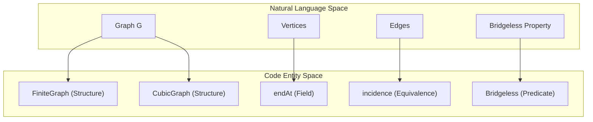
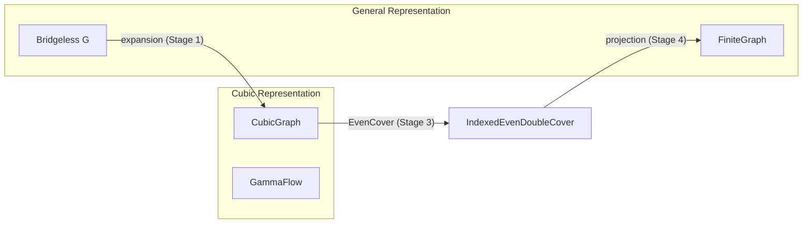

<!-- source: DeepWiki mcp.deepwiki.com · repo openai/cdc-lean · page 2 Core Graph Structures · fetched 2026-10-26 -->

# Core Graph Structures

Relevant source files

The following files were used as context for generating this wiki page:

- [CDCLean/Basic.lean](CDCLean/Basic.lean)
- [CDCLean/GeneralGraph.lean](CDCLean/GeneralGraph.lean)

This page provides a high-level overview of the foundational data types used to represent graphs in the CDCLean project. The project utilizes two primary representations: `FiniteGraph` for general loopless multigraphs and `CubicGraph` for a specialized three-slot incidence structure used in the core labeling proof.

## Overview of Graph Representations

The formalization distinguishes between a general graph structure used for the top-level theorem statements and a highly structured cubic representation used to facilitate the construction of cycle double covers.

| Structure | Purpose | File Reference |
| :--- | :--- | :--- |
| `FiniteGraph` | General multigraph representation; defines bridgelessness and flows. | [CDCLean/GeneralGraph.lean:17-20]() |
| `CubicGraph` | Incidence-based structure where every vertex has exactly degree 3. | [CDCLean/Basic.lean:30-33]() |

### From Natural Language to Code Entities

The following diagram maps the mathematical concepts of graph theory to the specific Lean structures and fields used in the codebase.

**Graph Theory Mapping**

Sources: [CDCLean/GeneralGraph.lean:17-52](), [CDCLean/Basic.lean:30-33]()

---

## 2.1 FiniteGraph: Vertices, Edges, and Predicates

The `FiniteGraph` structure is the entry point for the Cycle Double Cover conjecture. It represents a multigraph where edges are distinct objects, allowing for parallel edges between the same pair of vertices.

Key features of `FiniteGraph`:
*   **Half-Edges**: Represented as `HalfEdge E`, which is a product of an edge and a bit (0 or 1) indicating its ends [CDCLean/GeneralGraph.lean:27-27]().
*   **Flows**: Supports group-valued flows via `IsFlow`, which uses signed conservation (in-flow minus out-flow equals zero) [CDCLean/GeneralGraph.lean:55-58]().
*   **Bridgelessness**: Defined via the `cut` function; a graph is `Bridgeless` if no cut contains exactly one edge [CDCLean/GeneralGraph.lean:52-52]().

For detailed reference on vertices, edges, and predicates like `SixFlow` and `IndexedEvenDoubleCover`, see [FiniteGraph: Vertices, Edges, and Predicates](#2.1).

Sources: [CDCLean/GeneralGraph.lean:17-88]()

---

## 2.2 CubicGraph: Three-Slot Incidence Structure

The `CubicGraph` structure is a specialized representation where every vertex is incident to exactly three edge ends. This is implemented as a bijective `incidence` equivalence between vertex slots and edge ends.

Key features of `CubicGraph`:
*   **Incidence Equivalence**: A bijection `(V × Fin 3) ≃ (E × Fin 2)` ensuring that every vertex has 3 slots and every edge has 2 ends [CDCLean/Basic.lean:31-31]().
*   **Loopless Constraint**: Explicitly requires that the two ends of any edge map to different vertices [CDCLean/Basic.lean:32-33]().
*   **GammaFlow**: A simplified flow definition for the group $\mathbb{F}_2^3$ where, due to characteristic two, conservation is simply the sum of values at a vertex [CDCLean/Basic.lean:95-98]().

For details on the three-slot incidence structure and why it is used for the labeling proof, see [CubicGraph: Three-Slot Incidence Structure](#2.2).

Sources: [CDCLean/Basic.lean:30-98]()

---

## Structural Relationship

The project relates these two structures through a process of **Cubic Expansion**. An arbitrary `FiniteGraph` that is `Bridgeless` is expanded into a `CubicGraph`. The proof then constructs a double cover on the cubic version and projects it back to the original graph.

**Graph Structure Interaction**

Sources: [CDCLean/GeneralGraph.lean:75-88](), [CDCLean/Basic.lean:95-98]()

---

